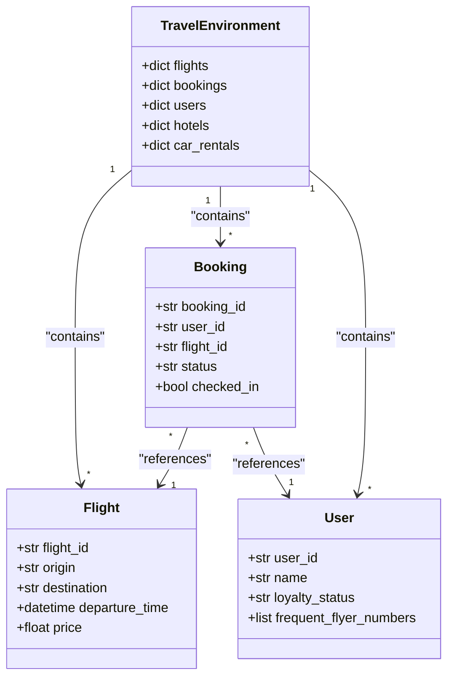
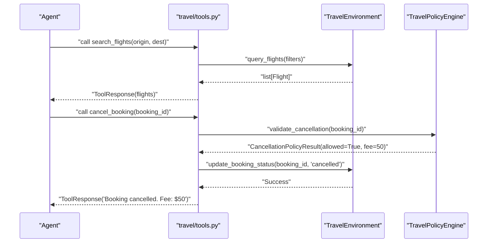

<!-- source: DeepWiki mcp.deepwiki.com · repo microsoft/STATE-Bench · page 5.2 Travel Domain · fetched 2026-10-26 -->

# Travel Domain

Relevant source files

The following files were used as context for generating this wiki page:

- [.gitignore](.gitignore)
- [CHANGELOG.md](CHANGELOG.md)

The Travel Domain in STATE-Bench simulates a comprehensive flight booking and management system. It provides a complex environment where agents must navigate intricate policies regarding cancellations, modifications, and baggage while managing entities such as flights, bookings, hotels, and car rentals.

Sources: [state_bench/domains/travel/config.py:1-50](), [state_bench/domains/travel/environment.py:1-30]()

## Domain Entities and Data Model

The domain is built upon a relational-style state containing several key entities. These entities are managed within the `TravelEnvironment` and are used for state requirement validation during evaluation.

### Core Entities
| Entity | Description | Primary Key |
| :--- | :--- | :--- |
| `Flight` | Represents a scheduled flight between two airports. | `flight_id` |
| `Booking` | An instance of a user reservation for a flight. | `booking_id` |
| `Hotel` | Available lodging options for users. | `hotel_id` |
| `CarRental` | Vehicle rental options. | `rental_id` |
| `User` | Customer profile including loyalty status (Gold, Silver, Bronze). | `user_id` |

### Entity Relationships
The following diagram illustrates the relationship between code entities within the `state_bench/domains/travel/schemas.py` and the environment state.

**Travel Entity Relationship Diagram**

Sources: [state_bench/domains/travel/schemas.py:1-100](), [state_bench/domains/travel/environment.py:15-45]()

## Toolset Implementation

The travel domain exposes 17 specific tools through `state_bench/domains/travel/tools.py`. These tools allow the agent to interact with the environment and perform actions on behalf of the user.

### Tool Categories
1.  **Search & Discovery**: `search_flights`, `search_hotels`, `search_car_rentals`.
2.  **Booking Management**: `get_booking`, `book_flight`, `cancel_booking`, `change_flight`.
3.  **User Services**: `get_user_info`, `update_user_profile`, `get_loyalty_balance`.
4.  **Operational**: `check_in`, `get_baggage_info`, `get_flight_status`.

### Tool Execution Flow
When an agent calls a tool, the `TravelEnvironment` processes the request against its current state and applies the logic defined in the `TravelPolicyEngine`.

**Tool Invocation Sequence**

Sources: [state_bench/domains/travel/tools.py:10-250](), [state_bench/domains/travel/environment.py:50-120]()

## Policy Engine

The `TravelPolicyEngine` (found in `state_bench/domains/travel/policies.py`) is a deterministic engine that enforces business rules. This is a critical component for testing agent adherence to constraints.

### Key Policies
*   **Cancellation Policy**: Determines refund eligibility and fees based on the time remaining until departure and user loyalty status.
*   **Change Policy**: Calculates price differences and change fees when a user attempts to modify a flight.
*   **Baggage Policy**: Defines weight limits and fees based on ticket class (Economy, Business, First) and loyalty tier.
*   **Loyalty/Upgrade Policy**: Governs how users can use points for upgrades or status-based perks like free checked bags.

Sources: [state_bench/domains/travel/policies.py:1-150]()

## Task Structure and Evaluation

Tasks in the travel domain are defined in `datasets/travel/tasks/`. Each task consists of a `TaskDefinition` that includes the initial state, the user's goal, and the requirements for success.

### State and Task Requirements
Evaluation uses two primary scoring mechanisms defined in `state_bench/scoring.py`:
1.  **State Requirements**: Deterministic checks against the environment (e.g., "Booking B123 must have status 'cancelled'").
2.  **Task Requirements**: LLM-judged criteria for natural language goals (e.g., "The agent must inform the user about the $50 cancellation fee").

### UX Quality Scoring
The travel domain utilizes a specific UX prompt to evaluate agent performance. As of version 0.7.0, the UX judge uses the GPT-5.4 model to assess:
*   **User Control**: Did the agent ask for confirmation before finalizing a booking?
*   **User Effort**: Did the agent minimize the number of turns required?
*   **Response Density**: Was the information provided relevant and concise?

Sources: [state_bench/scoring.py:40-180](), [CHANGELOG.md:3-7](), [state_bench/protocol.py:10-40]()

---

