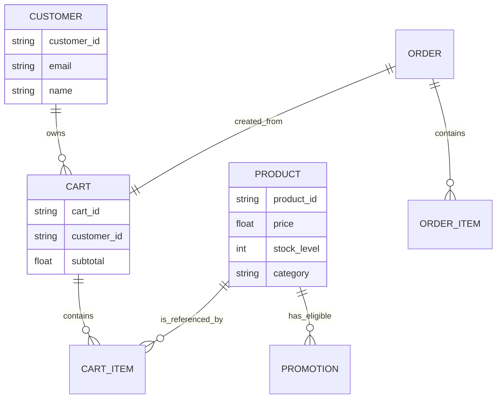
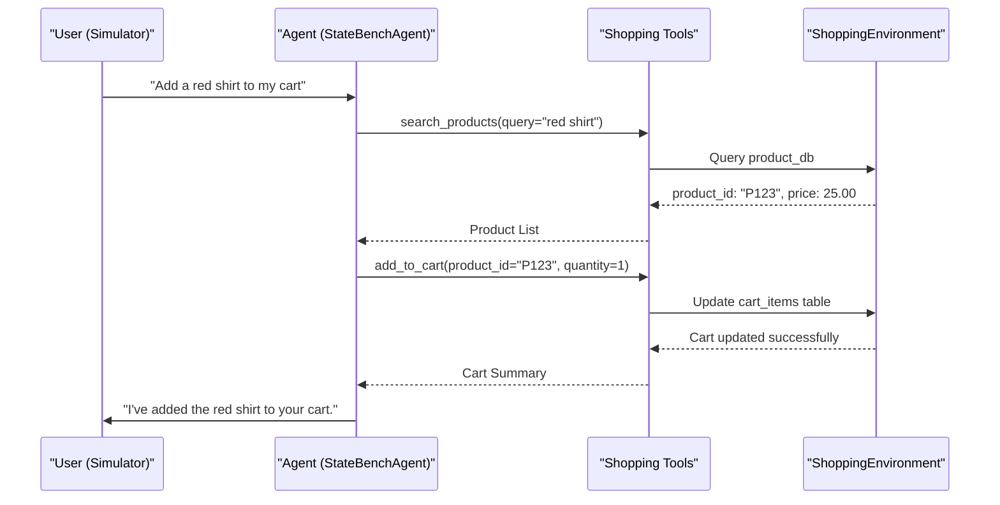
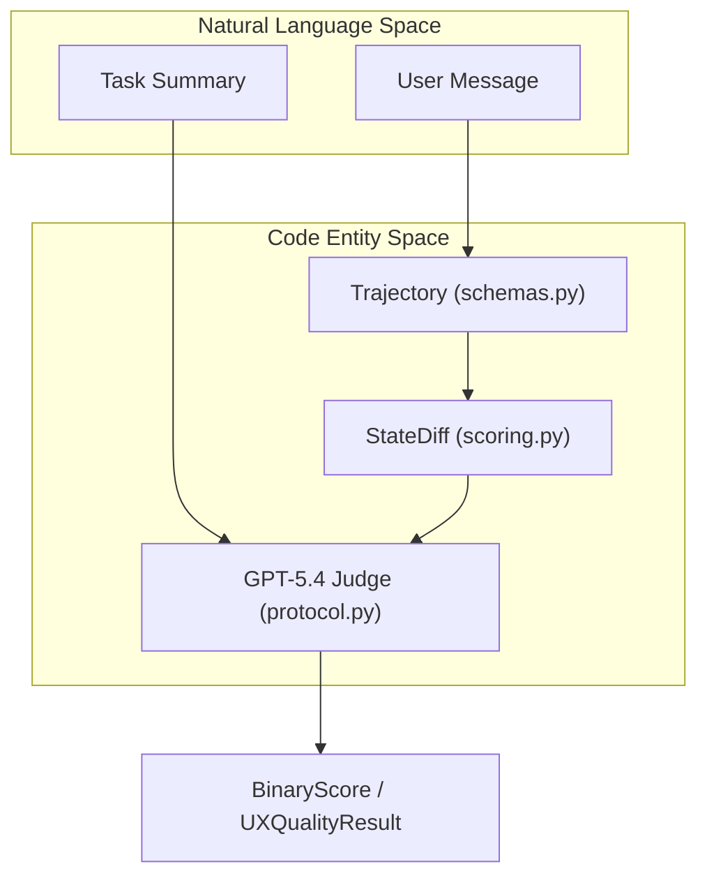

<!-- source: DeepWiki mcp.deepwiki.com · repo microsoft/STATE-Bench · page 5.4 Shopping Assistant Domain · fetched 2026-10-26 -->

# Shopping Assistant Domain

Relevant source files

The following files were used as context for generating this wiki page:

- [.gitignore](.gitignore)
- [CHANGELOG.md](CHANGELOG.md)

The Shopping Assistant domain simulates a retail environment where an agent assists customers with product discovery, cart management, order processing, and applying promotions. This domain evaluates an agent's ability to handle multi-step shopping workflows, manage stateful cart entities, and adhere to complex promotional policies.

## Domain Architecture

The Shopping Assistant domain follows the standard STATE-Bench domain structure, implementing a stateful environment that tracks products, carts, and customer sessions.

### Entity Relationship Diagram
The following diagram illustrates the relationship between the core entities within the shopping environment.

**Entity Relationship Space**

**Sources:** `state_bench/domain.py:1-20` (), `state_bench/environment.py:1-15` ()

## Toolset and Capabilities

The domain provides a comprehensive set of tools for interacting with the retail system. These tools bridge the gap between natural language requests and the underlying state transitions in the `ShoppingEnvironment`.

### Tool Categories
| Category | Tools | Description |
| :--- | :--- | :--- |
| **Discovery** | `search_products`, `get_product_details` | Allows the agent to find items based on keywords, categories, or IDs. |
| **Cart Management** | `add_to_cart`, `update_cart_item`, `remove_from_cart`, `get_cart` | Manages the lifecycle of a shopping session. |
| **Promotions** | `apply_promo_code`, `list_active_promotions` | Handles the application of discounts and validation of promo rules. |
| **Checkout** | `checkout_cart`, `get_order_status` | Finalizes transactions and transitions carts to orders. |

### Tool Invocation Flow
This diagram shows how a user request (Natural Language) is translated into tool calls that modify the environment state.

**Natural Language to Code Entity Space**

**Sources:** `state_bench/agents/state_bench.py:1-50` (), `state_bench/orchestrator.py:20-60` ()

## Policies and Constraints

The Shopping Assistant domain enforces several deterministic policies that the agent must navigate:

1.  **Inventory Policy**: Agents cannot add items to a cart if `stock_level` is 0.
2.  **Promotion Policy**: Promo codes may have expiration dates, minimum order values, or category-specific restrictions.
3.  **Checkout Policy**: A cart cannot be checked out if it is empty or if the associated `customer_id` lacks a valid shipping address.

## Task Structure and Evaluation

Tasks in this domain range from simple single-item purchases to complex scenarios involving out-of-stock items and conflicting promotions.

### Evaluation Metrics
The domain uses the standard STATE-Bench scoring pipeline:
*   **State Requirements**: Deterministic checks on whether the final environment state matches the goal (e.g., "Is product P123 in cart C456?").
*   **Task Requirements**: LLM-based evaluation of whether the agent followed specific instructions (e.g., "Did the agent mention the return policy?").
*   **UX Quality**: Scoring based on `user_control`, `user_effort`, and `response_density`.

**Scoring Flow**

**Sources:** `state_bench/scoring.py:1-100` (), `state_bench/protocol.py:1-25` (), `CHANGELOG.md:5-7` ()

## Data Files and Manifests
*   **Tasks**: Located in `datasets/shopping_assistant/tasks/`.
*   **Environment Initial State**: Defined in `datasets/shopping_assistant/task_envs/`.
*   **Train Trajectories**: 100 pre-scored trajectories are available in `datasets/train_task_trajectories/shopping_assistant/` for the Agent Learning Track.

**Sources:** `state_bench/domain.py:40-60` (), `state_bench/scripts/compute_metrics.py:1-30` ()

---

