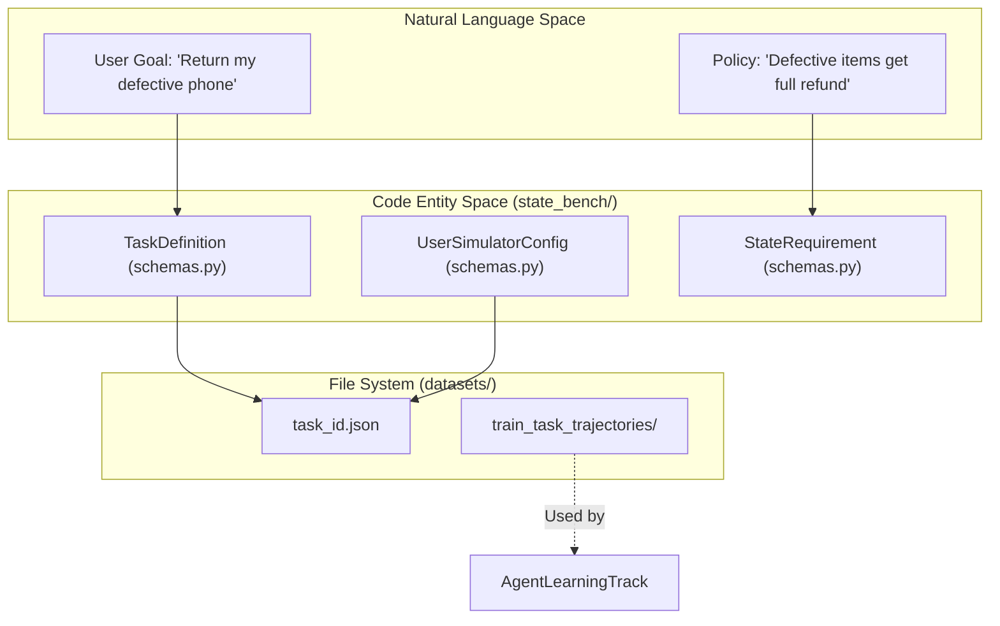
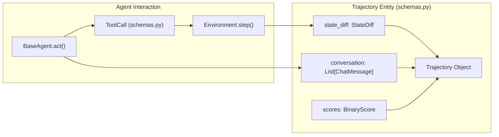

<!-- source: DeepWiki mcp.deepwiki.com · repo microsoft/STATE-Bench · page 6 Datasets and Task Definitions · fetched 2026-10-26 -->

# Datasets and Task Definitions

Relevant source files

The following files were used as context for generating this wiki page:

- [datasets/train_task_trajectories/customer_support/1-hard_false_defect_phone_battery_settings.json](datasets/train_task_trajectories/customer_support/1-hard_false_defect_phone_battery_settings.json)
- [datasets/train_task_trajectories/customer_support/10-return_full_order.json](datasets/train_task_trajectories/customer_support/10-return_full_order.json)
- [datasets/train_task_trajectories/customer_support/100-challenge_warranty_maxed_return_option.json](datasets/train_task_trajectories/customer_support/100-challenge_warranty_maxed_return_option.json)
- [datasets/train_task_trajectories/customer_support/2-return_defective_electronics.json](datasets/train_task_trajectories/customer_support/2-return_defective_electronics.json)

The `datasets/` directory contains the foundational data required to run and evaluate agents within STATE-Bench. This includes the task definitions that specify agent objectives and the training trajectories used for the Agent Learning Track.

## Task Definitions and JSON Format

Every task in STATE-Bench is defined by a JSON file that specifies the initial state, the user's goal, and the requirements for a successful completion. These files are typically organized by domain under `state_bench/domains/<domain_name>/tasks/`.

### Key Task Fields
A `TaskDefinition` includes several critical fields that govern the simulation and evaluation:

| Field | Description |
| :--- | :--- |
| `task_id` | A unique identifier for the task. |
| `task_summary` | A high-level description of the agent's goal. |
| `opening_message` | The first message sent by the simulated user to start the conversation. |
| `user_simulator` | Configuration for the LLM-based user, including its persona and hidden constraints. |
| `state_requirements` | Deterministic assertions about the final state of the environment (e.g., specific database records). |
| `task_requirements` | Natural language criteria used by an LLM judge to evaluate the agent's adherence to instructions. |

For a detailed reference of the schema and requirement shapes, see **[Task JSON Format](#6.1)**.

**Sources:**
- `state_bench/schemas.py:34-70` (TaskDefinition schema)
- `state_bench/schemas.py:73-85` (UserSimulatorConfig schema)

---

## Train Trajectories

The `datasets/train_task_trajectories/` directory contains 300 pre-generated, high-quality trajectories (100 per domain). These serve as the ground truth training data for the **Agent Learning Track**, allowing agents to "learn" from successful and unsuccessful past interactions.

### Trajectory Structure
Each trajectory file (e.g., `datasets/train_task_trajectories/customer_support/1-hard_false_defect_phone_battery_settings.json`) records the full interaction history:
*   **Conversation**: The turn-by-turn exchange between the `user` and `assistant`.
*   **Tool Calls**: The specific tools invoked by the agent, including arguments and the environment's response.
*   **State Diff**: The delta between the initial and final environment states.
*   **Scores**: The final evaluation metrics, including state success and UX quality.

For details on how to use these for agent training, see **[Train Trajectories and Agent Learning Track Data](#6.2)**.

**Sources:**
- `datasets/train_task_trajectories/customer_support/1-hard_false_defect_phone_battery_settings.json:2-15` (Trajectory JSON structure)
- `state_bench/schemas.py:164-184` (Trajectory class definition)

---

## Data Split Manifests

STATE-Bench uses manifest files to define the `train` and `test` sets for each evaluation protocol. These manifests ensure that benchmarks are reproducible and that agents are tested on unseen tasks.

### Mapping Natural Language to Code Entities

The following diagrams illustrate how the benchmark translates natural language task descriptions into structured code entities and data files.

**Task Data Flow: From Definition to Execution**

**Sources:**
- `state_bench/schemas.py:34-85` (Task and Simulator models)
- `datasets/train_task_trajectories/` (Directory structure)

**Trajectory Data Model: Recording Interaction**

**Sources:**
- `state_bench/schemas.py:164-184` (Trajectory structure)
- `state_bench/agents/base.py:58-85` (Agent act interface)

---

## Split Manifests and Evaluation Protocols

The benchmark organization relies on `state_bench/configs/eval_protocols/` to map task files to specific benchmark tracks. These files define which tasks belong to the `test` split (used for official leaderboards) and which are available in `train` for development.

**Sources:**
- `state_bench/protocol.py:15-45` (EvaluationProtocol logic)
- `state_bench/configs/eval_protocols/gpt54.json` (Standard split definition)

---

