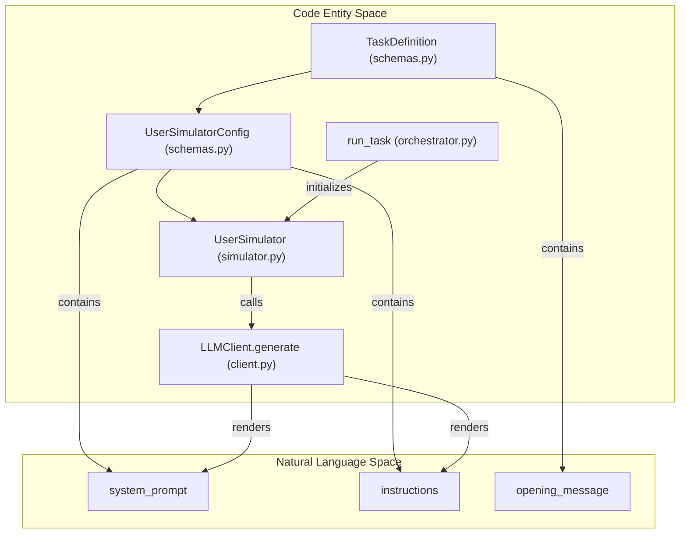
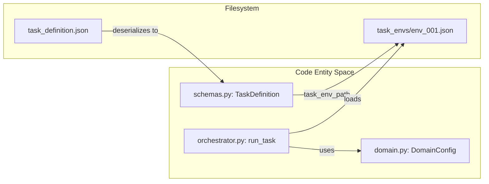

<!-- source: DeepWiki mcp.deepwiki.com · repo microsoft/STATE-Bench · page 6.1 Task JSON Format · fetched 2026-10-26 -->

# Task JSON Format

<details>
<summary>Relevant source files</summary>

The following files were used as context for generating this wiki page:

- [datasets/train_task_trajectories/customer_support/1-hard_false_defect_phone_battery_settings.json](datasets/train_task_trajectories/customer_support/1-hard_false_defect_phone_battery_settings.json)
- [datasets/train_task_trajectories/customer_support/2-return_defective_electronics.json](datasets/train_task_trajectories/customer_support/2-return_defective_electronics.json)
- [datasets/train_task_trajectories/customer_support/6-return_wrong_item.json](datasets/train_task_trajectories/customer_support/6-return_wrong_item.json)

</details>


This page provides a detailed technical reference for the Task Definition JSON schema used in STATE-Bench. It defines how benchmark tasks are structured, including the configuration for the user simulator, the deterministic state requirements, and the natural language task requirements used for scoring.

## Task Definition Overview

The `TaskDefinition` class is the root container for all task-specific data. It is defined as a Pydantic model in [state_bench/schemas.py:127-142](). When a task is loaded, the orchestrator uses this schema to initialize the environment and the user simulator.

### Core Fields

| Field | Type | Description |
| :--- | :--- | :--- |
| `task_id` | `str` | Unique identifier for the task (e.g., "1-hard_false_defect"). |
| `task_summary` | `str` | A brief description of the task objectives for human readability. |
| `task_env_path` | `str` | Relative path to the initial environment state (JSON) for this task. |
| `opening_message` | `str` | The first message sent by the user to the agent. |
| `user_simulator` | `UserSimulatorConfig` | Configuration for the LLM-based user simulator. |
| `state_requirements` | `List[Dict]` | Deterministic assertions checked against the final environment state. |
| `task_requirements` | `List[str]` | Natural language requirements checked by a judge LLM. |

**Sources:** [state_bench/schemas.py:127-142]()

---

## User Simulator Configuration

The `UserSimulatorConfig` defines the persona and constraints of the simulated user. This configuration is used by the `UserSimulator` class [state_bench/simulator.py:11-13]() to generate responses during the agent-user loop.

### Configuration Schema
The config is defined in [state_bench/schemas.py:118-124]():
- `system_prompt`: The persona instructions for the LLM (e.g., "You are a customer who is frustrated about a broken phone").
- `instructions`: Specific behavioral constraints (e.g., "Do not provide your order ID unless asked").
- `max_turns`: The maximum number of turns the simulator will engage in before terminating the session.

### User Simulator Data Flow
The following diagram illustrates how the `UserSimulatorConfig` is transformed into an active simulator within the `run_task` loop.

**Diagram: Simulator Initialization and Loop**

**Sources:** [state_bench/schemas.py:118-124](), [state_bench/simulator.py:11-55](), [state_bench/orchestrator.py:46-80]()

---

## State Requirements (Deterministic Scoring)

State requirements are the primary method for evaluating "hard" task success. They are evaluated by the `Scorer` in [state_bench/scoring.py:53-124]() by comparing the `StateDiff` between the initial and final environment states.

### Assertion Types

There are three primary shapes for state requirements:

#### 1. Direct Record Assertion
Checks if a specific field in an existing record matches a value.
- **Target**: `table_name` + `primary_key`.
- **Logic**: Evaluated in `Scorer._check_state_requirement` [state_bench/scoring.py:126-175]().

#### 2. Created-Record Matcher
Used when the agent creates a new entity (like a new booking or return). Since the ID is generated at runtime, the matcher looks for a record in a table where specific fields match the expected values.
- **Example**: Find a record in `returns` where `order_id` is `ORD-123` and `refund_amount` is `50.0`.

#### 3. Relational Assertion
Checks if a record exists that links two entities (e.g., an item in an order).

### Example JSON Structure
```json
{
  "state_requirements": [
    {
      "type": "record_update",
      "table": "order_items",
      "pk": "ITEM-10512",
      "expected": {
        "item_status": "returned",
        "refund_amount": 999
      }
    }
  ]
}
```
**Sources:** [state_bench/scoring.py:126-175](), [state_bench/schemas.py:139-140]()

---

## Task Requirements (LLM-based Scoring)

Task requirements are natural language strings that describe expected agent behaviors that cannot be easily captured in a database state. These are evaluated by the `TaskRequirementsJudge` [state_bench/scoring.py:180-210]().

### Evaluation Process
1. The judge receives the full `Trajectory` (conversation and tool calls).
2. The judge checks each requirement string against the trajectory.
3. A binary pass/fail is assigned to each requirement.

**Common Requirements:**
- "The agent must inform the customer that the return window has expired."
- "The agent must offer store credit as an alternative."
- "The agent must not disclose the internal policy category names."

**Sources:** [state_bench/scoring.py:180-210](), [datasets/train_task_trajectories/customer_support/1-hard_false_defect_phone_battery_settings.json:5-13]()

---

## Task Environment Convention

The `task_env_path` field in the JSON refers to a specific environment state file. By convention, these are stored in the domain's `task_envs/` directory.

### Environment Loading Logic
When `run_task()` is called:
1. It identifies the domain (e.g., `travel`).
2. It locates the environment file via the path provided in the `TaskDefinition`.
3. It initializes the `BaseEnvironment` [state_bench/environment.py:15-30]() using `json.load()` on that path.

**Diagram: Environment and Task Mapping**


**Sources:** [state_bench/orchestrator.py:46-60](), [state_bench/domain.py:10-25](), [state_bench/environment.py:15-30]()

---

