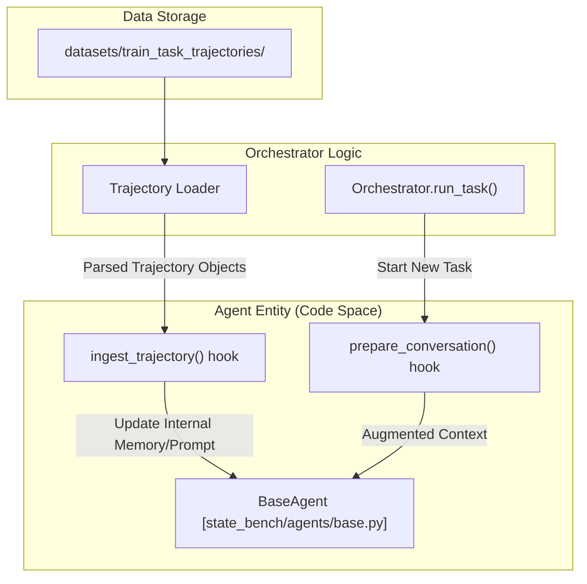
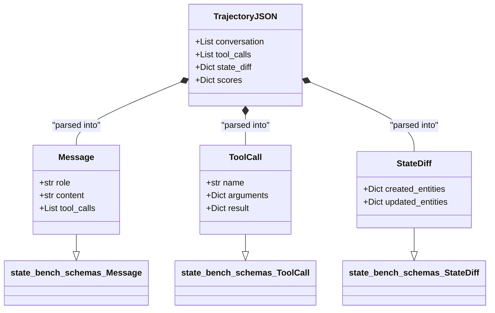

<!-- source: DeepWiki mcp.deepwiki.com · repo microsoft/STATE-Bench · page 6.2 Train Trajectories and Agent Learning Track Data · fetched 2026-10-26 -->

# Train Trajectories and Agent Learning Track Data

<details>
<summary>Relevant source files</summary>

The following files were used as context for generating this wiki page:

- [datasets/train_task_trajectories/customer_support/1-hard_false_defect_phone_battery_settings.json](datasets/train_task_trajectories/customer_support/1-hard_false_defect_phone_battery_settings.json)
- [datasets/train_task_trajectories/customer_support/10-return_full_order.json](datasets/train_task_trajectories/customer_support/10-return_full_order.json)
- [datasets/train_task_trajectories/customer_support/100-challenge_warranty_maxed_return_option.json](datasets/train_task_trajectories/customer_support/100-challenge_warranty_maxed_return_option.json)
- [datasets/train_task_trajectories/customer_support/103-hard_price_match_wrong_variant.json](datasets/train_task_trajectories/customer_support/103-hard_price_match_wrong_variant.json)

</details>


This page documents the pre-generated scored trajectories provided in the `datasets/train_task_trajectories/` directory. These trajectories serve as the foundational training data for the **Agent Learning Track**, allowing models to learn from high-quality, verified interactions across the three benchmark domains.

## Purpose and Scope

The `train_task_trajectories` dataset consists of 300 expert-level trajectories (100 per domain: Travel, Customer Support, and Shopping Assistant). Each trajectory represents a successful completion of a task from the training split, including all intermediate tool calls, environment responses, and final state changes.

In the **Agent Learning Track**, these trajectories are ingested by the agent (via the `ingest_trajectory` hook) to provide in-context examples or for fine-tuning, enabling the agent to better understand domain-specific policies, tool usage, and reasoning patterns.

---

## Dataset Structure

The trajectories are organized by domain within the `datasets/` directory:

```text
datasets/train_task_trajectories/
├── travel/             (100 JSON files)
├── customer_support/   (100 JSON files)
└── shopping_assistant/ (100 JSON files)
```

### JSON Schema
Each trajectory file follows a standardized format that includes the conversation history, tool execution logs, and the resulting state changes.

| Field | Type | Description |
| :--- | :--- | :--- |
| `conversation` | `List[Message]` | The full chat history between the System, User, and Assistant. |
| `tool_calls` | `List[ToolCall]` | A sequence of tool invocations including arguments and the environment's `result`. |
| `state_diff` | `Dict` | A map of entities created or updated during the session. |
| `scores` | `Dict` | The evaluation results (State, Task, and UX scores) for this specific run. |

### Example Trajectory Breakdown
In `datasets/train_task_trajectories/customer_support/1-hard_false_defect_phone_battery_settings.json` [1-138](), the trajectory captures a complex defect return:
1.  **System Prompt**: Defines the persona and constraints [4-6]().
2.  **User Input**: "The TechPhone from ORD-7512 is defective..." [8-10]().
3.  **Tool Call (`get_order`)**: Agent retrieves order details for `ORD-7512` [16-19]().
4.  **Tool Call (`get_policies`)**: Agent retrieves "return" policies to verify restocking fee waivers for defective items [75-77]().
5.  **Environment Result**: The environment provides the policy text, including the `fault_exempt` rule [115-117]().

---

## Data Flow: Agent Learning Track

The following diagram illustrates how these trajectories are utilized during the Agent Learning Track. Unlike the Main Track, the agent is initialized with these trajectories before the evaluation begins.

### Trajectory Ingestion Flow
"Natural Language Space" (Conversations) meets "Code Entity Space" (Agent Hooks).


**Sources:** `state_bench/agents/base.py:38-55` (), `state_bench/orchestrator.py` ()

---

## Implementation Details

### The `Trajectory` Schema
The trajectories are serialized versions of the `Trajectory` dataclass defined in the core schemas.

| Component | Code Reference | Role |
| :--- | :--- | :--- |
| **Conversation** | `state_bench/schemas.py` | Holds `role` and `content`. Assistant messages include `tool_calls`. |
| **Tool Results** | `state_bench/schemas.py` | Captures the raw output from `BaseEnvironment.handle_tool_call`. |
| **State Diff** | `state_bench/schemas.py` | Captures the delta between initial and final environment states. |

### Scoring Metadata
Each training trajectory includes a `scores` block. This allows learning agents to distinguish between "Golden" (perfectly scored) trajectories and those that might have minor UX deductions, although the provided 300 trajectories are curated for high performance.

Example score block in `100-challenge_warranty_maxed_return_option.json`:
```json
"scores": {
  "state_requirement_score": 1.0,
  "task_requirement_score": 1.0,
  "ux_quality_score": 5.0
}
```

### Integration with `BaseAgent`
The `BaseAgent` class provides two critical methods for handling this data:
1.  `ingest_trajectory(self, trajectory: Trajectory)`: Called by the benchmark harness for every trajectory in the training set [state_bench/agents/base.py:53-55]().
2.  `prepare_conversation(self, messages: List[Dict])`: Allows the agent to prepend learned information or few-shot examples to the conversation before the first turn [state_bench/agents/base.py:49-51]().

---

## Key Trajectory Patterns

The training data is designed to cover specific edge cases that agents will encounter in the evaluation split:

### 1. Policy-Driven Reasoning
Trajectories frequently show agents calling `get_policies` [datasets/train_task_trajectories/customer_support/100-challenge_warranty_maxed_return_option.json:75-77]() to resolve conflicts. For example, determining if a "Max claims reached" status on a warranty forces a paid repair vs. a free return for a defective item [131-136]().

### 2. Multi-Step State Changes
In the Shopping Assistant domain, trajectories demonstrate complex cart manipulations where multiple `add_to_cart` and `apply_promotion` calls result in a specific `StateDiff` that the agent must learn to replicate.

### 3. Handling Ambiguity
Trajectories in the Travel domain show agents asking clarifying questions when a user provides a vague destination, demonstrating how to maintain `UXQuality` while gathering necessary tool arguments.

---

## Data Entity Mapping

This diagram maps the JSON fields found in `train_task_trajectories` to the internal Python classes used by the scoring and execution engine.


**Sources:** `state_bench/schemas.py:10-150` (), `datasets/train_task_trajectories/customer_support/10-return_full_order.json` ()

**Sources:**
- `datasets/train_task_trajectories/customer_support/1-hard_false_defect_phone_battery_settings.json`
- `datasets/train_task_trajectories/customer_support/10-return_full_order.json`
- `datasets/train_task_trajectories/customer_support/100-challenge_warranty_maxed_return_option.json`
- `datasets/train_task_trajectories/customer_support/103-hard_price_match_wrong_variant.json`
- `state_bench/agents/base.py`
- `state_bench/schemas.py`

---

