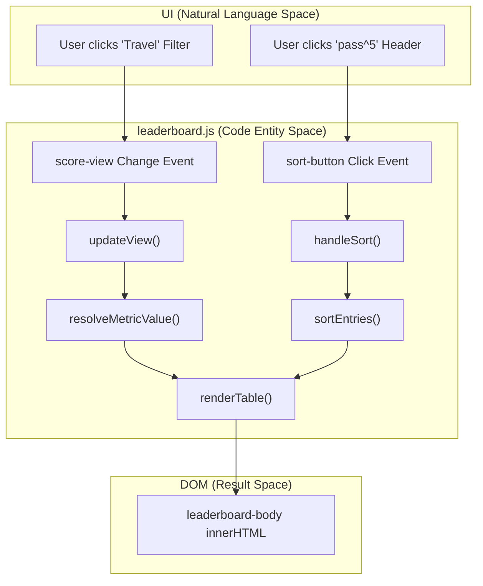
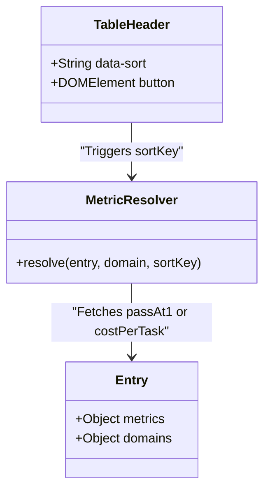

<!-- source: DeepWiki mcp.deepwiki.com · repo microsoft/STATE-Bench · page 7.1 Leaderboard Frontend · fetched 2026-10-26 -->

# Leaderboard Frontend

Relevant source files

The following files were used as context for generating this wiki page:

- [.leaderboard/index.html](.leaderboard/index.html)
- [.leaderboard/leaderboard.js](.leaderboard/leaderboard.js)
- [.leaderboard/styles.css](.leaderboard/styles.css)

The STATE-Bench Leaderboard is a static web application located in the `.leaderboard/` directory. It provides a visual interface for comparing model performance across different benchmark tracks, versions, and domains. The frontend is designed for high-density data visualization, featuring custom sorting, filtering, and grouping logic implemented in vanilla JavaScript.

### Sources:
* [.leaderboard/index.html:1-94]()
* [.leaderboard/leaderboard.js:1-205]()
* [.leaderboard/styles.css:1-359]()

## Shell Structure and Components

The application follows a single-page shell structure defined in `index.html`. It uses a utility-first CSS approach with a custom component system for benchmark-specific UI elements.

### Layout Overview
* **Compact Hero**: Contains the brand identity and navigation links to the GitHub repository [.leaderboard/index.html:10-25]().
* **Track Tabs**: A `role="tablist"` component that switches between the "Main Track" and "Agent Learning Track" [.leaderboard/index.html:31-39]().
* **Domain Filters**: Radio buttons that allow users to toggle between "Overall" scores and domain-specific metrics (Travel, Customer Support, Shopping) [.leaderboard/index.html:45-65]().
* **Leaderboard Table**: The core data grid featuring sortable headers and dynamic row injection [.leaderboard/index.html:67-84]().

### Visual Component System
The frontend utilizes a specific set of CSS classes to represent model status and performance:
* **Rank Pills**: Circular indicators (`.rank-pill`) for model standing [.leaderboard/styles.css:350-359]().
* **Status Badges**: Color-coded badges for `verified` (blue), `pending` (yellow), and `self-reported` (gray) results [.leaderboard/styles.css:11-17]().
* **Sort Buttons**: Interactive headers that update the visual sort state (`.sort-button.active`) [.leaderboard/index.html:74-78]().

### Sources:
* [.leaderboard/index.html:10-84]()
* [.leaderboard/styles.css:11-17, 350-359]()

## Data Model and Rendering Pipeline

The frontend logic is contained within `leaderboard.js`. It manages a collection of entry objects, performs data resolution based on user filters, and handles the DOM injection process.

### Entry Schema
Each entry in the `entries` array represents a single submission.

| Field | Description |
| :--- | :--- |
| `id` | Unique identifier for the submission. |
| `track` | Either `main` or `memory` (Agent Learning). |
| `model` | The name of the LLM or Agent system. |
| `benchmarkVersion` | The version of STATE-Bench used for the run. |
| `metrics` | Nested object containing `overall` and `domains` scores. |

### Data Flow Diagram: Natural Language to Code Entities
The following diagram illustrates how user interactions in the UI trigger internal logic to update the displayed results.

"Leaderboard Interaction Flow"

### Key Functions
* **`resolveMetricValue(entry, domain, metric)`**: Dynamically accesses either the `overall` metrics or the nested `domains[domain]` metrics based on the current radio button selection [.leaderboard/leaderboard.js:12-23]().
* **`groupEntriesByVersion(entries)`**: Organizes results by their `benchmarkVersion` string to ensure comparisons are valid within the same evaluation context [.leaderboard/leaderboard.js:10, 33, 55]().
* **`renderTable()`**: The primary pipeline function that clears the `leaderboard-body` and iterates through the filtered/sorted data to generate HTML rows [.leaderboard/index.html:82]().

### Sources:
* [.leaderboard/leaderboard.js:1-160]()
* [.leaderboard/index.html:45-82]()

## Metrics Resolution

The leaderboard displays four primary performance indicators. These are resolved from the `metrics` object in the data model.

| Metric | Code Key | Description |
| :--- | :--- | :--- |
| **pass@1 (%)** | `passAt1` | The percentage of tasks where the agent succeeded in a single attempt [.leaderboard/leaderboard.js:13](). |
| **pass^5 (%)** | `passAt5` | Success rate calculated over 5 attempts (pass-to-5) [.leaderboard/leaderboard.js:15](). |
| **UX (1-5)** | `meanUxScore` | The average score from the LLM-based UX Quality judge [.leaderboard/leaderboard.js:16](). |
| **Cost / Task** | `costPerTask` | The average USD cost per task based on token usage [.leaderboard/leaderboard.js:17](). |

### Metric Mapping Logic
The frontend bridges the raw JSON data to the display using a mapping between the `data-sort` attribute on HTML buttons and the keys in the `metrics` object.

"Metric Mapping and Sorting"

### Sources:
* [.leaderboard/leaderboard.js:12-23, 193-204]()
* [.leaderboard/index.html:74-77]()

## Filtering and Sorting Logic

### Track Filtering
The leaderboard filters entries by the `track` property. The `Main Track` corresponds to entries where `track: "main"`, while the `Agent Learning Track` corresponds to `track: "memory"` [.leaderboard/leaderboard.js:4, 186]().

### Sorting Behavior
1.  **Primary Sort**: Users can sort by any metric column. The `selectedScore` (pass@1) is the default active sort [.leaderboard/index.html:74]().
2.  **Rank Calculation**: Ranks are calculated dynamically after filtering and sorting, ensuring that the "Rank 1" pill always represents the top performer for the currently selected view.
3.  **Grouping**: Results are grouped by `benchmarkVersion`. Within each version group, models are ranked independently [.leaderboard/styles.css:330-338]().

### Sources:
* [.leaderboard/leaderboard.js:1-205]()
* [.leaderboard/index.html:31-79]()
* [.leaderboard/styles.css:330-359]()

---

