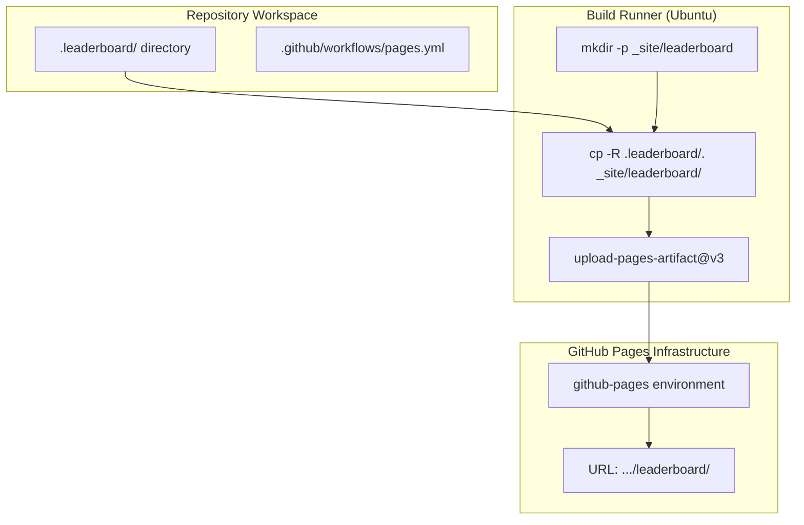
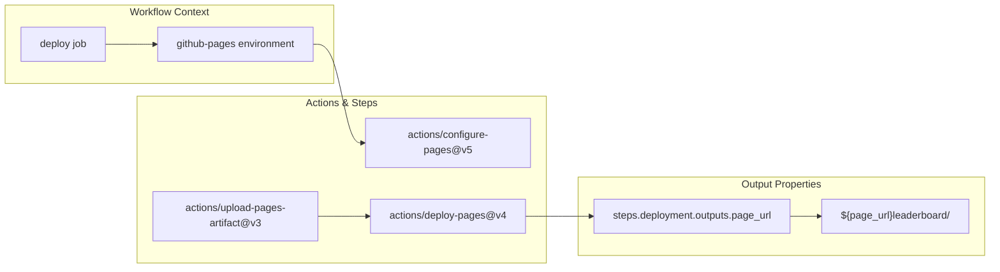

<!-- source: DeepWiki mcp.deepwiki.com · repo microsoft/STATE-Bench · page 7.2 Leaderboard Deployment · fetched 2026-10-26 -->

# Leaderboard Deployment

Relevant source files

The following files were used as context for generating this wiki page:

- [.github/workflows/pages.yml](.github/workflows/pages.yml)

The STATE-Bench leaderboard is a static web application hosted via GitHub Pages. The deployment process is fully automated through a Continuous Deployment (CD) pipeline that synchronizes the frontend assets located in the `.leaderboard/` directory to a public-facing URL whenever changes are detected or manually triggered.

## Deployment Pipeline Overview

The deployment is managed by the `.github/workflows/pages.yml` GitHub Actions workflow. This workflow handles the environment configuration, artifact preparation, and the final push to the GitHub Pages infrastructure.

### Trigger Conditions
The workflow is configured to execute under three specific scenarios:
1.  **Code Pushes**: Any push to the `main` branch that includes changes within the `.leaderboard/` directory [`.github/workflows/pages.yml`:4-8]().
2.  **Workflow Changes**: Updates to the deployment configuration file itself [`.github/workflows/pages.yml`:9-9]().
3.  **Manual Trigger**: Via the `workflow_dispatch` event, allowing maintainers to force a redeploy from the GitHub Actions UI [`.github/workflows/pages.yml`:10-10]().

### Concurrency and Permissions
To ensure deployment integrity, the workflow uses a specific concurrency group named `pages` [`.github/workflows/pages.yml`:17-18](). The `cancel-in-progress` flag is set to `false` to ensure that deployments complete in order and are not interrupted by subsequent pushes [`.github/workflows/pages.yml`:19-19]().

The workflow requires elevated permissions to interact with GitHub Pages:
*   `contents: read`: To checkout the repository code [`.github/workflows/pages.yml`:13-13]().
*   `pages: write`: To publish the site [`.github/workflows/pages.yml`:14-14]().
*   `id-token: write`: To verify the deployment source [`.github/workflows/pages.yml`:15-15]().

## Site Preparation and Data Flow

The deployment process involves moving the source files from the repository's internal structure into a specialized `_site` directory that GitHub Pages expects.

### The Preparation Step
The pipeline creates a directory structure that dictates the final URL path. Specifically, it creates `_site/leaderboard` and copies the contents of the `.leaderboard/` source folder into it [`.github/workflows/pages.yml`:35-37](). This ensures that the leaderboard is served at a sub-path rather than the root domain.

### Deployment Logic Diagram
The following diagram illustrates the transition from the repository structure to the deployed GitHub Pages environment.

**Leaderboard Artifact Preparation**

**Sources:** [`.github/workflows/pages.yml`:21-47]()

## Implementation Details

The `deploy` job runs on `ubuntu-latest` and targets the `github-pages` environment [`.github/workflows/pages.yml`:22-26]().

### Step-by-Step Execution
| Step | Action | Description |
| :--- | :--- | :--- |
| **Checkout** | `actions/checkout@v4` | Fetches the repository content [`.github/workflows/pages.yml`:28-29](). |
| **Configure Pages** | `actions/configure-pages@v5` | Initializes the GitHub Pages settings for the runner [`.github/workflows/pages.yml`:31-32](). |
| **Prepare site** | Shell Script | Creates `_site/leaderboard` and populates it with frontend assets [`.github/workflows/pages.yml`:34-37](). |
| **Upload artifact** | `actions/upload-pages-artifact@v3` | Compresses the `_site` directory and uploads it as a deployment-ready artifact [`.github/workflows/pages.yml`:39-42](). |
| **Deploy** | `actions/deploy-pages@v4` | Finalizes the deployment to the live environment [`.github/workflows/pages.yml`:44-47](). |

### Deployment Pipeline Entities
This diagram maps the GitHub Action steps to the resulting environment variables and outputs.

**Workflow Entity Mapping**

**Sources:** [`.github/workflows/pages.yml`:23-25](), [`.github/workflows/pages.yml`:44-47]()

## URL Structure
The deployment is configured to serve the leaderboard at a specific sub-directory. The base URL is determined by the GitHub Pages settings (typically `https://<org>.github.io/<repo>/`), and the workflow appends `leaderboard/` to this base [`.github/workflows/pages.yml`:25-25]().

This structure allows the repository to potentially host other static content (such as documentation or project landing pages) at the root level while keeping the leaderboard assets isolated.

**Sources:**
*   [`.github/workflows/pages.yml:1-47`]()

---

