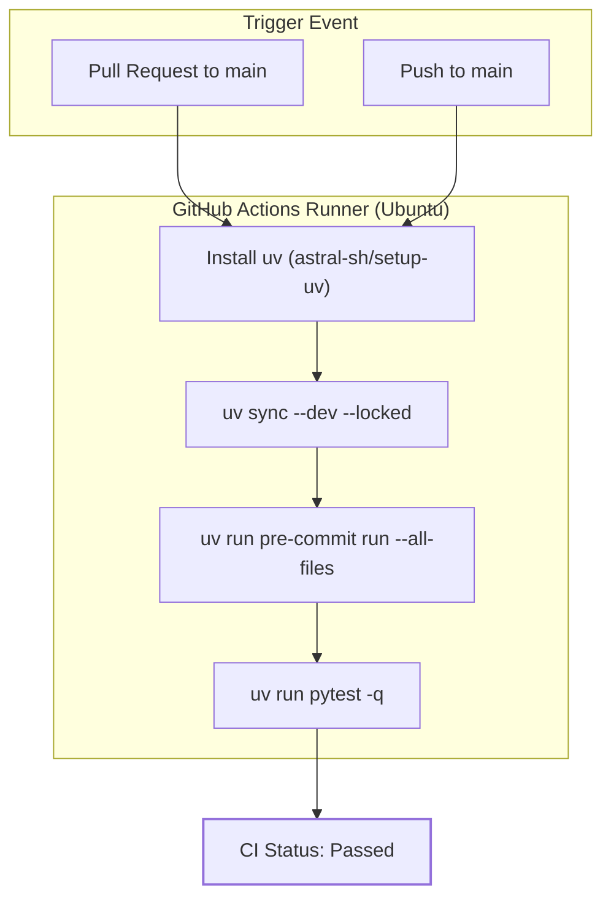
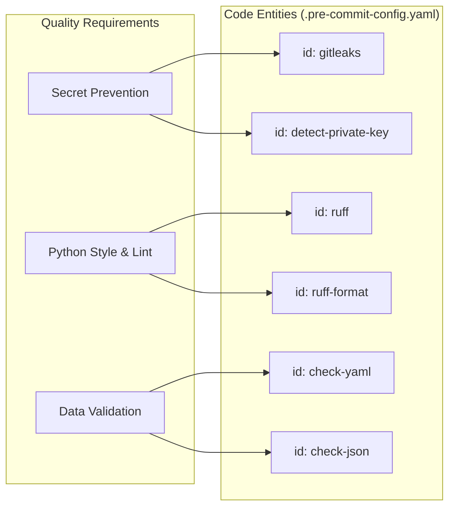

<!-- source: DeepWiki mcp.deepwiki.com · repo microsoft/STATE-Bench · page 8.1 CI/CD and Code Quality · fetched 2026-10-26 -->

# CI/CD and Code Quality

Relevant source files

The following files were used as context for generating this wiki page:

- [.github/workflows/ci.yml](.github/workflows/ci.yml)
- [.pre-commit-config.yaml](.pre-commit-config.yaml)

This page documents the Continuous Integration (CI) pipeline and code quality standards for the STATE-Bench repository. The project utilizes GitHub Actions for automated testing and linting, alongside `pre-commit` hooks to ensure local development adheres to project standards before code is pushed.

## Continuous Integration Pipeline

The CI pipeline is defined in `.github/workflows/ci.yml` and is triggered on every push to the `main` branch, every pull request targeting `main`, and manual `workflow_dispatch` events [ .github/workflows/ci.yml:3-8 ](). The pipeline runs on the `ubuntu-latest` environment [ .github/workflows/ci.yml:16 ]().

### Pipeline Execution Flow

The pipeline uses `uv` for high-performance dependency management and environment isolation.

1.  **Environment Setup**:
    *   **Checkout**: Retrieves the repository content [ .github/workflows/ci.yml:19-20 ]().
    *   **Install uv**: Sets up the `uv` package manager with caching enabled to speed up subsequent runs [ .github/workflows/ci.yml:22-25 ]().
    *   **Python Setup**: Configures Python 3.12 [ .github/workflows/ci.yml:27-30 ]().
2.  **Dependency Installation**:
    *   Runs `uv sync --dev --locked` to install all project and development dependencies based on the lockfile, ensuring a reproducible environment [ .github/workflows/ci.yml:32-33 ]().
3.  **Static Analysis & Linting**:
    *   Executes `pre-commit` against all files in the repository to verify formatting and security constraints [ .github/workflows/ci.yml:35-36 ]().
4.  **Automated Testing**:
    *   Runs the test suite using `pytest` in quiet mode [ .github/workflows/ci.yml:38-39 ]().

### CI Data Flow Diagram

The following diagram illustrates the flow from code submission to CI completion.

"CI Execution Logic"

**Sources:** [ .github/workflows/ci.yml:1-40 ]()

---

## Code Quality and Pre-commit Hooks

STATE-Bench uses `pre-commit` to enforce coding standards, security best practices, and file integrity. These hooks are configured in `.pre-commit-config.yaml` [ .pre-commit-config.yaml:1 ]().

### Hook Categories

| Category | Hooks | Description |
| :--- | :--- | :--- |
| **Security** | `gitleaks`, `detect-private-key` | Prevents accidental commits of secrets, API keys, or private keys [ .pre-commit-config.yaml:2-6, 21 ](). |
| **Linting & Formatting** | `ruff`, `ruff-format` | Uses the Ruff tool for lightning-fast Python linting (with auto-fix) and formatting [ .pre-commit-config.yaml:22-28 ](). |
| **File Integrity** | `check-yaml`, `check-toml`, `check-json` | Validates the syntax of configuration and data files [ .pre-commit-config.yaml:12-14 ](). |
| **Cleanup** | `trailing-whitespace`, `end-of-file-fixer` | Ensures consistent file endings and removes unnecessary whitespace [ .pre-commit-config.yaml:10-11 ](). |
| **Safety** | `check-added-large-files`, `check-merge-conflict` | Prevents committing files >5MB or files containing unresolved git conflicts [ .pre-commit-config.yaml:15-17 ](). |

### Code Quality Entity Mapping

This diagram maps the high-level quality requirements to the specific tools and configuration entries in the codebase.

"Quality Control Entity Mapping"

**Sources:** [ .pre-commit-config.yaml:1-28 ]()

---

## Test Suite Structure

The testing framework is built on `pytest`. While the CI pipeline executes all tests globally using `uv run pytest` [ .github/workflows/ci.yml:39 ](), the suite is organized under the `tests/` directory to cover different layers of the system.

### Test Execution Strategy

Developers are encouraged to run tests locally before pushing:

1.  **Run all tests**: `uv run pytest`
2.  **Run with coverage**: `uv run pytest --cov=state_bench` (requires `pytest-cov`)
3.  **Run specific domain tests**: `uv run pytest tests/travel/`

The test suite ensures that:
*   The `orchestrator.py` correctly manages the loop between the agent and the environment.
*   Scoring logic in `scoring.py` accurately evaluates `StateDiff` assertions.
*   The `LLMClient` handles retries and content filtering as expected.
*   Domain-specific tools in `travel`, `shopping_assistant`, and `customer_support` return the correct environment states.

**Sources:** [ .github/workflows/ci.yml:38-39 ](), [ .pre-commit-config.yaml:1-28 ]()

---

