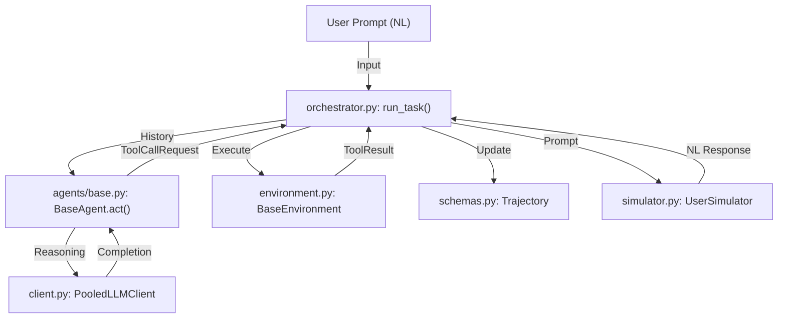
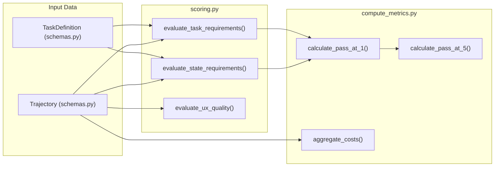

<!-- source: DeepWiki mcp.deepwiki.com · repo microsoft/STATE-Bench · page 9 Glossary · fetched 2026-10-26 -->

# Glossary

Relevant source files

The following files were used as context for generating this wiki page:

- [.env.example](.env.example)
- [.gitignore](.gitignore)
- [.leaderboard/index.html](.leaderboard/index.html)
- [.leaderboard/leaderboard.js](.leaderboard/leaderboard.js)
- [CHANGELOG.md](CHANGELOG.md)
- [README.md](README.md)
- [datasets/train_task_trajectories/customer_support/1-hard_false_defect_phone_battery_settings.json](datasets/train_task_trajectories/customer_support/1-hard_false_defect_phone_battery_settings.json)

This glossary defines the technical terms, architectural concepts, and domain-specific entities used within the STATE-Bench codebase. It serves as a reference for onboarding engineers to understand the mapping between benchmark terminology and the underlying Python implementation.

## Core System Concepts

### Orchestrator
The central engine that manages the lifecycle of a single benchmark task. It coordinates the interaction between the **Agent**, the **User Simulator**, and the **Environment**.
*   **Key Function**: `run_task()` [state_bench/orchestrator.py:1-20]().
*   **Data Flow**: The orchestrator maintains the conversation history and passes it to the agent, captures tool calls, executes them against the environment, and then passes the results back to the agent or triggers the user simulator for a response.

### Trajectory
A complete record of a task execution session. It includes the full conversation history, all tool calls made by the agent, their results, and the final state of the environment.
*   **Schema**: `Trajectory` [state_bench/schemas.py:1-30]().
*   **Usage**: Trajectories are the primary output of a benchmark run and the input for the scoring pipeline [state_bench/scripts/compute_metrics.py:1-15]().

### User Simulator
An LLM-powered component that acts as the "customer" or "user" in the benchmark. It is configured with a specific persona and goal defined in the task.
*   **Class**: `UserSimulator` [state_bench/simulator.py:1-40]().
*   **Configuration**: `UserSimulatorConfig` [state_bench/schemas.py:40-60]().

### Evaluation Protocol
A versioned configuration that defines which models are used for judging, which tasks are included in a specific benchmark version, and the prompts used for evaluation.
*   **Class**: `EvaluationProtocol` [state_bench/protocol.py:1-25]().
*   **Locked Protocol**: The canonical benchmark uses a "locked" protocol (e.g., `gpt54`) to ensure reproducibility [state_bench/configs/eval_protocols/gpt54.json:1-10]().

---

## Agent Architecture

### BaseAgent
The abstract base class that all agents must implement to be compatible with the STATE-Bench orchestrator.
*   **File**: [state_bench/agents/base.py:1-50]().
*   **Core Methods**: 
    *   `act()`: The main entry point for the agent to process the current state and return a response.
    *   `ingest_trajectory()`: Used in the **Agent Learning Track** to allow agents to learn from past experiences.

### AgentRuntimeContext
A container passed to the agent during each turn, providing access to available tools and the current environment state.
*   **Schema**: `AgentRuntimeContext` [state_bench/agents/base.py:10-25]().

### StateBenchAgent
The default, built-in agent implementation provided by the benchmark. It supports standard tool-calling loops and optional integration with memory retrieval.
*   **File**: [state_bench/agents/state_bench.py:1-100]().

---

## Evaluation and Scoring

### State Requirements
Deterministic assertions about the final state of the environment database after a task is completed. This measures if the agent actually performed the requested actions (e.g., updated a booking or processed a refund).
*   **Logic**: `StateDiff` evaluation [state_bench/scoring.py:1-50]().
*   **Source**: Defined in the task JSON under `state_requirements` [datasets/train_task_trajectories/customer_support/1-hard_false_defect_phone_battery_settings.json:1-20]().

### Task Requirements
Qualitative requirements that the agent must follow during the conversation, judged by an LLM (the "Judge").
*   **Logic**: `TaskRequirements` judge [state_bench/scoring.py:60-100]().

### UX Score
A 1-5 metric evaluating the quality of the agent's interaction based on user control, effort, and response density.
*   **Logic**: `UXQualityResult` [state_bench/schemas.py:100-120]().

### Pass@1 and Pass^5
*   **Pass@1**: The average success rate (both state and task requirements met) across multiple runs.
*   **Pass^5**: A stricter metric requiring the agent to succeed in 5 out of 5 attempts for a single task to count as a pass [state_bench/scripts/compute_metrics.py:40-60]().

---

## Domain Concepts

### Environment
A domain-specific sandbox containing a local database (e.g., SQLite or in-memory) and business logic.
*   **Base Class**: `BaseEnvironment` [state_bench/environment.py:1-30]().

### Policy Engine
A set of deterministic rules within a domain (e.g., "15-day return window for electronics") that the agent must reason about using tools like `get_policies`.
*   **Example**: Customer Support return policies [datasets/train_task_trajectories/customer_support/1-hard_false_defect_phone_battery_settings.json:75-126]().

---

## Technical Mapping Diagrams

### Execution Flow: Natural Language to Code Entities
The following diagram traces how a user's natural language request moves through the system's code entities.

"Natural Language to Code Entity Flow"

Sources: [state_bench/orchestrator.py:1-20](), [state_bench/agents/base.py:1-50](), [state_bench/client.py:1-30](), [state_bench/simulator.py:1-40](), [state_bench/schemas.py:1-30]()

### Scoring Pipeline: Trajectory to Metrics
The following diagram illustrates how raw trajectory data is transformed into benchmark scores.

"Scoring Logic: Code Entity Mapping"

Sources: [state_bench/scoring.py:1-100](), [state_bench/schemas.py:1-120](), [state_bench/scripts/compute_metrics.py:1-80]()

---

## Key File Summary

| Term | File / Class | Description |
| :--- | :--- | :--- |
| **LLM Client** | `state_bench/client.py` | Handles API calls, retries, and Azure/OpenAI auth [state_bench/client.py:1-100](). |
| **Task Definition** | `TaskDefinition` | The schema for a benchmark task JSON [state_bench/schemas.py:150-200](). |
| **Domain Config** | `DomainConfig` | Metadata and entry points for a specific domain (Travel, etc.) [state_bench/domain.py:1-20](). |
| **Leaderboard** | `.leaderboard/leaderboard.js` | Frontend logic for displaying and sorting results [.leaderboard/leaderboard.js:1-100](). |
| **Env Variables** | `.env.example` | Template for configuring API keys and model endpoints [.env.example:1-29](). |

Sources: [.env.example:1-29](), [.leaderboard/leaderboard.js:1-100](), [state_bench/client.py:1-100](), [state_bench/schemas.py:1-200](), [state_bench/domain.py:1-20]()