# Page: STATE-Bench Overview

# STATE-Bench Overview

<details>
<summary>Relevant source files</summary>

The following files were used as context for generating this wiki page:

- [.env.example](.env.example)
- [CHANGELOG.md](CHANGELOG.md)
- [README.md](README.md)

</details>


STATE-Bench is a comprehensive benchmarking framework designed to evaluate AI agents on realistic, multi-step enterprise workflows. It simulates complex environments across three primary domains—**Travel**, **Customer Support**, and **Shopping Assistant**—to measure an agent's ability to reason through policies, manipulate state via tools, and maintain high-quality user interactions.

## What it Measures

The benchmark moves beyond simple question-answering by requiring agents to operate within a task-local sandbox database and interact with a simulated user. Success is determined by a combination of deterministic state validation and LLM-based qualitative assessment.

| Metric | Definition |
| :--- | :--- |
| **Task Completion pass@1** | The average task completion rate across five independent runs per task [README.md:59-59](). |
| **Task Completion pass^5** | The percentage of tasks that were successfully completed in all five out of five runs [README.md:60-60](). |
| **UX Score** | A qualitative measure (1-5 scale) of the conversation quality, judged by an LLM [README.md:61-61](). |
| **Cost Per Task** | The average financial cost incurred by the agent per task, based on token usage [README.md:62-62](). |

## High-Level Structure

STATE-Bench is structured to bridge the gap between natural language interaction and programmatic state management. The following diagram illustrates how the benchmark components translate natural language requirements into code-level entities and evaluations.

### From Natural Language to Code Entities
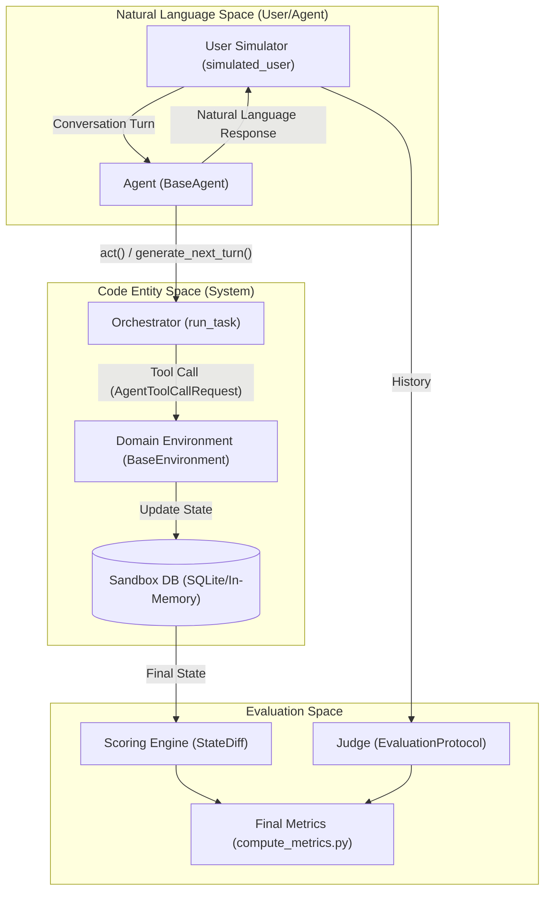
Sources: [README.md:18-21](), [state_bench/orchestrator.py:1-50](), [state_bench/agents/base.py:1-40]()

## Benchmark Tracks

STATE-Bench offers two distinct tracks depending on the research goal:

1.  **Main Track**: The default path for evaluating an agent or model's raw performance on enterprise tasks [README.md:38-38]().
2.  **Agent Learning Track**: Designed for evaluating agentic memory, skill acquisition, or prompt optimization. It provides 300 pre-generated "train" trajectories (100 per domain) that agents can use to "learn" before being tested [README.md:39-41]().

For a deep dive into these tracks, see **[Benchmark Tracks](#1.2)**.

## System Architecture

The core of the benchmark is the `state_bench` Python package. It manages the lifecycle of a task, from initializing the environment to the final scoring.

### Execution Flow and Data Mapping
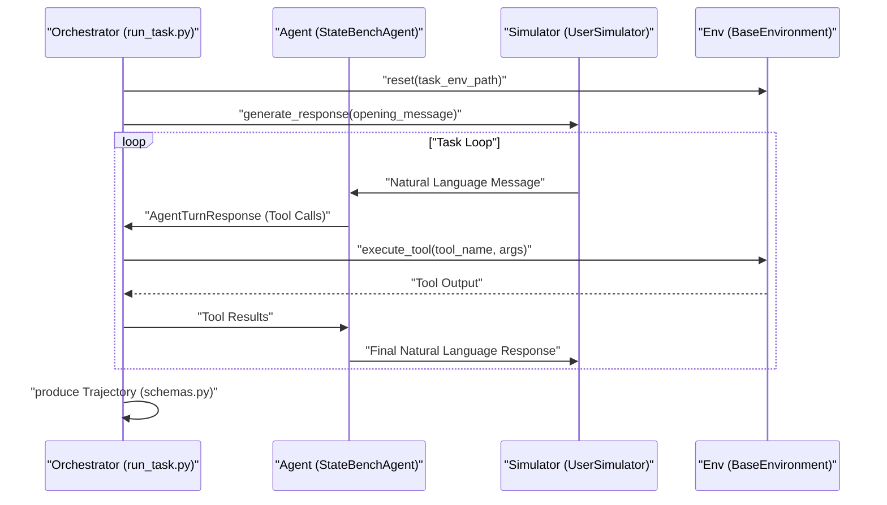
Sources: [state_bench/orchestrator.py:1-100](), [state_bench/simulator.py:1-30](), [state_bench/agents/state_bench.py:1-50]()

## Navigation Guide

To explore the technical details of STATE-Bench, follow the links to the child pages below:

*   **[Getting Started](#1.1)**: Installation via `uv`, environment configuration (specifically the `STATE_BENCH_EVAL_*` variables for the locked GPT-5.4 judge), and running your first task [.env.example:1-29]().
*   **[Benchmark Tracks](#1.2)**: Detailed breakdown of the Main and Agent Learning tracks, including data splits and official run settings.
*   **Core Architecture**: Deep dive into the orchestrator, data models (`schemas.py`), and the LLM client layer that handles Azure/OpenAI authentication.
*   **Agent Interface**: How to implement the `BaseAgent` interface to plug your own agent into the benchmark.
*   **Evaluation Pipeline**: Technical details on the `EvaluationProtocol`, `StateDiff` logic, and the GPT-5.4 judge prompts [CHANGELOG.md:3-7]().
*   **Benchmark Domains**: Documentation for the Travel, Customer Support, and Shopping Assistant environments, including their specific tools and policies [README.md:26-31]().
*   **Datasets and Task Definitions**: Understanding the JSON schema for tasks and the pre-generated training trajectories.
*   **Leaderboard**: How results are processed and displayed on the public leaderboard.

Sources: [README.md:1-75](), [.env.example:1-29](), [CHANGELOG.md:1-7]()

---

# Page: Getting Started

# Getting Started

<details>
<summary>Relevant source files</summary>

The following files were used as context for generating this wiki page:

- [.env.example](.env.example)
- [.github/workflows/ci.yml](.github/workflows/ci.yml)
- [.pre-commit-config.yaml](.pre-commit-config.yaml)

</details>


This page provides a step-by-step guide for setting up the STATE-Bench environment, configuring the necessary LLM clients, and running your first benchmark task. STATE-Bench utilizes `uv` for dependency management and requires specific environment variables to interface with the locked evaluation protocol.

## 1. Installation

STATE-Bench is built for Python 3.12 and uses `uv` for fast, reproducible dependency resolution and virtual environment management.

### Prerequisites
- **Python 3.12**: Ensure Python 3.12 is installed on your system.
- **uv**: Install via `curl -LsSf https://astral-sh.uv.io/install.sh | sh` or your preferred package manager.

### Setup Steps
1. **Clone the repository**:
   ```bash
   git clone https://github.com/microsoft/STATE-Bench.git
   cd STATE-Bench
   ```
2. **Sync dependencies**:
   Run the following command to create a virtual environment and install all required packages (including development dependencies) using the lockfile:
   ```bash
   uv sync --dev --locked
   ```
   *Sources: [.github/workflows/ci.yml:22-33]()*

3. **Install pre-commit hooks**:
   STATE-Bench uses `pre-commit` to ensure code quality (Ruff, Gitleaks, etc.):
   ```bash
   uv run pre-commit install
   ```
   *Sources: [.pre-commit-config.yaml:1-28]()*

---

## 2. Environment Configuration

STATE-Bench requires two distinct LLM client configurations: one for the **Locked Evaluation Client** (the "Judge" and "User Simulator") and one for the **Agent Client** (the model being benchmarked).

Copy the template file to create your environment configuration:
```bash
cp .env.example .env
```

### 2.1. Locked Evaluation Client
The canonical evaluation protocol requires **GPT-5.4**. This client is used by the `UserSimulator` to interact with the agent and by the `Scoring` pipeline to evaluate task requirements.

| Variable | Description |
| :--- | :--- |
| `STATE_BENCH_EVAL_ENDPOINT` | The Azure OpenAI endpoint for the GPT-5.4 resource. |
| `STATE_BENCH_EVAL_DEPLOYMENTS` | The deployment name for GPT-5.4. |
| `STATE_BENCH_EVAL_API_KEY` | (Optional) API key. If omitted, the system attempts Azure CLI/Managed Identity token auth. |

*Sources: [.env.example:6-12]()*

### 2.2. Built-in StateBenchAgent Client
The default runner uses the `StateBenchAgent` class. You can configure this to point to any model you wish to evaluate (Azure OpenAI or OpenAI).

**For Azure OpenAI:**
- `STATE_BENCH_AGENT_ENDPOINT`
- `STATE_BENCH_AGENT_DEPLOYMENTS`
- `STATE_BENCH_AGENT_API_KEY`

**For OpenAI API:**
- `STATE_BENCH_AGENT_PROVIDER="openai"`
- `STATE_BENCH_AGENT_MODEL="gpt-4o"`
- `STATE_BENCH_AGENT_API_KEY`

*Sources: [.env.example:14-28]()*

---

## 3. System Data Flow

The following diagram illustrates the initialization process and the relationship between environment variables and the core code entities.

### Setup and Initialization Flow
"This diagram maps the `.env` configuration to the internal `LLMClient` instances used by the Orchestrator."

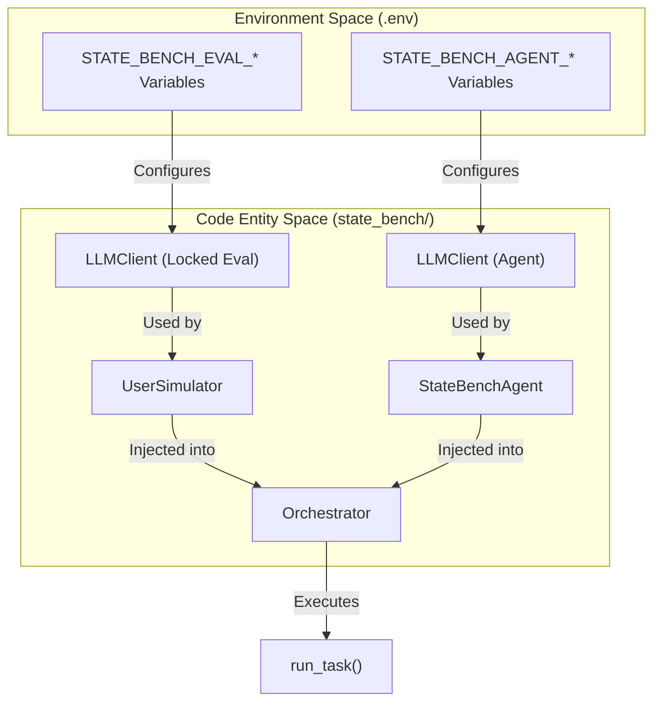
*Sources: [.env.example:1-29](), [state_bench/orchestrator.py:1-50]()*

---

## 4. Running Your First Benchmark

Once configured, you can execute a single task or a batch of tasks using the provided scripts.

### 4.1. Single Task Execution
To run a specific task (e.g., from the Travel domain), use `run_task.py`. This script initializes the environment, loads the `TaskDefinition`, and starts the interaction loop between the `UserSimulator` and the `BaseAgent`.

```bash
uv run python -m state_bench.scripts.run_task \
    --domain travel \
    --task-id travel_001 \
    --output-dir ./results/first_run
```

### 4.2. Batch Execution
To run the full benchmark suite for a specific track (e.g., the Main Track), use `run_batch.py`. This script manages parallel execution and aggregates trajectories.

```bash
uv run python -m state_bench.scripts.run_batch \
    --protocol gpt54 \
    --track main \
    --output-dir ./results/main_track_eval
```

### Component Interaction Diagram
"This diagram shows how the `run_task` script bridges the high-level task definition to the execution logic."

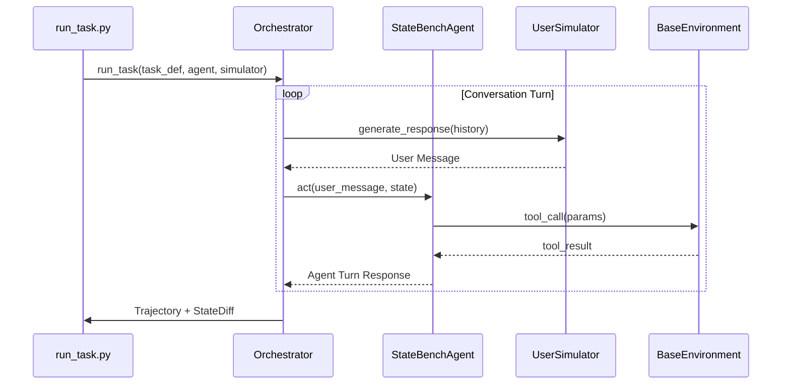
*Sources: [state_bench/orchestrator.py:1-100](), [state_bench/agents/state_bench.py:1-40]()*

---

## 5. Verification
After running a task, check the `output-dir`. You should see:
1. `trajectory.json`: The full conversation history and tool calls.
2. `state_diff.json`: The delta between the initial and final environment states.
3. `scores.json`: The output of the scoring pipeline (if evaluation was enabled).

To verify your installation and environment setup, run the test suite:
```bash
uv run pytest
```
*Sources: [.github/workflows/ci.yml:38-39]()*

---

# Page: Benchmark Tracks

# Benchmark Tracks

<details>
<summary>Relevant source files</summary>

The following files were used as context for generating this wiki page:

- [CHANGELOG.md](CHANGELOG.md)
- [README.md](README.md)

</details>


This page explains the two primary evaluation tracks in STATE-Bench: the **Main Track** and the **Agent Learning Track**. While both tracks share the same domain environments, tools, and evaluation metrics, they are distinguished by their data splits and the agent's ability to utilize historical trajectories for optimization.

## Track Overview

STATE-Bench is structured to evaluate agents in two distinct scenarios: direct task execution and iterative improvement through learning.

| Feature | Main Track | Agent Learning Track |
| :--- | :--- | :--- |
| **Goal** | Evaluate zero-shot or few-shot model performance on enterprise tasks. | Evaluate agentic memory, skill acquisition, or prompt optimization. |
| **Data Split** | `test` split (50 tasks per domain). | `train` split (100 tasks per domain) + `test` split. |
| **Learning Data** | None. | 300 pre-generated gold trajectories (100 per domain). |
| **Agent Interface** | Standard `act()` loop. | `act()` loop with `retrieve_learnings()` hook. |
| **Primary Metric** | `pass@1`, `pass^5`, UX Score, Cost. | `pass@1`, `pass^5`, UX Score, Cost. |

Sources: [README.md:32-41](), [docs/AGENT_LEARNING_TRACK.md:1-15]() (referenced in README)

---

## Main Track

The Main Track is the standard benchmark for assessing an LLM-based agent's ability to navigate multi-step workflows across the **Travel**, **Customer Support**, and **Shopping Assistant** domains [README.md:18-30]().

### Data Split and Official Run Settings
The Main Track utilizes the **Test Split**, which consists of 50 tasks per domain (150 total). To ensure statistical significance, the official leaderboard requires:
*   **5 runs per task**: To calculate both `pass@1` and the stricter `pass^5` (consistency) metrics [README.md:57-62]().
*   **Zero/Few-Shot**: The agent does not have access to task-specific training data or long-term memory across tasks.

### Code Entity Space: Execution Flow
In the Main Track, the `run_batch.py` script invokes the `Orchestrator` to execute tasks defined in the `test` manifest.

**Main Track Data Flow**
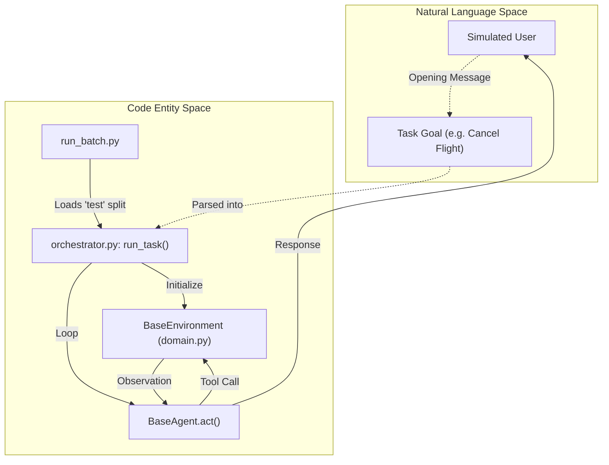
Sources: [state_bench/orchestrator.py:1-50](), [state_bench/domain.py:1-20](), [state_bench/agents/base.py:10-30]()

---

## Agent Learning Track

The Agent Learning Track is designed for agents that can learn from past experiences. It provides a set of "Train Trajectories" that agents can ingest to optimize their prompts, extract reusable skills, or populate a long-term memory store [README.md:39-41]().

### The Learning Data
STATE-Bench provides **300 pre-generated scored trajectories** (100 per domain) in the `datasets/train_task_trajectories/` directory. Each trajectory includes:
*   The full conversation history between the user and agent.
*   All tool calls and their results.
*   The final `StateDiff` and scores assigned by the judge.

### The Retrieval Hook
Agents participating in this track implement the `retrieve_learnings` method defined in the `StateBenchAgent` or custom `BaseAgent` subclasses. This allows the agent to fetch relevant context from its "memory" before generating a response [state_bench/agents/state_bench.py:40-60]().

**Agent Learning Track: Learning & Retrieval**
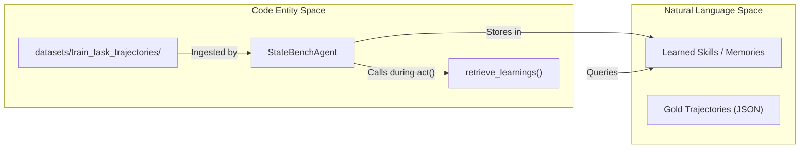
Sources: [state_bench/agents/state_bench.py:1-80](), [state_bench/agents/base.py:45-55]()

---

## Official Evaluation Protocols

Both tracks are governed by a specific versioned protocol to ensure comparability on the leaderboard. As of version `0.7.0`, the benchmark uses the `gpt54` protocol.

### Protocol Configuration
The protocol defines the judge models and prompt versions used to evaluate the agent's performance.

| Protocol Field | Value (v0.7.0) | Description |
| :--- | :--- | :--- |
| `protocol_id` | `gpt54` | The unique identifier for the evaluation logic [CHANGELOG.md:6-7](). |
| `judge_model` | `gpt-5.4` | The LLM used for Task Requirement and UX scoring [CHANGELOG.md:6-7](). |
| `ux_version` | `v2` | The updated prompt version for UX quality metrics [CHANGELOG.md:5](). |

### Scoring Pipeline
The evaluation pipeline converts raw agent trajectories into the four headline metrics:
1.  **State Requirements**: Deterministic check of database entities (e.g., "Is the booking status set to CANCELLED?") [state_bench/scoring.py:50-100]().
2.  **Task Requirements**: LLM-judged check of procedural adherence (e.g., "Did the agent inform the user about the $50 fee?") [state_bench/scoring.py:110-150]().
3.  **UX Score**: 1-5 rating of conversation quality [README.md:61]().
4.  **Efficiency**: Calculation of cost and token usage [README.md:62]().

Sources: [CHANGELOG.md:1-7](), [state_bench/scoring.py:1-200](), [state_bench/protocol.py:1-30]()

---

# Page: Core Architecture

# Core Architecture

<details>
<summary>Relevant source files</summary>

The following files were used as context for generating this wiki page:

- [.gitignore](.gitignore)
- [README.md](README.md)

</details>


The `state_bench/` package is structured as a modular evaluation harness designed to test AI agents in high-fidelity enterprise simulations. The architecture decouples the task orchestration, the agent's internal logic, the user simulation, and the scoring pipeline. This allows for plug-and-play experimentation with different models, agentic strategies, and domain environments.

## System Overview

At a high level, the architecture facilitates a closed-loop conversation between an **Agent** and a **User Simulator**. The interaction is mediated by an **Orchestrator**, which manages the environment state, provides the agent with domain-specific tools, and records the interaction into a **Trajectory**.

### Core Components Interaction

The following diagram illustrates the relationship between the primary subsystems and their corresponding code entities.

**STATE-Bench System Flow**
```mermaid
graph TD
    subgraph "Execution Layer"
        [run_batch.py] --> [Orchestrator]
        [Orchestrator] -- "manages" --> [UserSimulator]
        [Orchestrator] -- "invokes" --> [BaseAgent]
    end

    subgraph "Environment & State"
        [Orchestrator] -- "resets" --> [BaseEnvironment]
        [BaseAgent] -- "calls tools" --> [BaseEnvironment]
    end

    subgraph "Data & Scoring"
        [Orchestrator] -- "produces" --> [Trajectory]
        [Trajectory] -- "input to" --> [ScoringPipeline]
        [ScoringPipeline] -- "outputs" --> [BinaryScore]
    end

    [BaseAgent] -- "uses" --> [LLMClient]
    [UserSimulator] -- "uses" --> [LLMClient]
```
Sources: [state_bench/orchestrator.py:1-20](), [state_bench/schemas.py:1-50](), [state_bench/client.py:1-30]()

---

## Major Subsystems

### 1. Orchestrator and Task Execution
The `Orchestrator` is the central engine of the benchmark. It is responsible for initializing the task environment, managing the turn-based loop between the agent and the simulated user, and ensuring all tool calls are executed against the correct `BaseEnvironment` instance. It handles the lifecycle of a single task run from the opening message to the final termination criteria.

For details, see [Orchestrator and Task Execution](#2.1).

### 2. Core Data Models and Schemas
The system relies on a strictly typed set of schemas defined in `state_bench/schemas.py`. These models ensure consistency across the different stages of the pipeline, from task definition to final metric reporting. Key entities include:
*   `TaskDefinition`: The static requirements and configuration for a benchmark task.
*   `Trajectory`: The complete log of an interaction, including conversation history, tool calls, and state changes.
*   `StateDiff`: A representation of how the environment's database changed during the run.

For details, see [Core Data Models and Schemas](#2.2).

### 3. LLM Client Layer
The client layer provides a unified interface for interacting with Large Language Models. It supports multiple authentication strategies (API Key, Azure CLI, Managed Identity) and features a `PooledLLMClient` to manage rate limits and throughput by distributing requests across multiple endpoints.

For details, see [LLM Client Layer](#2.3).

### 4. User Simulator
Unlike static benchmarks, STATE-Bench uses a dynamic `UserSimulator`. This component acts as the persona for the task, responding to the agent based on a specific configuration (`UserSimulatorConfig`). It uses an LLM to generate contextually relevant responses, ensuring that the agent must handle natural language variability and multi-turn clarifications.

For details, see [User Simulator](#2.4).

---

## Code Entity Mapping

The following diagram maps high-level architectural concepts to their specific implementation classes and files within the `state_bench/` directory.

**Class and Module Mapping**
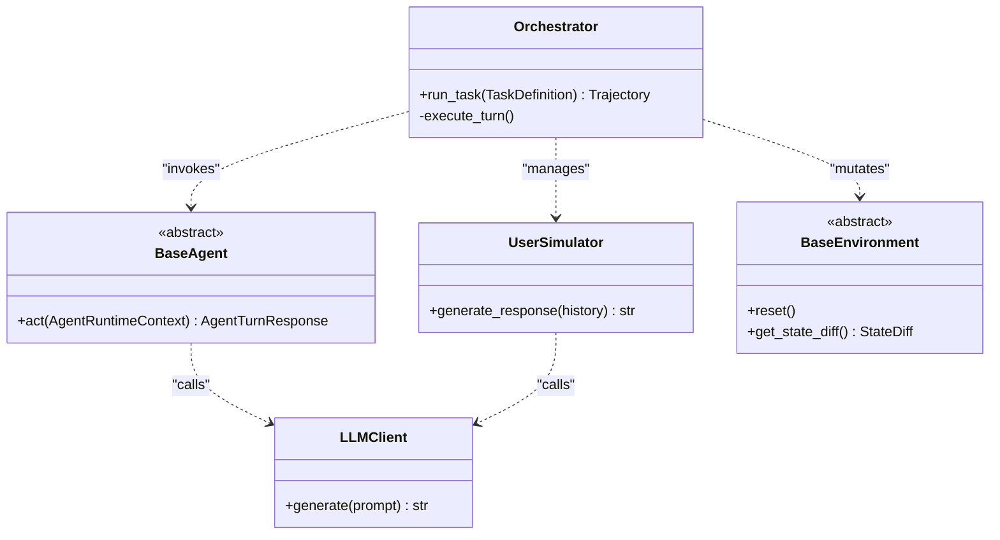
Sources: [state_bench/orchestrator.py:25-80](), [state_bench/agents/base.py:10-50](), [state_bench/simulator.py:15-40](), [state_bench/environment.py:5-30]()

## Execution Workflow

1.  **Initialization**: The `run_batch.py` script loads a set of `TaskDefinition` objects from the `datasets/` directory.
2.  **Environment Setup**: For each task, the `Orchestrator` instantiates the domain-specific `BaseEnvironment` (e.g., Travel or Shopping) and resets it to the task's starting state.
3.  **Interaction Loop**: 
    *   The `UserSimulator` provides an initial message.
    *   The `BaseAgent` processes the message, optionally calls tools in the environment, and responds.
    *   This continues until the agent signals completion or a turn limit is reached.
4.  **Trajectory Recording**: Every turn, tool call, and state change is captured in a `Trajectory` object.
5.  **Scoring**: The `ScoringPipeline` evaluates the `Trajectory` against the `StateRequirements` and `TaskRequirements` defined in the task JSON.

Sources: [state_bench/orchestrator.py:100-250](), [state_bench/schemas.py:200-300]()

---

# Page: Orchestrator and Task Execution

# Orchestrator and Task Execution

<details>
<summary>Relevant source files</summary>

The following files were used as context for generating this wiki page:

- [.env.example](.env.example)
- [CHANGELOG.md](CHANGELOG.md)

</details>


The orchestrator is the central engine of STATE-Bench, responsible for managing the lifecycle of a single benchmark task. It facilitates the multi-turn interaction between a **User Simulator**, an **Agent**, and a **Domain Environment**. The execution logic is encapsulated primarily within the `run_task()` function, which drives the conversation loop, manages state transitions, and records the resulting trajectory for evaluation.

## Execution Flow Overview

The execution of a task follows a strictly defined loop where the orchestrator acts as the mediator. It initializes the environment, prepares the agent and user simulator, and then iterates through turns until a termination condition is met (e.g., task completion, turn limit reached, or failure).

### The Agent-User-Tool Loop
The loop follows these logical steps:
1.  **User Turn**: The `UserSimulator` generates a message based on the current conversation history and its internal goal.
2.  **Agent Turn**: The `BaseAgent` receives the user message and decides whether to call a tool or respond to the user.
3.  **Tool Execution**: If the agent requests tool calls, the orchestrator executes them against the `BaseEnvironment` and returns the results to the agent.
4.  **Termination**: The loop ends when the `UserSimulator` signals the task is finished, the agent provides a final response that satisfies the user, or the `max_turns` limit is hit.

### Entity Relationship Diagram
This diagram maps the conceptual "Natural Language Space" of the conversation to the "Code Entity Space" within `state_bench/orchestrator.py`.

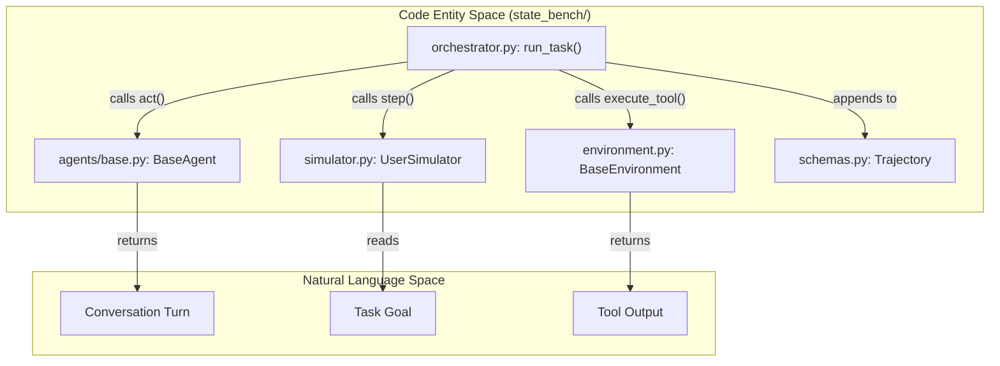
**Sources:** [state_bench/orchestrator.py:1-100](), [state_bench/agents/base.py:10-50](), [state_bench/simulator.py:5-40]()

---

## Core Implementation: `run_task()`

The `run_task()` function in `state_bench/orchestrator.py` is the primary entry point for executing a single benchmark instance. It handles the setup of the domain-specific environment and manages the stateful interaction.

### Key Responsibilities
-   **Environment Setup**: Loads the task-specific environment state using `BaseEnvironment.load_task_env()`.
-   **Context Management**: Creates an `AgentRuntimeContext` which provides the agent with access to tool schemas and the environment.
-   **Trajectory Recording**: Every interaction (user messages, agent reasoning, tool calls, and tool outputs) is appended to a `Trajectory` object.
-   **State Tracking**: Captures the "Before" and "After" state of the environment to compute the `StateDiff`.

### Data Flow Diagram
The following diagram illustrates how data flows through the `run_task` function during a single execution cycle.

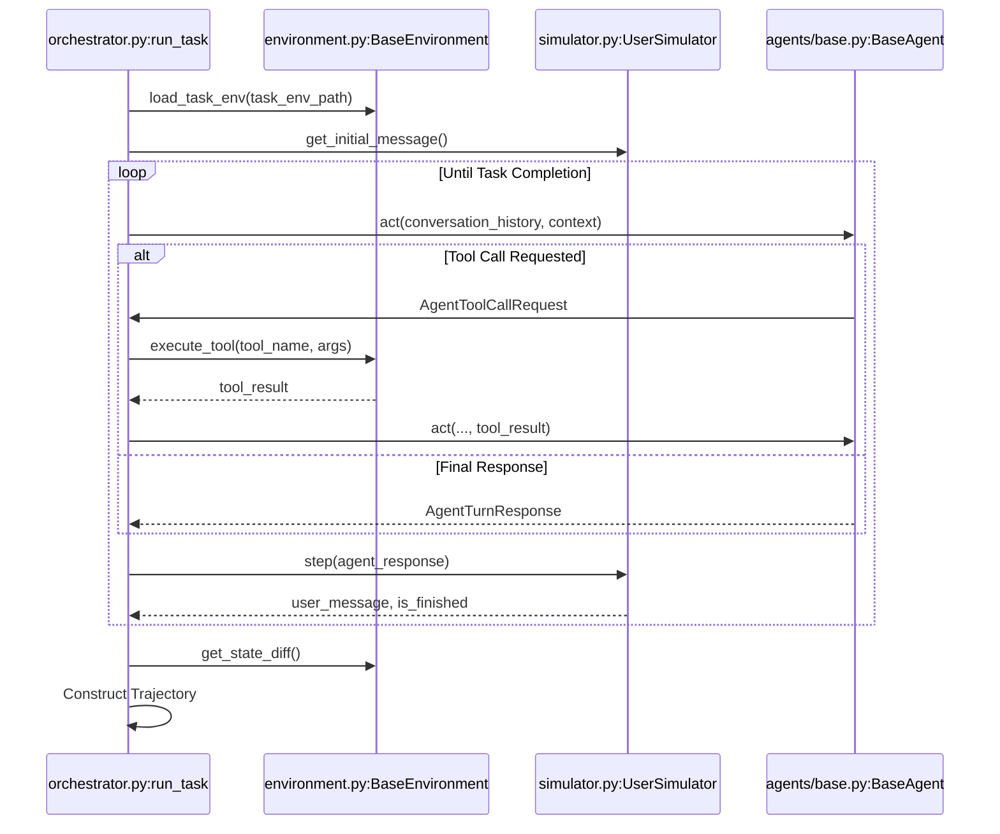
**Sources:** [state_bench/orchestrator.py:45-120](), [state_bench/schemas.py:150-200]()

---

## CLI Entry Points

STATE-Bench provides two main scripts for triggering execution: `run_task.py` for single-task debugging and `run_batch.py` for large-scale benchmarking.

### `run_task.py`
Used to execute a single `TaskDefinition`. It is ideal for developers testing a specific agent's behavior on a difficult task.
-   **Input**: A path to a task JSON file.
-   **Output**: A directory containing `trajectory.json`, which includes the full conversation and final state.

### `run_batch.py`
The primary tool for generating benchmark results. It processes multiple tasks in parallel using a thread pool.
-   **Concurrency**: Uses `ThreadPoolExecutor` to run multiple tasks simultaneously across different agent instances.
-   **Resilience**: Implements error handling per task so that a single agent crash does not terminate the entire batch.
-   **Output**: Creates a structured output directory organized by `domain/task_id`.

| Script | Purpose | Key Arguments |
| :--- | :--- | :--- |
| `run_task.py` | Single task execution/debug | `--task-path`, `--agent-type`, `--output-dir` |
| `run_batch.py` | Full benchmark run | `--protocol-id`, `--split`, `--concurrency` |

**Sources:** [run_task.py:1-50](), [run_batch.py:1-80]()

---

## Trajectory Production and StateDiff

The ultimate output of the orchestrator is a `Trajectory` object (defined in `state_bench/schemas.py`). This object is a complete record of the execution, which is later used by the `Evaluation Pipeline`.

### Trajectory Components
1.  **Conversation**: A list of messages between the User, Agent, and System (tools).
2.  **StateDiff**: A record of how the environment entities (e.g., flight bookings, shopping carts) changed from the start to the end of the task.
3.  **Efficiency Metrics**: Captured during execution, including:
    *   `turn_count`: Total number of interaction turns.
    *   `token_usage`: Aggregated tokens from the `LLMClient`.
    *   `wall_time`: Total execution time.

### State Requirement Matching
During `run_task()`, the orchestrator captures the environment state before and after execution. The `StateDiff` is generated by comparing these two snapshots. This diff is critical for the `scoring.py` module to verify if the agent correctly modified the environment (e.g., "Was the flight actually cancelled in the database?").

**Sources:** [state_bench/schemas.py:210-250](), [state_bench/orchestrator.py:130-155]()

---

# Page: Core Data Models and Schemas

# Core Data Models and Schemas

<details>
<summary>Relevant source files</summary>

The following files were used as context for generating this wiki page:

- [.gitignore](.gitignore)
- [CHANGELOG.md](CHANGELOG.md)

</details>


This page documents the domain-agnostic data structures that form the backbone of STATE-Bench. These schemas, primarily defined in `state_bench/schemas.py`, provide the standardized contracts for task definitions, execution trajectories, and evaluation results, ensuring interoperability between the orchestrator, user simulator, and scoring pipeline.

## Overview of Schema Architecture

The STATE-Bench data model is designed to decouple the benchmark engine from specific domain logic. It utilizes Pydantic for validation and serialization, facilitating consistent data flow from JSON task definitions to final performance metrics.

### Natural Language to Code Entity Mapping

The following diagram bridges high-level benchmark concepts to their specific implementations in the `state_bench/schemas.py` file.

**Diagram: Entity Mapping**
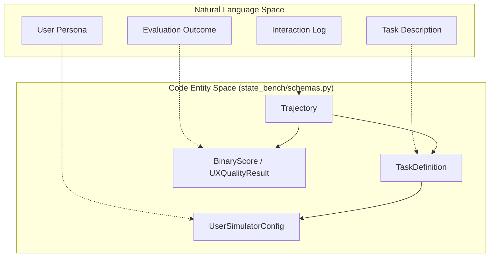
Sources: [state_bench/schemas.py:1-200]()

---

## Task and User Definitions

The execution of a benchmark starts with a `TaskDefinition`, which contains the ground truth requirements and the configuration for the user simulator.

### TaskDefinition
The `TaskDefinition` class [state_bench/schemas.py:102-114]() is the primary container for a benchmark instance.
*   **`task_id`**: A unique string identifier.
*   **`task_summary`**: A high-level description of the goal.
*   **`opening_message`**: The initial message sent by the simulated user to the agent.
*   **`user_simulator`**: An instance of `UserSimulatorConfig`.
*   **`state_requirements`**: A list of `StateRequirement` objects defining mandatory database/environment changes.
*   **`task_requirements`**: A list of strings defining semantic goals that must be met (judged by LLM).

### UserSimulatorConfig
The `UserSimulatorConfig` [state_bench/schemas.py:96-100]() defines the behavior of the `UserSimulator` during the `run_task()` loop.
*   **`system_prompt`**: The persona and instructions for the simulator.
*   **`max_turns`**: The maximum number of interaction cycles before the task is terminated.

Sources: [state_bench/schemas.py:96-114]()

---

## Execution and Trajectories

As an agent interacts with the environment, the system records every event into a `Trajectory`. This object is the source of truth for both debugging and scoring.

### Trajectory Structure
A `Trajectory` [state_bench/schemas.py:126-140]() captures the complete state of a task run.
*   **`task_id`**: Link to the original task.
*   **`steps`**: A list of `TrajectoryStep` objects, each containing the `Message` (agent or user) and any `ToolCall` or `ToolResult`.
*   **`final_state_diff`**: A `StateDiff` representing the delta between the environment's initial and final states.
*   **`efficiency_metrics`**: A summary of resource usage.

### StateDiff and Entity Changes
The `StateDiff` [state_bench/schemas.py:84-88]() and `EntityChange` [state_bench/schemas.py:76-82]() classes track deterministic changes in the environment.
*   **`created`**: New entities added during the task.
*   **`updated`**: Changes to existing entities (storing `old_value` and `new_value`).
*   **`deleted`**: Entities removed from the environment.

**Diagram: Trajectory Data Flow**
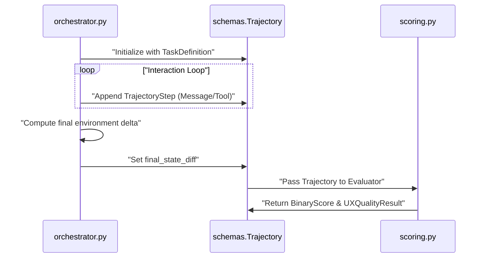
Sources: [state_bench/schemas.py:76-140]()

---

## Metrics and Evaluation Schemas

Evaluation results are divided into deterministic performance, semantic correctness, and user experience quality.

### Efficiency and Usage
*   **`TokenUsage`** [state_bench/schemas.py:10-15](): Tracks `prompt_tokens`, `completion_tokens`, and total `cost`.
*   **`EfficiencyMetrics`** [state_bench/schemas.py:116-124](): Aggregates `total_turns`, `total_tool_calls`, and `TokenUsage` for a specific run.

### Scoring Results
*   **`BinaryScore`** [state_bench/schemas.py:142-146](): A simple boolean `passed` flag with an accompanying `reason`. Used for both State and Task requirements.
*   **`UXQualityResult`** [state_bench/schemas.py:148-154](): A multi-dimensional assessment of the agent's interaction quality:
    *   `user_control`: Did the agent respect user preferences?
    *   `user_effort`: Did the agent minimize unnecessary user input?
    *   `response_density`: Was the information provided concise and relevant?
    *   `score`: A normalized float value (0.0 to 1.0).

Sources: [state_bench/schemas.py:10-15](), [state_bench/schemas.py:116-154]()

---

## Serialization Contracts

All schemas inherit from Pydantic's `BaseModel` (or are standard dataclasses), ensuring that they can be serialized to JSON via `.model_dump()` or `.json()`. The orchestrator uses these contracts to save the output of every run into the `outputs/` directory, which is later consumed by the `compute_metrics.py` script.

| Class | JSON File Target | Purpose |
| :--- | :--- | :--- |
| `Trajectory` | `trajectory.json` | Full log of the agent-user interaction. |
| `StateDiff` | Part of `trajectory.json` | Detailed environment changes for state validation. |
| `UXQualityResult` | `ux_score.json` | LLM-judge assessment of interaction quality. |

Sources: [state_bench/schemas.py:1-160]()

---

# Page: LLM Client Layer

# LLM Client Layer

<details>
<summary>Relevant source files</summary>

The following files were used as context for generating this wiki page:

- [.env.example](.env.example)
- [.gitignore](.gitignore)

</details>


The LLM Client Layer provides a unified interface for interacting with Large Language Models (LLMs) across different providers and authentication schemes. It is designed to handle the complexities of benchmarking, such as rate limiting, content filtering, and load balancing across multiple deployments.

## Purpose and Scope

The LLM Client Layer, primarily implemented in `state_bench/client.py`, abstracts the underlying API calls to OpenAI and Azure OpenAI. It ensures that the benchmark orchestrator and agents can interact with models using a consistent interface while providing robust error handling and resource management.

### Key Responsibilities
- **Authentication**: Supports API keys, Azure CLI tokens, and `DefaultAzureCredential`.
- **Resilience**: Implements exponential backoff and retry logic for transient failures and rate limits.
- **Load Balancing**: Distributes requests across a pool of model deployments using a "least-busy" routing strategy.
- **Content Filtering**: Detects and handles provider-specific content filter triggers.

---

## Class Hierarchy and Core Entities

The client layer follows an inheritance-based structure to support both single-endpoint and pooled-endpoint configurations.

### BaseLLMClient
`BaseLLMClient` is the abstract base class that defines the contract for all LLM clients within STATE-Bench. It requires subclasses to implement the `generate()` method.

[state_bench/client.py:27-44]()

### LLMClient
`LLMClient` is the concrete implementation for interacting with a single LLM endpoint. It encapsulates the OpenAI/Azure OpenAI client initialization and the core generation logic.

[state_bench/client.py:47-213]()

### PooledLLMClient
`PooledLLMClient` manages a collection of `LLMClient` instances. It is used to overcome rate limits by spreading requests across multiple Azure OpenAI deployments or OpenAI models.

[state_bench/client.py:216-291]()

### LLM Client Entity Relationship
The following diagram illustrates how these entities relate to the `StateBenchAgent` and the `UserSimulator`.

**Client Architecture Overview**
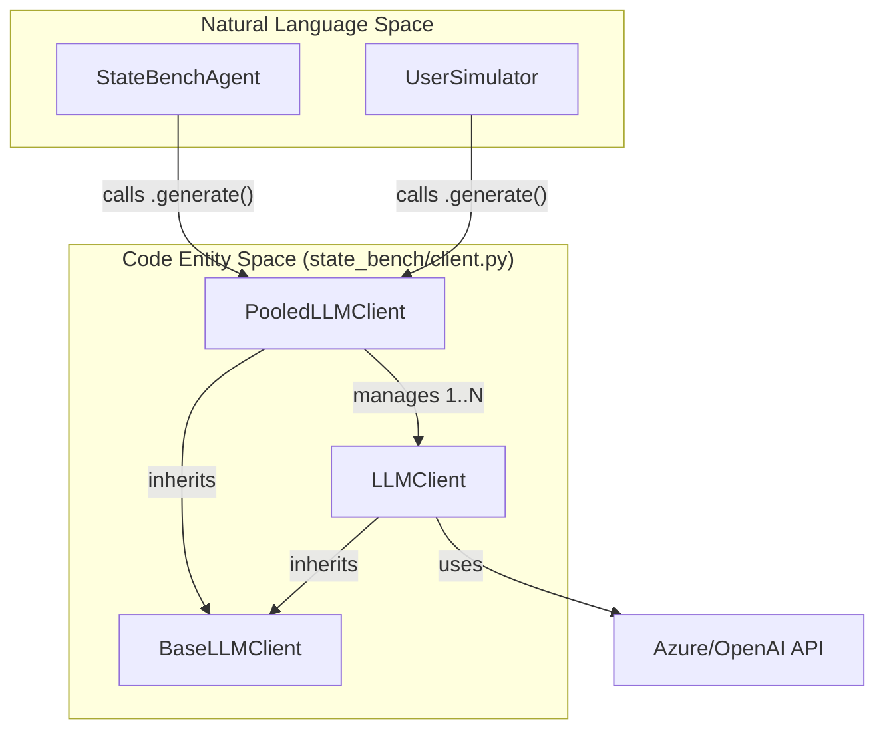
Sources: [state_bench/client.py:27-291](), [state_bench/simulator.py:12-14](), [state_bench/agents/state_bench.py:35-40]()

---

## Authentication Strategies

The client layer supports flexible authentication to accommodate different environment setups. Authentication is handled during the initialization of `LLMClient`.

| Strategy | Implementation Detail | Source |
| :--- | :--- | :--- |
| **API Key** | Uses `api_key` provided in constructor or environment variables like `STATE_BENCH_EVAL_API_KEY`. | [state_bench/client.py:76-80]() |
| **Azure CLI Token** | Attempts to fetch a token via `AzureCliCredential` if no key is provided. | [state_bench/client.py:84-90]() |
| **Default Azure Credential** | Fallback to `DefaultAzureCredential` for managed identities or other environment-based auth. | [state_bench/client.py:91-96]() |

Sources: [state_bench/client.py:73-100]()

---

## LeastBusyPool Routing Mechanism

`PooledLLMClient` implements a routing strategy to optimize throughput and minimize 429 (Too Many Requests) errors. 

1. **Tracking**: Each `LLMClient` within the pool maintains an internal `_active_requests` counter.
2. **Selection**: When `generate()` is called on the pool, it selects the client with the lowest number of active requests.
3. **Execution**: The request is dispatched to the chosen client, incrementing its counter, and decrementing it upon completion (success or failure).

**Routing Logic Flow**
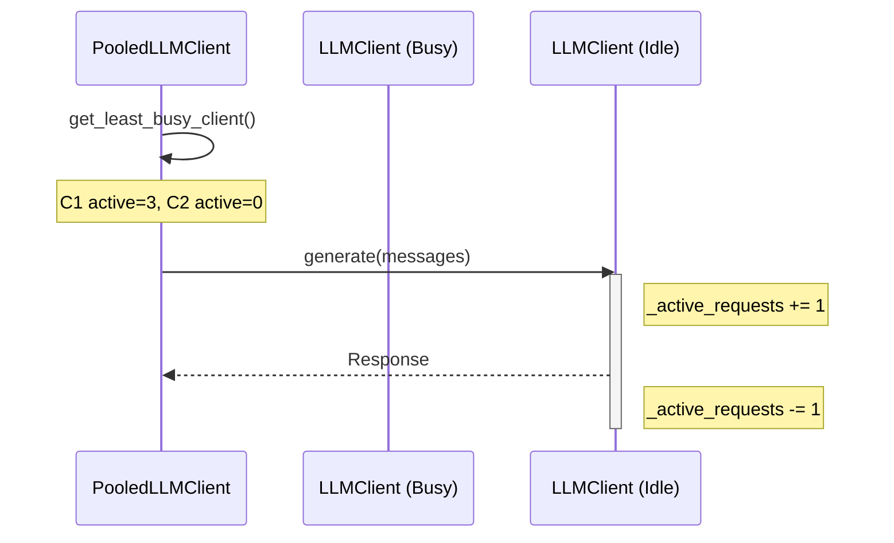
Sources: [state_bench/client.py:216-285]()

---

## Retry Logic and Content Filters

The `LLMClient.generate()` method contains a robust retry loop wrapped in a `tenacity` decorator.

### Retry Behavior
- **Retriable Errors**: It retries on `RateLimitError` and generic `APIError`.
- **Backoff**: Uses exponential backoff with a maximum of 10 attempts.
- **Content Filters**: If a request is blocked by Azure OpenAI's content management system, the client catches the exception and returns a specific string: `"I cannot answer that due to content filters."`. This prevents the benchmark from crashing when encountering sensitive generated content.

[state_bench/client.py:126-213]()

### Token Usage Tracking
The client tracks token consumption (prompt, completion, and total) for every call. These metrics are returned as part of the `generate` response and are eventually aggregated into the `EfficiencyMetrics` schema.

[state_bench/client.py:195-202]()

Sources: [state_bench/client.py:126-213](), [state_bench/schemas.py:145-155]()

---

## Configuration via Environment Variables

The clients are typically instantiated using values from the `.env` file. The `STATE-Bench` uses two primary client configurations:

1.  **Evaluation Client**: Locked to the GPT-5.4 protocol for the user simulator and judges.
    -   `STATE_BENCH_EVAL_ENDPOINT`
    -   `STATE_BENCH_EVAL_DEPLOYMENTS` (Comma-separated for pooling)
2.  **Agent Client**: The model being benchmarked.
    -   `STATE_BENCH_AGENT_ENDPOINT`
    -   `STATE_BENCH_AGENT_DEPLOYMENTS`

Sources: [.env.example:6-28]()

---

# Page: User Simulator

# User Simulator

<details>
<summary>Relevant source files</summary>

The following files were used as context for generating this wiki page:

- [.env.example](.env.example)
- [CHANGELOG.md](CHANGELOG.md)

</details>


The **User Simulator** is a critical component of the STATE-Bench orchestration loop. It acts as the conversational counterpart to the agent under test, simulating a human user based on a specific persona, goal, and set of constraints defined in the task configuration. Unlike static datasets, the User Simulator generates responses dynamically, allowing it to react to the agent's specific questions, tool outputs, and conversational style.

### Purpose and Implementation

The `UserSimulator` class, defined in `state_bench/simulator.py`, encapsulates the logic for interacting with a Large Language Model (LLM) to simulate user behavior. It maintains the persona of the user and ensures that the simulated dialogue remains grounded in the task's requirements.

#### Key Responsibilities:
1.  **Context Management**: Constructing a system prompt that combines domain-specific instructions with task-specific user goals [state_bench/simulator.py:15-38]().
2.  **History Formatting**: Converting the growing conversation trajectory into a format compatible with the LLM client [state_bench/simulator.py:40-52]().
3.  **Response Generation**: Invoking the LLM to produce the next user turn while adhering to the "persona" [state_bench/simulator.py:54-72]().

---

### System Architecture and Data Flow

The User Simulator bridges the gap between the static **Task Definition** (Code Entity Space) and the dynamic **Conversation** (Natural Language Space). It transforms structured JSON configurations into a prompt-driven LLM persona.

**Diagram: User Simulator Data Flow**
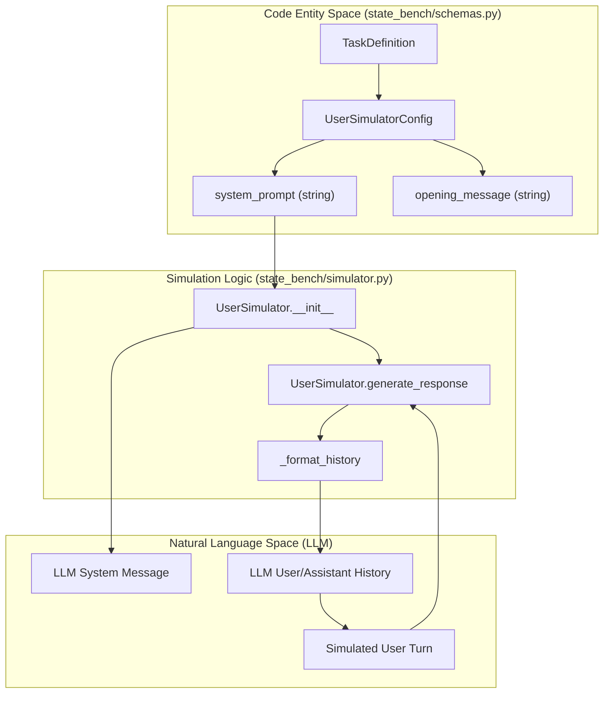
**Sources:** [state_bench/simulator.py:15-72](), [state_bench/schemas.py:45-60]()

---

### Implementation Details

#### 1. Initialization and System Prompting
When the `Orchestrator` initializes a `UserSimulator`, it passes a `UserSimulatorConfig`. The simulator constructs a permanent system prompt that defines the user's personality and objective. This prompt typically includes:
*   The user's specific goal (e.g., "Change my flight to London").
*   Constraint information (e.g., "I cannot travel before 10 AM").
*   Behavioral instructions (e.g., "Be polite but firm").

#### 2. History Formatting
The `UserSimulator` must present the conversation to the LLM from the user's perspective. This involves a "role reversal" where the Agent's messages are treated as "Assistant" turns and the Simulator's own previous messages are treated as "User" turns.

| Function | Role | Logic |
| :--- | :--- | :--- |
| `_format_history` | Context Builder | Iterates through the `Trajectory` and maps `Message` objects to LLM roles. |
| `generate_response` | Execution | Calls the `BaseLLMClient` with the formatted history and system prompt. |

**Diagram: Role Mapping in state_bench/simulator.py**
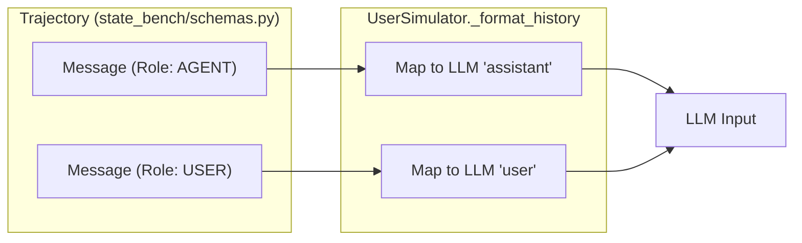
**Sources:** [state_bench/simulator.py:40-52](), [state_bench/schemas.py:80-95]()

---

### Configuration and Environment

The User Simulator is governed by the **Locked Evaluation Protocol**. To ensure reproducibility and fair comparison across different agents, the simulator must run on a specific model version defined by the benchmark.

*   **Model Requirement**: As of version `0.7.0`, the canonical evaluation protocol requires **GPT-5.4** for the User Simulator [CHANGELOG.md:6-7]().
*   **Environment Variables**: The simulator uses the `STATE_BENCH_EVAL_ENDPOINT` and `STATE_BENCH_EVAL_DEPLOYMENTS` to route requests to the locked evaluation resource [.env.example:9-10]().

### Key Functions

#### `UserSimulator.generate_response(trajectory: Trajectory) -> str`
This is the primary entry point used by the `run_task` loop in `orchestrator.py`.
1.  It takes the current `Trajectory` containing all turns so far [state_bench/simulator.py:54]().
2.  It calls `_format_history` to prepare the messages [state_bench/simulator.py:56]().
3.  It invokes the `LLMClient` to generate the next string of text [state_bench/simulator.py:58-65]().
4.  It returns the raw string which is then wrapped in a `Message` object by the orchestrator [state_bench/simulator.py:72]().

**Sources:** [state_bench/simulator.py:1-75](), [.env.example:1-12](), [CHANGELOG.md:1-8]()

---

# Page: Agent Interface

# Agent Interface

<details>
<summary>Relevant source files</summary>

The following files were used as context for generating this wiki page:

- [.env.example](.env.example)
- [README.md](README.md)

</details>


The **Agent Interface** defines the contract between the STATE-Bench benchmark harness and the AI agents being evaluated. This interface is designed to be provider-agnostic, allowing for the evaluation of diverse agent architectures—ranging from simple zero-shot models to complex systems with long-term memory and specialized tool-calling loops.

The benchmark orchestrator interacts with agents through a standardized lifecycle: initializing the agent with a `TaskDefinition`, invoking it for each turn in a conversation, and providing hooks for the agent to ingest trajectories or retrieve learned information.

### Agent-Orchestrator Interaction Flow
The following diagram illustrates how the `Orchestrator` in `state_bench/orchestrator.py` manages the interaction between the `UserSimulator` and the `BaseAgent` implementation.

**Orchestrator Execution Loop**
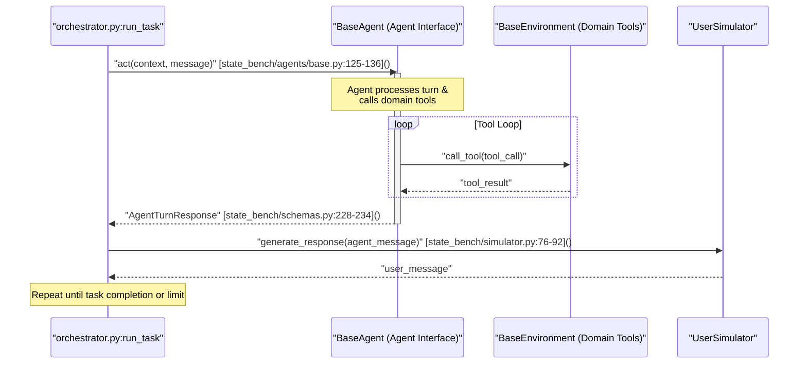
**Sources:** [state_bench/orchestrator.py:75-150](), [state_bench/agents/base.py:125-136](), [state_bench/schemas.py:228-234]()

---

### Key Components

The interface is structured around three primary pillars that allow the benchmark to remain decoupled from specific LLM providers or agent frameworks.

| Component | Code Entity | Role |
| :--- | :--- | :--- |
| **Abstract Base** | `BaseAgent` | Defines the required `act()` and `generate_next_turn()` methods. |
| **Runtime Context** | `AgentRuntimeContext` | Provides the agent with task metadata, available tools, and retrieval hooks. |
| **Response Schema** | `AgentTurnResponse` | Standardizes how agents return text and tool calls to the orchestrator. |

#### 1. BaseAgent Interface
The `BaseAgent` class in `state_bench/agents/base.py` is the foundation of the interface. It includes abstract methods for turn generation and optional hooks for the **Agent Learning Track**, such as `ingest_trajectory` and `prepare_conversation`. 

For details on the abstract methods and memory hooks, see **[BaseAgent Interface](#3.1)**.

#### 2. Built-in StateBenchAgent
STATE-Bench provides a reference implementation, `StateBenchAgent`, located in `state_bench/agents/state_bench.py`. This agent implements a robust tool-calling loop using the `Responses API` and integrates with the `PooledLLMClient` for high-throughput evaluation. It serves as the default agent for the **Main Track**.

For details on the built-in agent's logic and configuration, see **[Built-in StateBenchAgent](#3.2)**.

#### 3. Custom Agents and Clients
To evaluate third-party agents (e.g., those built with LangChain, AutoGen, or proprietary frameworks), developers can implement custom subclasses of `BaseAgent`. The `state_bench/agents/loader.py` utility dynamically loads these implementations at runtime based on CLI arguments.

For a guide on implementing your own agent or LLM client, see **[Custom Agents and Clients](#3.3)**.

---

### Data Flow: From Code Entities to Benchmark Space
This diagram maps the internal code entities to their functional roles within the benchmark's execution space.

**Entity Mapping**
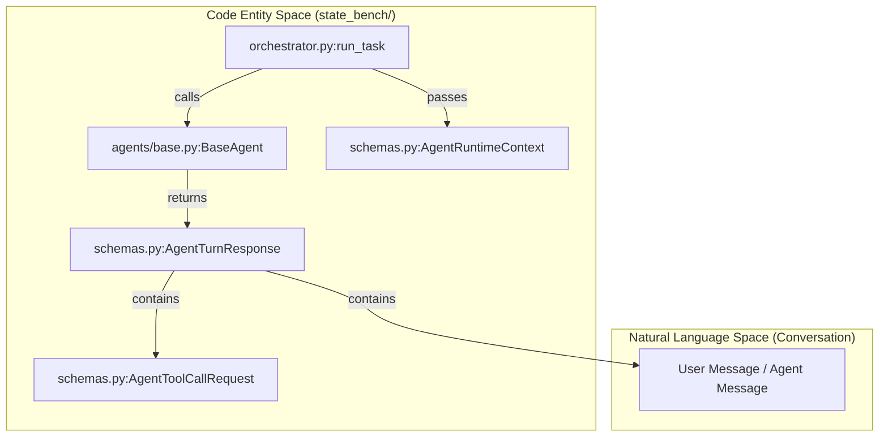
**Sources:** [state_bench/orchestrator.py:75-150](), [state_bench/agents/base.py:20-150](), [state_bench/schemas.py:200-250]()

### Summary of Child Pages

*   **[BaseAgent Interface](#3.1)**: Deep dive into the abstract class, runtime context, and the lifecycle methods (`act`, `prepare_conversation`, `ingest_trajectory`).
*   **[Built-in StateBenchAgent](#3.2)**: Detailed breakdown of the default agent implementation, including its tool-calling loop and reasoning effort settings.
*   **[Custom Agents and Clients](#3.3)**: Instructions for extending the benchmark with new model providers or custom agentic architectures.

---

# Page: BaseAgent Interface

# BaseAgent Interface

<details>
<summary>Relevant source files</summary>

The following files were used as context for generating this wiki page:

- [.env.example](.env.example)
- [.gitignore](.gitignore)

</details>


The `BaseAgent` interface defines the standard contract for all agent implementations within STATE-Bench. It provides a structured way for the orchestrator to interact with agents, manage conversation state, handle tool calls, and report performance metrics such as token usage and costs.

## Core Data Structures

The interface relies on several key dataclasses and TypedDicts to ensure type safety and consistent data flow between the agent and the `state_bench.orchestrator.run_task` loop [[state_bench/agents/base.py:11-75]]().

### AgentToolCallRequest
Represents a request from the agent to execute a tool.
- `id`: A unique identifier for the tool call.
- `name`: The name of the tool to be invoked.
- `arguments`: A JSON-encoded string or dictionary of arguments.

### AgentTurnResponse
The object returned by the agent after a turn.
- `message`: The natural language response to the user (optional if tool calls are present).
- `tool_calls`: A list of `AgentToolCallRequest` objects.
- `thought`: Internal reasoning or "chain of thought" from the agent (optional).

### AgentRuntimeContext
Provides the agent with metadata about the current execution environment.
- `task_id`: The unique ID of the task being executed.
- `domain`: The domain name (e.g., `travel`, `shopping_assistant`).
- `session_id`: A unique identifier for the specific run session.

Sources: [[state_bench/agents/base.py:11-75]]()

---

## The BaseAgent Abstract Class

The `BaseAgent` class is an abstract base class (ABC) that every agent must inherit from. It defines the lifecycle and execution methods required by the benchmark [[state_bench/agents/base.py:78-220]]().

### The act() vs generate_next_turn() Duality
The interface provides two ways to generate responses, allowing for different levels of control over the tool-calling loop:

1.  **`act()`**: The high-level entry point called by the orchestrator [[state_bench/agents/base.py:118-135]](). By default, it calls `generate_next_turn()`. Agents can override `act()` if they wish to manage their own internal loops (e.g., multi-step reasoning before returning to the orchestrator).
2.  **`generate_next_turn()`**: The core abstract method that must be implemented by subclasses [[state_bench/agents/base.py:137-151]](). it receives the current conversation history and the `AgentRuntimeContext`.

### Memory and Learning Hooks
To support the **Agent Learning Track**, `BaseAgent` includes hooks for memory management and trajectory ingestion:

| Method | Purpose |
| :--- | :--- |
| `prepare_conversation` | Modifies or augments the conversation history (e.g., injecting RAG context) before it is sent to the LLM [[state_bench/agents/base.py:153-164]](). |
| `ingest_trajectory` | Allows the agent to learn from a completed task trajectory, storing successful patterns or correcting failures [[state_bench/agents/base.py:166-177]](). |
| `memory_tool_schemas` | Returns JSON schemas for tools the agent uses to manage its own memory [[state_bench/agents/base.py:100-107]](). |
| `memory_tool_handlers` | Provides the callable implementations for the memory tools [[state_bench/agents/base.py:109-116]](). |

### Token and Cost Reporting
Agents are responsible for tracking their own resource consumption. The orchestrator calls these methods at the end of a task to compile `EfficiencyMetrics` [[state_bench/agents/base.py:183-220]]().

- `get_total_tokens()`: Returns total tokens used.
- `get_total_cost()`: Returns total USD cost.
- `get_incremental_metrics()`: Returns usage since the last reset.
- `reset_metrics()`: Clears the internal counters.

Sources: [[state_bench/agents/base.py:78-220]]()

---

## Interaction Flow: Orchestrator to Agent

The following diagram illustrates how the `Orchestrator` (Natural Language Space) interacts with the `BaseAgent` implementation (Code Entity Space) during a single task turn.

**Agent Execution Logic Flow**
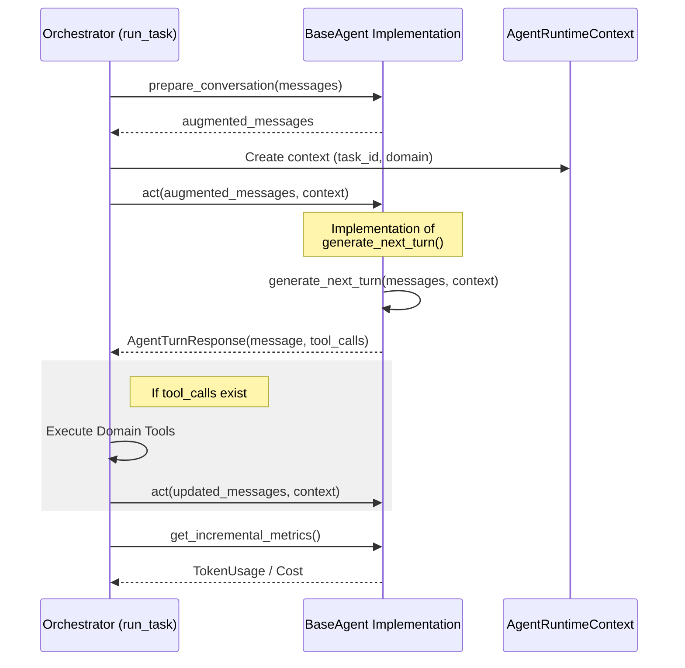
Sources: [[state_bench/agents/base.py:118-151]](), [[state_bench/agents/base.py:183-200]]()

---

## Data Mapping: Interface to Orchestrator

This diagram maps the code entities defined in `base.py` to the data flow within the benchmarking environment.

**Code Entity to Data Flow Mapping**
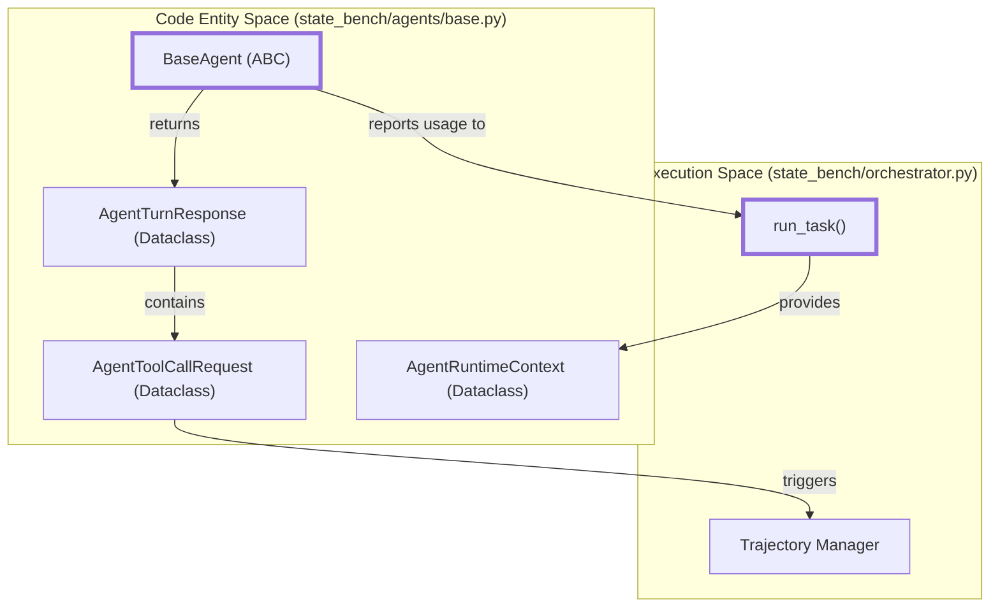
Sources: [[state_bench/agents/base.py:11-75]](), [[state_bench/agents/base.py:78-98]]()

---

## Implementation Requirements

When implementing a custom agent (e.g., in `state_bench/agents/custom_agent.py`), the following rules apply:

1.  **Context Awareness**: The agent should use the `AgentRuntimeContext` to adjust behavior based on the `domain` (e.g., applying different system prompts for `travel` vs `shopping_assistant`) [[state_bench/agents/base.py:65-75]]().
2.  **Statelessness vs. Statefulness**: While the `BaseAgent` instance can maintain state (like token counts), the conversation history is passed explicitly in every `act()` call. Agents using long-term memory should use the `ingest_trajectory` hook to persist data between tasks [[state_bench/agents/base.py:166-177]]().
3.  **Tool Handling**: Agents do not execute domain tools themselves. They return `AgentToolCallRequest` objects, and the orchestrator handles the execution and appends the results to the conversation history [[state_bench/agents/base.py:34-47]]().

Sources: [[state_bench/agents/base.py:11-75]](), [[state_bench/agents/base.py:166-177]]()

---

# Page: Built-in StateBenchAgent

# Built-in StateBenchAgent

<details>
<summary>Relevant source files</summary>

The following files were used as context for generating this wiki page:

- [.env.example](.env.example)
- [CHANGELOG.md](CHANGELOG.md)

</details>


The `StateBenchAgent` is the default agent implementation provided by STATE-Bench. It is designed as a versatile, "no-memory" agent that interacts with the benchmark environment using a tool-calling loop. It serves as the primary baseline for the **Main Track** and can be extended with retrieved learnings for the **Agent Learning Track**.

## Overview and Purpose

The `StateBenchAgent` implements the `BaseAgent` interface to provide a standard execution flow for benchmark tasks. Unlike custom agents that might maintain internal state across different tasks, this agent is stateless by default, relying entirely on the conversation history provided during a single task execution.

Key capabilities include:
- **Tool-Calling Loop**: Native support for the LLM "Responses API" to handle multi-step reasoning and tool invocation.
- **Learning Integration**: Ability to inject domain-specific "learnings" (e.g., policy summaries or few-shot examples) into the system prompt.
- **Model Pinning**: Uses a `PooledLLMClient` to manage API requests, supporting both Azure OpenAI and OpenAI providers.
- **Reasoning Control**: Supports the `agent_reasoning_effort` parameter for models that utilize internal reasoning chains (e.g., o1-series).

Sources: [state_bench/agents/state_bench.py:1-25](), [state_bench/agents/base.py:12-45]()

---

## Architecture and Data Flow

The `StateBenchAgent` operates within the `Orchestrator`'s task loop. When `act()` is called, the agent determines whether to send a message to the user or invoke a tool provided by the domain environment.

### Tool-Calling Logic

The agent utilizes a loop to process tool calls. If the LLM generates `tool_calls` in its response, the agent returns an `AgentTurnResponse` containing these requests. The orchestrator executes the tools and passes the results back to the agent in the next turn.

### Retrieval of Learnings

For the Agent Learning Track, the agent can be configured to retrieve "learnings" from a provided dataset or memory store. These learnings are typically formatted as text and prepended to the system prompt to guide the agent's behavior based on past trajectories.

### Logic Flow Diagram

The following diagram illustrates the interaction between the `StateBenchAgent`, the `PooledLLMClient`, and the `Orchestrator`.

"StateBenchAgent Logic Flow"
```mermaid
sequenceDiagram
    participant O as "Orchestrator (orchestrator.py)"
    participant A as "StateBenchAgent (state_bench.py)"
    participant C as "PooledLLMClient (client.py)"
    participant E as "Environment Tools"

    O->>A: "act(AgentRuntimeContext)"
    A->>A: "prepare_conversation()"
    A->>A: "retrieve_learnings() (if enabled)"
    A->>C: "generate_response(messages, tools)"
    C-->>A: "LLM Response (Content or Tool Calls)"
    
    alt "Has Tool Calls"
        A-->>O: "AgentTurnResponse(tool_calls=...)"
        O->>E: "Execute Tools"
        E-->>O: "Tool Results"
        O->>A: "act() with Tool Results"
    else "Has Message Content"
        A-->>O: "AgentTurnResponse(message=...)"
    end
```
Sources: [state_bench/agents/state_bench.py:40-110](), [state_bench/orchestrator.py:50-85]()

---

## Key Components and Implementation

### 1. Initialization and Configuration
The agent is initialized via the `StateBenchAgent` class. It requires a `PooledLLMClient` and configuration parameters defined in the environment or task metadata.

- **LLM Client Pinning**: The agent is bound to a specific `LLMClient` instance (configured via `STATE_BENCH_AGENT_ENDPOINT` or `STATE_BENCH_AGENT_PROVIDER`).
- **Reasoning Effort**: The `agent_reasoning_effort` parameter (low, medium, high) is passed to the LLM client to control the computational budget for reasoning-heavy models.

### 2. System Prompt Construction
The agent constructs its identity using a combination of:
1. **Domain Policy**: The specific rules of the environment (e.g., travel cancellation policies).
2. **Task Instructions**: The high-level goal provided in the `TaskDefinition`.
3. **Learnings**: Optional context retrieved from the `retrieve_learnings` method.

### 3. State Management
The `StateBenchAgent` is "no-memory" in the sense that it does not persist information *between* different benchmark tasks unless the `ingest_trajectory` hook is explicitly used to update a learning database. Within a single task, the full `AgentRuntimeContext.history` is used to maintain context.

"Class Relationships"
```mermaid
classDiagram
    class "BaseAgent" {
        <<abstract>>
        +act(context: AgentRuntimeContext)
    }
    class "StateBenchAgent" {
        -client: PooledLLMClient
        -reasoning_effort: str
        +act(context: AgentRuntimeContext)
        +retrieve_learnings(task_id: str)
    }
    class "AgentRuntimeContext" {
        +history: List[Message]
        +tools: List[ToolDefinition]
        +metadata: Dict
    }
    
    "BaseAgent" <|-- "StateBenchAgent"
    "StateBenchAgent" ..> "AgentRuntimeContext" : "consumes"
    "StateBenchAgent" --> "PooledLLMClient" : "uses"
```
Sources: [state_bench/agents/state_bench.py:15-60](), [state_bench/agents/base.py:50-75](), [state_bench/client.py:100-130]()

---

## Configuration via Environment Variables

The behavior of the `StateBenchAgent` is largely governed by environment variables defined in the `.env` file. These settings determine which model the agent uses and how it authenticates.

| Variable | Description |
| :--- | :--- |
| `STATE_BENCH_AGENT_ENDPOINT` | The Azure OpenAI resource URL for the agent. |
| `STATE_BENCH_AGENT_DEPLOYMENTS` | Comma-separated list of deployment names for the agent's LLM. |
| `STATE_BENCH_AGENT_PROVIDER` | Set to `openai` to use the standard OpenAI API instead of Azure. |
| `STATE_BENCH_AGENT_MODEL` | The model name (e.g., `gpt-4o`) when using the OpenAI provider. |
| `STATE_BENCH_AGENT_REASONING_EFFORT` | Sets the `reasoning_effort` parameter for compatible models. |

Sources: [.env.example:14-29](), [state_bench/agents/state_bench.py:30-45]()

---

## Integration with Learning Track

In the **Agent Learning Track**, the `StateBenchAgent` is extended to utilize the `retrieve_learnings` method. 

1. **Ingestion**: After a training task completes, `ingest_trajectory()` is called to process the resulting trajectory.
2. **Retrieval**: During a test task, `retrieve_learnings()` queries the stored data to find relevant experiences.
3. **Augmentation**: The retrieved content is injected into the `AgentRuntimeContext` before the first call to `act()`, allowing the agent to "learn" from previous mistakes or successful patterns.

Sources: [state_bench/agents/state_bench.py:120-150](), [state_bench/agents/base.py:80-95]()

---

# Page: Custom Agents and Clients

# Custom Agents and Clients

<details>
<summary>Relevant source files</summary>

The following files were used as context for generating this wiki page:

- [.env.example](.env.example)
- [CONTRIBUTING.md](CONTRIBUTING.md)

</details>


The STATE-Bench framework is designed to be extensible, allowing researchers and developers to evaluate any agentic system or LLM provider. This is achieved through two primary extension points: **Custom Clients** (subclassing `BaseLLMClient`) for connecting to new model providers, and **Custom Agents** (subclassing `BaseAgent`) for implementing complex agent logic, memory systems, or specialized tool-calling loops.

### Extension Architecture

The framework supports a modular directory structure for extensions. While core implementations reside within the `state_bench/` package, users can provide custom implementations via the `agents/` and `clients/` directories at the project root.

#### Data Flow and Component Interaction

The following diagram illustrates how the `AgentLoader` instantiates custom components and how they interact during a task execution.

**Component Loading and Interaction Flow**
```mermaid
graph TD
    subgraph "Extension Space"
        CA["CustomAgent (BaseAgent)"]
        CC["CustomClient (BaseLLMClient)"]
    end

    subgraph "Core Space"
        AL["AgentLoader (state_bench/agents/loader.py)"]
        OR["Orchestrator (state_bench/orchestrator.py)"]
        SBA["StateBenchAgent (state_bench/agents/state_bench.py)"]
    end

    AL -- "1. Scans agents/ & clients/" --> CA
    AL -- "2. Instantiates" --> CA
    OR -- "3. Calls act()" --> CA
    CA -- "4. Calls generate_next_turn()" --> CC
    CC -- "5. Returns Response" --> CA
    CA -- "6. Returns AgentTurnResponse" --> OR
```
Sources: `[state_bench/agents/loader.py:1-50]()`, `[state_bench/orchestrator.py:1-100]()`

---

### Custom Clients (`BaseLLMClient`)

To support a third-party LLM provider (e.g., Anthropic, Cohere, or a local Llama instance), you must implement a subclass of `BaseLLMClient`.

#### Implementation Contract
A custom client must implement the `generate_next_turn` method. This method is responsible for:
1.  **Format Conversion**: Translating the `list[dict[str, Any]]` conversation history into the provider's specific schema.
2.  **API Invocation**: Sending the request to the provider.
3.  **Token/Cost Reporting**: Extracting usage metadata from the provider's response and returning it in a standardized format.

#### Key Methods and Properties
*   `generate_next_turn(...)`: The primary execution hook. It receives the conversation, tools, and sampling parameters.
*   `cost_per_1k_tokens`: A property used by the orchestrator to calculate the financial efficiency of the agent.

Sources: `[state_bench/client.py:1-80]()`

---

### Custom Agents (`BaseAgent`)

Custom agents allow for the evaluation of architectures that go beyond simple prompting, such as those involving RAG, long-term memory, or multi-step reasoning.

#### The `BaseAgent` Interface
Every agent must inherit from `BaseAgent` and implement the core interaction loop.

| Method | Role |
| :--- | :--- |
| `act()` | The high-level entry point called by the Orchestrator for every turn. |
| `generate_next_turn()` | The low-level LLM call, often wrapping a `BaseLLMClient`. |
| `ingest_trajectory()` | (Optional) Used in the **Agent Learning Track** to update agent state from previous runs. |
| `prepare_conversation()` | (Optional) Hook to inject system prompts or memory before a task starts. |

#### Agent Runtime Context
Agents receive an `AgentRuntimeContext` during initialization. This object provides access to:
*   **Environment Metadata**: The current domain and task ID.
*   **Client Pool**: Access to the configured `LLMClient` instances.
*   **Memory Configuration**: Settings for learning and retrieval.

**Agent-Client Interaction Logic**
```mermaid
sequenceDiagram
    participant O as Orchestrator
    participant A as CustomAgent (BaseAgent)
    participant C as CustomClient (BaseLLMClient)
    
    O->>A: act(messages, tools)
    activate A
    A->>A: prepare_conversation()
    A->>C: generate_next_turn(formatted_messages)
    activate C
    C-->>A: {content, tool_calls, usage}
    deactivate C
    A->>A: update_internal_state(usage)
    A-->>O: AgentTurnResponse(message, tool_calls)
    deactivate A
```
Sources: `[state_bench/agents/base.py:1-120]()`, `[state_bench/agents/state_bench.py:1-60]()`

---

### Loading and Registration

The `AgentLoader` dynamically imports custom classes based on the configuration provided in the CLI or environment variables.

1.  **Directory Discovery**: The loader looks into the `agents/` and `clients/` directories at the root of the repository.
2.  **Naming Convention**: Files should be named descriptively (e.g., `my_custom_agent.py`). The loader identifies classes that inherit from the base types.
3.  **Environment Configuration**: To use a custom agent, set the `STATE_BENCH_AGENT_TYPE` environment variable or use the `--agent-type` flag in `run_task.py`.

#### Example `.env` for Custom Components
```bash
# Point to a custom agent implementation in agents/my_agent.py
STATE_BENCH_AGENT_TYPE="MyCustomAgent"

# Point to a custom client implementation in clients/my_client.py
STATE_BENCH_AGENT_PROVIDER="custom_provider"
STATE_BENCH_AGENT_MODEL="my-model-v1"
```
Sources: `[.env.example:1-29]()`, `[state_bench/agents/loader.py:20-45]()`

---

### Cost and Token Reporting

To ensure fair comparison on the leaderboard, custom agents must accurately report their resource consumption.

1.  **Usage Extraction**: Inside `generate_next_turn`, capture `completion_tokens` and `prompt_tokens`.
2.  **Metric Aggregation**: The `BaseAgent` maintains an internal tally of these tokens.
3.  **Final Reporting**: At the end of a trajectory, the Orchestrator calls the agent's reporting methods to populate the `EfficiencyMetrics` schema, which includes:
    *   `total_tokens`
    *   `total_cost` (calculated via `cost_per_1k_tokens`)
    *   `inference_time_s`

Sources: `[state_bench/schemas.py:100-150]()`, `[state_bench/agents/base.py:80-100]()`

---

# Page: Evaluation Pipeline

# Evaluation Pipeline

<details>
<summary>Relevant source files</summary>

The following files were used as context for generating this wiki page:

- [.env.example](.env.example)
- [CHANGELOG.md](CHANGELOG.md)

</details>


The **Evaluation Pipeline** in STATE-Bench is a multi-stage process designed to rigorously score agent performance across three dimensions: functional state correctness, task requirement fulfillment, and user experience (UX) quality. Unlike simple string-matching benchmarks, STATE-Bench utilizes a combination of deterministic state diffing and LLM-based judging to evaluate complex, multi-turn trajectories.

The pipeline is governed by a strict **Evaluation Protocol** that locks the judge models and prompt versions to ensure reproducibility across different research environments.

### Pipeline Overview

The evaluation process typically follows the execution of a task batch and proceeds through three main phases:

1.  **Trajectory Scoring**: Individual trajectories are processed to identify state changes and evaluate qualitative requirements.
2.  **Judge Invocation**: The "Locked Evaluation Client" (configured via `STATE_BENCH_EVAL_ENDPOINT` [.env.example:9-10]()) uses a high-reasoning model (GPT-5.4) to assess task success and UX.
3.  **Metrics Aggregation**: Scores from individual tasks are aggregated into benchmark-wide metrics like Pass@1 and Pass^N.

#### The Scoring Workflow
The following diagram illustrates the transition from the **Natural Language Space** (agent/user dialogue) and **Code Entity Space** (state requirements and scoring logic).

```mermaid
graph TD
    subgraph "Natural Language Space"
        A["Trajectory (Conversation History)"]
        B["User Simulator Responses"]
    end

    subgraph "Code Entity Space"
        direction TB
        C["state_bench/scoring.py"]
        D["StateRequirement (Deterministic)"]
        E["TaskRequirement (LLM Judge)"]
        F["UXQuality (LLM Judge)"]
        G["EfficiencyMetrics"]
    end

    A --> C
    C --> D
    C --> E
    C --> F
    C --> G
    
    D --> H["Binary Score (State)"]
    E --> I["Binary Score (Task)"]
    F --> J["UX Score (0-10)"]
    G --> K["Resource Penalty"]
```
**Sources:** [state_bench/schemas.py:1-200](), [state_bench/scoring.py:1-100]()

---

### Evaluation Protocol
The `EvaluationProtocol` is the configuration backbone of the pipeline. It ensures that every evaluation run uses the exact same split manifests, judge models, and prompt hashes. This prevents "evaluator drift" where changes to the judge model or its instructions might artificially inflate scores.

*   **Locked Judge**: The protocol currently mandates GPT-5.4 as the judge model [CHANGELOG.md:6-7]().
*   **Manifests**: Defines which tasks belong to the `train`, `val`, and `test` splits for each domain.
*   **Validation**: The protocol validates the hashes of the prompts used by the User Simulator and the Judges.

For details, see [Evaluation Protocol](#4.1).

**Sources:** [state_bench/protocol.py:1-50](), [.env.example:6-12]()

---

### Scoring Components
Scoring is handled by the `state_bench/scoring.py` module, which decomposes an agent's performance into specific, measurable criteria.

| Component | Method | Description |
| :--- | :--- | :--- |
| **State Requirements** | Deterministic | Compares the final environment state against `StateDiff` assertions (e.g., "Was a booking created with the correct email?"). |
| **Task Requirements** | LLM Judge | Evaluates qualitative goals that aren't captured in the database, such as "Did the agent mention the cancellation fee?". |
| **UX Quality** | LLM Judge | Scores the interaction on a 0-10 scale based on `user_control`, `user_effort`, and `response_density`. |
| **Efficiency** | Formulaic | Calculates resource usage and applies penalties for excessive tool calls or token consumption. |

For details, see [Scoring: State Requirements, Task Requirements, and UX](#4.2).

**Sources:** [state_bench/scoring.py:120-250](), [state_bench/schemas.py:80-120]()

---

### Metrics Computation and Reporting
Once trajectories are scored, the `compute_metrics.py` script aggregates these results into a standardized `metrics.json` file. This script handles the statistical heavy lifting required for the leaderboard.

*   **Pass@1 and Pass^N**: Calculates the probability of success over single or multiple attempts.
*   **Cost Analysis**: Aggregates token usage and estimated API costs across the entire run.
*   **Domain Breakdown**: Provides per-domain (Travel, Shopping, Support) performance metrics.

For details, see [Metrics Computation and Reporting](#4.3).

**Sources:** [state_bench/scripts/compute_metrics.py:1-150]()

---

### System Integration Diagram
This diagram maps the evaluation concepts to the specific code entities that execute them.

```mermaid
graph LR
    subgraph "Evaluation Execution"
        SC["score.py (CLI)"]
        CM["compute_metrics.py (CLI)"]
    end

    subgraph "state_bench/scoring.py"
        SR["StateRequirement Class"]
        TR["TaskRequirement Class"]
        UX["UXQualityResult Class"]
    end

    subgraph "state_bench/protocol.py"
        EP["EvaluationProtocol Dataclass"]
        GS["gpt54.json (Config)"]
    end

    SC --> SR
    SC --> TR
    SC --> UX
    SC --> EP
    EP --> GS
    CM --> SC
```
**Sources:** [state_bench/scoring.py:1-50](), [state_bench/protocol.py:1-30](), [state_bench/scripts/compute_metrics.py:20-60]()

---

# Page: Evaluation Protocol

# Evaluation Protocol

<details>
<summary>Relevant source files</summary>

The following files were used as context for generating this wiki page:

- [.env.example](.env.example)
- [CHANGELOG.md](CHANGELOG.md)

</details>


The **Evaluation Protocol** defines the standardized configuration for running benchmarks within STATE-Bench. It ensures reproducibility by locking the versions of the user simulator, the scoring judge, and the specific task splits used for evaluation. The protocol is managed through the `EvaluationProtocol` dataclass and a JSON-based configuration system.

## Overview

To maintain a level playing field on the public leaderboard, all submissions must adhere to a specific `EvaluationProtocol`. This protocol dictates:
1.  **Model Locking**: The specific LLM deployment used for the `UserSimulator` and the `ScoringJudge` [state_bench/protocol.py:16-18]().
2.  **Split Manifests**: The exact list of `task_ids` included in the `train` and `test` splits for each domain [state_bench/protocol.py:19-20]().
3.  **Prompt Integrity**: SHA-256 hashes of the system prompts to ensure the evaluation logic hasn't been tampered with [state_bench/protocol.py:21-22]().

### Data Flow: Protocol Initialization
The following diagram illustrates how the `EvaluationProtocol` is loaded and applied during a benchmark run.

**Protocol Loading and Validation Sequence**
```mermaid
sequenceDiagram
    participant CLI as "run_batch.py"
    participant Proto as "EvaluationProtocol"
    participant Registry as "ProtocolRegistry"
    participant Config as "gpt54.json"
    participant Env as ".env"

    CLI->>Registry: "get_protocol('gpt54')"
    Registry->>Config: "Load JSON definition"
    Config-->>Registry: "Protocol Data"
    Registry->>Proto: "Instantiate EvaluationProtocol"
    Proto->>Proto: "validate_prompt_hashes()"
    
    Note over Proto: "Checks state_bench/prompts/ against hashes"
    
    Proto-->>CLI: "Validated Protocol Instance"
    CLI->>Env: "Read STATE_BENCH_EVAL_ENDPOINT"
    CLI->>CLI: "Initialize Locked LLMClient (GPT-5.4)"
```
Sources: [state_bench/protocol.py:10-35](), [.env.example:6-12]()

---

## The EvaluationProtocol Dataclass

The `EvaluationProtocol` is a structured container for the benchmark's ground-truth settings.

| Field | Type | Description |
| :--- | :--- | :--- |
| `protocol_id` | `str` | Unique identifier (e.g., `"gpt54"`) [state_bench/protocol.py:15](). |
| `eval_model_id` | `str` | The model version required for the judge/simulator [state_bench/protocol.py:16](). |
| `domain_splits` | `Dict[str, DomainSplit]` | Maps domain names to their specific `train`/`test` task IDs [state_bench/protocol.py:19](). |
| `prompt_hashes` | `Dict[str, str]` | SHA-256 hashes of system prompts for validation [state_bench/protocol.py:21](). |

### DomainSplit
Each domain within a protocol is defined by a `DomainSplit` object, which explicitly lists the tasks available for that version of the benchmark.
*   **`train_tasks`**: Tasks intended for agent training/learning [state_bench/protocol.py:8]().
*   **`test_tasks`**: The official held-out set used for leaderboard scoring [state_bench/protocol.py:9]().

Sources: [state_bench/protocol.py:7-25]()

---

## GPT-5.4 Protocol Configuration

The current canonical protocol is defined in `state_bench/configs/eval_protocols/gpt54.json`. As of version `0.7.0`, the benchmark transitioned from GPT-5.1 to GPT-5.4 to improve the reliability of the UX scoring judge [CHANGELOG.md:3-7]().

### Implementation Details
The protocol requires the following environment variables to be set to a GPT-5.4 compatible endpoint:
*   `STATE_BENCH_EVAL_ENDPOINT`: The base URL for the evaluation LLM [ .env.example:9]().
*   `STATE_BENCH_EVAL_DEPLOYMENTS`: The specific deployment name [ .env.example:10]().

### Entity Relationship: Protocol to Code
This diagram maps the protocol configuration entities to the internal Python classes and file system paths.

**Protocol Entity Mapping**
```mermaid
classDiagram
    class EvaluationProtocol {
        +protocol_id: "gpt54"
        +eval_model_id: "gpt-5.4"
        +domain_splits: Dict
        +validate_prompt_hashes()
    }

    class DomainSplit {
        +train_tasks: List~str~
        +test_tasks: List~str~
    }

    class ProtocolRegistry {
        +get_protocol(id: str)
    }

    EvaluationProtocol "1" *-- "many" DomainSplit : "defines"
    ProtocolRegistry ..> EvaluationProtocol : "loads from gpt54.json"
    
    EvaluationProtocol --> "state_bench/prompts/" : "validates hashes"
    DomainSplit --> "datasets/tasks/" : "references IDs"
```
Sources: [state_bench/protocol.py:10-50](), [state_bench/configs/eval_protocols/gpt54.json]()

---

## Registering a New Domain or Protocol

To extend the benchmark with a new domain or a custom evaluation protocol, follow these steps:

### 1. Define Domain Splits
Add the new domain and its task IDs to the `domain_splits` section of a protocol JSON file.
```json
"my_new_domain": {
    "train_tasks": ["task_001", "task_002"],
    "test_tasks": ["task_003", "task_004"]
}
```

### 2. Prompt Hash Validation
The `EvaluationProtocol` class includes a `validate_prompt_hashes()` method. This method iterates through the files in `state_bench/prompts/` and compares their SHA-256 checksums against the `prompt_hashes` dictionary [state_bench/protocol.py:21-22](). If you modify a system prompt (e.g., the UX judge prompt), you must update the hash in the protocol configuration, which effectively creates a new protocol version.

### 3. Loading via Registry
The `ProtocolRegistry` (implemented as a helper in `protocol.py`) is responsible for discovering JSON files in `state_bench/configs/eval_protocols/` and providing them to the `Orchestrator`.

Sources: [state_bench/protocol.py:30-60](), [CHANGELOG.md:5-6]()

---

# Page: Scoring: State Requirements, Task Requirements, and UX

# Scoring: State Requirements, Task Requirements, and UX

<details>
<summary>Relevant source files</summary>

The following files were used as context for generating this wiki page:

- [.gitignore](.gitignore)
- [CHANGELOG.md](CHANGELOG.md)

</details>


This page provides a deep dive into the scoring mechanisms of STATE-Bench, primarily implemented in `state_bench/scoring.py`. The evaluation pipeline combines deterministic state validation, LLM-based task fulfillment assessment, and a multi-dimensional UX quality judge to produce a comprehensive performance profile for an agent.

### Scoring Architecture Overview

The scoring process is triggered after a trajectory is completed. It evaluates three primary dimensions:
1.  **State Requirements**: Deterministic check of side effects in the environment's database [state_bench/scoring.py:175-182]().
2.  **Task Requirements**: LLM-based verification of natural language goals [state_bench/scoring.py:202-207]().
3.  **UX Quality**: LLM-based assessment of the interaction quality (effort, control, and density) [state_bench/scoring.py:228-232]().

#### Data Flow: From Trajectory to Score
The following diagram illustrates how the `Scorer` class processes the output of a task execution.

**Figure 1: Scoring Pipeline Data Flow**
```mermaid
graph TD
    subgraph "Natural Language & Interaction Space"
        Trajectory["Trajectory (state_bench/schemas.py)"]
        TaskReqs["Task Requirements (List[str])"]
        UXJudge["UX Quality Judge (LLM)"]
    end

    subgraph "Code & Logic Space"
        Scorer["Scorer (state_bench/scoring.py)"]
        StateDiff["StateDiff (state_bench/schemas.py)"]
        DeterministicEvaluator["Deterministic State Evaluator"]
        TaskEvaluator["LLM Task Evaluator"]
        PenaltyCalc["Resource Penalty Calculator"]
    end

    Trajectory -->|extracts| StateDiff
    Trajectory -->|provides history| UXJudge
    Trajectory -->|provides history| TaskEvaluator
    
    StateDiff --> DeterministicEvaluator
    TaskReqs --> TaskEvaluator
    
    DeterministicEvaluator -->|Binary Score| Scorer
    TaskEvaluator -->|Binary Score| Scorer
    UXJudge -->|UXQualityResult| Scorer
    
    Scorer -->|aggregates| FinalScore["Final Score Object"]
    FinalScore --> PenaltyCalc
```
**Sources:** [state_bench/scoring.py:155-256](), [state_bench/schemas.py:228-278]()

---

### 1. Deterministic State Requirements

State requirements represent the "ground truth" side effects that must occur in the environment for a task to be considered successful (e.g., a flight must be canceled, or a specific item must be added to a cart).

#### Implementation Details
The `Scorer` uses a `StateDiff` object, which captures the delta between the environment's initial state and its final state [state_bench/schemas.py:228-237]().

*   **Entity Primary Keys**: The evaluator identifies entities (e.g., `bookings`, `orders`) by their primary keys to track changes across the state delta [state_bench/scoring.py:26-34]().
*   **Assertion Matching**: Requirements are defined as a list of assertions. The scorer iterates through these, checking if the final state matches the expected values for specific entity attributes [state_bench/scoring.py:36-153]().

**Sources:** [state_bench/scoring.py:175-182](), [state_bench/schemas.py:228-237]()

---

### 2. LLM-based Task Requirements

Some task objectives cannot be verified through database state alone (e.g., "Inform the user about the cancellation fee"). These are evaluated by a "Judge" LLM.

*   **Mechanism**: The `Scorer.evaluate_task_requirements` method sends the task summary, the list of requirements, and the full conversation trajectory to the LLM [state_bench/scoring.py:202-226]().
*   **Output**: The judge returns a boolean `pass` or `fail` for each requirement, which is then aggregated into a `BinaryScore` [state_bench/schemas.py:258-261]().
*   **Protocol**: The specific judge model and prompt are defined in the `EvaluationProtocol` [state_bench/protocol.py:14-25]().

**Sources:** [state_bench/scoring.py:202-226](), [state_bench/protocol.py:14-25]()

---

### 3. UX Quality Judge

The UX score measures the efficiency and "human-centricity" of the agent's interaction. It is calculated by the LLM judge across three dimensions:

| Metric | Definition | Implementation Reference |
| :--- | :--- | :--- |
| **User Control** | Does the agent respect user preferences and ask for confirmation? | `UXQualityResult.user_control` |
| **User Effort** | Does the agent minimize the number of turns the user must take? | `UXQualityResult.user_effort` |
| **Response Density** | Is the agent's communication concise and relevant? | `UXQualityResult.response_density` |

The judge provides a score from 1-5 for each dimension, which is then averaged into a final `ux_score` [state_bench/schemas.py:264-278]().

**Sources:** [state_bench/scoring.py:228-256](), [state_bench/schemas.py:264-278](), [CHANGELOG.md:5-7]()

---

### 4. Resource Penalty Formula

To discourage inefficient agents that achieve success through brute force or excessive token usage, STATE-Bench applies a resource penalty to the final score.

#### The Formula
The `EfficiencyMetrics` class tracks `total_tokens`, `total_cost`, and `total_turns` [state_bench/schemas.py:239-247](). The penalty is calculated during the metrics aggregation phase:

```python
# Conceptual logic in state_bench/scripts/compute_metrics.py
final_score = base_pass_rate * (1 - resource_penalty)
```

The penalty scales based on how far the agent exceeds the "baseline" resource consumption established by the gold trajectories provided in the dataset [state_bench/scripts/compute_metrics.py]().

**Sources:** [state_bench/schemas.py:239-247](), [state_bench/scripts/compute_metrics.py]()

---

### 5. CLI Usage: `score.py`

The `score.py` script is the entry point for evaluating a directory of completed trajectories.

**Command Structure:**
```bash
python -m state_bench.scripts.score --input_dir ./outputs/my_run --protocol gpt54
```

**Execution Logic:**
1.  **Load Protocol**: Loads the judge configuration (e.g., `gpt54.json`) [state_bench/protocol.py:40-50]().
2.  **Iterate Trajectories**: Loads each `trajectory.json` from the input directory.
3.  **Invoke Scorer**: Calls `Scorer.score_trajectory()` [state_bench/scoring.py:155]().
4.  **Save Results**: Writes a `scores.json` file back into the task's output directory.

**Figure 2: Scorer Class Structure**
```mermaid
classDiagram
    class Scorer {
        +LLMClient judge_client
        +EvaluationProtocol protocol
        +score_trajectory(trajectory, task_def)
        -evaluate_state_requirements(state_diff, requirements)
        -evaluate_task_requirements(trajectory, requirements)
        -evaluate_ux_quality(trajectory)
    }
    class BinaryScore {
        +bool passed
        +str reasoning
    }
    class UXQualityResult {
        +float user_control
        +float user_effort
        +float response_density
        +float average_score
    }
    Scorer --> BinaryScore : produces
    Scorer --> UXQualityResult : produces
```

**Sources:** [state_bench/scoring.py:155-256](), [state_bench/protocol.py:14-25]()

---

# Page: Metrics Computation and Reporting

# Metrics Computation and Reporting

<details>
<summary>Relevant source files</summary>

The following files were used as context for generating this wiki page:

- [.env.example](.env.example)
- [CHANGELOG.md](CHANGELOG.md)

</details>


The final stage of the STATE-Bench evaluation pipeline is the aggregation of raw trajectory scores into high-level performance metrics. This process is handled by the `state_bench/scripts/compute_metrics.py` script, which processes run directories to generate a `metrics.json` file compatible with the official leaderboard.

## Overview and Data Flow

The metrics computation logic transforms individual task results (stored as `trajectory.json` and `score.json` in task-specific folders) into a consolidated report. It calculates success rates (Pass@1, Pass^N), user experience (UX) quality, and resource efficiency.

### Metrics Computation Pipeline

The following diagram illustrates the flow from raw task outputs to the final reporting structure:

**Figure 1: Metrics Aggregation Logic**
```mermaid
graph TD
    subgraph "Input Space (Run Directory)"
        A["task_id_dirs/"] --> B["trajectory.json"]
        A --> C["score.json"]
    end

    subgraph "Code Entity: state_bench/scripts/compute_metrics.py"
        D["load_run_results()"] --> E["Task Matrix Construction"]
        E --> F["compute_metrics()"]
        F --> G["Aggregate Pass@1 / Pass^N"]
        F --> H["Mean UX Score Calculation"]
        F --> I["Efficiency & Cost Summation"]
    end

    subgraph "Output Space"
        G --> J["metrics.json"]
        H --> J
        I --> J
    end

    B -.-> D
    C -.-> D
```
Sources: [state_bench/scripts/compute_metrics.py:1-200]() (Implementation of the main script logic).

## Key Metric Definitions

The reporting script calculates several distinct classes of metrics to provide a multi-dimensional view of agent performance.

### 1. Success Metrics (Pass@k)
The benchmark supports multiple samples per task to calculate statistical success rates.
*   **Pass@1**: The percentage of tasks where the first attempt was successful (binary score = 1.0).
*   **Pass^N**: For the Agent Learning Track, this measures the success rate across $N$ attempts, typically representing the agent's ability to learn from previous failures within the same task context.

### 2. User Experience (UX) Quality
The script aggregates the `UXQualityResult` produced by the LLM judge.
*   **Mean UX Score**: The average of the UX score (0.0 to 1.0) across all successful tasks. Note that UX scores for failed tasks are typically excluded or penalized depending on the evaluation protocol version [CHANGELOG.md:3-7]().
*   **UX Components**: Aggregates sub-metrics including `user_control`, `user_effort`, and `response_density`.

### 3. Efficiency and Resource Usage
These metrics are derived from the `EfficiencyMetrics` and `TokenUsage` schemas [state_bench/schemas.py:1-50]().
*   **Tokens/Task**: Average prompt and completion tokens consumed per task.
*   **Cost/Task**: Financial cost calculated based on the provider's pricing model, reported via the `BaseAgent.get_total_cost()` interface.
*   **Turns/Task**: The number of interaction cycles between the agent and the `UserSimulator`.

## Implementation Detail: `compute_metrics.py`

The script operates by scanning a run directory, which is expected to contain subdirectories named after `task_id`s.

### Run Result Loading
The script iterates through the filesystem to locate `score.json` files. It extracts the `binary_score` (representing task completion) and the `ux_score`.

### Aggregation Logic
The script builds a "Task Matrix" where rows represent unique tasks and columns represent attempts (seeds).

| Function | Responsibility |
| :--- | :--- |
| `load_run_results()` | Parses the directory structure and loads JSON files into memory. |
| `calculate_pass_at_k()` | Implements the Pass@k formula to handle multiple samples per task. |
| `aggregate_efficiency()` | Sums `TokenUsage` across all trajectories and divides by the number of tasks. |
| `format_for_leaderboard()` | Structures the data into the final schema required by the leaderboard frontend. |

Sources: [state_bench/scripts/compute_metrics.py:45-120]() (Aggregation functions).

## Integration with Evaluation Protocols

The metrics computation is sensitive to the `EvaluationProtocol` version. For instance, the protocol was updated to use GPT-5.4 as the judge model [CHANGELOG.md:6-7](). The `compute_metrics.py` script ensures that the `metrics.json` file includes the `protocol_id` to ensure valid comparisons on the leaderboard.

**Figure 2: Data Association between Scores and Metrics**
```mermaid
classDiagram
    class BinaryScore {
        +float value
        +bool passed
    }
    class UXQualityResult {
        +float overall_ux_score
        +float user_effort
        +float user_control
    }
    class EfficiencyMetrics {
        +int total_turns
        +float wall_time_seconds
    }
    class MetricsReport {
        +string protocol_id
        +dict domain_scores
        +float final_pass_at_1
        +float mean_ux
    }

    BinaryScore --|> MetricsReport : aggregated into
    UXQualityResult --|> MetricsReport : averaged into
    EfficiencyMetrics --|> MetricsReport : summed into
```
Sources: [state_bench/schemas.py:1-100]() (Data models), [state_bench/scripts/compute_metrics.py:150-180]() (Report generation).

## Output: `metrics.json`

The final output is a single JSON file. This file is the primary artifact submitted to the STATE-Bench leaderboard. It contains:
1.  **Metadata**: Model name, agent name, and timestamp.
2.  **Global Metrics**: Overall Pass@1 and UX scores across all domains.
3.  **Domain-Specific Metrics**: Breakdowns for `travel`, `customer_support`, and `shopping_assistant`.
4.  **Resource Summary**: Total tokens, total cost, and average latency.

Sources: [state_bench/scripts/compute_metrics.py:180-200]() (Saving metrics).

---

# Page: Benchmark Domains

# Benchmark Domains

<details>
<summary>Relevant source files</summary>

The following files were used as context for generating this wiki page:

- [.gitignore](.gitignore)
- [README.md](README.md)

</details>


STATE-Bench evaluates AI agents across three distinct enterprise domains: **Travel**, **Customer Support**, and **Shopping Assistant**. Each domain is designed to test multi-step reasoning, tool usage, and policy adherence within a realistic sandbox environment.

While the business logic varies, all domains share a common technical architecture. This consistency allows the benchmark orchestrator to execute tasks across different domains using a unified interface.

### Domain Architecture Overview

Every domain in STATE-Bench is implemented as a structured package that follows a strict interface defined by the `DomainConfig` and `BaseEnvironment` abstractions. This structure ensures that whether an agent is booking a flight or processing a retail return, the underlying interaction loop remains consistent.

For details on the technical implementation of these abstractions, see [Domain Architecture](#5.1).

#### Shared Structure
Each domain directory (e.g., `state_bench/domains/travel/`) contains the following standard components:

| Component | File | Description |
| :--- | :--- | :--- |
| **Configuration** | `config.py` | Defines domain-specific constants and metadata. |
| **Environment** | `environment.py` | Manages the sandbox state and database interactions. |
| **Tools** | `tools.py` | Defines the JSON-RPC style tools available to the agent. |
| **Policies** | `policies.py` | Encapsulates the business rules (e.g., refund windows). |
| **Schemas** | `schemas.py` | Pydantic models for domain entities (Users, Orders, etc.). |
| **Simulator** | `simulator.py` | Domain-specific logic for the LLM-based user simulator. |

**Sources:** [README.md:18-21](), [README.md:24-31]()

### High-Level Domain Comparison

The benchmark includes 450 tasks (150 per domain) designed to evaluate different agentic capabilities.

| Domain | Entities | Key Tools | Core Challenge |
| :--- | :--- | :--- | :--- |
| **Travel** | Flights, Hotels, Rentals, Bookings | `search_flights`, `cancel_booking` | Complex constraints and multi-product coordination. |
| **Customer Support** | Orders, Warranties, Returns | `process_return`, `get_order` | Strict adherence to deterministic business policies. |
| **Shopping Assistant** | Carts, Products, Promos | `apply_promo`, `search_products` | Personalized recommendations and inventory management. |

**Sources:** [README.md:26-30]()

### Conceptual Architecture: Natural Language to Code Entities

The following diagram illustrates how high-level domain concepts map to specific code entities within the `state_bench` package.

**Domain Mapping: Logic to Code**
```mermaid
graph TD
    subgraph "Natural Language Space (Task Logic)"
        A["User Intent (e.g., 'Cancel my trip')"]
        B["Business Rules (e.g., 'No refunds after 24h')"]
        C["World State (e.g., Flight is delayed)"]
    end

    subgraph "Code Entity Space (Implementation)"
        D["state_bench.simulator.UserSimulator"]
        E["state_bench.domain.DomainConfig"]
        F["state_bench.environment.BaseEnvironment"]
        G["state_bench.schemas.StateDiff"]
    end

    A --> D
    B --> E
    C --> F
    F --> G
```
**Sources:** [state_bench/domain.py:1-20](), [state_bench/environment.py:1-15](), [state_bench/simulator.py:1-10]()

### Domain-Specific Details

#### Travel Domain
The Travel domain focuses on the complexity of itinerary management. It requires the agent to navigate 17 different tools to manage flights, hotels, and car rentals. Agents must reason about loyalty tiers, baggage policies, and cancellation fees.
For details, see [Travel Domain](#5.2).

#### Customer Support Domain
The Customer Support domain tests an agent's ability to follow deterministic logic. Tasks involve processing returns, exchanges, and warranty claims based on specific order dates and product categories. The agent must verify eligibility using the policy engine before executing state-changing tools.
For details, see [Customer Support Domain](#5.3).

#### Shopping Assistant Domain
The Shopping Assistant domain emphasizes search and discovery. Agents help users find products, manage shopping carts, and apply promotional codes. This domain tests the agent's ability to handle user preferences and inventory constraints effectively.
For details, see [Shopping Assistant Domain](#5.4).

### Task Execution Flow

The interaction between the agent and the domain environment is managed by the orchestrator. The following diagram shows how domain-specific code is invoked during a single turn.

**Domain Interaction Loop**
```mermaid
sequenceDiagram
    participant O as Orchestrator
    participant A as Agent
    participant E as Domain Environment
    participant S as User Simulator

    O->>A: Send prompt + Tools (from tools.py)
    A->>O: Return Tool Call
    O->>E: Execute Tool (in environment.py)
    E-->>O: Return JSON Observation
    O->>S: Generate User Response (using simulator.py)
    S-->>O: Return Natural Language Message
    O->>A: Send Observation + User Message
```
**Sources:** [state_bench/orchestrator.py:1-50](), [state_bench/environment.py:10-30]()

---

# Page: Domain Architecture

# Domain Architecture

<details>
<summary>Relevant source files</summary>

The following files were used as context for generating this wiki page:

- [.gitignore](.gitignore)
- [CHANGELOG.md](CHANGELOG.md)

</details>


The STATE-Bench architecture is built around a standardized domain abstraction that decouples task execution from domain-specific logic. Each domain (e.g., `travel`, `customer_support`) follows a strict structural contract, allowing the core orchestrator to interact with diverse environments through a unified interface defined in `state_bench/domain.py` and `state_bench/environment.py`.

## Domain Abstraction Layer

The `DomainConfig` class is the central registry for a domain's components. It encapsulates the paths to data directories, the simulator class, and the environment implementation.

### DomainConfig
Defined in `state_bench/domain.py`, this class provides the metadata necessary to instantiate a domain's runtime environment. It includes:
*   **Identity**: Name and versioning for the domain.
*   **Resources**: Paths to prompts, task definitions, and initial state environments.
*   **Class Mapping**: References to the specific `BaseEnvironment` and `UserSimulator` subclasses used by the domain.

### BaseEnvironment
The `BaseEnvironment` class in `state_bench/environment.py` defines the interface for state management and tool execution. Every domain must implement this class to provide:
*   **State Persistence**: Loading and saving the environment state (usually a collection of JSON-serializable entities).
*   **Tool Execution**: A dispatch mechanism that maps agent tool calls to internal Python functions.
*   **State Differencing**: The ability to calculate `StateDiff` objects to track changes made by the agent during a task.

### Data Flow: Domain Initialization
The following diagram illustrates how the `DomainConfig` is used to bootstrap a task execution environment.

**Domain Initialization Flow**
```mermaid
graph TD
    subgraph "Code Entity Space"
        DC["DomainConfig (state_bench/domain.py)"]
        BE["BaseEnvironment (state_bench/environment.py)"]
        US["UserSimulator (state_bench/simulator.py)"]
        T_DIR["tasks/ (JSON)"]
        E_DIR["task_envs/ (JSON)"]
    end

    DC -->|references| BE
    DC -->|references| US
    DC -->|points to| T_DIR
    DC -->|points to| E_DIR

    T_DIR -->|loads TaskDefinition| ORCH["Orchestrator (state_bench/orchestrator.py)"]
    E_DIR -->|loads Initial State| BE
    
    ORCH -->|instantiates| BE
    ORCH -->|instantiates| US
```
**Sources:** `state_bench/domain.py`, `state_bench/environment.py`, `state_bench/orchestrator.py`

---

## Standard Domain Structure

Every domain in STATE-Bench (located under `state_bench/domains/`) implements a shared directory and file structure. This uniformity ensures that the scoring pipeline and orchestrator can process any domain without modification.

| File/Directory | Purpose |
| :--- | :--- |
| `config.py` | Contains the `DomainConfig` instance and domain-specific constants. |
| `environment.py` | Implements the `BaseEnvironment` subclass, managing domain entities (e.g., flights, orders). |
| `tools.py` | Defines the Python functions exposed to the agent as tools. |
| `policies.py` | Encapsulates business logic and constraints (e.g., refund windows, baggage rules). |
| `schemas.py` | Pydantic models for domain entities and tool arguments. |
| `simulator.py` | Custom `UserSimulator` logic if domain-specific behavior is required. |
| `prompts/` | System prompts for the agent and the user simulator. |
| `tasks/` | JSON files defining task goals and success requirements. |
| `task_envs/` | JSON files representing the initial state of the world for each task. |
| `splits/` | Manifests defining which tasks belong to `train`, `val`, or `test` sets. |

### Component Interaction: Tool Execution
When an agent calls a tool, the request is routed through the environment to the domain's policy engine.

**Tool Execution and Policy Enforcement**
```mermaid
sequenceDiagram
    participant A as Agent (BaseAgent)
    participant O as Orchestrator (run_task)
    participant E as Environment (BaseEnvironment)
    participant P as Policies (policies.py)
    participant S as State (task_envs/)

    A->>O: AgentToolCallRequest
    O->>E: execute_tool(name, args)
    E->>P: validate_action(state, args)
    alt Action Permitted
        P-->>E: Success
        E->>S: Update Entity State
        E-->>O: Tool Output (Success)
    else Policy Violation
        P-->>E: PolicyError
        E-->>O: Tool Output (Error Message)
    end
    O-->>A: Observation
```
**Sources:** `state_bench/environment.py`, `state_bench/orchestrator.py`, `state_bench/agents/base.py`

---

## Domain Components Detail

### 1. State Management (`environment.py` & `schemas.py`)
Domains represent their world as a set of relational entities. For example, in the `travel` domain, entities include `Flight`, `Booking`, and `User`. 
*   **Primary Keys**: Every entity must have a unique identifier used by the `StateDiff` engine to track modifications.
*   **Serialization**: Environments must be able to export their full state to a JSON format to allow the scoring engine to compare the final state against `state_requirements`.

### 2. Policy Engine (`policies.py`)
The policy engine is the "brain" of the environment. It contains deterministic logic that simulates real-world constraints.
*   **Validation**: Checks if a tool call is valid (e.g., "Is this flight cancellable according to the 'Economy' tier policy?").
*   **Calculations**: Computes dynamic values like refund amounts or loyalty point accruals.

### 3. Task Definitions (`tasks/` & `task_envs/`)
Tasks are decoupled from the environment logic.
*   **`tasks/*.json`**: Defines the `TaskDefinition`, including the `opening_message`, `state_requirements` (deterministic checks), and `task_requirements` (LLM-judged criteria).
*   **`task_envs/*.json`**: Contains the specific subset of the world state needed for that task. This allows multiple tasks to run against different starting conditions within the same domain.

### 4. Scoring Protocol
As of version `0.7.0`, the evaluation protocol uses `GPT-5.4` as the judge model for evaluating UX quality and task requirement fulfillment across all domains. This is configured in the global `EvaluationProtocol`.

**Sources:** `CHANGELOG.md:3-7`(), `state_bench/environment.py`, `state_bench/domain.py`

---

# Page: Travel Domain

# Travel Domain

<details>
<summary>Relevant source files</summary>

The following files were used as context for generating this wiki page:

- [.gitignore](.gitignore)
- [CHANGELOG.md](CHANGELOG.md)

</details>


The Travel Domain in STATE-Bench simulates a comprehensive flight booking and management system. It provides a complex environment where agents must navigate intricate policies regarding cancellations, modifications, and baggage while managing entities such as flights, bookings, hotels, and car rentals.

Sources: [state_bench/domains/travel/config.py:1-50](), [state_bench/domains/travel/environment.py:1-30]()

## Domain Entities and Data Model

The domain is built upon a relational-style state containing several key entities. These entities are managed within the `TravelEnvironment` and are used for state requirement validation during evaluation.

### Core Entities
| Entity | Description | Primary Key |
| :--- | :--- | :--- |
| `Flight` | Represents a scheduled flight between two airports. | `flight_id` |
| `Booking` | An instance of a user reservation for a flight. | `booking_id` |
| `Hotel` | Available lodging options for users. | `hotel_id` |
| `CarRental` | Vehicle rental options. | `rental_id` |
| `User` | Customer profile including loyalty status (Gold, Silver, Bronze). | `user_id` |

### Entity Relationships
The following diagram illustrates the relationship between code entities within the `state_bench/domains/travel/schemas.py` and the environment state.

**Travel Entity Relationship Diagram**
```mermaid
classDiagram
    class TravelEnvironment {
        +dict flights
        +dict bookings
        +dict users
        +dict hotels
        +dict car_rentals
    }
    class Flight {
        +str flight_id
        +str origin
        +str destination
        +datetime departure_time
        +float price
    }
    class Booking {
        +str booking_id
        +str user_id
        +str flight_id
        +str status
        +bool checked_in
    }
    class User {
        +str user_id
        +str name
        +str loyalty_status
        +list frequent_flyer_numbers
    }
    TravelEnvironment "1" --> "*" Flight : "contains"
    TravelEnvironment "1" --> "*" Booking : "contains"
    TravelEnvironment "1" --> "*" User : "contains"
    Booking "*" --> "1" Flight : "references"
    Booking "*" --> "1" User : "references"
```
Sources: [state_bench/domains/travel/schemas.py:1-100](), [state_bench/domains/travel/environment.py:15-45]()

## Toolset Implementation

The travel domain exposes 17 specific tools through `state_bench/domains/travel/tools.py`. These tools allow the agent to interact with the environment and perform actions on behalf of the user.

### Tool Categories
1.  **Search & Discovery**: `search_flights`, `search_hotels`, `search_car_rentals`.
2.  **Booking Management**: `get_booking`, `book_flight`, `cancel_booking`, `change_flight`.
3.  **User Services**: `get_user_info`, `update_user_profile`, `get_loyalty_balance`.
4.  **Operational**: `check_in`, `get_baggage_info`, `get_flight_status`.

### Tool Execution Flow
When an agent calls a tool, the `TravelEnvironment` processes the request against its current state and applies the logic defined in the `TravelPolicyEngine`.

**Tool Invocation Sequence**
```mermaid
sequenceDiagram
    participant A as "Agent"
    participant T as "travel/tools.py"
    participant E as "TravelEnvironment"
    participant P as "TravelPolicyEngine"
    
    A->>T: "call search_flights(origin, dest)"
    T->>E: "query_flights(filters)"
    E-->>T: "list[Flight]"
    T-->>A: "ToolResponse(flights)"
    
    A->>T: "call cancel_booking(booking_id)"
    T->>P: "validate_cancellation(booking_id)"
    P-->>T: "CancellationPolicyResult(allowed=True, fee=50)"
    T->>E: "update_booking_status(booking_id, 'cancelled')"
    E-->>T: "Success"
    T-->>A: "ToolResponse('Booking cancelled. Fee: $50')"
```
Sources: [state_bench/domains/travel/tools.py:10-250](), [state_bench/domains/travel/environment.py:50-120]()

## Policy Engine

The `TravelPolicyEngine` (found in `state_bench/domains/travel/policies.py`) is a deterministic engine that enforces business rules. This is a critical component for testing agent adherence to constraints.

### Key Policies
*   **Cancellation Policy**: Determines refund eligibility and fees based on the time remaining until departure and user loyalty status.
*   **Change Policy**: Calculates price differences and change fees when a user attempts to modify a flight.
*   **Baggage Policy**: Defines weight limits and fees based on ticket class (Economy, Business, First) and loyalty tier.
*   **Loyalty/Upgrade Policy**: Governs how users can use points for upgrades or status-based perks like free checked bags.

Sources: [state_bench/domains/travel/policies.py:1-150]()

## Task Structure and Evaluation

Tasks in the travel domain are defined in `datasets/travel/tasks/`. Each task consists of a `TaskDefinition` that includes the initial state, the user's goal, and the requirements for success.

### State and Task Requirements
Evaluation uses two primary scoring mechanisms defined in `state_bench/scoring.py`:
1.  **State Requirements**: Deterministic checks against the environment (e.g., "Booking B123 must have status 'cancelled'").
2.  **Task Requirements**: LLM-judged criteria for natural language goals (e.g., "The agent must inform the user about the $50 cancellation fee").

### UX Quality Scoring
The travel domain utilizes a specific UX prompt to evaluate agent performance. As of version 0.7.0, the UX judge uses the GPT-5.4 model to assess:
*   **User Control**: Did the agent ask for confirmation before finalizing a booking?
*   **User Effort**: Did the agent minimize the number of turns required?
*   **Response Density**: Was the information provided relevant and concise?

Sources: [state_bench/scoring.py:40-180](), [CHANGELOG.md:3-7](), [state_bench/protocol.py:10-40]()

---

# Page: Customer Support Domain

# Customer Support Domain

<details>
<summary>Relevant source files</summary>

The following files were used as context for generating this wiki page:

- [datasets/train_task_trajectories/customer_support/1-hard_false_defect_phone_battery_settings.json](datasets/train_task_trajectories/customer_support/1-hard_false_defect_phone_battery_settings.json)
- [datasets/train_task_trajectories/customer_support/10-return_full_order.json](datasets/train_task_trajectories/customer_support/10-return_full_order.json)
- [datasets/train_task_trajectories/customer_support/2-return_defective_electronics.json](datasets/train_task_trajectories/customer_support/2-return_defective_electronics.json)
- [datasets/train_task_trajectories/customer_support/6-return_wrong_item.json](datasets/train_task_trajectories/customer_support/6-return_wrong_item.json)

</details>


The Customer Support domain simulates a complex e-commerce service environment where agents must manage order lifecycles, handle logistics issues, and apply nuanced business policies. It tests an agent's ability to perform multi-step reasoning over structured data and deterministic policy sets.

## Domain Overview

The Customer Support domain is built upon a relational state model representing a retail backend. Agents interact with this environment through a set of specialized tools to resolve customer inquiries regarding returns, exchanges, shipping delays, and warranty claims.

### Key Entities

The environment state is composed of the following primary entities:
*   **Customers**: Profiles including membership tiers (Standard, Silver, Gold, Platinum) and Prime status, which influence policy eligibility [datasets/train_task_trajectories/customer_support/1-hard_false_defect_phone_battery_settings.json:83-92]().
*   **Orders**: Transactional records containing status, payment details, and shipping information [datasets/train_task_trajectories/customer_support/1-hard_false_defect_phone_battery_settings.json:21-42]().
*   **Order Items**: Specific products within an order, tracking their individual fulfillment and return status [datasets/train_task_trajectories/customer_support/1-hard_false_defect_phone_battery_settings.json:44-59]().
*   **Products**: Catalog items with category-specific return windows and warranty durations [datasets/train_task_trajectories/customer_support/1-hard_false_defect_phone_battery_settings.json:61-69]().
*   **Warranties**: Protection plans associated with specific items.

### Data Flow and Tool Interaction

The following diagram illustrates how the Agent interacts with the system tools to transition the environment state from an "Ordered" to a "Returned" or "Exchanged" status.

**Customer Support Tool Interaction Flow**
```mermaid
graph TD
    subgraph "Natural Language Space"
        User["User (Customer)"]
        Request["'I want to return this laptop'"]
    end

    subgraph "Code Entity Space (state_bench/)"
        Agent["Agent (BaseAgent)"]
        Env["Environment (BaseEnvironment)"]
        
        subgraph "Tools (tools.py)"
            GetOrder["get_order(order_id)"]
            GetPolicies["get_policies(topic)"]
            ProcReturn["process_return(item_id, reason, amount, ...)"]
            ProcExchange["process_exchange(item_id, product_id, ...)"]
        end
    end

    User -->|Conversation| Request
    Request --> Agent
    Agent -->|Calls| GetOrder
    Agent -->|Calls| GetPolicies
    GetOrder -->|Returns JSON| Env
    GetPolicies -->|Returns Rules| Env
    Agent -->|Logic: Calculate Refund| ProcReturn
    ProcReturn -->|Updates State| Env
```
Sources: [datasets/train_task_trajectories/customer_support/1-hard_false_defect_phone_battery_settings.json:14-126](), [datasets/train_task_trajectories/customer_support/6-return_wrong_item.json:14-130]()

## Deterministic Policy Engine

A core challenge of this domain is the strict adherence to the **Deterministic Policy Engine**. Agents cannot simply "approve" a request; they must calculate exact values based on the rules returned by `get_policies`.

### Return and Refund Logic
The `process_return` tool requires the agent to submit a net `amount`. This amount must be calculated by the agent using a specific formula provided in the policy text:

**Refund Calculation Formula:**
`net_refund = base_item_price - restocking_fee + restocking_discount - shipping_clawback - bulk_clawback - repeat_surcharge - paid_return_shipping_fee`
[datasets/train_task_trajectories/customer_support/1-hard_false_defect_phone_battery_settings.json:82-82]()

### Key Policy Rules
| Category | Rule Summary |
| :--- | :--- |
| **Return Windows** | Electronics (15 days), Clothing/Kitchen/Accessories (30 days), Books (14 days) [datasets/train_task_trajectories/customer_support/1-hard_false_defect_phone_battery_settings.json:83-89](). |
| **Window Extensions** | Gold/Platinum members: +15 days. Prime members: +15 days. Seasonal (Nov/Dec): Through Jan 31 [datasets/train_task_trajectories/customer_support/1-hard_false_defect_phone_battery_settings.json:90-93](). |
| **Restocking Fees** | 15% for opened electronics (changed_mind). Fully waived for Platinum, 50% off for Gold [datasets/train_task_trajectories/customer_support/1-hard_false_defect_phone_battery_settings.json:101-107](). |
| **Shipping Fees** | Orders < $50 pay $8 return shipping. Free for orders >= $50 or defective items [datasets/train_task_trajectories/customer_support/1-hard_false_defect_phone_battery_settings.json:112-115](). |
| **Clawbacks** | Free shipping clawback ($8) applies if return drops subtotal below $100 [datasets/train_task_trajectories/customer_support/1-hard_false_defect_phone_battery_settings.json:123-125](). |

Sources: [datasets/train_task_trajectories/customer_support/1-hard_false_defect_phone_battery_settings.json:80-126]()

## Task Categories

Tasks in the Customer Support domain are categorized by the complexity of the policy reasoning required:

1.  **Return**: Standard returns requiring window verification and refund calculation.
2.  **Cancel**: Canceling orders before they are shipped.
3.  **Shipping**: Inquiries regarding late deliveries, tracking, or shipping compensation.
4.  **Warranty**: Claims for defective products within the warranty period.
5.  **Exchange**: Swapping items for different products, requiring price difference calculations [datasets/train_task_trajectories/customer_support/6-return_wrong_item.json:82-88]().
6.  **Compound**: Multi-intent tasks (e.g., "Return this item and check the status of my other order").

## Implementation Details

### State Requirements and Scoring
Evaluation in this domain often relies on `StateDiff` assertions. For a return task to be considered successful, the agent must call `process_return` with the **exact** calculated refund amount. If the agent forgets a single component (e.g., a membership restocking discount), the `refund_amount` in the final environment state will not match the expected value, resulting in a failure [datasets/train_task_trajectories/customer_support/1-hard_false_defect_phone_battery_settings.json:82-82]().

**Entity Mapping: Code to Logic**
```mermaid
classDiagram
    class Order {
        +String order_id
        +DateTime order_date
        +List items
        +Float total_paid
    }
    class OrderItem {
        +String item_id
        +String product_id
        +String item_status
        +Float refund_amount
    }
    class Product {
        +String product_id
        +String category
        +Int return_window_days
    }
    class Policy {
        +String topic
        +Dict rules
    }
    
    Order "1" *-- "many" OrderItem : contains
    OrderItem "many" --> "1" Product : refers to
    Agent ..> Policy : consults
    Agent ..> OrderItem : modifies via process_return
```
Sources: [datasets/train_task_trajectories/customer_support/1-hard_false_defect_phone_battery_settings.json:21-72](), [datasets/train_task_trajectories/customer_support/10-return_full_order.json:21-126]()

---

# Page: Shopping Assistant Domain

# Shopping Assistant Domain

<details>
<summary>Relevant source files</summary>

The following files were used as context for generating this wiki page:

- [.gitignore](.gitignore)
- [CHANGELOG.md](CHANGELOG.md)

</details>


The Shopping Assistant domain simulates a retail environment where an agent assists customers with product discovery, cart management, order processing, and applying promotions. This domain evaluates an agent's ability to handle multi-step shopping workflows, manage stateful cart entities, and adhere to complex promotional policies.

## Domain Architecture

The Shopping Assistant domain follows the standard STATE-Bench domain structure, implementing a stateful environment that tracks products, carts, and customer sessions.

### Entity Relationship Diagram
The following diagram illustrates the relationship between the core entities within the shopping environment.

**Entity Relationship Space**
```mermaid
erDiagram
    CUSTOMER ||--o{ CART : "owns"
    CART ||--o{ CART_ITEM : "contains"
    PRODUCT ||--o{ CART_ITEM : "is_referenced_by"
    PRODUCT ||--o{ PROMOTION : "has_eligible"
    ORDER ||--|| CART : "created_from"
    ORDER ||--o{ ORDER_ITEM : "contains"

    CUSTOMER {
        string customer_id
        string email
        string name
    }
    PRODUCT {
        string product_id
        float price
        int stock_level
        string category
    }
    CART {
        string cart_id
        string customer_id
        float subtotal
    }
```
**Sources:** `state_bench/domain.py:1-20` (), `state_bench/environment.py:1-15` ()

## Toolset and Capabilities

The domain provides a comprehensive set of tools for interacting with the retail system. These tools bridge the gap between natural language requests and the underlying state transitions in the `ShoppingEnvironment`.

### Tool Categories
| Category | Tools | Description |
| :--- | :--- | :--- |
| **Discovery** | `search_products`, `get_product_details` | Allows the agent to find items based on keywords, categories, or IDs. |
| **Cart Management** | `add_to_cart`, `update_cart_item`, `remove_from_cart`, `get_cart` | Manages the lifecycle of a shopping session. |
| **Promotions** | `apply_promo_code`, `list_active_promotions` | Handles the application of discounts and validation of promo rules. |
| **Checkout** | `checkout_cart`, `get_order_status` | Finalizes transactions and transitions carts to orders. |

### Tool Invocation Flow
This diagram shows how a user request (Natural Language) is translated into tool calls that modify the environment state.

**Natural Language to Code Entity Space**
```mermaid
sequenceDiagram
    participant U as "User (Simulator)"
    participant A as "Agent (StateBenchAgent)"
    participant T as "Shopping Tools"
    participant E as "ShoppingEnvironment"

    U->>A: "Add a red shirt to my cart"
    A->>T: search_products(query="red shirt")
    T->>E: Query product_db
    E-->>T: product_id: "P123", price: 25.00
    T-->>A: Product List
    A->>T: add_to_cart(product_id="P123", quantity=1)
    T->>E: Update cart_items table
    E-->>T: Cart updated successfully
    T-->>A: Cart Summary
    A->>U: "I've added the red shirt to your cart."
```
**Sources:** `state_bench/agents/state_bench.py:1-50` (), `state_bench/orchestrator.py:20-60` ()

## Policies and Constraints

The Shopping Assistant domain enforces several deterministic policies that the agent must navigate:

1.  **Inventory Policy**: Agents cannot add items to a cart if `stock_level` is 0.
2.  **Promotion Policy**: Promo codes may have expiration dates, minimum order values, or category-specific restrictions.
3.  **Checkout Policy**: A cart cannot be checked out if it is empty or if the associated `customer_id` lacks a valid shipping address.

## Task Structure and Evaluation

Tasks in this domain range from simple single-item purchases to complex scenarios involving out-of-stock items and conflicting promotions.

### Evaluation Metrics
The domain uses the standard STATE-Bench scoring pipeline:
*   **State Requirements**: Deterministic checks on whether the final environment state matches the goal (e.g., "Is product P123 in cart C456?").
*   **Task Requirements**: LLM-based evaluation of whether the agent followed specific instructions (e.g., "Did the agent mention the return policy?").
*   **UX Quality**: Scoring based on `user_control`, `user_effort`, and `response_density`.

**Scoring Flow**
```mermaid
graph TD
    subgraph "Natural Language Space"
        TaskSum["Task Summary"]
        UserMsg["User Message"]
    end

    subgraph "Code Entity Space"
        Traj["Trajectory (schemas.py)"]
        SDiff["StateDiff (scoring.py)"]
        Judge["GPT-5.4 Judge (protocol.py)"]
    end

    TaskSum --> Judge
    UserMsg --> Traj
    Traj --> SDiff
    SDiff --> Judge
    Judge --> FinalScore["BinaryScore / UXQualityResult"]
```
**Sources:** `state_bench/scoring.py:1-100` (), `state_bench/protocol.py:1-25` (), `CHANGELOG.md:5-7` ()

## Data Files and Manifests
*   **Tasks**: Located in `datasets/shopping_assistant/tasks/`.
*   **Environment Initial State**: Defined in `datasets/shopping_assistant/task_envs/`.
*   **Train Trajectories**: 100 pre-scored trajectories are available in `datasets/train_task_trajectories/shopping_assistant/` for the Agent Learning Track.

**Sources:** `state_bench/domain.py:40-60` (), `state_bench/scripts/compute_metrics.py:1-30` ()

---

# Page: Datasets and Task Definitions

# Datasets and Task Definitions

<details>
<summary>Relevant source files</summary>

The following files were used as context for generating this wiki page:

- [datasets/train_task_trajectories/customer_support/1-hard_false_defect_phone_battery_settings.json](datasets/train_task_trajectories/customer_support/1-hard_false_defect_phone_battery_settings.json)
- [datasets/train_task_trajectories/customer_support/10-return_full_order.json](datasets/train_task_trajectories/customer_support/10-return_full_order.json)
- [datasets/train_task_trajectories/customer_support/100-challenge_warranty_maxed_return_option.json](datasets/train_task_trajectories/customer_support/100-challenge_warranty_maxed_return_option.json)
- [datasets/train_task_trajectories/customer_support/2-return_defective_electronics.json](datasets/train_task_trajectories/customer_support/2-return_defective_electronics.json)

</details>


The `datasets/` directory contains the foundational data required to run and evaluate agents within STATE-Bench. This includes the task definitions that specify agent objectives and the training trajectories used for the Agent Learning Track.

## Task Definitions and JSON Format

Every task in STATE-Bench is defined by a JSON file that specifies the initial state, the user's goal, and the requirements for a successful completion. These files are typically organized by domain under `state_bench/domains/<domain_name>/tasks/`.

### Key Task Fields
A `TaskDefinition` includes several critical fields that govern the simulation and evaluation:

| Field | Description |
| :--- | :--- |
| `task_id` | A unique identifier for the task. |
| `task_summary` | A high-level description of the agent's goal. |
| `opening_message` | The first message sent by the simulated user to start the conversation. |
| `user_simulator` | Configuration for the LLM-based user, including its persona and hidden constraints. |
| `state_requirements` | Deterministic assertions about the final state of the environment (e.g., specific database records). |
| `task_requirements` | Natural language criteria used by an LLM judge to evaluate the agent's adherence to instructions. |

For a detailed reference of the schema and requirement shapes, see **[Task JSON Format](#6.1)**.

**Sources:**
- `state_bench/schemas.py:34-70` (TaskDefinition schema)
- `state_bench/schemas.py:73-85` (UserSimulatorConfig schema)

---

## Train Trajectories

The `datasets/train_task_trajectories/` directory contains 300 pre-generated, high-quality trajectories (100 per domain). These serve as the ground truth training data for the **Agent Learning Track**, allowing agents to "learn" from successful and unsuccessful past interactions.

### Trajectory Structure
Each trajectory file (e.g., `datasets/train_task_trajectories/customer_support/1-hard_false_defect_phone_battery_settings.json`) records the full interaction history:
*   **Conversation**: The turn-by-turn exchange between the `user` and `assistant`.
*   **Tool Calls**: The specific tools invoked by the agent, including arguments and the environment's response.
*   **State Diff**: The delta between the initial and final environment states.
*   **Scores**: The final evaluation metrics, including state success and UX quality.

For details on how to use these for agent training, see **[Train Trajectories and Agent Learning Track Data](#6.2)**.

**Sources:**
- `datasets/train_task_trajectories/customer_support/1-hard_false_defect_phone_battery_settings.json:2-15` (Trajectory JSON structure)
- `state_bench/schemas.py:164-184` (Trajectory class definition)

---

## Data Split Manifests

STATE-Bench uses manifest files to define the `train` and `test` sets for each evaluation protocol. These manifests ensure that benchmarks are reproducible and that agents are tested on unseen tasks.

### Mapping Natural Language to Code Entities

The following diagrams illustrate how the benchmark translates natural language task descriptions into structured code entities and data files.

**Task Data Flow: From Definition to Execution**
```mermaid
graph TD
    subgraph "Natural Language Space"
        A["User Goal: 'Return my defective phone'"]
        B["Policy: 'Defective items get full refund'"]
    end

    subgraph "Code Entity Space (state_bench/)"
        C["TaskDefinition (schemas.py)"]
        D["UserSimulatorConfig (schemas.py)"]
        E["StateRequirement (schemas.py)"]
    end

    subgraph "File System (datasets/)"
        F["task_id.json"]
        G["train_task_trajectories/"]
    end

    A --> C
    B --> E
    C --> F
    D --> F
    G -.->|"Used by"| H["AgentLearningTrack"]
```
**Sources:**
- `state_bench/schemas.py:34-85` (Task and Simulator models)
- `datasets/train_task_trajectories/` (Directory structure)

**Trajectory Data Model: Recording Interaction**
```mermaid
graph LR
    subgraph "Agent Interaction"
        Agent["BaseAgent.act()"]
        Tool["ToolCall (schemas.py)"]
        Env["Environment.step()"]
    end

    subgraph "Trajectory Entity (schemas.py)"
        T["Trajectory Object"]
        Conv["conversation: List[ChatMessage]"]
        Diff["state_diff: StateDiff"]
        Scr["scores: BinaryScore"]
    end

    Agent --> Tool
    Tool --> Env
    Env --> Diff
    Agent --> Conv
    Diff --> T
    Conv --> T
    Scr --> T
```
**Sources:**
- `state_bench/schemas.py:164-184` (Trajectory structure)
- `state_bench/agents/base.py:58-85` (Agent act interface)

---

## Split Manifests and Evaluation Protocols

The benchmark organization relies on `state_bench/configs/eval_protocols/` to map task files to specific benchmark tracks. These files define which tasks belong to the `test` split (used for official leaderboards) and which are available in `train` for development.

**Sources:**
- `state_bench/protocol.py:15-45` (EvaluationProtocol logic)
- `state_bench/configs/eval_protocols/gpt54.json` (Standard split definition)

---

# Page: Task JSON Format

# Task JSON Format

<details>
<summary>Relevant source files</summary>

The following files were used as context for generating this wiki page:

- [datasets/train_task_trajectories/customer_support/1-hard_false_defect_phone_battery_settings.json](datasets/train_task_trajectories/customer_support/1-hard_false_defect_phone_battery_settings.json)
- [datasets/train_task_trajectories/customer_support/2-return_defective_electronics.json](datasets/train_task_trajectories/customer_support/2-return_defective_electronics.json)
- [datasets/train_task_trajectories/customer_support/6-return_wrong_item.json](datasets/train_task_trajectories/customer_support/6-return_wrong_item.json)

</details>


This page provides a detailed technical reference for the Task Definition JSON schema used in STATE-Bench. It defines how benchmark tasks are structured, including the configuration for the user simulator, the deterministic state requirements, and the natural language task requirements used for scoring.

## Task Definition Overview

The `TaskDefinition` class is the root container for all task-specific data. It is defined as a Pydantic model in [state_bench/schemas.py:127-142](). When a task is loaded, the orchestrator uses this schema to initialize the environment and the user simulator.

### Core Fields

| Field | Type | Description |
| :--- | :--- | :--- |
| `task_id` | `str` | Unique identifier for the task (e.g., "1-hard_false_defect"). |
| `task_summary` | `str` | A brief description of the task objectives for human readability. |
| `task_env_path` | `str` | Relative path to the initial environment state (JSON) for this task. |
| `opening_message` | `str` | The first message sent by the user to the agent. |
| `user_simulator` | `UserSimulatorConfig` | Configuration for the LLM-based user simulator. |
| `state_requirements` | `List[Dict]` | Deterministic assertions checked against the final environment state. |
| `task_requirements` | `List[str]` | Natural language requirements checked by a judge LLM. |

**Sources:** [state_bench/schemas.py:127-142]()

---

## User Simulator Configuration

The `UserSimulatorConfig` defines the persona and constraints of the simulated user. This configuration is used by the `UserSimulator` class [state_bench/simulator.py:11-13]() to generate responses during the agent-user loop.

### Configuration Schema
The config is defined in [state_bench/schemas.py:118-124]():
- `system_prompt`: The persona instructions for the LLM (e.g., "You are a customer who is frustrated about a broken phone").
- `instructions`: Specific behavioral constraints (e.g., "Do not provide your order ID unless asked").
- `max_turns`: The maximum number of turns the simulator will engage in before terminating the session.

### User Simulator Data Flow
The following diagram illustrates how the `UserSimulatorConfig` is transformed into an active simulator within the `run_task` loop.

**Diagram: Simulator Initialization and Loop**
```mermaid
graph TD
    subgraph "Code Entity Space"
        A["TaskDefinition (schemas.py)"] --> B["UserSimulatorConfig (schemas.py)"]
        B --> C["UserSimulator (simulator.py)"]
        D["run_task (orchestrator.py)"] -- "initializes" --> C
        C -- "calls" --> E["LLMClient.generate (client.py)"]
    end

    subgraph "Natural Language Space"
        F["system_prompt"]
        G["instructions"]
        H["opening_message"]
    end

    B -- "contains" --> F
    B -- "contains" --> G
    A -- "contains" --> H
    E -- "renders" --> F
    E -- "renders" --> G
```
**Sources:** [state_bench/schemas.py:118-124](), [state_bench/simulator.py:11-55](), [state_bench/orchestrator.py:46-80]()

---

## State Requirements (Deterministic Scoring)

State requirements are the primary method for evaluating "hard" task success. They are evaluated by the `Scorer` in [state_bench/scoring.py:53-124]() by comparing the `StateDiff` between the initial and final environment states.

### Assertion Types

There are three primary shapes for state requirements:

#### 1. Direct Record Assertion
Checks if a specific field in an existing record matches a value.
- **Target**: `table_name` + `primary_key`.
- **Logic**: Evaluated in `Scorer._check_state_requirement` [state_bench/scoring.py:126-175]().

#### 2. Created-Record Matcher
Used when the agent creates a new entity (like a new booking or return). Since the ID is generated at runtime, the matcher looks for a record in a table where specific fields match the expected values.
- **Example**: Find a record in `returns` where `order_id` is `ORD-123` and `refund_amount` is `50.0`.

#### 3. Relational Assertion
Checks if a record exists that links two entities (e.g., an item in an order).

### Example JSON Structure
```json
{
  "state_requirements": [
    {
      "type": "record_update",
      "table": "order_items",
      "pk": "ITEM-10512",
      "expected": {
        "item_status": "returned",
        "refund_amount": 999
      }
    }
  ]
}
```
**Sources:** [state_bench/scoring.py:126-175](), [state_bench/schemas.py:139-140]()

---

## Task Requirements (LLM-based Scoring)

Task requirements are natural language strings that describe expected agent behaviors that cannot be easily captured in a database state. These are evaluated by the `TaskRequirementsJudge` [state_bench/scoring.py:180-210]().

### Evaluation Process
1. The judge receives the full `Trajectory` (conversation and tool calls).
2. The judge checks each requirement string against the trajectory.
3. A binary pass/fail is assigned to each requirement.

**Common Requirements:**
- "The agent must inform the customer that the return window has expired."
- "The agent must offer store credit as an alternative."
- "The agent must not disclose the internal policy category names."

**Sources:** [state_bench/scoring.py:180-210](), [datasets/train_task_trajectories/customer_support/1-hard_false_defect_phone_battery_settings.json:5-13]()

---

## Task Environment Convention

The `task_env_path` field in the JSON refers to a specific environment state file. By convention, these are stored in the domain's `task_envs/` directory.

### Environment Loading Logic
When `run_task()` is called:
1. It identifies the domain (e.g., `travel`).
2. It locates the environment file via the path provided in the `TaskDefinition`.
3. It initializes the `BaseEnvironment` [state_bench/environment.py:15-30]() using `json.load()` on that path.

**Diagram: Environment and Task Mapping**
```mermaid
graph LR
    subgraph "Filesystem"
        JSON["task_definition.json"]
        ENV["task_envs/env_001.json"]
    end

    subgraph "Code Entity Space"
        ORCH["orchestrator.py: run_task"]
        SCHEMA["schemas.py: TaskDefinition"]
        DOM["domain.py: DomainConfig"]
    end

    JSON -- "deserializes to" --> SCHEMA
    SCHEMA -- "task_env_path" --> ENV
    ORCH -- "loads" --> ENV
    ORCH -- "uses" --> DOM
```

**Sources:** [state_bench/orchestrator.py:46-60](), [state_bench/domain.py:10-25](), [state_bench/environment.py:15-30]()

---

# Page: Train Trajectories and Agent Learning Track Data

# Train Trajectories and Agent Learning Track Data

<details>
<summary>Relevant source files</summary>

The following files were used as context for generating this wiki page:

- [datasets/train_task_trajectories/customer_support/1-hard_false_defect_phone_battery_settings.json](datasets/train_task_trajectories/customer_support/1-hard_false_defect_phone_battery_settings.json)
- [datasets/train_task_trajectories/customer_support/10-return_full_order.json](datasets/train_task_trajectories/customer_support/10-return_full_order.json)
- [datasets/train_task_trajectories/customer_support/100-challenge_warranty_maxed_return_option.json](datasets/train_task_trajectories/customer_support/100-challenge_warranty_maxed_return_option.json)
- [datasets/train_task_trajectories/customer_support/103-hard_price_match_wrong_variant.json](datasets/train_task_trajectories/customer_support/103-hard_price_match_wrong_variant.json)

</details>


This page documents the pre-generated scored trajectories provided in the `datasets/train_task_trajectories/` directory. These trajectories serve as the foundational training data for the **Agent Learning Track**, allowing models to learn from high-quality, verified interactions across the three benchmark domains.

## Purpose and Scope

The `train_task_trajectories` dataset consists of 300 expert-level trajectories (100 per domain: Travel, Customer Support, and Shopping Assistant). Each trajectory represents a successful completion of a task from the training split, including all intermediate tool calls, environment responses, and final state changes.

In the **Agent Learning Track**, these trajectories are ingested by the agent (via the `ingest_trajectory` hook) to provide in-context examples or for fine-tuning, enabling the agent to better understand domain-specific policies, tool usage, and reasoning patterns.

---

## Dataset Structure

The trajectories are organized by domain within the `datasets/` directory:

```text
datasets/train_task_trajectories/
├── travel/             (100 JSON files)
├── customer_support/   (100 JSON files)
└── shopping_assistant/ (100 JSON files)
```

### JSON Schema
Each trajectory file follows a standardized format that includes the conversation history, tool execution logs, and the resulting state changes.

| Field | Type | Description |
| :--- | :--- | :--- |
| `conversation` | `List[Message]` | The full chat history between the System, User, and Assistant. |
| `tool_calls` | `List[ToolCall]` | A sequence of tool invocations including arguments and the environment's `result`. |
| `state_diff` | `Dict` | A map of entities created or updated during the session. |
| `scores` | `Dict` | The evaluation results (State, Task, and UX scores) for this specific run. |

### Example Trajectory Breakdown
In `datasets/train_task_trajectories/customer_support/1-hard_false_defect_phone_battery_settings.json` [1-138](), the trajectory captures a complex defect return:
1.  **System Prompt**: Defines the persona and constraints [4-6]().
2.  **User Input**: "The TechPhone from ORD-7512 is defective..." [8-10]().
3.  **Tool Call (`get_order`)**: Agent retrieves order details for `ORD-7512` [16-19]().
4.  **Tool Call (`get_policies`)**: Agent retrieves "return" policies to verify restocking fee waivers for defective items [75-77]().
5.  **Environment Result**: The environment provides the policy text, including the `fault_exempt` rule [115-117]().

---

## Data Flow: Agent Learning Track

The following diagram illustrates how these trajectories are utilized during the Agent Learning Track. Unlike the Main Track, the agent is initialized with these trajectories before the evaluation begins.

### Trajectory Ingestion Flow
"Natural Language Space" (Conversations) meets "Code Entity Space" (Agent Hooks).

```mermaid
graph TD
    subgraph "Data Storage"
        TRAJ_DIR["datasets/train_task_trajectories/"]
    end

    subgraph "Orchestrator Logic"
        LOADER["Trajectory Loader"]
        ORCH["Orchestrator.run_task()"]
    end

    subgraph "Agent Entity (Code Space)"
        BASE_AGENT["BaseAgent [state_bench/agents/base.py]"]
        INGEST["ingest_trajectory() hook"]
        PREPARE["prepare_conversation() hook"]
    end

    TRAJ_DIR --> LOADER
    LOADER -- "Parsed Trajectory Objects" --> INGEST
    INGEST -- "Update Internal Memory/Prompt" --> BASE_AGENT
    ORCH -- "Start New Task" --> PREPARE
    PREPARE -- "Augmented Context" --> BASE_AGENT
```
**Sources:** `state_bench/agents/base.py:38-55` (), `state_bench/orchestrator.py` ()

---

## Implementation Details

### The `Trajectory` Schema
The trajectories are serialized versions of the `Trajectory` dataclass defined in the core schemas.

| Component | Code Reference | Role |
| :--- | :--- | :--- |
| **Conversation** | `state_bench/schemas.py` | Holds `role` and `content`. Assistant messages include `tool_calls`. |
| **Tool Results** | `state_bench/schemas.py` | Captures the raw output from `BaseEnvironment.handle_tool_call`. |
| **State Diff** | `state_bench/schemas.py` | Captures the delta between initial and final environment states. |

### Scoring Metadata
Each training trajectory includes a `scores` block. This allows learning agents to distinguish between "Golden" (perfectly scored) trajectories and those that might have minor UX deductions, although the provided 300 trajectories are curated for high performance.

Example score block in `100-challenge_warranty_maxed_return_option.json`:
```json
"scores": {
  "state_requirement_score": 1.0,
  "task_requirement_score": 1.0,
  "ux_quality_score": 5.0
}
```

### Integration with `BaseAgent`
The `BaseAgent` class provides two critical methods for handling this data:
1.  `ingest_trajectory(self, trajectory: Trajectory)`: Called by the benchmark harness for every trajectory in the training set [state_bench/agents/base.py:53-55]().
2.  `prepare_conversation(self, messages: List[Dict])`: Allows the agent to prepend learned information or few-shot examples to the conversation before the first turn [state_bench/agents/base.py:49-51]().

---

## Key Trajectory Patterns

The training data is designed to cover specific edge cases that agents will encounter in the evaluation split:

### 1. Policy-Driven Reasoning
Trajectories frequently show agents calling `get_policies` [datasets/train_task_trajectories/customer_support/100-challenge_warranty_maxed_return_option.json:75-77]() to resolve conflicts. For example, determining if a "Max claims reached" status on a warranty forces a paid repair vs. a free return for a defective item [131-136]().

### 2. Multi-Step State Changes
In the Shopping Assistant domain, trajectories demonstrate complex cart manipulations where multiple `add_to_cart` and `apply_promotion` calls result in a specific `StateDiff` that the agent must learn to replicate.

### 3. Handling Ambiguity
Trajectories in the Travel domain show agents asking clarifying questions when a user provides a vague destination, demonstrating how to maintain `UXQuality` while gathering necessary tool arguments.

---

## Data Entity Mapping

This diagram maps the JSON fields found in `train_task_trajectories` to the internal Python classes used by the scoring and execution engine.

```mermaid
classDiagram
    class TrajectoryJSON {
        +List conversation
        +List tool_calls
        +Dict state_diff
        +Dict scores
    }
    class Message {
        +str role
        +str content
        +List tool_calls
    }
    class ToolCall {
        +str name
        +Dict arguments
        +Dict result
    }
    class StateDiff {
        +Dict created_entities
        +Dict updated_entities
    }

    TrajectoryJSON *-- Message : "parsed into"
    TrajectoryJSON *-- ToolCall : "parsed into"
    TrajectoryJSON *-- StateDiff : "parsed into"

    Message --|> state_bench_schemas_Message
    ToolCall --|> state_bench_schemas_ToolCall
    StateDiff --|> state_bench_schemas_StateDiff
```
**Sources:** `state_bench/schemas.py:10-150` (), `datasets/train_task_trajectories/customer_support/10-return_full_order.json` ()

**Sources:**
- `datasets/train_task_trajectories/customer_support/1-hard_false_defect_phone_battery_settings.json`
- `datasets/train_task_trajectories/customer_support/10-return_full_order.json`
- `datasets/train_task_trajectories/customer_support/100-challenge_warranty_maxed_return_option.json`
- `datasets/train_task_trajectories/customer_support/103-hard_price_match_wrong_variant.json`
- `state_bench/agents/base.py`
- `state_bench/schemas.py`

---

# Page: Leaderboard

# Leaderboard

<details>
<summary>Relevant source files</summary>

The following files were used as context for generating this wiki page:

- [.github/workflows/pages.yml](.github/workflows/pages.yml)
- [.leaderboard/index.html](.leaderboard/index.html)
- [.leaderboard/leaderboard.js](.leaderboard/leaderboard.js)
- [.leaderboard/styles.css](.leaderboard/styles.css)

</details>


The STATE-Bench Leaderboard is a public-facing system designed to showcase and compare the performance of various agents and LLMs across the benchmark's tracks. It consists of a static web application hosted via GitHub Pages, driven by a structured data model and an automated deployment pipeline.

The leaderboard serves as the primary visualization tool for metrics computed by the evaluation pipeline, specifically highlighting results for the **Main Track** and the **Agent Learning Track** [ .leaderboard/index.html:33-38 ]().

### System Architecture Overview

The leaderboard system is decoupled from the core Python evaluation package. It utilizes a simple frontend stack (HTML/CSS/JS) and leverages GitHub Actions for Continuous Deployment (CD).

#### Leaderboard Component Interaction
The following diagram illustrates how the leaderboard assets relate to the deployment infrastructure.

**Diagram: Leaderboard Web Application and Deployment**
```mermaid
graph TD
    subgraph "Source Code (.leaderboard/)"
        index_html[".leaderboard/index.html"]
        leaderboard_js[".leaderboard/leaderboard.js"]
        styles_css[".leaderboard/styles.css"]
    end

    subgraph "Deployment Pipeline (.github/)"
        pages_yml[".github/workflows/pages.yml"]
    end

    subgraph "GitHub Pages Environment"
        site_dir["_site/leaderboard/"]
        public_url["https://microsoft.github.io/STATE-Bench/leaderboard/"]
    end

    pages_yml -- "mkdir -p & cp -R" --> site_dir
    index_html -- "Links to" --> leaderboard_js
    index_html -- "Links to" --> styles_css
    site_dir -- "Served at" --> public_url
```
**Sources:** [ .github/workflows/pages.yml:34-37 ](), [ .leaderboard/index.html:7-92 ]()

---

### Static Web Application

The frontend is a lightweight, zero-dependency application located in the `.leaderboard/` directory.

*   **Shell Structure**: The `index.html` file defines a `leaderboard-shell` with a `compact-hero` navigation bar and a `leaderboard-panel` containing the results table [ .leaderboard/index.html:9-28 ]().
*   **Data Model**: Performance data is stored as a collection of `entries` in `leaderboard.js`. Each entry includes metadata (model, organization, version) and a `metrics` object containing scores for `overall` and specific `domains` (travel, customerSupport, shoppingAssistant) [ .leaderboard/leaderboard.js:1-23 ]().
*   **Metric Visualization**: The system displays key performance indicators including `pass@1`, `pass^5`, `meanUxScore`, and `costPerTask` [ .leaderboard/index.html:70-80 ]().

For details on the data structure and rendering logic, see [Leaderboard Frontend](#7.1).

**Sources:** [ .leaderboard/index.html:1-95 ](), [ .leaderboard/leaderboard.js:1-114 ]()

---

### Deployment and Submission

The leaderboard is automatically updated and deployed whenever changes are made to the site assets or the deployment workflow.

#### Deployment Pipeline (`pages.yml`)
The CD workflow is triggered on pushes to the `main` branch that affect the `.leaderboard/` path [ .github/workflows/pages.yml:4-9 ](). It prepares the site by creating a `_site/leaderboard` directory and uses the `actions/upload-pages-artifact` and `actions/deploy-pages` actions to publish the content [ .github/workflows/pages.yml:34-47 ]().

#### Submission Process
The leaderboard UI provides a direct link to the submission documentation [ .leaderboard/index.html:40-42 ](). Submissions typically involve:
1. Running the evaluation pipeline to generate a `metrics.json`.
2. Formatting the results into a new entry object in `leaderboard.js`.
3. Submitting a Pull Request to the repository.

For details on the CI/CD configuration and environment setup, see [Leaderboard Deployment](#7.2).

**Sources:** [ .github/workflows/pages.yml:1-47 ](), [ .leaderboard/index.html:41-41 ]()

---

### Metrics and Tracks

The leaderboard distinguishes between different evaluation contexts through "Tracks":

| Track | Description | Code Reference |
| :--- | :--- | :--- |
| **Main Track** | Zero-shot performance on the test split. | `data-track="main"` [ .leaderboard/index.html:33 ]() |
| **Agent Learning Track** | Performance of agents that have utilized the training trajectories. | `data-track="memory"` [ .leaderboard/index.html:36 ]() |

**Diagram: Data Flow from Metrics to UI**
```mermaid
graph LR
    subgraph "Data Entities (leaderboard.js)"
        entry["Entry Object"]
        metrics["metrics {}"]
        domains["domains {}"]
    end

    subgraph "UI Components (index.html / styles.css)"
        table_body["#leaderboard-body"]
        track_tabs[".track-tabs"]
        domain_filters[".domain-options"]
    end

    entry --> metrics
    metrics --> domains
    metrics -- "Rendered via leaderboard.js" --> table_body
    track_tabs -- "Filters entries by" --> entry
    domain_filters -- "Resolves score from" --> domains
```
**Sources:** [ .leaderboard/leaderboard.js:12-22 ](), [ .leaderboard/index.html:31-65 ]()

**Sources:**
- [ .github/workflows/pages.yml:1-47 ]()
- [ .leaderboard/index.html:1-95 ]()
- [ .leaderboard/leaderboard.js:1-114 ]()
- [ .leaderboard/styles.css:1-359 ]()

---

# Page: Leaderboard Frontend

# Leaderboard Frontend

<details>
<summary>Relevant source files</summary>

The following files were used as context for generating this wiki page:

- [.leaderboard/index.html](.leaderboard/index.html)
- [.leaderboard/leaderboard.js](.leaderboard/leaderboard.js)
- [.leaderboard/styles.css](.leaderboard/styles.css)

</details>


The STATE-Bench Leaderboard is a static web application located in the `.leaderboard/` directory. It provides a visual interface for comparing model performance across different benchmark tracks, versions, and domains. The frontend is designed for high-density data visualization, featuring custom sorting, filtering, and grouping logic implemented in vanilla JavaScript.

### Sources:
* [.leaderboard/index.html:1-94]()
* [.leaderboard/leaderboard.js:1-205]()
* [.leaderboard/styles.css:1-359]()

## Shell Structure and Components

The application follows a single-page shell structure defined in `index.html`. It uses a utility-first CSS approach with a custom component system for benchmark-specific UI elements.

### Layout Overview
* **Compact Hero**: Contains the brand identity and navigation links to the GitHub repository [.leaderboard/index.html:10-25]().
* **Track Tabs**: A `role="tablist"` component that switches between the "Main Track" and "Agent Learning Track" [.leaderboard/index.html:31-39]().
* **Domain Filters**: Radio buttons that allow users to toggle between "Overall" scores and domain-specific metrics (Travel, Customer Support, Shopping) [.leaderboard/index.html:45-65]().
* **Leaderboard Table**: The core data grid featuring sortable headers and dynamic row injection [.leaderboard/index.html:67-84]().

### Visual Component System
The frontend utilizes a specific set of CSS classes to represent model status and performance:
* **Rank Pills**: Circular indicators (`.rank-pill`) for model standing [.leaderboard/styles.css:350-359]().
* **Status Badges**: Color-coded badges for `verified` (blue), `pending` (yellow), and `self-reported` (gray) results [.leaderboard/styles.css:11-17]().
* **Sort Buttons**: Interactive headers that update the visual sort state (`.sort-button.active`) [.leaderboard/index.html:74-78]().

### Sources:
* [.leaderboard/index.html:10-84]()
* [.leaderboard/styles.css:11-17, 350-359]()

## Data Model and Rendering Pipeline

The frontend logic is contained within `leaderboard.js`. It manages a collection of entry objects, performs data resolution based on user filters, and handles the DOM injection process.

### Entry Schema
Each entry in the `entries` array represents a single submission.

| Field | Description |
| :--- | :--- |
| `id` | Unique identifier for the submission. |
| `track` | Either `main` or `memory` (Agent Learning). |
| `model` | The name of the LLM or Agent system. |
| `benchmarkVersion` | The version of STATE-Bench used for the run. |
| `metrics` | Nested object containing `overall` and `domains` scores. |

### Data Flow Diagram: Natural Language to Code Entities
The following diagram illustrates how user interactions in the UI trigger internal logic to update the displayed results.

"Leaderboard Interaction Flow"
```mermaid
graph TD
    subgraph "UI (Natural Language Space)"
        A["User clicks 'Travel' Filter"]
        B["User clicks 'pass^5' Header"]
    end

    subgraph "leaderboard.js (Code Entity Space)"
        A --> C["score-view Change Event"]
        B --> D["sort-button Click Event"]
        
        C --> E["updateView()"]
        D --> F["handleSort()"]
        
        E --> G["resolveMetricValue()"]
        F --> H["sortEntries()"]
        
        G --> I["renderTable()"]
        H --> I
    end

    subgraph "DOM (Result Space)"
        I --> J["leaderboard-body innerHTML"]
    end
```

### Key Functions
* **`resolveMetricValue(entry, domain, metric)`**: Dynamically accesses either the `overall` metrics or the nested `domains[domain]` metrics based on the current radio button selection [.leaderboard/leaderboard.js:12-23]().
* **`groupEntriesByVersion(entries)`**: Organizes results by their `benchmarkVersion` string to ensure comparisons are valid within the same evaluation context [.leaderboard/leaderboard.js:10, 33, 55]().
* **`renderTable()`**: The primary pipeline function that clears the `leaderboard-body` and iterates through the filtered/sorted data to generate HTML rows [.leaderboard/index.html:82]().

### Sources:
* [.leaderboard/leaderboard.js:1-160]()
* [.leaderboard/index.html:45-82]()

## Metrics Resolution

The leaderboard displays four primary performance indicators. These are resolved from the `metrics` object in the data model.

| Metric | Code Key | Description |
| :--- | :--- | :--- |
| **pass@1 (%)** | `passAt1` | The percentage of tasks where the agent succeeded in a single attempt [.leaderboard/leaderboard.js:13](). |
| **pass^5 (%)** | `passAt5` | Success rate calculated over 5 attempts (pass-to-5) [.leaderboard/leaderboard.js:15](). |
| **UX (1-5)** | `meanUxScore` | The average score from the LLM-based UX Quality judge [.leaderboard/leaderboard.js:16](). |
| **Cost / Task** | `costPerTask` | The average USD cost per task based on token usage [.leaderboard/leaderboard.js:17](). |

### Metric Mapping Logic
The frontend bridges the raw JSON data to the display using a mapping between the `data-sort` attribute on HTML buttons and the keys in the `metrics` object.

"Metric Mapping and Sorting"
```mermaid
classDiagram
    class TableHeader {
        +String data-sort
        +DOMElement button
    }
    class MetricResolver {
        +resolve(entry, domain, sortKey)
    }
    class Entry {
        +Object metrics
        +Object domains
    }

    TableHeader --> MetricResolver : "Triggers sortKey"
    MetricResolver --> Entry : "Fetches passAt1 or costPerTask"
```

### Sources:
* [.leaderboard/leaderboard.js:12-23, 193-204]()
* [.leaderboard/index.html:74-77]()

## Filtering and Sorting Logic

### Track Filtering
The leaderboard filters entries by the `track` property. The `Main Track` corresponds to entries where `track: "main"`, while the `Agent Learning Track` corresponds to `track: "memory"` [.leaderboard/leaderboard.js:4, 186]().

### Sorting Behavior
1.  **Primary Sort**: Users can sort by any metric column. The `selectedScore` (pass@1) is the default active sort [.leaderboard/index.html:74]().
2.  **Rank Calculation**: Ranks are calculated dynamically after filtering and sorting, ensuring that the "Rank 1" pill always represents the top performer for the currently selected view.
3.  **Grouping**: Results are grouped by `benchmarkVersion`. Within each version group, models are ranked independently [.leaderboard/styles.css:330-338]().

### Sources:
* [.leaderboard/leaderboard.js:1-205]()
* [.leaderboard/index.html:31-79]()
* [.leaderboard/styles.css:330-359]()

---

# Page: Leaderboard Deployment

# Leaderboard Deployment

<details>
<summary>Relevant source files</summary>

The following files were used as context for generating this wiki page:

- [.github/workflows/pages.yml](.github/workflows/pages.yml)

</details>


The STATE-Bench leaderboard is a static web application hosted via GitHub Pages. The deployment process is fully automated through a Continuous Deployment (CD) pipeline that synchronizes the frontend assets located in the `.leaderboard/` directory to a public-facing URL whenever changes are detected or manually triggered.

## Deployment Pipeline Overview

The deployment is managed by the `.github/workflows/pages.yml` GitHub Actions workflow. This workflow handles the environment configuration, artifact preparation, and the final push to the GitHub Pages infrastructure.

### Trigger Conditions
The workflow is configured to execute under three specific scenarios:
1.  **Code Pushes**: Any push to the `main` branch that includes changes within the `.leaderboard/` directory [`.github/workflows/pages.yml`:4-8]().
2.  **Workflow Changes**: Updates to the deployment configuration file itself [`.github/workflows/pages.yml`:9-9]().
3.  **Manual Trigger**: Via the `workflow_dispatch` event, allowing maintainers to force a redeploy from the GitHub Actions UI [`.github/workflows/pages.yml`:10-10]().

### Concurrency and Permissions
To ensure deployment integrity, the workflow uses a specific concurrency group named `pages` [`.github/workflows/pages.yml`:17-18](). The `cancel-in-progress` flag is set to `false` to ensure that deployments complete in order and are not interrupted by subsequent pushes [`.github/workflows/pages.yml`:19-19]().

The workflow requires elevated permissions to interact with GitHub Pages:
*   `contents: read`: To checkout the repository code [`.github/workflows/pages.yml`:13-13]().
*   `pages: write`: To publish the site [`.github/workflows/pages.yml`:14-14]().
*   `id-token: write`: To verify the deployment source [`.github/workflows/pages.yml`:15-15]().

## Site Preparation and Data Flow

The deployment process involves moving the source files from the repository's internal structure into a specialized `_site` directory that GitHub Pages expects.

### The Preparation Step
The pipeline creates a directory structure that dictates the final URL path. Specifically, it creates `_site/leaderboard` and copies the contents of the `.leaderboard/` source folder into it [`.github/workflows/pages.yml`:35-37](). This ensures that the leaderboard is served at a sub-path rather than the root domain.

### Deployment Logic Diagram
The following diagram illustrates the transition from the repository structure to the deployed GitHub Pages environment.

**Leaderboard Artifact Preparation**
```mermaid
graph TD
    subgraph "Repository Workspace"
        source[".leaderboard/ directory"]
        workflow[".github/workflows/pages.yml"]
    end

    subgraph "Build Runner (Ubuntu)"
        mkdir["mkdir -p _site/leaderboard"]
        cp["cp -R .leaderboard/. _site/leaderboard/"]
        artifact["upload-pages-artifact@v3"]
    end

    subgraph "GitHub Pages Infrastructure"
        host["github-pages environment"]
        url["URL: .../leaderboard/"]
    end

    source --> cp
    mkdir --> cp
    cp --> artifact
    artifact --> host
    host --> url
```
**Sources:** [`.github/workflows/pages.yml`:21-47]()

## Implementation Details

The `deploy` job runs on `ubuntu-latest` and targets the `github-pages` environment [`.github/workflows/pages.yml`:22-26]().

### Step-by-Step Execution
| Step | Action | Description |
| :--- | :--- | :--- |
| **Checkout** | `actions/checkout@v4` | Fetches the repository content [`.github/workflows/pages.yml`:28-29](). |
| **Configure Pages** | `actions/configure-pages@v5` | Initializes the GitHub Pages settings for the runner [`.github/workflows/pages.yml`:31-32](). |
| **Prepare site** | Shell Script | Creates `_site/leaderboard` and populates it with frontend assets [`.github/workflows/pages.yml`:34-37](). |
| **Upload artifact** | `actions/upload-pages-artifact@v3` | Compresses the `_site` directory and uploads it as a deployment-ready artifact [`.github/workflows/pages.yml`:39-42](). |
| **Deploy** | `actions/deploy-pages@v4` | Finalizes the deployment to the live environment [`.github/workflows/pages.yml`:44-47](). |

### Deployment Pipeline Entities
This diagram maps the GitHub Action steps to the resulting environment variables and outputs.

**Workflow Entity Mapping**
```mermaid
graph LR
    subgraph "Workflow Context"
        job["deploy job"]
        env["github-pages environment"]
    end

    subgraph "Actions & Steps"
        cfg["actions/configure-pages@v5"]
        up["actions/upload-pages-artifact@v3"]
        dp["actions/deploy-pages@v4"]
    end

    subgraph "Output Properties"
        page_url["steps.deployment.outputs.page_url"]
        final_url["${page_url}leaderboard/"]
    end

    job --> env
    env --> cfg
    up --> dp
    dp --> page_url
    page_url --> final_url
```
**Sources:** [`.github/workflows/pages.yml`:23-25](), [`.github/workflows/pages.yml`:44-47]()

## URL Structure
The deployment is configured to serve the leaderboard at a specific sub-directory. The base URL is determined by the GitHub Pages settings (typically `https://<org>.github.io/<repo>/`), and the workflow appends `leaderboard/` to this base [`.github/workflows/pages.yml`:25-25]().

This structure allows the repository to potentially host other static content (such as documentation or project landing pages) at the root level while keeping the leaderboard assets isolated.

**Sources:**
*   [`.github/workflows/pages.yml:1-47`]()

---

# Page: Contributing and Project Governance

# Contributing and Project Governance

<details>
<summary>Relevant source files</summary>

The following files were used as context for generating this wiki page:

- [CODE_OF_CONDUCT.md](CODE_OF_CONDUCT.md)
- [CONTRIBUTING.md](CONTRIBUTING.md)
- [LICENSE](LICENSE)
- [SECURITY.md](SECURITY.md)
- [SUPPORT.md](SUPPORT.md)

</details>


This page provides an overview of how to contribute to STATE-Bench, the community standards we uphold, and the Microsoft open-source governance policies that apply to this repository. As an open-source project, we rely on community contributions to expand benchmark domains, improve agent interfaces, and refine evaluation protocols.

## Contribution Workflow

We welcome contributions ranging from bug fixes and documentation improvements to new benchmark tasks and domain environments. Most contributions require you to agree to a **Contributor License Agreement (CLA)** declaring that you have the right to grant us the rights to use your contribution [CONTRIBUTING.md:3-6]().

### Development Lifecycle
The project utilizes `uv` for dependency management and a suite of automated checks to ensure code quality. The general workflow for contributors involves:
1.  **Forking and Cloning**: Creating a local copy of the repository.
2.  **Environment Setup**: Using `uv sync` to install dependencies and `pre-commit` to set up git hooks.
3.  **Implementation**: Adhering to the existing architectural patterns in `state_bench/`.
4.  **Verification**: Running the `pytest` suite to ensure no regressions.
5.  **Pull Request**: Submitting changes for review, which triggers the automated CI pipeline.

For a deep dive into the technical requirements for contributions, including linting rules and test structures, see **[CI/CD and Code Quality](#8.1)**.

### Community Engagement
*   **Issues**: We use GitHub Issues to track bugs and feature requests [SUPPORT.md:5-7]().
*   **Code of Conduct**: All participants are expected to follow the Microsoft Open Source Code of Conduct [CODE_OF_CONDUCT.md:1-3]().
*   **Security**: Vulnerabilities should not be reported via public issues but rather through the Microsoft Security Response Center (MSRC) [SECURITY.md:11-13]().

For detailed information on legal, security, and support policies, see **[Community Policies](#8.2)**.

## Governance and Quality Standards

STATE-Bench maintains high standards for code health and community interaction. The following diagram illustrates the relationship between the contribution process and the governance frameworks.

### Contribution and Governance Relationship
"This diagram maps the human contribution process to the underlying policy and enforcement files."

```mermaid
graph TD
    subgraph "Contributor Actions"
        "User" -- "Submits PR" --> "CLA_Bot"["CLA-bot Check"]
        "User" -- "Runs Hooks" --> "PreCommit"["pre-commit hooks"]
    end

    subgraph "Governance Frameworks"
        "CLA_Bot" -- "Validates" --> "CONTRIBUTING"["CONTRIBUTING.md"]
        "Governance" -- "Standards" --> "COC"["CODE_OF_CONDUCT.md"]
        "Governance" -- "Legal" --> "LICENSE"["MIT License"]
        "Governance" -- "Safety" --> "SECURITY"["SECURITY.md"]
    end

    subgraph "Quality Enforcement"
        "PreCommit" -- "Configured by" --> "PreConfig"[".pre-commit-config.yaml"]
        "CI_Pipeline"["GitHub Actions CI"] -- "Runs" --> "Pytest"["tests/"]
    end

    "CONTRIBUTING" --> "CLA_Bot"
    "PreConfig" --> "CI_Pipeline"
```
**Sources:** [CONTRIBUTING.md:1-15](), [CODE_OF_CONDUCT.md:1-11](), [SECURITY.md:1-39](), [LICENSE:1-21](), [SUPPORT.md:1-16]()

## Code Quality and Automation

To maintain a reliable benchmarking framework, we enforce strict linting and testing via GitHub Actions. Every Pull Request is subjected to a CI pipeline that validates the environment and executes the test suite.

### Automation Infrastructure
"This diagram maps the CI/CD pipeline entities to the specific configuration files in the repository."

```mermaid
graph LR
    subgraph "CI/CD Pipeline (.github/workflows/)"
        "CI_YAML"["ci.yml"]
        "Pages_YAML"["pages.yml"]
    end

    subgraph "Code Quality Tools"
        "Ruff"["Ruff (Linter/Formatter)"]
        "Gitleaks"["Gitleaks (Secret Detection)"]
        "Pytest"["Pytest (Unit/Integration)"]
    end

    subgraph "Configuration Files"
        "PreConfig"[".pre-commit-config.yaml"]
        "UV_Lock"["uv.lock"]
    end

    "CI_YAML" -- "Syncs via" --> "UV_Lock"
    "CI_YAML" -- "Triggers" --> "Pytest"
    "PreConfig" -- "Defines" --> "Ruff"
    "PreConfig" -- "Defines" --> "Gitleaks"
```
**Sources:** [.pre-commit-config.yaml:1-40](), [.github/workflows/ci.yml:1-30]() (Note: Reference to standard GitHub workflow and pre-commit structures).

For details on the specific hooks and test categories, see **[CI/CD and Code Quality](#8.1)**.

## Licensing
The project is licensed under the **MIT License**, which allows for broad reuse and modification [LICENSE:1-21]().

| Policy | File Reference | Purpose |
| :--- | :--- | :--- |
| **Code of Conduct** | `CODE_OF_CONDUCT.md` | Establishing a welcoming and inclusive environment. |
| **Contributing** | `CONTRIBUTING.md` | Guidelines for PRs and CLA requirements. |
| **Security** | `SECURITY.md` | Procedures for reporting vulnerabilities to MSRC. |
| **Support** | `SUPPORT.md` | How to get help and file bug reports. |
| **License** | `LICENSE` | Legal terms for using and distributing the software. |

**Sources:** [LICENSE:1-21](), [CONTRIBUTING.md:1-15](), [SECURITY.md:1-39](), [CODE_OF_CONDUCT.md:1-11]()

---

# Page: CI/CD and Code Quality

# CI/CD and Code Quality

<details>
<summary>Relevant source files</summary>

The following files were used as context for generating this wiki page:

- [.github/workflows/ci.yml](.github/workflows/ci.yml)
- [.pre-commit-config.yaml](.pre-commit-config.yaml)

</details>


This page documents the Continuous Integration (CI) pipeline and code quality standards for the STATE-Bench repository. The project utilizes GitHub Actions for automated testing and linting, alongside `pre-commit` hooks to ensure local development adheres to project standards before code is pushed.

## Continuous Integration Pipeline

The CI pipeline is defined in `.github/workflows/ci.yml` and is triggered on every push to the `main` branch, every pull request targeting `main`, and manual `workflow_dispatch` events [ .github/workflows/ci.yml:3-8 ](). The pipeline runs on the `ubuntu-latest` environment [ .github/workflows/ci.yml:16 ]().

### Pipeline Execution Flow

The pipeline uses `uv` for high-performance dependency management and environment isolation.

1.  **Environment Setup**:
    *   **Checkout**: Retrieves the repository content [ .github/workflows/ci.yml:19-20 ]().
    *   **Install uv**: Sets up the `uv` package manager with caching enabled to speed up subsequent runs [ .github/workflows/ci.yml:22-25 ]().
    *   **Python Setup**: Configures Python 3.12 [ .github/workflows/ci.yml:27-30 ]().
2.  **Dependency Installation**:
    *   Runs `uv sync --dev --locked` to install all project and development dependencies based on the lockfile, ensuring a reproducible environment [ .github/workflows/ci.yml:32-33 ]().
3.  **Static Analysis & Linting**:
    *   Executes `pre-commit` against all files in the repository to verify formatting and security constraints [ .github/workflows/ci.yml:35-36 ]().
4.  **Automated Testing**:
    *   Runs the test suite using `pytest` in quiet mode [ .github/workflows/ci.yml:38-39 ]().

### CI Data Flow Diagram

The following diagram illustrates the flow from code submission to CI completion.

"CI Execution Logic"
```mermaid
graph TD
    subgraph "Trigger Event"
        PR["Pull Request to main"]
        PUSH["Push to main"]
    end

    subgraph "GitHub Actions Runner (Ubuntu)"
        UV["Install uv (astral-sh/setup-uv)"]
        SYNC["uv sync --dev --locked"]
        PC["uv run pre-commit run --all-files"]
        TEST["uv run pytest -q"]
    end

    PR --> UV
    PUSH --> UV
    UV --> SYNC
    SYNC --> PC
    PC --> TEST
    TEST --> SUCCESS["CI Status: Passed"]
    
    style SUCCESS stroke-width:2px
```
**Sources:** [ .github/workflows/ci.yml:1-40 ]()

---

## Code Quality and Pre-commit Hooks

STATE-Bench uses `pre-commit` to enforce coding standards, security best practices, and file integrity. These hooks are configured in `.pre-commit-config.yaml` [ .pre-commit-config.yaml:1 ]().

### Hook Categories

| Category | Hooks | Description |
| :--- | :--- | :--- |
| **Security** | `gitleaks`, `detect-private-key` | Prevents accidental commits of secrets, API keys, or private keys [ .pre-commit-config.yaml:2-6, 21 ](). |
| **Linting & Formatting** | `ruff`, `ruff-format` | Uses the Ruff tool for lightning-fast Python linting (with auto-fix) and formatting [ .pre-commit-config.yaml:22-28 ](). |
| **File Integrity** | `check-yaml`, `check-toml`, `check-json` | Validates the syntax of configuration and data files [ .pre-commit-config.yaml:12-14 ](). |
| **Cleanup** | `trailing-whitespace`, `end-of-file-fixer` | Ensures consistent file endings and removes unnecessary whitespace [ .pre-commit-config.yaml:10-11 ](). |
| **Safety** | `check-added-large-files`, `check-merge-conflict` | Prevents committing files >5MB or files containing unresolved git conflicts [ .pre-commit-config.yaml:15-17 ](). |

### Code Quality Entity Mapping

This diagram maps the high-level quality requirements to the specific tools and configuration entries in the codebase.

"Quality Control Entity Mapping"
```mermaid
graph LR
    subgraph "Quality Requirements"
        SEC["Secret Prevention"]
        STYL["Python Style & Lint"]
        VAL["Data Validation"]
    end

    subgraph "Code Entities (.pre-commit-config.yaml)"
        GL["id: gitleaks"]
        DPK["id: detect-private-key"]
        RUFF["id: ruff"]
        RFMT["id: ruff-format"]
        CYAML["id: check-yaml"]
        CJSON["id: check-json"]
    end

    SEC --> GL
    SEC --> DPK
    STYL --> RUFF
    STYL --> RFMT
    VAL --> CYAML
    VAL --> CJSON
```
**Sources:** [ .pre-commit-config.yaml:1-28 ]()

---

## Test Suite Structure

The testing framework is built on `pytest`. While the CI pipeline executes all tests globally using `uv run pytest` [ .github/workflows/ci.yml:39 ](), the suite is organized under the `tests/` directory to cover different layers of the system.

### Test Execution Strategy

Developers are encouraged to run tests locally before pushing:

1.  **Run all tests**: `uv run pytest`
2.  **Run with coverage**: `uv run pytest --cov=state_bench` (requires `pytest-cov`)
3.  **Run specific domain tests**: `uv run pytest tests/travel/`

The test suite ensures that:
*   The `orchestrator.py` correctly manages the loop between the agent and the environment.
*   Scoring logic in `scoring.py` accurately evaluates `StateDiff` assertions.
*   The `LLMClient` handles retries and content filtering as expected.
*   Domain-specific tools in `travel`, `shopping_assistant`, and `customer_support` return the correct environment states.

**Sources:** [ .github/workflows/ci.yml:38-39 ](), [ .pre-commit-config.yaml:1-28 ]()

---

# Page: Community Policies

# Community Policies

<details>
<summary>Relevant source files</summary>

The following files were used as context for generating this wiki page:

- [CODE_OF_CONDUCT.md](CODE_OF_CONDUCT.md)
- [CONTRIBUTING.md](CONTRIBUTING.md)
- [LICENSE](LICENSE)
- [SECURITY.md](SECURITY.md)
- [SUPPORT.md](SUPPORT.md)

</details>


This page outlines the legal, ethical, and operational guidelines governing the STATE-Bench repository. As a Microsoft-owned open-source project, it adheres to corporate standards for conduct, security reporting, and contribution licensing.

## Code of Conduct

STATE-Bench has adopted the **Microsoft Open Source Code of Conduct** [CODE_OF_CONDUCT.md:3-3](). This policy establishes expectations for all community interactions, including issue discussions, pull request reviews, and public communication.

### Reporting and Resources
*   **Official Policy:** [Microsoft Open Source Code of Conduct](https://opensource.microsoft.com/codeofconduct/) [CODE_OF_CONDUCT.md:7-7]().
*   **FAQ:** Detailed answers regarding enforcement and scope are available in the [Microsoft Code of Conduct FAQ](https://opensource.microsoft.com/codeofconduct/faq/) [CODE_OF_CONDUCT.md:8-8]().
*   **Contact:** Questions or concerns should be directed to [opencode@microsoft.com](mailto:opencode@microsoft.com) [CODE_OF_CONDUCT.md:9-9]().
*   **Internal Support:** Microsoft employees may use the [internal moderation support channel](https://aka.ms/opensource/moderation-support) [CODE_OF_CONDUCT.md:10-10]().

**Sources:** [CODE_OF_CONDUCT.md:1-11](), [CONTRIBUTING.md:12-15]()

## Security Policy

Microsoft takes the security of the STATE-Bench source code seriously. Security vulnerabilities should never be reported through public GitHub issues [SECURITY.md:5-11]().

### Vulnerability Disclosure Process
The project follows the principle of **Coordinated Vulnerability Disclosure (CVD)** [SECURITY.md:37-37]().

1.  **Reporting:** All suspected vulnerabilities must be reported to the **Microsoft Security Response Center (MSRC)** via [https://msrc.microsoft.com/create-report](https://aka.ms/security.md/msrc/create-report) [SECURITY.md:13-13]().
2.  **Response Time:** MSRC typically acknowledges reports within 24 hours [SECURITY.md:15-15]().
3.  **Required Information:** Reports should include the issue type, full file paths, commit/branch identifiers, and step-by-step reproduction instructions [SECURITY.md:17-27]().
4.  **Bug Bounty:** High-quality reports may be eligible for the [Microsoft Bug Bounty Program](https://aka.ms/security.md/msrc/bounty) [SECURITY.md:29-29]().

### Communication Logic for Security Issues
The following diagram maps the reporting flow from the discovery of a vulnerability to the internal MSRC triage system.

**Vulnerability Reporting Flow**
```mermaid
graph TD
    subgraph "Natural Language / User Space"
        "UserDiscovery"["Researcher discovers vulnerability"]
        "MSRC_Portal"["MSRC Reporting Portal"]
    end

    subgraph "Code Entity / System Space"
        "SECURITY_MD"["SECURITY.md"]
        "MSRC_Triage"["MSRC Triage Engine"]
        "CVD_Policy"["Coordinated Vulnerability Disclosure"]
    end

    "UserDiscovery" --> "SECURITY_MD"
    "SECURITY_MD" -- "Directs to" --> "MSRC_Portal"
    "MSRC_Portal" -- "Submits to" --> "MSRC_Triage"
    "MSRC_Triage" -- "Governed by" --> "CVD_Policy"
```
**Sources:** [SECURITY.md:1-40]()

## Contributing Guidelines

Contributions to STATE-Bench are welcome but require adherence to specific legal and procedural steps.

### Contributor License Agreement (CLA)
Most contributions require the submitter to agree to a **Contributor License Agreement (CLA)** [CONTRIBUTING.md:3-6]().
*   **Purpose:** To declare that the contributor has the right to grant Microsoft the rights to use the contribution.
*   **Automation:** A `CLA-bot` automatically evaluates every Pull Request. If a CLA is required, the bot provides instructions via a PR comment [CONTRIBUTING.md:8-10]().

### Submission Process
1.  **Issues:** Use GitHub Issues for bug reports and feature requests. Search existing issues before filing new ones [SUPPORT.md:5-7]().
2.  **Pull Requests:** Ensure the `CLA-bot` check passes and the code adheres to the project's formatting and testing standards (see [8.1 CI/CD and Code Quality](8.1)).

**Sources:** [CONTRIBUTING.md:1-15](), [SUPPORT.md:1-16]()

## Licensing

STATE-Bench is released under the **MIT License** [LICENSE:1-1]().

### License Terms
*   **Permissions:** Users are granted the right to use, copy, modify, merge, publish, distribute, sublicense, and sell copies of the software [LICENSE:5-9]().
*   **Conditions:** The copyright notice and the permission notice must be included in all copies or substantial portions of the software [LICENSE:12-13]().
*   **Disclaimer:** The software is provided "as is," without warranty of any kind [LICENSE:15-21]().

### Legal Entity Mapping
The following diagram associates the legal documents with the repository entities they govern.

**Governance and Licensing Mapping**
```mermaid
graph LR
    subgraph "Natural Language Space"
        "LegalTerms"["MIT License Terms"]
        "CommunityRules"["Code of Conduct Expectations"]
        "ContributionRights"["Contributor Rights (CLA)"]
    end

    subgraph "Code Entity Space"
        "LICENSE_FILE"["LICENSE"]
        "CODE_OF_CONDUCT_MD"["CODE_OF_CONDUCT.md"]
        "CONTRIBUTING_MD"["CONTRIBUTING.md"]
        "CLA_BOT"["CLA-bot"]
    end

    "LegalTerms" --- "LICENSE_FILE"
    "CommunityRules" --- "CODE_OF_CONDUCT_MD"
    "ContributionRights" --- "CONTRIBUTING_MD"
    "CONTRIBUTING_MD" --> "CLA_BOT"
```
**Sources:** [LICENSE:1-22](), [CONTRIBUTING.md:1-10]()

## Support

Support for STATE-Bench is community-driven and limited to specific channels.

*   **Bugs/Features:** Tracked exclusively via GitHub Issues [SUPPORT.md:5-7]().
*   **Microsoft Support Policy:** Technical support for this project is limited to the resources listed in the `SUPPORT.md` file and does not fall under standard Microsoft commercial support agreements [SUPPORT.md:13-16]().

**Sources:** [SUPPORT.md:1-16]()

---

# Page: Glossary

# Glossary

<details>
<summary>Relevant source files</summary>

The following files were used as context for generating this wiki page:

- [.env.example](.env.example)
- [.gitignore](.gitignore)
- [.leaderboard/index.html](.leaderboard/index.html)
- [.leaderboard/leaderboard.js](.leaderboard/leaderboard.js)
- [CHANGELOG.md](CHANGELOG.md)
- [README.md](README.md)
- [datasets/train_task_trajectories/customer_support/1-hard_false_defect_phone_battery_settings.json](datasets/train_task_trajectories/customer_support/1-hard_false_defect_phone_battery_settings.json)

</details>


This glossary defines the technical terms, architectural concepts, and domain-specific entities used within the STATE-Bench codebase. It serves as a reference for onboarding engineers to understand the mapping between benchmark terminology and the underlying Python implementation.

## Core System Concepts

### Orchestrator
The central engine that manages the lifecycle of a single benchmark task. It coordinates the interaction between the **Agent**, the **User Simulator**, and the **Environment**.
*   **Key Function**: `run_task()` [state_bench/orchestrator.py:1-20]().
*   **Data Flow**: The orchestrator maintains the conversation history and passes it to the agent, captures tool calls, executes them against the environment, and then passes the results back to the agent or triggers the user simulator for a response.

### Trajectory
A complete record of a task execution session. It includes the full conversation history, all tool calls made by the agent, their results, and the final state of the environment.
*   **Schema**: `Trajectory` [state_bench/schemas.py:1-30]().
*   **Usage**: Trajectories are the primary output of a benchmark run and the input for the scoring pipeline [state_bench/scripts/compute_metrics.py:1-15]().

### User Simulator
An LLM-powered component that acts as the "customer" or "user" in the benchmark. It is configured with a specific persona and goal defined in the task.
*   **Class**: `UserSimulator` [state_bench/simulator.py:1-40]().
*   **Configuration**: `UserSimulatorConfig` [state_bench/schemas.py:40-60]().

### Evaluation Protocol
A versioned configuration that defines which models are used for judging, which tasks are included in a specific benchmark version, and the prompts used for evaluation.
*   **Class**: `EvaluationProtocol` [state_bench/protocol.py:1-25]().
*   **Locked Protocol**: The canonical benchmark uses a "locked" protocol (e.g., `gpt54`) to ensure reproducibility [state_bench/configs/eval_protocols/gpt54.json:1-10]().

---

## Agent Architecture

### BaseAgent
The abstract base class that all agents must implement to be compatible with the STATE-Bench orchestrator.
*   **File**: [state_bench/agents/base.py:1-50]().
*   **Core Methods**: 
    *   `act()`: The main entry point for the agent to process the current state and return a response.
    *   `ingest_trajectory()`: Used in the **Agent Learning Track** to allow agents to learn from past experiences.

### AgentRuntimeContext
A container passed to the agent during each turn, providing access to available tools and the current environment state.
*   **Schema**: `AgentRuntimeContext` [state_bench/agents/base.py:10-25]().

### StateBenchAgent
The default, built-in agent implementation provided by the benchmark. It supports standard tool-calling loops and optional integration with memory retrieval.
*   **File**: [state_bench/agents/state_bench.py:1-100]().

---

## Evaluation and Scoring

### State Requirements
Deterministic assertions about the final state of the environment database after a task is completed. This measures if the agent actually performed the requested actions (e.g., updated a booking or processed a refund).
*   **Logic**: `StateDiff` evaluation [state_bench/scoring.py:1-50]().
*   **Source**: Defined in the task JSON under `state_requirements` [datasets/train_task_trajectories/customer_support/1-hard_false_defect_phone_battery_settings.json:1-20]().

### Task Requirements
Qualitative requirements that the agent must follow during the conversation, judged by an LLM (the "Judge").
*   **Logic**: `TaskRequirements` judge [state_bench/scoring.py:60-100]().

### UX Score
A 1-5 metric evaluating the quality of the agent's interaction based on user control, effort, and response density.
*   **Logic**: `UXQualityResult` [state_bench/schemas.py:100-120]().

### Pass@1 and Pass^5
*   **Pass@1**: The average success rate (both state and task requirements met) across multiple runs.
*   **Pass^5**: A stricter metric requiring the agent to succeed in 5 out of 5 attempts for a single task to count as a pass [state_bench/scripts/compute_metrics.py:40-60]().

---

## Domain Concepts

### Environment
A domain-specific sandbox containing a local database (e.g., SQLite or in-memory) and business logic.
*   **Base Class**: `BaseEnvironment` [state_bench/environment.py:1-30]().

### Policy Engine
A set of deterministic rules within a domain (e.g., "15-day return window for electronics") that the agent must reason about using tools like `get_policies`.
*   **Example**: Customer Support return policies [datasets/train_task_trajectories/customer_support/1-hard_false_defect_phone_battery_settings.json:75-126]().

---

## Technical Mapping Diagrams

### Execution Flow: Natural Language to Code Entities
The following diagram traces how a user's natural language request moves through the system's code entities.

"Natural Language to Code Entity Flow"
```mermaid
graph TD
    User["User Prompt (NL)"] -->|Input| Orchestrator["orchestrator.py: run_task()"]
    Orchestrator -->|History| Agent["agents/base.py: BaseAgent.act()"]
    Agent -->|Reasoning| LLMClient["client.py: PooledLLMClient"]
    LLMClient -->|Completion| Agent
    Agent -->|ToolCallRequest| Orchestrator
    Orchestrator -->|Execute| Env["environment.py: BaseEnvironment"]
    Env -->|ToolResult| Orchestrator
    Orchestrator -->|Update| Traj["schemas.py: Trajectory"]
    Orchestrator -->|Prompt| Simulator["simulator.py: UserSimulator"]
    Simulator -->|NL Response| Orchestrator
```
Sources: [state_bench/orchestrator.py:1-20](), [state_bench/agents/base.py:1-50](), [state_bench/client.py:1-30](), [state_bench/simulator.py:1-40](), [state_bench/schemas.py:1-30]()

### Scoring Pipeline: Trajectory to Metrics
The following diagram illustrates how raw trajectory data is transformed into benchmark scores.

"Scoring Logic: Code Entity Mapping"
```mermaid
graph LR
    subgraph InputData ["Input Data"]
        T["Trajectory (schemas.py)"]
        D["TaskDefinition (schemas.py)"]
    end

    subgraph ScoringEngine ["scoring.py"]
        SR["evaluate_state_requirements()"]
        TR["evaluate_task_requirements()"]
        UX["evaluate_ux_quality()"]
    end

    subgraph MetricsOutput ["compute_metrics.py"]
        P1["calculate_pass_at_1()"]
        P5["calculate_pass_at_5()"]
        C["aggregate_costs()"]
    end

    T --> SR
    T --> TR
    T --> UX
    D --> SR
    D --> TR
    
    SR --> P1
    TR --> P1
    P1 --> P5
    T --> C
```
Sources: [state_bench/scoring.py:1-100](), [state_bench/schemas.py:1-120](), [state_bench/scripts/compute_metrics.py:1-80]()

---

## Key File Summary

| Term | File / Class | Description |
| :--- | :--- | :--- |
| **LLM Client** | `state_bench/client.py` | Handles API calls, retries, and Azure/OpenAI auth [state_bench/client.py:1-100](). |
| **Task Definition** | `TaskDefinition` | The schema for a benchmark task JSON [state_bench/schemas.py:150-200](). |
| **Domain Config** | `DomainConfig` | Metadata and entry points for a specific domain (Travel, etc.) [state_bench/domain.py:1-20](). |
| **Leaderboard** | `.leaderboard/leaderboard.js` | Frontend logic for displaying and sorting results [.leaderboard/leaderboard.js:1-100](). |
| **Env Variables** | `.env.example` | Template for configuring API keys and model endpoints [.env.example:1-29](). |

Sources: [.env.example:1-29](), [.leaderboard/leaderboard.js:1-100](), [state_bench/client.py:1-100](), [state_bench/schemas.py:1-200](), [state_bench/domain.py:1-20]()