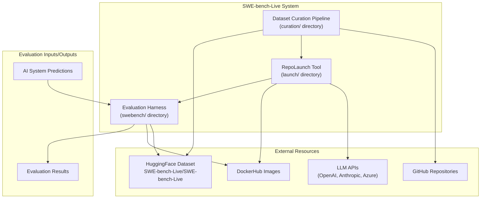
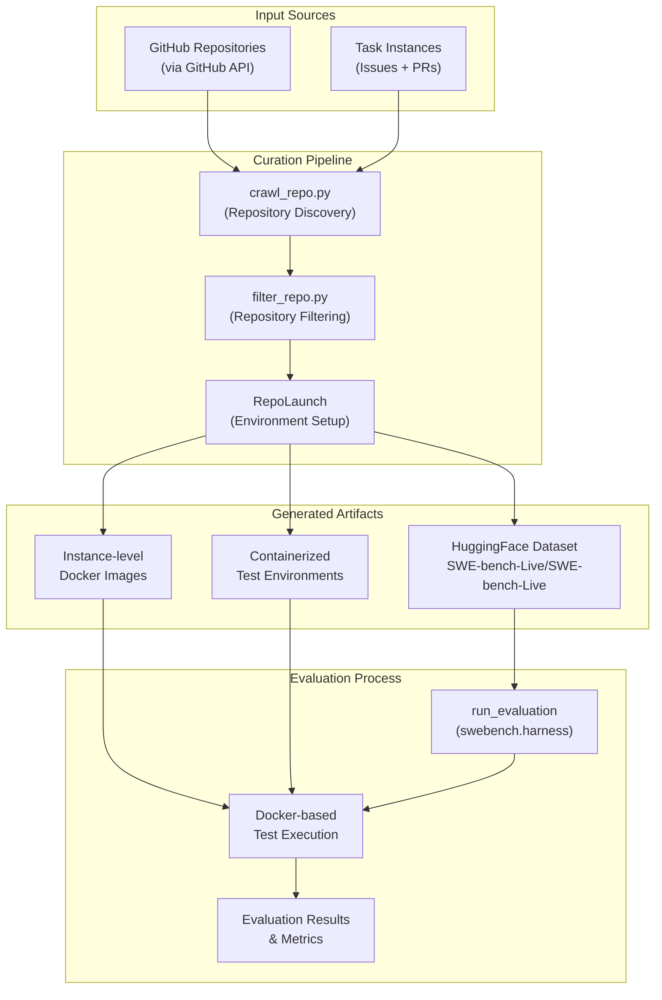

<!-- source: DeepWiki mcp.deepwiki.com · repo microsoft/SWE-bench-Live · page 1 Overview · fetched 2026-10-26 -->

# Overview

<details>
<summary>Relevant source files</summary>

The following files were used as context for generating this wiki page:

- [README.md](README.md)

</details>


## Purpose and Scope

This document provides a high-level introduction to SWE-bench-Live, explaining its purpose as a continuously updated benchmark for evaluating AI systems on real-world software engineering tasks. It covers the three main system components: the evaluation harness, dataset curation pipeline, and RepoLaunch tool, and how they work together to provide contamination-free evaluation.

For detailed information about specific components, see [System Architecture](#2), [RepoLaunch Deep Dive](#3), and [Curation Pipeline Components](#4).

## What is SWE-bench-Live

SWE-bench-Live is a live benchmark for issue resolving that evaluates AI systems' ability to complete real-world software engineering tasks. Unlike static benchmarks, SWE-bench-Live updates monthly through an automated curation pipeline to provide up-to-date task instances and support rigorous, contamination-free evaluation.

The system includes **1,319 task instances** covering **93 repositories**, with each instance paired with an instance-level Docker image for test execution. All task instances are created after 2024 to ensure freshness and reduce contamination risk.

**Key Features:**
- Continuous monthly updates via automated pipeline
- Docker-based isolated test execution
- Instance-level containerized environments
- Integration with major repositories and package ecosystems
- LLM-powered environment setup automation

Sources: [README.md:31-33]()

## System Architecture Overview

SWE-bench-Live consists of three primary components that work together to provide a comprehensive benchmarking solution:

### High-Level System Components



**System Component Details:**

| Component | Primary Location | Purpose |
|-----------|------------------|---------|
| **Evaluation Harness** | `swebench/` | Executes AI system predictions against test instances using Docker containers |
| **Dataset Curation Pipeline** | `curation/` | Automates discovery, filtering, and processing of GitHub repositories into benchmark tasks |
| **RepoLaunch Tool** | `launch/` | LLM-powered agent that creates testable containerized environments for any GitHub repository |

Sources: [README.md:35-44]()

### Core Data Flow



Sources: [README.md:38-44](), [README.md:81-95]()

## Component Integration

### Evaluation Harness
The evaluation harness is built on a fork of the original SWE-bench codebase, located in the `swebench/` directory. It provides the `run_evaluation` entrypoint for executing AI system predictions against task instances using Docker containers.

**Key Entry Points:**
- `swebench.harness.run_evaluation` - Main evaluation command
- Docker-based test execution with instance-level containers
- Integration with HuggingFace dataset `SWE-bench-Live/SWE-bench-Live`

### Dataset Curation Pipeline  
The curation pipeline automates the creation and updating of benchmark datasets through scripts in the `curation/` directory. It handles repository discovery, filtering, and processing to generate fresh task instances monthly.

**Core Pipeline Scripts:**
- Repository crawling and discovery
- Quality-based filtering of candidate repositories  
- Integration with RepoLaunch for environment setup

### RepoLaunch Tool
RepoLaunch is an LLM-powered agentic tool in the `launch/` directory that automates the setup of testable containerized environments for GitHub repositories. It bridges the gap between raw repositories and executable test environments.

**LLM Integration:**
- Support for OpenAI, Anthropic, and Azure OpenAI models
- Automated environment analysis and setup
- Docker container generation with test capabilities

For detailed information about each component, see [Evaluation Harness](#2.1), [Dataset Curation Pipeline](#2.2), and [RepoLaunch Tool Overview](#2.3).

Sources: [README.md:28-29](), [README.md:55-77](), [README.md:91-95]()

## Getting Started

To set up SWE-bench-Live for evaluation:

```bash
# Install the package (Python >= 3.10 required)
pip install -e .

# Test installation with a sample evaluation
python -m swebench.harness.run_evaluation \
    --dataset_name SWE-bench-Live/SWE-bench-Live \
    --split lite \
    --instance_ids amoffat__sh-744 \
    --namespace starryzhang \
    --predictions_path gold \
    --max_workers 1 \
    --run_id validate-gold
```

The system automatically pulls task instances from the HuggingFace dataset and corresponding Docker images from DockerHub for isolated test execution.

Sources: [README.md:46-63]()

---

