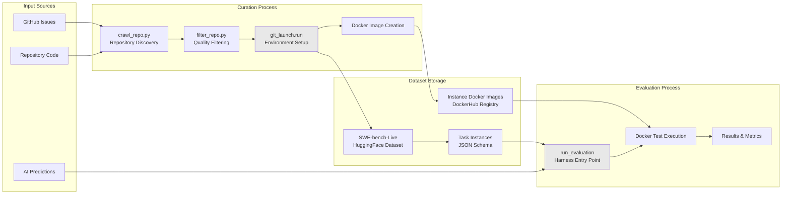
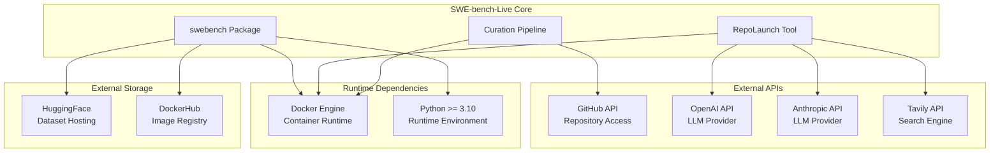

<!-- source: DeepWiki mcp.deepwiki.com · repo microsoft/SWE-bench-Live · page 2 System Architecture · fetched 2026-10-26 -->

# System Architecture

<details>
<summary>Relevant source files</summary>

The following files were used as context for generating this wiki page:

- [README.md](README.md)
- [launch/README.md](launch/README.md)
- [pyproject.toml](pyproject.toml)

</details>


This document provides a comprehensive overview of the SWE-bench-Live system architecture, detailing how the three main components work together: the evaluation harness, dataset curation pipeline, and RepoLaunch tool. It covers the overall system design, data flow patterns, component relationships, and external dependencies.

For specific implementation details of individual components, see [Evaluation Harness](#2.1), [Dataset Curation Pipeline](#2.2), and [RepoLaunch Tool Overview](#2.3). For deep technical details of the RepoLaunch system, see [RepoLaunch Deep Dive](#3).

## High-Level System Overview

SWE-bench-Live consists of three primary components that work together to provide a continuously updated benchmark for AI systems on software engineering tasks.

### System Components Overview

```mermaid
graph TB
    subgraph "SWE-bench-Live System"
        subgraph "swebench_package["swebench Package"]"
            A["run_evaluation"]
            B["Docker Test Execution"]
            C["Results Processing"]
        end
        
        subgraph "curation_pipeline["Curation Pipeline"]"
            D["crawl_repo.py"]
            E["filter_repo.py"]
            F["Dataset Creation"]
        end
        
        subgraph "launch_tool["RepoLaunch Tool"]"
            G["git_launch.run"]
            H["LLM Agent Workflow"]
            I["Docker Environment Setup"]
        end
    end
    
    subgraph "External Systems"
        J["GitHub Repositories"]
        K["HuggingFace Datasets"]
        L["DockerHub Registry"]
        M["LLM APIs"]
    end
    
    D --> J
    E --> F
    F --> K
    G --> H
    H --> M
    I --> L
    A --> B
    B --> L
    F --> G
    
    style swebench_package fill:#f9f9f9
    style curation_pipeline fill:#f9f9f9
    style launch_tool fill:#f9f9f9
```

Sources: [README.md:35-44](), [launch/README.md:7-11](), [pyproject.toml:5-6]()

## Component Relationships and Data Flow

The system operates through a coordinated workflow where each component serves specific functions in the benchmark lifecycle.

### Data Flow Architecture



Sources: [README.md:83-93](), [launch/README.md:22-23](), [README.md:55-63]()

## Component Integration Points

### Evaluation Harness Integration

The `swebench` package serves as the core evaluation engine, providing the `run_evaluation` entry point that coordinates test execution across Docker containers.

| Component | File Path | Function |
|-----------|-----------|----------|
| Main Entry Point | `swebench.harness.run_evaluation` | Orchestrates evaluation workflow |
| Docker Integration | `swebench` package modules | Manages containerized test execution |
| Dataset Loading | HuggingFace integration | Loads task instances from `SWE-bench-Live/SWE-bench-Live` |

### Curation Pipeline Integration

The curation pipeline automates dataset creation through repository discovery, filtering, and environment setup.

| Component | File Path | Function |
|-----------|-----------|----------|
| Repository Discovery | `curation/crawl_repo.py` | Searches GitHub for candidate repositories |
| Quality Filtering | `curation/filter_repo.py` | Applies quality criteria to repositories |
| Environment Setup | `launch/` directory | Automated containerization via RepoLaunch |

### RepoLaunch Tool Integration

RepoLaunch provides automated environment setup capabilities using LLM-based agents to create testable containerized environments.

| Component | File Path | Function |
|-----------|-----------|----------|
| Main Runner | `git_launch.run` | Entry point for environment setup |
| Agent Workflow | `launch/` modules | LLM-powered environment automation |
| Docker Output | Container registry | Produces instance-level Docker images |

Sources: [README.md:38-44](), [launch/README.md:18-23](), [README.md:55-63]()

## External Dependencies and Integrations

### Core Dependencies

The system relies on several external services and libraries for its operation:



### Dependency Configuration

The project dependencies are managed through `pyproject.toml` with the following key packages:

| Package Category | Dependencies | Purpose |
|------------------|--------------|---------|
| Core Runtime | `docker`, `requests`, `datasets` | Container management and data access |
| LLM Integration | `openai`, `anthropic` | AI model API access |
| Data Processing | `GitPython`, `ghapi`, `beautifulsoup4` | Repository and web data handling |
| UI/Logging | `rich`, `tqdm` | Progress reporting and formatted output |
| Reliability | `tenacity` | Retry logic for external API calls |

Sources: [pyproject.toml:23-38](), [pyproject.toml:40-63](), [launch/README.md:14]()

## System Configuration and Execution

### Workspace Organization

The system organizes its work through a structured workspace layout:

```
├── swebench/             # Evaluation harness (forked from SWE-bench)
├── launch/               # RepoLaunch tool and configuration
├── curation/             # Dataset curation scripts
├── assets/               # Static resources and documentation
└── README.md             # Project documentation
```

### Evaluation Workflow

The evaluation process follows a standardized pattern using the `run_evaluation` module:

```bash
python -m swebench.harness.run_evaluation \
    --dataset_name SWE-bench-Live/SWE-bench-Live \
    --split <lite/full> \
    --namespace starryzhang \
    --predictions_path <predictions_file> \
    --max_workers <worker_count> \
    --run_id <evaluation_run_id>
```

### RepoLaunch Configuration

RepoLaunch operates through JSON configuration files that specify LLM providers, workspace settings, and execution parameters:

| Configuration Field | Type | Purpose |
|---------------------|------|---------|
| `llm_provider_name` | string | Specifies LLM provider (OpenAI, AOAI, etc.) |
| `workspace_root` | string | Base directory for processing |
| `dataset` | string | Path to input dataset file |
| `max_workers` | integer | Parallel processing worker count |
| `overwrite` | boolean | Controls result overwriting behavior |

Sources: [README.md:35-44](), [README.md:69-77](), [launch/README.md:40-54]()

## Data Schema and Interfaces

### Input Data Schema

The system processes task instances with the following required fields:

| Field | Type | Description |
|-------|------|-------------|
| `repo` | string | Full repository name (e.g., `owner/repo`) |
| `base_commit` | string | Git commit hash for environment setup |
| `instance_id` | string | Unique task instance identifier |
| `created_at` | string (optional) | Instance creation timestamp |
| `language` | string (optional) | Primary programming language |

### Output Data Schema

RepoLaunch produces structured results with environment setup information:

| Field | Type | Description |
|-------|------|-------------|
| `instance_id` | string | Task instance identifier |
| `base_image` | string | Docker base image specification |
| `setup_commands` | array | Shell commands for environment setup |
| `test_commands` | array | Shell commands for test execution |
| `duration` | number | Setup time in minutes |
| `completed` | boolean | Success status indicator |
| `exception` | string/null | Error message if setup failed |

Sources: [launch/README.md:27-37](), [launch/README.md:55-67]()

---

