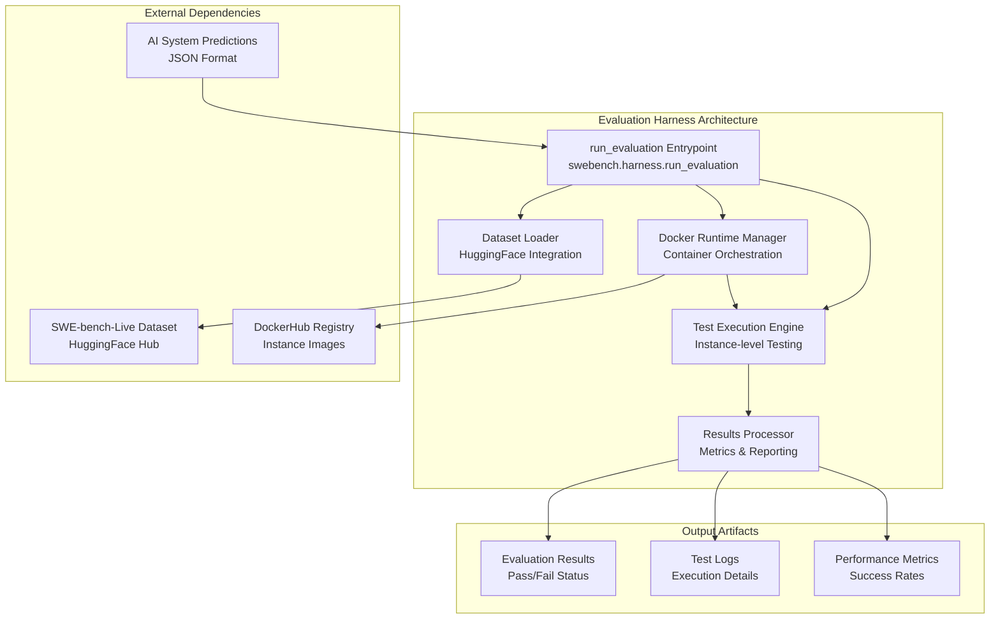
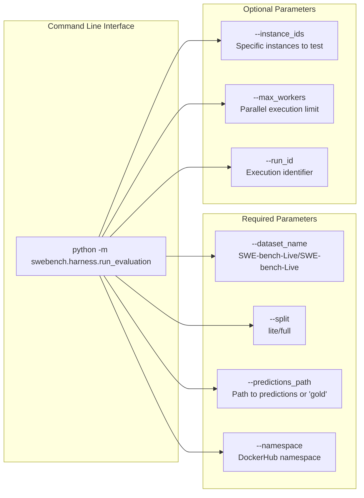
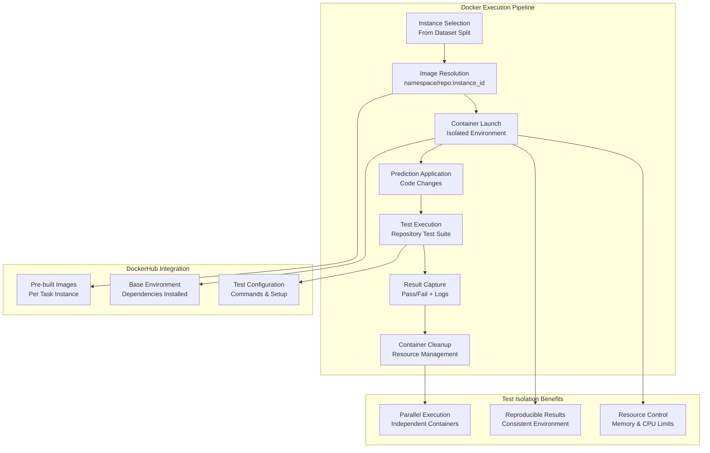
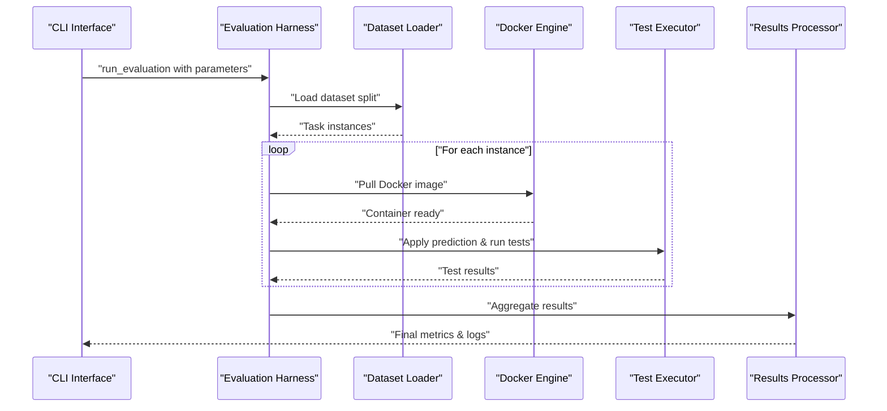

<!-- source: DeepWiki mcp.deepwiki.com · repo microsoft/SWE-bench-Live · page 2.1 Evaluation Harness · fetched 2026-10-26 -->

# Evaluation Harness

<details>
<summary>Relevant source files</summary>

The following files were used as context for generating this wiki page:

- [README.md](README.md)
- [pyproject.toml](pyproject.toml)

</details>


## Purpose and Scope

The Evaluation Harness is the core component responsible for executing and evaluating AI system predictions against task instances in the SWE-bench-Live dataset. This document covers the `swebench` package structure, the `run_evaluation` entrypoint, Docker-based test execution, and the evaluation methodology.

For information about how task instances are created and maintained, see [Dataset Curation Pipeline](#2.2). For details about environment setup and containerization, see [RepoLaunch Tool Overview](#2.3).

## System Overview

The Evaluation Harness operates as a forked and minimally modified version of the original SWE-bench evaluation system, adapted specifically for the SWE-bench-Live dataset while maintaining compatibility with existing evaluation workflows.



Sources: [README.md:1-150](), [pyproject.toml:1-99]()

## Package Structure

The `swebench` package serves as the primary evaluation framework, organized to support scalable and reproducible evaluation workflows.

| Component | Purpose | Location |
|-----------|---------|----------|
| Core Evaluation | Main evaluation logic forked from SWE-bench | `swebench/` |
| Harness Module | Entry point and orchestration | `swebench.harness` |
| Dataset Integration | HuggingFace dataset loading | `swebench.datasets` |
| Docker Management | Container lifecycle management | `swebench.docker` |

The package maintains backward compatibility with the original SWE-bench while adding support for the continuously updated SWE-bench-Live dataset format.

Sources: [README.md:28-44](), [pyproject.toml:79-88]()

## Evaluation Entrypoint

The primary interface for running evaluations is the `run_evaluation` module, accessible through Python's module execution syntax.



### Key Parameters

| Parameter | Description | Example |
|-----------|-------------|---------|
| `dataset_name` | HuggingFace dataset identifier | `SWE-bench-Live/SWE-bench-Live` |
| `split` | Dataset split to evaluate | `lite` or `full` |
| `predictions_path` | Path to predictions JSON or `gold` for reference | `path/to/predictions.json` |
| `namespace` | DockerHub namespace for images | `starryzhang` |
| `instance_ids` | Comma-separated list of specific instances | `amoffat__sh-744` |
| `max_workers` | Number of parallel workers | `4` |
| `run_id` | Unique identifier for the evaluation run | `validate-gold` |

Sources: [README.md:55-77]()

## Docker-Based Test Execution

The evaluation system leverages instance-level Docker images to provide isolated, reproducible test environments for each task instance.



### Image Naming Convention

Docker images follow a structured naming pattern that maps directly to dataset instances:

- **Format**: `{namespace}/{repository}:{instance_id}`
- **Example**: `starryzhang/amoffat__sh:744`
- **Registry**: DockerHub public registry

This naming scheme enables automatic image resolution based on the task instance metadata from the SWE-bench-Live dataset.

Sources: [README.md:79-80]()

## Evaluation Methodology

The evaluation process follows a systematic approach to measure AI system performance on real-world software engineering tasks.



### Evaluation Workflow

1. **Dataset Loading**: Retrieves task instances from the specified HuggingFace dataset split
2. **Instance Processing**: Iterates through selected instances, supporting parallel execution
3. **Environment Setup**: Pulls and launches pre-configured Docker containers
4. **Prediction Application**: Applies AI system predictions to the codebase
5. **Test Execution**: Runs the repository's test suite within the container
6. **Result Collection**: Captures test outcomes, logs, and performance metrics
7. **Metrics Calculation**: Aggregates results to compute success rates and other metrics

### Gold Standard Testing

The system supports "gold" predictions for validation purposes, where known-correct solutions are evaluated to verify the testing infrastructure's reliability.

```bash
python -m swebench.harness.run_evaluation \
    --dataset_name SWE-bench-Live/SWE-bench-Live \
    --split lite \
    --predictions_path gold \
    --namespace starryzhang \
    --run_id validate-gold
```

Sources: [README.md:53-63](), [README.md:65-77]()

## Integration with SWE-bench-Live Dataset

The evaluation harness is specifically designed to work with the continuously updated SWE-bench-Live dataset, which provides fresh task instances covering recent GitHub issues and pull requests.

| Dataset Feature | Evaluation Support |
|-----------------|-------------------|
| Monthly Updates | Automatic dataset refresh support |
| Instance-level Images | Direct Docker image mapping |
| 1,319 Task Instances | Comprehensive test coverage |
| 93 Repositories | Diverse codebase evaluation |
| Contamination-free | Post-2024 task instances |

The system maintains consistency with the original SWE-bench evaluation methodology while supporting the dynamic nature of the Live dataset through automated Docker image management and flexible instance selection.

Sources: [README.md:31-34](), [README.md:28-30]()

---

