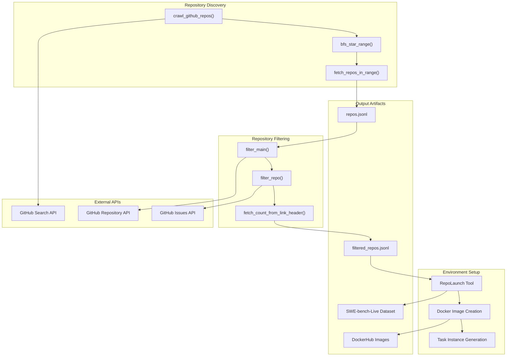
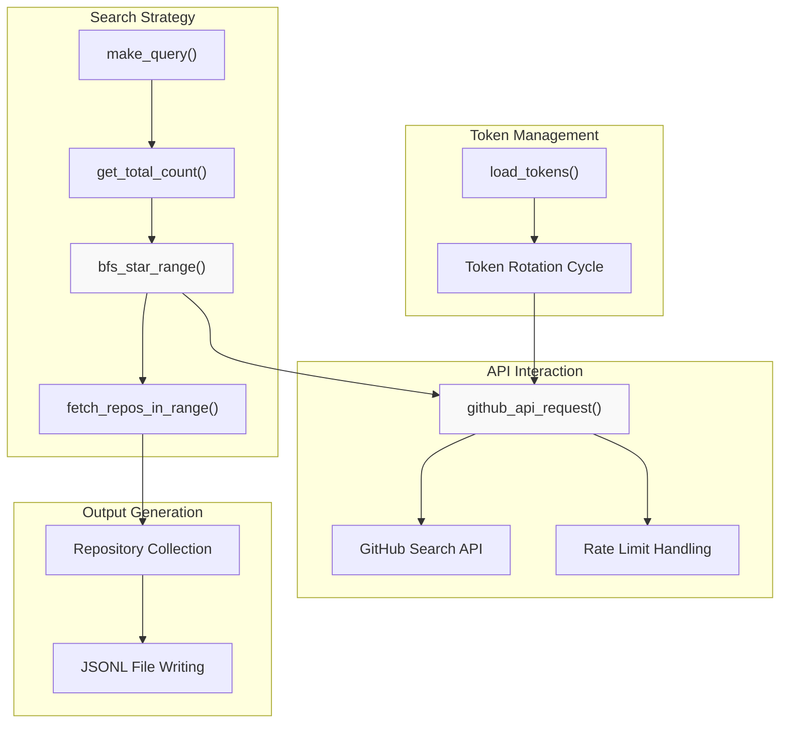
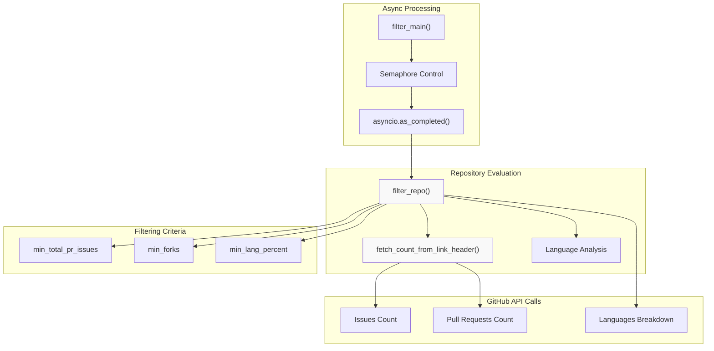
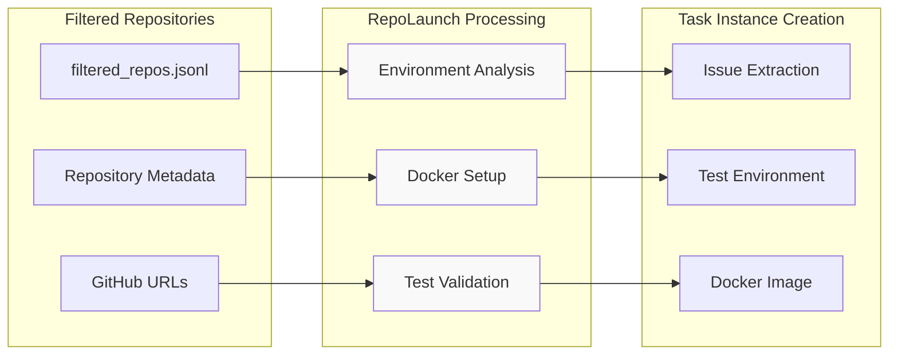
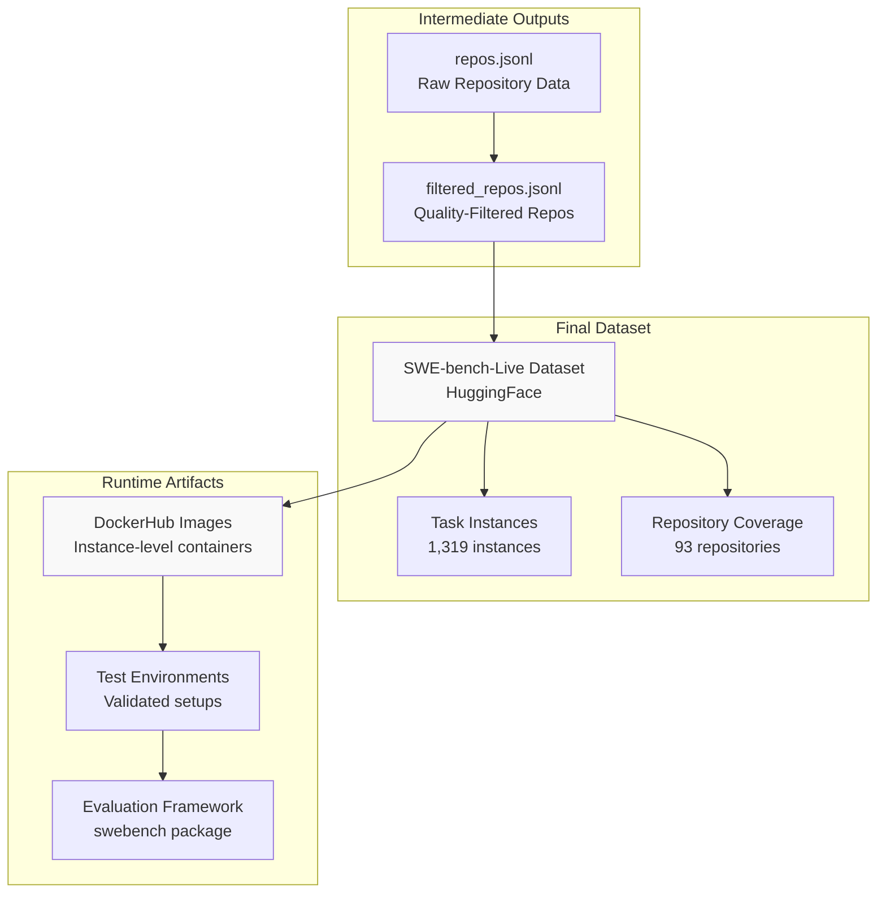

<!-- source: DeepWiki mcp.deepwiki.com · repo microsoft/SWE-bench-Live · page 2.2 Dataset Curation Pipeline · fetched 2026-10-26 -->

# Dataset Curation Pipeline

Relevant source files

The following files were used as context for generating this wiki page:

- [README.md](README.md)
- [curation/crawl_repo.py](curation/crawl_repo.py)
- [curation/filter_repo.py](curation/filter_repo.py)

This document describes the automated pipeline that creates and maintains the SWE-bench-Live dataset. The pipeline discovers GitHub repositories, filters them based on quality criteria, and uses the RepoLaunch tool to create testable containerized environments for task instances.

For details about the RepoLaunch environment setup tool, see [RepoLaunch Tool Overview](#2.3). For information about how the curated dataset is used for evaluation, see [Evaluation Harness](#2.1).

## Pipeline Overview

The dataset curation pipeline operates as an automated system that transforms raw GitHub repository data into structured task instances ready for AI system evaluation. The pipeline consists of three main stages: repository discovery, repository filtering, and environment setup.

**Curation Pipeline Architecture**

Sources: [README.md:81-96](), [curation/crawl_repo.py:133-180](), [curation/filter_repo.py:127-196]()

## Repository Discovery Process

The repository discovery stage uses the `crawl_repo.py` script to systematically search GitHub for repositories matching specified criteria. The process implements a breadth-first search strategy to work around GitHub's API limitations.

**Repository Crawling Workflow**

The discovery process implements several key mechanisms:

| Component | Function | Implementation |
|-----------|----------|----------------|
| **Token Rotation** | `load_tokens()` | Cycles through multiple GitHub API tokens to handle rate limits [curation/crawl_repo.py:13-18]() |
| **Query Construction** | `make_query()` | Builds GitHub search queries with language and star count filters [curation/crawl_repo.py:21-31]() |
| **BFS Search** | `bfs_star_range()` | Recursively divides star ranges when result count exceeds 1000 [curation/crawl_repo.py:85-130]() |
| **Batch Fetching** | `fetch_repos_in_range()` | Retrieves up to 1000 repositories per query with pagination [curation/crawl_repo.py:58-82]() |

The BFS strategy addresses GitHub's 1000-result limit by automatically subdividing star ranges when the total count exceeds this threshold [curation/crawl_repo.py:107-120]().

Sources: [curation/crawl_repo.py:1-181]()

## Repository Filtering Process

The filtering stage uses `filter_repo.py` to evaluate repositories against quality criteria using asynchronous processing for efficiency. The system fetches additional repository metadata to make filtering decisions.

**Repository Filtering Architecture**

The filtering system evaluates repositories using these criteria:

| Criterion | Default Value | Purpose |
|-----------|---------------|---------|
| **Minimum Forks** | 200 | Ensures repository has community adoption [curation/filter_repo.py:94-97]() |
| **Total PR/Issues** | 200 | Indicates active development and issue resolution [curation/filter_repo.py:110-113]() |
| **Language Percentage** | 60% | Ensures repository is primarily in target language [curation/filter_repo.py:115-122]() |

The filtering process uses link header parsing to efficiently count issues and pull requests without fetching full result sets [curation/filter_repo.py:53-77]().

Sources: [curation/filter_repo.py:1-201]()

## Integration with RepoLaunch

After repository filtering, the pipeline integrates with RepoLaunch to create testable environments for each repository. This integration transforms filtered repositories into complete task instances with working development environments.

**RepoLaunch Integration Flow**

The integration process creates:

- **Task Instances**: Each repository generates multiple task instances from recent issues and pull requests
- **Docker Images**: Instance-level containerized environments hosted on DockerHub [README.md:79]()
- **Test Validation**: Verified execution environments for reliable evaluation

Sources: [README.md:91-96](), [README.md:33-34]()

## Output Artifacts and Dataset Structure

The curation pipeline produces several key artifacts that enable contamination-free evaluation of AI systems on software engineering tasks.

**Dataset Output Structure**

The pipeline generates these key outputs:

| Artifact Type | Description | Location |
|---------------|-------------|----------|
| **Raw Repository Data** | Unfiltered GitHub repository metadata | `repos.jsonl` |
| **Filtered Repositories** | Quality-validated repository subset | `filtered_repos.jsonl` |
| **Task Dataset** | Structured task instances with issue/PR context | HuggingFace Dataset |
| **Docker Images** | Instance-specific containerized environments | DockerHub namespace |

The initial release contains 1,319 task instances covering 93 repositories, all created after 2024 to ensure freshness and reduce contamination risk [README.md:33]().

Sources: [README.md:21-24](), [README.md:33-34](), [README.md:79]()

---

