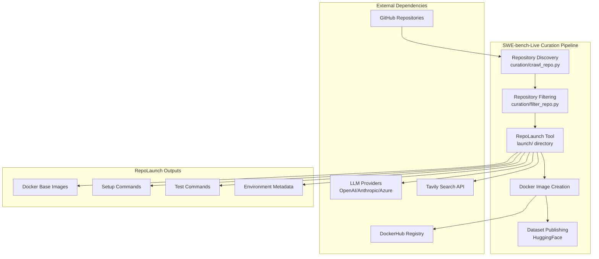
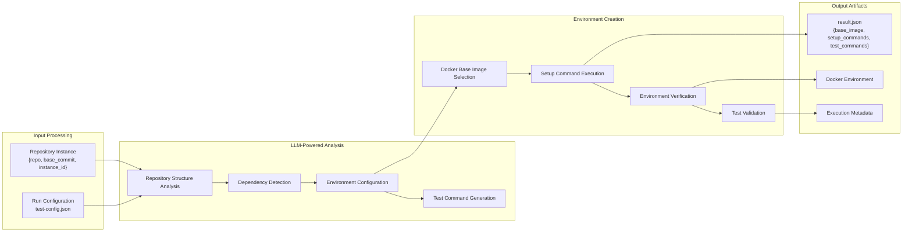
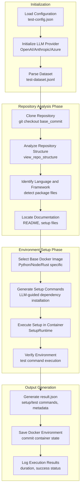

<!-- source: DeepWiki mcp.deepwiki.com · repo microsoft/SWE-bench-Live · page 2.3 RepoLaunch Tool Overview · fetched 2026-10-26 -->

# RepoLaunch Tool Overview

<details>
<summary>Relevant source files</summary>

The following files were used as context for generating this wiki page:

- [README.md](README.md)
- [launch/README.md](launch/README.md)

</details>


This document provides a high-level introduction to RepoLaunch, the LLM-based agentic tool that automates environment setup for GitHub repositories within the SWE-bench-Live system. RepoLaunch addresses the critical bottleneck of creating testable containerized environments by leveraging large language models to intelligently analyze repository structure, identify dependencies, and configure Docker environments.

For detailed implementation specifics including agent architecture and LLM integration patterns, see [RepoLaunch Deep Dive](#3). For information about how RepoLaunch integrates into the broader dataset creation process, see [Dataset Curation Pipeline](#2.2).

## System Role and Integration

RepoLaunch serves as the automated environment setup component within the SWE-bench-Live curation pipeline. It transforms raw GitHub repositories into testable, containerized environments that can be used for evaluation.

**RepoLaunch Integration Architecture**


Sources: [README.md:91-96](), [launch/README.md:7-11]()

## Core Functionality

RepoLaunch operates as an intelligent agent that can analyze any GitHub repository and automatically determine the steps needed to create a working development and testing environment. The tool handles the complexity of dependency management, environment configuration, and test execution setup without requiring manual intervention.

**RepoLaunch Core Components**


Sources: [launch/README.md:25-67](), [README.md:91-95]()

## Data Schema and Interface

RepoLaunch operates through a well-defined input/output interface that integrates seamlessly with the broader curation pipeline.

### Input Schema

| Field | Type | Required | Description |
|-------|------|----------|-------------|
| `repo` | string | Yes | Full repository name (e.g., "microsoft/SWE-bench-Live") |
| `base_commit` | string | Yes | Git commit hash to checkout for environment setup |
| `instance_id` | string | Yes | Unique identifier for the task instance |
| `created_at` | string | No | Creation timestamp for time-aware package resolution |
| `language` | string | No | Primary programming language of the repository |

### Configuration Schema

| Field | Type | Description |
|-------|------|-------------|
| `llm_provider_name` | string | LLM provider ("OpenAI", "AOAI", "Anthropic") |
| `model_config` | object | Contains `model_name` and `temperature` settings |
| `workspace_root` | string | Working directory for environment setup |
| `dataset` | string | Path to input dataset file |
| `max_workers` | integer | Parallel processing worker count |
| `overwrite` | boolean | Whether to recreate existing environments |

### Output Schema

| Field | Type | Description |
|-------|------|-------------|
| `instance_id` | string | Task instance identifier |
| `base_image` | string | Selected Docker base image |
| `setup_commands` | array | Shell commands for environment setup |
| `test_commands` | array | Shell commands for running tests |
| `duration` | number | Processing time in minutes |
| `completed` | boolean | Success status of environment creation |
| `exception` | string | Error message if setup failed |

Sources: [launch/README.md:27-67]()

## Workflow Overview

RepoLaunch follows an intelligent, multi-stage workflow that leverages LLM reasoning to make decisions about environment setup. The process is designed to handle the diverse landscape of open-source repositories with minimal manual configuration.

**RepoLaunch Execution Workflow**


The workflow integrates external services including Tavily search API for documentation lookup and PyPI Time Machine for historical package resolution, ensuring reproducible environment creation even for older repositories.

Sources: [launch/README.md:13-23](), [launch/README.md:55-67]()

## Command Line Interface

RepoLaunch provides a straightforward command-line interface for execution:

```bash
cd launch
pip install -e .
python -m git_launch.run --config-path test-config.json
```

The tool processes repositories in parallel based on the `max_workers` configuration and can be configured to process specific instances or entire datasets. Results are saved in structured JSON format under the configured workspace directory.

Sources: [launch/README.md:18-23]()

---

