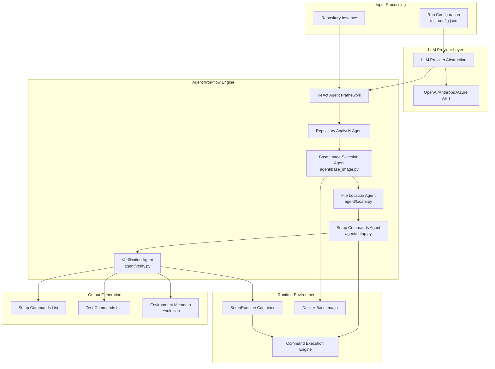
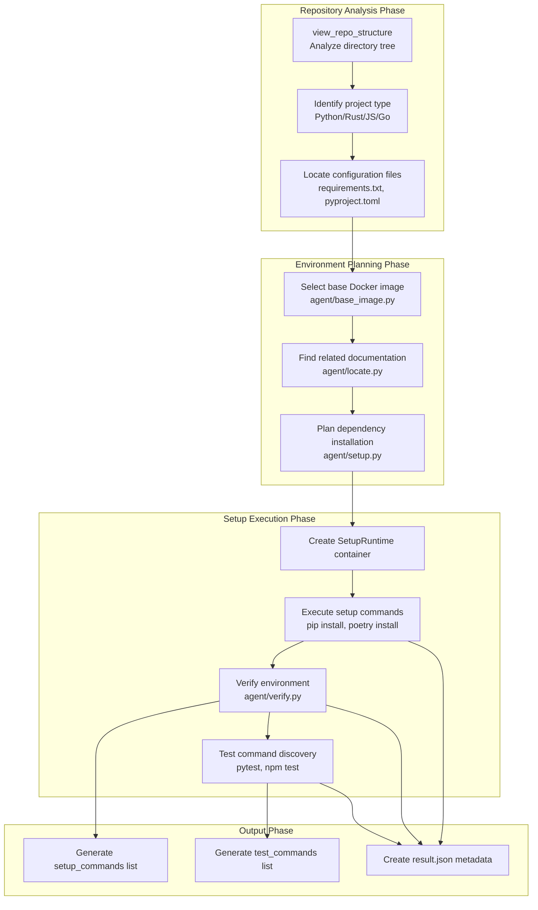

<!-- source: DeepWiki mcp.deepwiki.com · repo microsoft/SWE-bench-Live · page 3 RepoLaunch Deep Dive · fetched 2026-10-26 -->

# RepoLaunch Deep Dive

Relevant source files

The following files were used as context for generating this wiki page:

- [launch/README.md](launch/README.md)
- [launch/test-config.json](launch/test-config.json)
- [launch/test-result.json](launch/test-result.json)

This document provides a comprehensive technical overview of the RepoLaunch system, an LLM-based agentic tool that automates the setup of testable containerized environments for any GitHub repository. RepoLaunch serves as a critical component in the SWE-bench-Live curation pipeline, enabling automated environment preparation for software engineering benchmarks.

For information about the overall system architecture, see [System Architecture](#2). For details about LLM provider integration, see [LLM Integration](#3.1). For agent system internals, see [Agent System](#3.2). For runtime environment details, see [Runtime Environment](#3.3). For configuration and execution guidance, see [Configuration & Execution](#3.4).

## System Architecture Overview

RepoLaunch transforms any GitHub repository into a testable sandbox environment through an automated workflow that combines repository analysis, LLM-powered decision making, and Docker containerization.

### RepoLaunch Core Architecture

Sources: [launch/README.md:11](), [launch/test-config.json:1-11](), [launch/test-result.json:1-17]()

### Agent-Based Environment Setup Process

Sources: [launch/README.md:25-67](), [launch/test-result.json:2-16]()

## Core Workflow Components

RepoLaunch operates through a series of specialized agents, each responsible for a specific aspect of environment setup. The system uses a ReAct (Reasoning + Acting) framework to iteratively analyze repositories and make setup decisions.

### Input Data Schema

The system accepts repository instances with the following structure:

| Field | Type | Description | Required |
|-------|------|-------------|----------|
| `repo` | string | Full repository name (owner/repo) | Yes |
| `base_commit` | string | Git commit hash to checkout | Yes |
| `instance_id` | string | Unique identifier for this instance | Yes |
| `created_at` | string | ISO timestamp for time-aware setup | No |
| `language` | string | Primary programming language | No |

### Configuration Schema

RepoLaunch uses a JSON configuration file with these parameters:

| Field | Type | Description | Default |
|-------|------|-------------|---------|
| `llm_provider_name` | string | LLM provider ("OpenAI", "AOAI", "Anthropic") | Required |
| `model_config` | object | Model name and temperature settings | Required |
| `workspace_root` | string | Directory for output files | Required |
| `dataset` | string | Path to input JSONL file | Required |
| `instance_id` | string | Specific instance to process (null for all) | null |
| `first_N_repos` | integer | Limit to first N repositories (-1 for all) | -1 |
| `max_workers` | integer | Parallel processing worker count | 1 |
| `overwrite` | boolean | Skip existing results if false | false |

### Output Data Schema

Each repository processing generates a `result.json` file containing:

| Field | Type | Description |
|-------|------|-------------|
| `instance_id` | string | Unique identifier matching input |
| `base_image` | string | Selected Docker base image |
| `setup_commands` | array | Shell commands for environment setup |
| `test_commands` | array | Shell commands for running tests |
| `duration` | integer | Processing time in minutes |
| `completed` | boolean | Success status of the operation |
| `exception` | string\|null | Error message if processing failed |

Sources: [launch/README.md:25-67](), [launch/test-config.json:1-11](), [launch/test-result.json:1-17]()

## Agent Workflow Integration

RepoLaunch integrates multiple specialized agents through a coordinated workflow that leverages LLM capabilities for intelligent decision-making at each step.

### LLM-Powered Decision Points

The system makes several critical decisions using LLM analysis:

1. **Base Image Selection**: Analyzes project structure to choose appropriate Docker base image (Python 3.x, Node.js, Rust, etc.)
2. **Dependency Resolution**: Identifies and installs project dependencies from various sources (pip, poetry, npm, cargo)
3. **Test Discovery**: Locates and configures test frameworks and commands
4. **Environment Verification**: Validates that the setup successfully creates a working environment

### External Service Integration

RepoLaunch integrates with several external services:

- **Tavily Search API**: Provides web search capabilities for finding documentation and solutions
- **PyPI Time Machine**: Serves historical package versions for reproducible builds
- **Docker Registry**: Pulls and manages base container images
- **LLM APIs**: Powers the agent reasoning and decision-making process

The system handles API rate limiting, token rotation, and retry logic to ensure robust operation across different service providers and usage patterns.

Sources: [launch/README.md:11-24](), [launch/test-config.json:2-6]()

---

