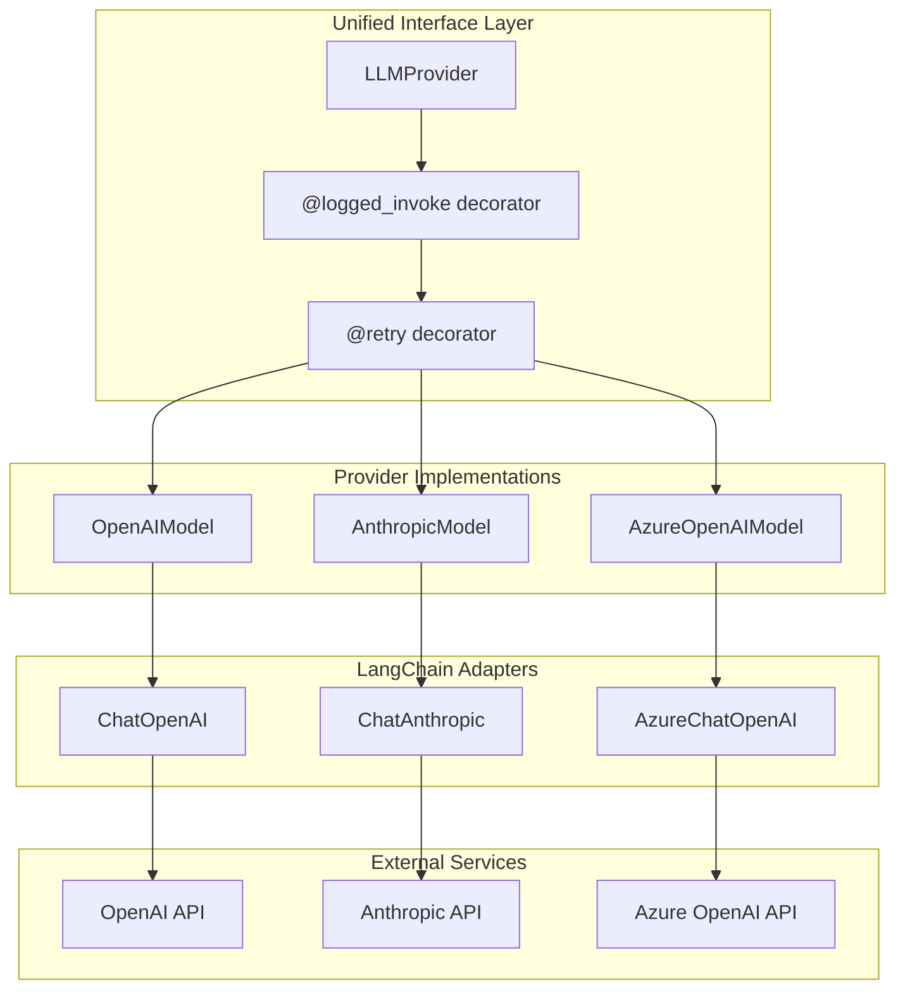
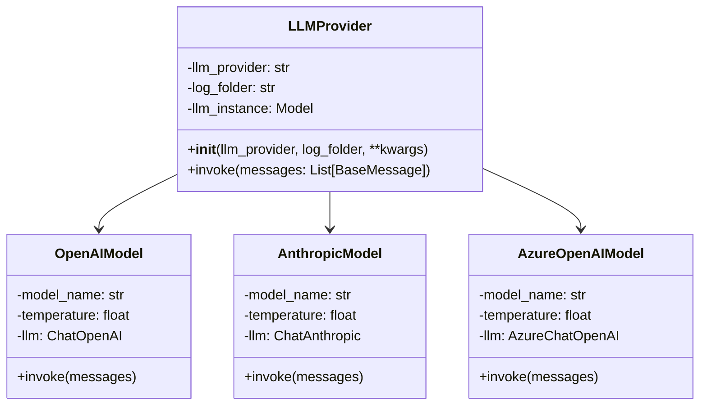
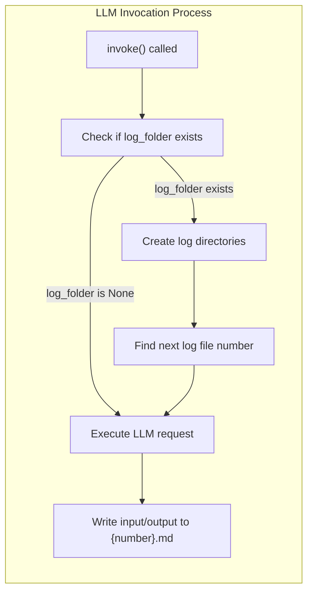
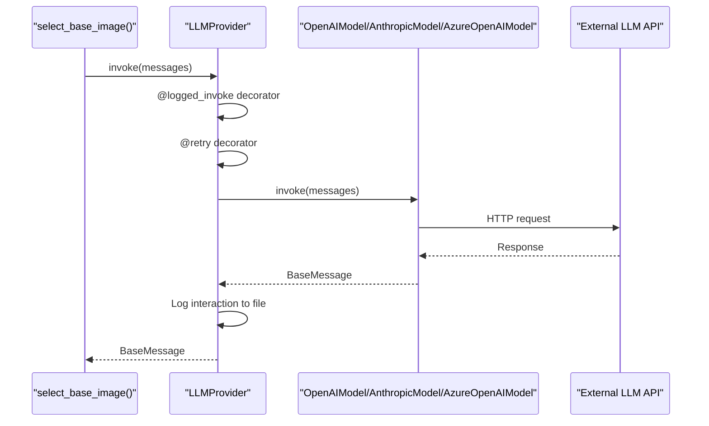

<!-- source: DeepWiki mcp.deepwiki.com · repo microsoft/SWE-bench-Live · page 3.1 LLM Integration · fetched 2026-10-26 -->

# LLM Integration

<details>
<summary>Relevant source files</summary>

The following files were used as context for generating this wiki page:

- [launch/git_launch/agent/base_image.py](launch/git_launch/agent/base_image.py)
- [launch/git_launch/utilities/llm.py](launch/git_launch/utilities/llm.py)

</details>


This document covers the LLM (Large Language Model) integration system that provides a unified abstraction layer for multiple AI model providers within the RepoLaunch tool. The system supports OpenAI, Anthropic, and Azure OpenAI services with automatic logging, retry logic, and token management capabilities.

For information about how these LLM integrations are used within the ReAct agent workflow, see [Agent System](#3.2). For details on configuration and execution of RepoLaunch with different LLM providers, see [Configuration & Execution](#3.4).

## Architecture Overview

The LLM integration system provides a unified interface across multiple AI model providers, enabling consistent usage patterns throughout the RepoLaunch codebase while supporting provider-specific configurations and authentication methods.

**LLM Provider Abstraction Architecture**


Sources: [launch/git_launch/utilities/llm.py:48-93]()

## LLMProvider Class

The `LLMProvider` class serves as the primary interface for all LLM interactions, abstracting away provider-specific implementation details while providing consistent logging and error handling capabilities.

**Core LLMProvider Implementation**


The `LLMProvider` constructor accepts three provider types through the `llm_provider` parameter:

| Provider String | Model Class | Authentication Method |
|----------------|-------------|----------------------|
| `"OpenAI"` | `OpenAIModel` | `OPENAI_API_KEY` environment variable |
| `"Anthropic"` | `AnthropicModel` | `ANTHROPIC_API_KEY` environment variable |
| `"AOAI"` | `AzureOpenAIModel` | Azure token-based authentication |

Sources: [launch/git_launch/utilities/llm.py:55-74]()

## Provider Implementations

Each model provider implements a consistent `invoke()` method interface while handling provider-specific authentication and configuration requirements.

### OpenAI Integration

The `OpenAIModel` class integrates with OpenAI's API through the LangChain `ChatOpenAI` adapter:

```python
# Example configuration from codebase
OpenAIModel(
    model_name="gpt-4o-20241120",
    temperature=0.0
)
```

Authentication relies on the `OPENAI_API_KEY` environment variable being set prior to instantiation.

Sources: [launch/git_launch/utilities/llm.py:94-125]()

### Anthropic Integration

The `AnthropicModel` class provides access to Anthropic's Claude models through the LangChain `ChatAnthropic` adapter:

```python
# Example usage pattern
AnthropicModel(
    model_name="claude-3-opus-20240229", 
    temperature=0.0
)
```

Authentication requires the `ANTHROPIC_API_KEY` environment variable.

Sources: [launch/git_launch/utilities/llm.py:128-159]()

### Azure OpenAI Integration

The `AzureOpenAIModel` class connects to Azure's OpenAI service using the `AzureChatOpenAI` adapter with token-based authentication:

```python
# Example Azure configuration
AzureOpenAIModel(
    model_name="gpt-4o-20241120",
    temperature=0.0
)
```

Sources: [launch/git_launch/utilities/llm.py:162-192]()

## Logging System

The `@logged_invoke` decorator provides comprehensive interaction logging for debugging and audit purposes. When logging is enabled, all LLM inputs and outputs are automatically saved to numbered markdown files.

**Logging Workflow**


The logging system creates sequentially numbered markdown files containing both input messages and LLM responses:

```markdown
##### LLM INPUT #####
Human: What is the capital of France?
##### LLM OUTPUT #####
AI: The capital of France is Paris.
```

Log file numbering automatically continues from the highest existing number in the log directory.

Sources: [launch/git_launch/utilities/llm.py:11-45]()

## Retry Mechanism

The system implements robust error handling through the tenacity library, providing exponential backoff with jitter for failed LLM requests:

| Retry Parameter | Value | Purpose |
|----------------|-------|---------|
| `stop_after_attempt` | 5 | Maximum retry attempts |
| `initial` | 5 seconds | Initial wait time |
| `max` | 120 seconds | Maximum wait time |
| `jitter` | 3 seconds | Random variance |

The retry decorator is applied to the `invoke()` method, automatically handling transient network issues, rate limiting, and temporary service unavailability.

Sources: [launch/git_launch/utilities/llm.py:77-81]()

## Usage Patterns

The LLM integration is used throughout the RepoLaunch agent system for various automated tasks. Here's how the system is typically instantiated and used:

**Example Usage in Base Image Selection**


In the `select_base_image` function, the LLM is accessed through the agent state and used to analyze repository documentation:

```python
llm = state["llm"]  # LLMProvider instance
response = llm.invoke(messages)  # Automatic logging and retry
```

The system supports multi-turn conversations by maintaining message history and allows for iterative refinement based on LLM responses.

Sources: [launch/git_launch/agent/base_image.py:29-53](), [launch/git_launch/utilities/llm.py:194-203]()

---

