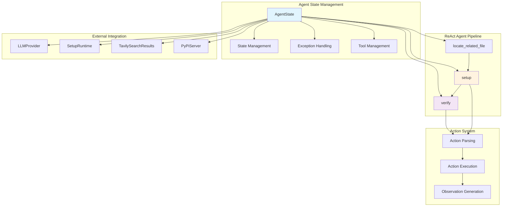
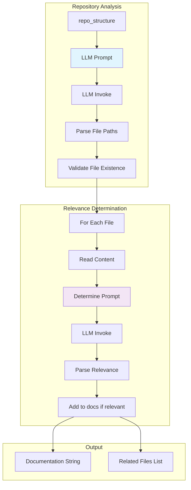
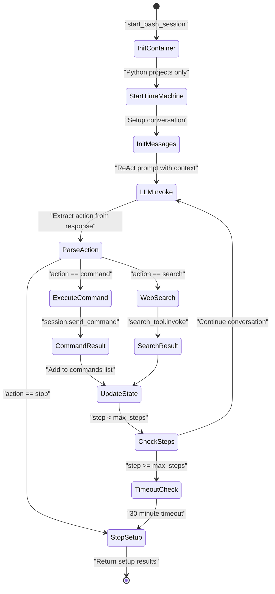
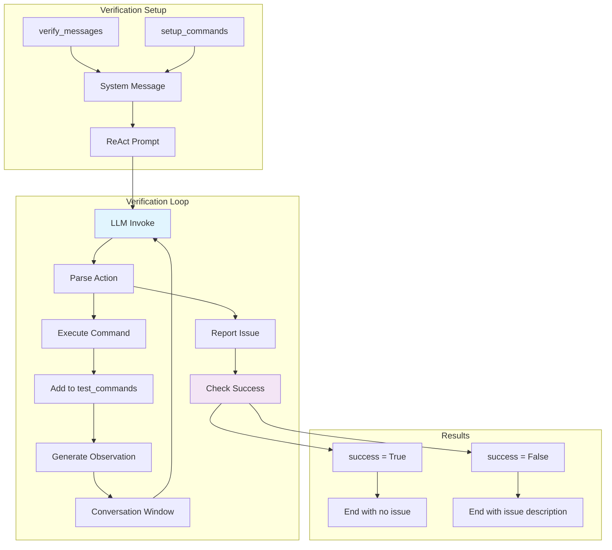
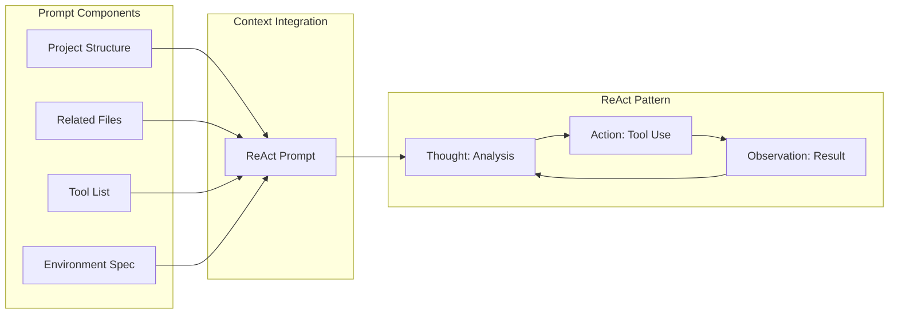

<!-- source: DeepWiki mcp.deepwiki.com · repo microsoft/SWE-bench-Live · page 3.2 Agent System · fetched 2026-10-26 -->

# Agent System

<details>
<summary>Relevant source files</summary>

The following files were used as context for generating this wiki page:

- [launch/git_launch/agent/__init__.py](launch/git_launch/agent/__init__.py)
- [launch/git_launch/agent/locate.py](launch/git_launch/agent/locate.py)
- [launch/git_launch/agent/prompt.py](launch/git_launch/agent/prompt.py)
- [launch/git_launch/agent/setup.py](launch/git_launch/agent/setup.py)
- [launch/git_launch/agent/state.py](launch/git_launch/agent/state.py)
- [launch/git_launch/agent/verify.py](launch/git_launch/agent/verify.py)

</details>


The Agent System implements the core ReAct (Reasoning + Acting) agent architecture that powers RepoLaunch's automated environment setup workflow. This system orchestrates multiple specialized agents to analyze repositories, set up development environments, and verify successful configuration through conversational interactions with LLM providers.

For information about the underlying LLM provider abstraction, see [LLM Integration](#3.1). For details about the Docker runtime environment where agents execute commands, see [Runtime Environment](#3.3).

## Overview and Architecture

The Agent System consists of three main components: state management through `AgentState`, specialized ReAct agents for different workflow stages, and structured action parsing for LLM interactions.

### Agent System Architecture



Sources: [launch/git_launch/agent/state.py:32-126](), [launch/git_launch/agent/setup.py:162-241](), [launch/git_launch/agent/verify.py:117-199]()

## State Management

The `AgentState` class serves as the central state container for the entire repository setup workflow, tracking all necessary information, tools, and progress through multiple agent interactions.

### AgentState Structure

| Field | Type | Purpose |
|-------|------|---------|
| `instance` | dict | SWE-bench instance data |
| `llm` | LLMProvider | LLM provider for agent interactions |
| `language` | LANGUAGE | Programming language (python/rust/javascript/bash) |
| `logger` | Logger | Logging instance for this workflow |
| `messages` | List[Message] | Complete conversation history |
| `setup_messages` | List[Message] | Setup-specific conversation history |
| `verify_messages` | List[Message] | Verification-specific conversation history |
| `setup_commands` | List[str] | Commands executed during setup |
| `test_commands` | List[str] | Commands executed during verification |
| `session` | SetupRuntime | Docker container session |
| `pypiserver` | PyPiServer | Time machine server for Python packages |
| `search_tool` | TavilySearchResults | Web search integration |
| `success` | bool | Final workflow success status |

The state uses `auto_catch` decorator for exception handling, automatically capturing and storing exceptions in the state for graceful error recovery.

Sources: [launch/git_launch/agent/state.py:32-126](), [launch/git_launch/agent/state.py:129-149]()

## Repository Analysis Agent

The `locate_related_file` function implements the first stage of the agent pipeline, analyzing repository structure to identify files relevant for environment setup.

### Repository Analysis Flow



The agent uses a two-stage process: first identifying potential files using repository structure, then determining relevance through individual file analysis with content size limits (`THRESHOLD = 128 * 1000 * 3`).

Sources: [launch/git_launch/agent/locate.py:46-132]()

## Setup Agent

The setup agent implements a ReAct loop for environment configuration, executing commands in Docker containers while maintaining conversational context with the LLM.

### Setup Agent Actions

The setup agent supports three structured action types defined in `SetupAction`:

- **Command**: Execute bash commands in the container (`<command>bash command</command>`)
- **Search**: Web search for information (`<search>search query</search>`)  
- **Stop**: Terminate setup process (`<stop></stop>`)

### Setup Agent Workflow



The agent maintains conversation windows (`SETUP_CONVERSATION_WINDOW = 5`) to manage context length, preserving initial messages while sliding recent conversation history.

Sources: [launch/git_launch/agent/setup.py:162-241](), [launch/git_launch/agent/setup.py:35-54](), [launch/git_launch/agent/setup.py:116-156]()

## Verification Agent

The verification agent validates environment setup success by executing tests and analyzing their output for detailed pass/fail status.

### Verification Requirements

The verification agent has strict requirements for test output parsing:

```
Your test command must output detailed pass/fail status for each test item. 
This is mandatory. For example, with pytest, use the -rA option to get output like:
PASSED tests/test_resources.py::test_fetch_centromeres  
PASSED tests/test_vis.py::test_to_ucsc_colorstring
```

### Verification Actions

The `VerifyAction` model defines two action types:

- **Command**: Execute test commands (`<command>pytest -rA</command>`)
- **Issue**: Report setup status (`<issue>None</issue>` for success, `<issue>error description</issue>` for failure)

### Verification Agent Flow



The verification agent uses a larger conversation window (`VERIFY_CONVERSATION_WINDOW = 10`) to maintain more context about test execution attempts.

Sources: [launch/git_launch/agent/verify.py:117-199](), [launch/git_launch/agent/verify.py:40-56]()

## ReAct Prompt Framework

The ReAct prompt framework provides the conversational structure for both setup and verification agents, implementing the Think-Act-Observe pattern.

### ReAct Prompt Structure



The framework includes environment specifications that define success criteria: correctly exported environment variables, successful source compilation/installation, and ability to run tests without errors.

Sources: [launch/git_launch/agent/prompt.py:2-43]()

## Action Parsing and Execution

The agent system implements structured action parsing to extract specific commands and parameters from LLM responses.

### Action Parsing Implementation

Both setup and verification agents use similar parsing patterns:

```python
# Setup action parsing
if "<command>" in response:
    command = response.split("<command>")[1].split("</command>")[0].strip()
    return SetupAction(action="command", args=command)
elif "<search>" in response:
    query = response.split("<search>")[1].split("</search>")[0].strip()  
    return SetupAction(action="search", args=query)
```

### Observation Generation

Each action type generates specific observation formats:

- **Command execution**: Uses `session.send_command(args).to_observation()` for formatted command output
- **Web search**: Returns JSON-formatted search results from `search_tool.invoke(args)`
- **Stop/Issue actions**: Generate success/failure status with optional error descriptions

Sources: [launch/git_launch/agent/setup.py:63-113](), [launch/git_launch/agent/verify.py:64-111]()

## Integration Points

The Agent System integrates with several external components through the `AgentState`:

- **LLMProvider**: Unified interface for OpenAI, Anthropic, and Azure models
- **SetupRuntime**: Docker container session for command execution  
- **TavilySearchResults**: Web search tool for environment setup information
- **PyPiServer**: Time machine server for historical Python package versions

The `auto_catch` decorator ensures graceful error handling across all agent functions, storing exceptions in the state for upstream handling.

Sources: [launch/git_launch/agent/state.py:129-149](), [launch/git_launch/agent/setup.py:115-156]()

---

