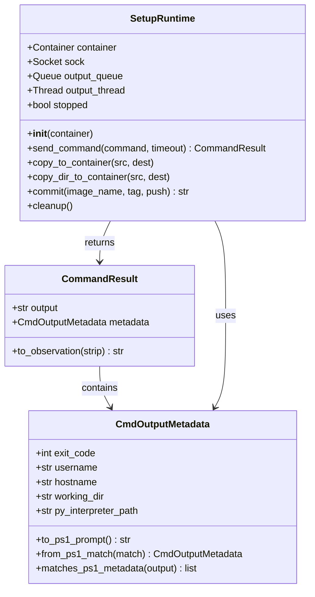
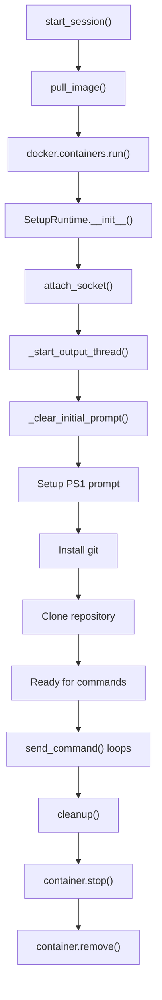
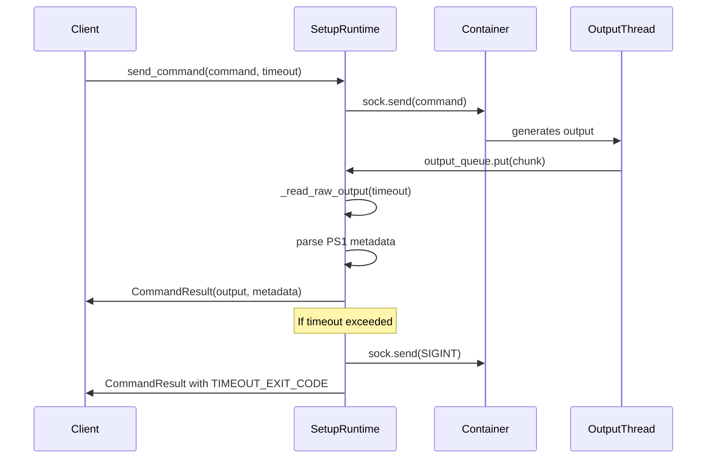
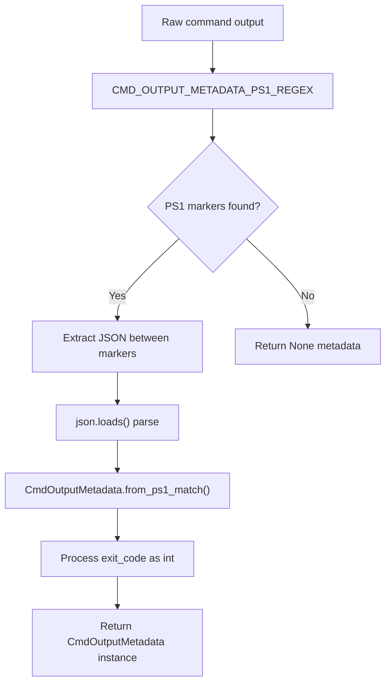
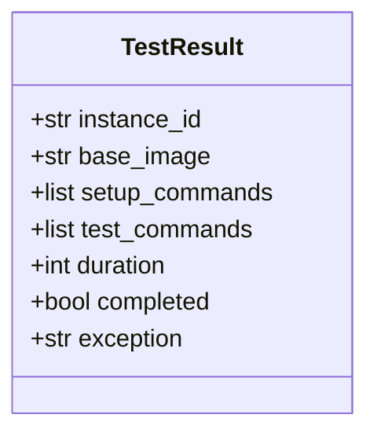

<!-- source: DeepWiki mcp.deepwiki.com · repo microsoft/SWE-bench-Live · page 3.3 Runtime Environment · fetched 2026-10-26 -->

# Runtime Environment

<details>
<summary>Relevant source files</summary>

The following files were used as context for generating this wiki page:

- [launch/git_launch/runtime.py](launch/git_launch/runtime.py)
- [launch/test-result.json](launch/test-result.json)

</details>


This document details the Docker container runtime system that provides isolated execution environments for repository testing and command execution. The runtime manages containerized bash sessions, captures command output with metadata, handles file operations, and formats test results for evaluation.

For information about the LLM integration that drives the runtime, see [LLM Integration](#3.1). For details about the agent system that orchestrates runtime operations, see [Agent System](#3.2).

## Container Runtime Architecture

The runtime environment is built around the `SetupRuntime` class, which manages Docker containers with persistent bash sessions and provides command execution capabilities with comprehensive output capture.

### Runtime Components



Sources: [launch/git_launch/runtime.py:159-356]()

### Container Session Lifecycle

The runtime follows a specific lifecycle for managing Docker container sessions:



Sources: [launch/git_launch/runtime.py:376-432](), [launch/git_launch/runtime.py:166-197](), [launch/git_launch/runtime.py:325-339]()

## Command Execution System

The runtime provides robust command execution with timeout handling, output capture, and metadata extraction through a customized bash prompt system.

### Command Execution Flow



Sources: [launch/git_launch/runtime.py:256-284](), [launch/git_launch/runtime.py:217-238]()

### PS1 Prompt System

The runtime uses a custom PS1 prompt to capture execution metadata in JSON format:

| Metadata Field | Shell Variable | Purpose |
|----------------|----------------|---------|
| `exit_code` | `$?` | Last command exit status |
| `username` | `\u` | Current user context |
| `hostname` | `\h` | Container hostname |
| `working_dir` | `$(pwd)` | Current working directory |
| `py_interpreter_path` | `$(which python)` | Active Python interpreter |

The PS1 prompt format uses delimiter markers:
- Begin: `\n###PS1JSON###\n`
- End: `\n###PS1END###`

Sources: [launch/git_launch/runtime.py:24-29](), [launch/git_launch/runtime.py:53-75](), [launch/git_launch/runtime.py:181-194]()

## Output Capture and Processing

### Output Metadata Extraction



Sources: [launch/git_launch/runtime.py:78-108](), [launch/git_launch/runtime.py:225-237]()

### Command Result Formatting

The `CommandResult.to_observation()` method formats output for agent consumption:

1. **ANSI Code Stripping**: Removes color codes and carriage returns
2. **Length Truncation**: Limits output to 8KB with middle truncation
3. **Context Addition**: Appends shell prompt and exit code information

```
Output content here...
username@hostname:/working/dir $

exit code: 0
```

Sources: [launch/git_launch/runtime.py:123-156]()

## File Operations

The runtime provides file transfer capabilities between the host and container:

### File Transfer Methods

| Method | Purpose | Implementation |
|--------|---------|----------------|
| `copy_to_container()` | Copy single file/directory | Uses tarfile with arcname handling |
| `copy_dir_to_container()` | Copy directory recursively | Path.rglob() with relative paths |

Both methods use tarfile streams and Docker's `put_archive()` API for efficient transfer.

Sources: [launch/git_launch/runtime.py:286-324]()

## Container Configuration

### Resource Limits

The runtime applies the following resource constraints:

```python
MEM_LIMIT = "8g"
CPU_CORES = 4
```

### Container Setup Parameters

| Parameter | Value | Purpose |
|-----------|--------|---------|
| `mem_limit` | `"8g"` | Memory limit |
| `cpu_quota` | `400000` | CPU time quota (4 cores) |
| `working_dir` | `"/testbed"` | Default working directory |
| `environment.TERM` | `"xterm-mono"` | Terminal type |
| `extra_hosts` | `host.docker.internal` | Host access |

Sources: [launch/git_launch/runtime.py:33-34](), [launch/git_launch/runtime.py:402-418]()

## Test Result Format

The runtime produces structured test results in JSON format:

### Result Schema



### Example Output Structure

```json
{
    "instance_id": "repo__project-123",
    "base_image": "python:3.10",
    "setup_commands": ["pip install poetry", "poetry install"],
    "test_commands": ["poetry run pytest -rA"],
    "duration": 3,
    "completed": true,
    "exception": null
}
```

Sources: [launch/test-result.json:1-17]()

## Error Handling and Timeouts

### Timeout Management

The runtime implements a two-stage timeout system:

1. **Command Timeout**: Default 20 minutes per command
2. **Kill Timeout**: 5 seconds for cleanup after SIGINT

When a timeout occurs:
- Sets exit code to `TIMEOUT_EXIT_CODE` (124)
- Appends `"**Exited due to timeout**"` to output
- Attempts graceful termination with SIGINT

Sources: [launch/git_launch/runtime.py:31](), [launch/git_launch/runtime.py:269-284]()

### Container Cleanup

The `cleanup()` method ensures proper resource management:
- Stops the container gracefully
- Removes the container with force if needed
- Sets `stopped` flag to prevent double cleanup
- Handles exceptions during cleanup process

Sources: [launch/git_launch/runtime.py:325-339]()

---

