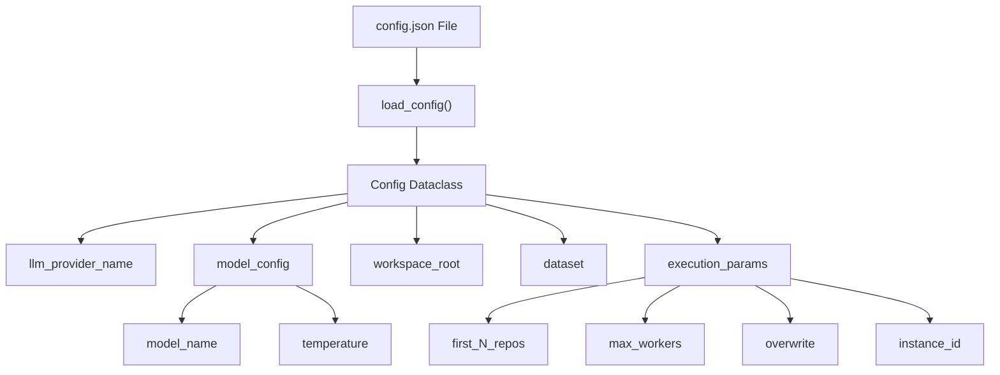
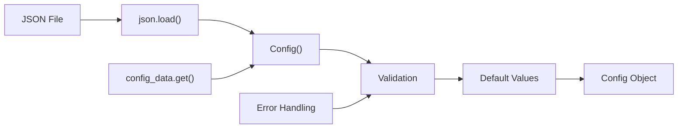
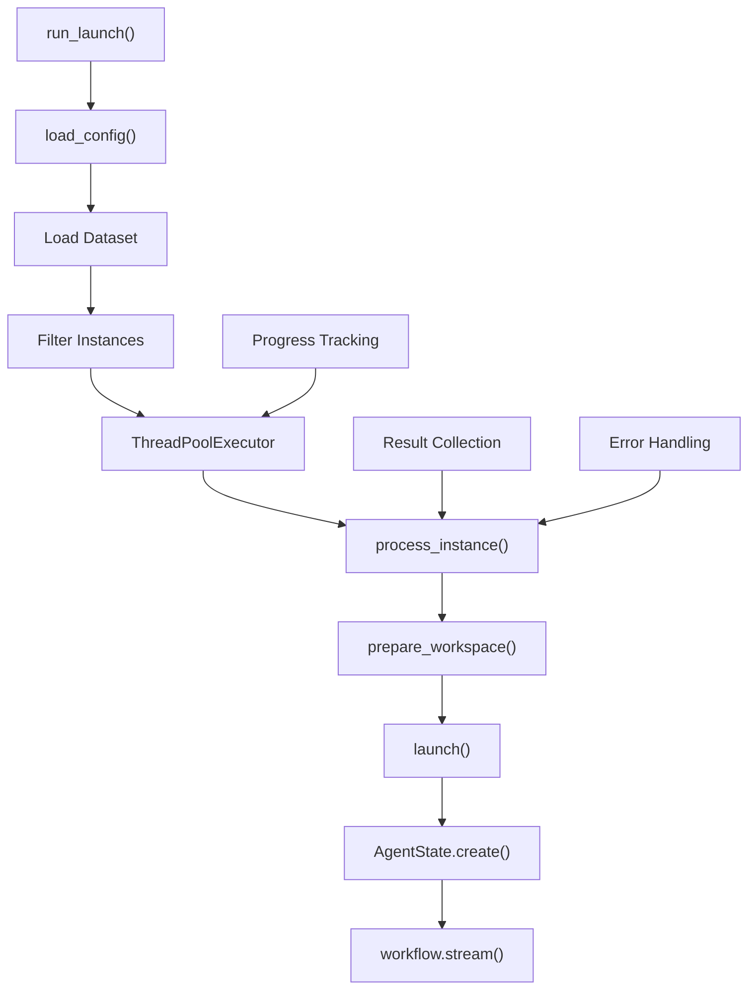
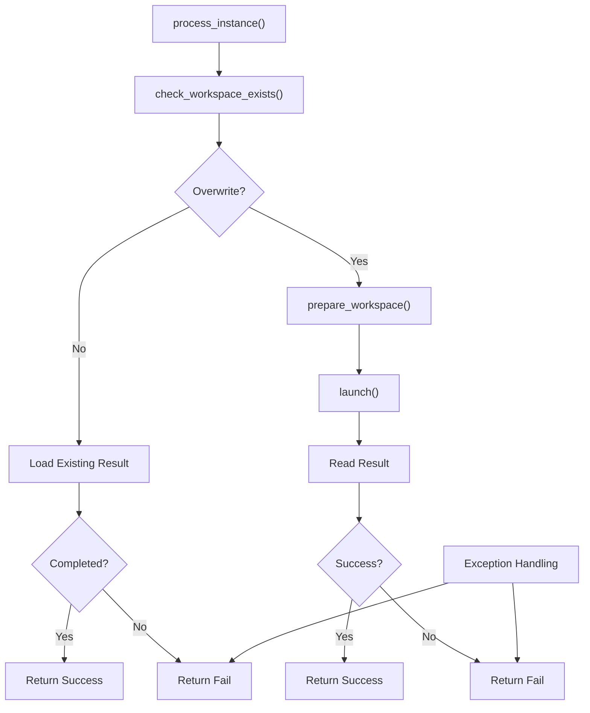
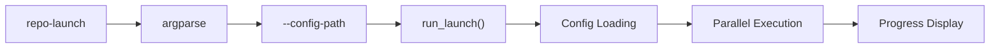
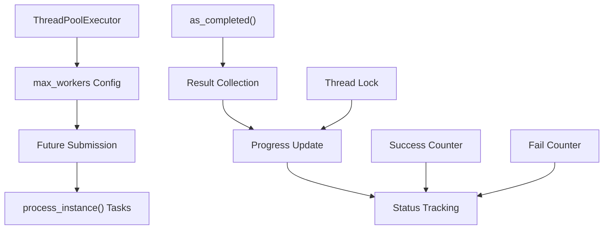
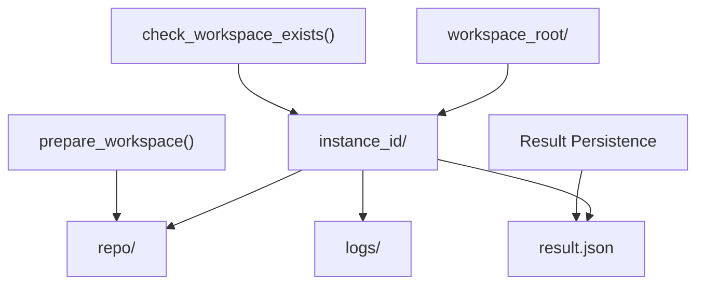
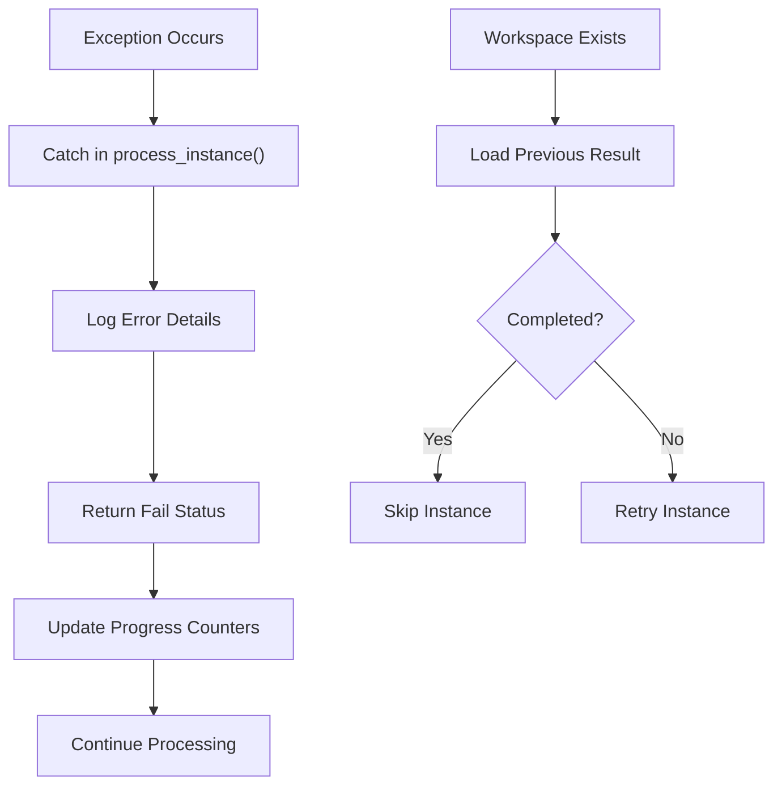

<!-- source: DeepWiki mcp.deepwiki.com · repo microsoft/SWE-bench-Live · page 3.4 Configuration & Execution · fetched 2026-10-26 -->

# Configuration & Execution

<details>
<summary>Relevant source files</summary>

The following files were used as context for generating this wiki page:

- [launch/git_launch/launch.py](launch/git_launch/launch.py)
- [launch/git_launch/run.py](launch/git_launch/run.py)
- [launch/git_launch/utilities/config.py](launch/git_launch/utilities/config.py)
- [launch/test-config.json](launch/test-config.json)

</details>


This document covers how to configure and execute RepoLaunch operations, including configuration file management, command-line interfaces, and parallel processing capabilities. For details about the underlying agent workflows and runtime environments, see [Agent System](#3.2) and [Runtime Environment](#3.3).

## Configuration System

RepoLaunch uses a JSON-based configuration system managed by the `Config` dataclass. The configuration controls LLM provider settings, workspace management, dataset processing, and execution parameters.

### Configuration Structure



Sources: [launch/git_launch/utilities/config.py:1-67](), [launch/test-config.json:1-11]()

### Configuration Parameters

| Parameter | Type | Default | Description |
|-----------|------|---------|-------------|
| `llm_provider_name` | str | "AOAI" | LLM provider identifier |
| `model_config` | dict | `{"model_name": "gpt-4o-20241120", "temperature": 0.0}` | Model configuration |
| `workspace_root` | str | Required | Root directory for workspace creation |
| `dataset` | str | Required | Path to JSONL dataset file |
| `first_N_repos` | int | -1 | Limit processing to first N repos (-1 for all) |
| `max_workers` | int | 5 | Number of parallel workers |
| `overwrite` | bool | false | Whether to overwrite existing results |
| `instance_id` | str | null | Specific instance ID to run |
| `print_to_console` | bool | true | Enable console logging |

Sources: [launch/git_launch/utilities/config.py:8-35]()

### Configuration Loading

The `load_config()` function processes JSON configuration files with validation and default value assignment:



Sources: [launch/git_launch/utilities/config.py:37-66]()

## Execution Architecture

RepoLaunch supports both single-instance and parallel batch execution modes through the `run_launch()` orchestration system.

### Execution Flow



Sources: [launch/git_launch/run.py:73-147](), [launch/git_launch/launch.py:12-36]()

### Instance Processing

The `process_instance()` function handles individual repository launches with workspace management and error recovery:



Sources: [launch/git_launch/run.py:28-71]()

## Command Line Interface

RepoLaunch provides a command-line entry point through the `main()` function with argparse configuration.

### CLI Structure



Sources: [launch/git_launch/run.py:149-167]()

### Usage Example

```bash
repo-launch --config-path launch/test-config.json
```

The CLI supports the following argument:
- `--config-path`: Required path to JSON configuration file

Sources: [launch/git_launch/run.py:155-163]()

## Parallel Processing

RepoLaunch implements thread-based parallel processing using `ThreadPoolExecutor` for efficient batch operations.

### Concurrency Architecture



Sources: [launch/git_launch/run.py:116-144]()

### Progress Tracking

The system uses Rich library components for real-time progress visualization:

| Component | Purpose |
|-----------|---------|
| `SpinnerColumn` | Visual activity indicator |
| `TextColumn` | Success/fail counters |
| `BarColumn` | Progress bar visualization |
| `TimeElapsedColumn` | Execution time tracking |

Sources: [launch/git_launch/run.py:98-114]()

## Workspace Management

RepoLaunch manages workspace creation and result persistence through the workspace root directory structure.

### Workspace Structure



Sources: [launch/git_launch/run.py:47-48](), [launch/git_launch/utilities/utils.py]()

### Result Format

Each instance generates a `result.json` file with execution status and metadata:

```json
{
    "completed": true,
    "exception": null,
    "duration": 120.5,
    "setup_commands": [...],
    "test_commands": [...]
}
```

Sources: [launch/git_launch/run.py:49-50](), [launch/git_launch/run.py:59-68]()

## Error Handling and Recovery

The execution system implements comprehensive error handling with graceful degradation and skip logic.

### Error Flow



Sources: [launch/git_launch/run.py:69-70](), [launch/git_launch/run.py:125-144]()

---

