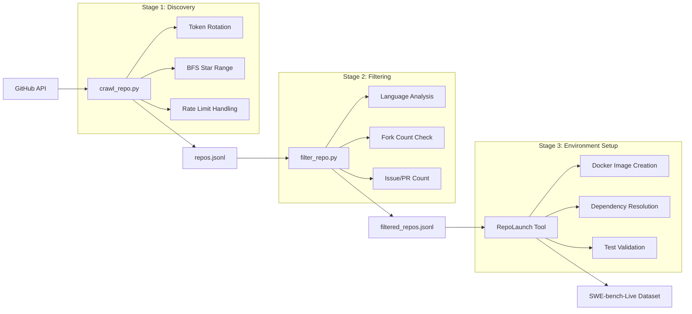
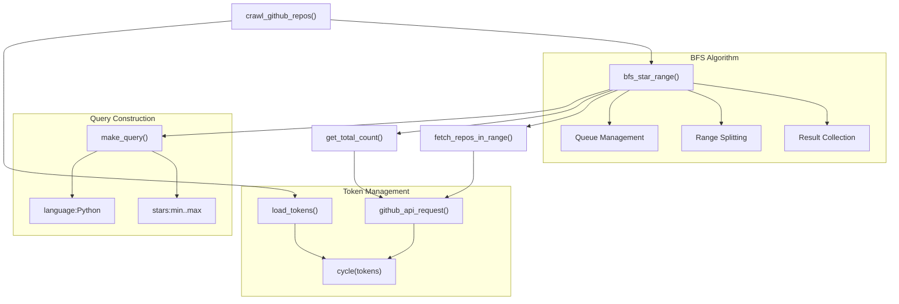
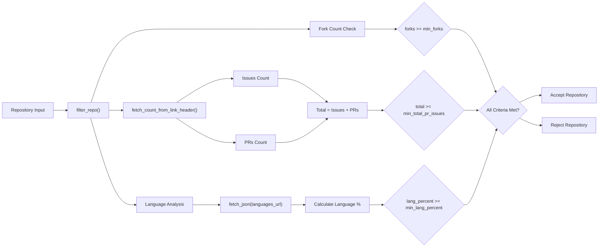

<!-- source: DeepWiki mcp.deepwiki.com · repo microsoft/SWE-bench-Live · page 4 Curation Pipeline Components · fetched 2026-10-26 -->

# Curation Pipeline Components

<details>
<summary>Relevant source files</summary>

The following files were used as context for generating this wiki page:

- [curation/crawl_repo.py](curation/crawl_repo.py)
- [curation/filter_repo.py](curation/filter_repo.py)

</details>


This document covers the automated dataset curation pipeline that discovers, filters, and prepares GitHub repositories for inclusion in the SWE-bench-Live dataset. The pipeline consists of two primary stages: repository discovery through GitHub API crawling and quality-based filtering. For detailed information about the RepoLaunch tool used for environment setup after filtering, see [RepoLaunch Deep Dive](#3). For the overall system architecture context, see [System Architecture](#2).

## Overview

The curation pipeline automatically maintains the SWE-bench-Live dataset by continuously discovering and evaluating GitHub repositories. The pipeline operates in distinct stages, each implemented as standalone Python modules that can be executed independently or as part of an automated workflow.

## Pipeline Architecture

The curation pipeline follows a linear workflow where each stage produces output consumed by the next stage:

**Curation Pipeline Workflow**


Sources: [curation/crawl_repo.py:1-181](), [curation/filter_repo.py:1-201]()

## Core Components

### Repository Discovery Module

The `crawl_repo.py` module implements intelligent GitHub repository discovery using the GitHub Search API. It employs a breadth-first search strategy to handle API rate limits and result pagination constraints.

**Key Functions and Classes**


Sources: [curation/crawl_repo.py:13-18](), [curation/crawl_repo.py:21-31](), [curation/crawl_repo.py:85-130]()

### Repository Filtering Module  

The `filter_repo.py` module implements asynchronous repository evaluation based on configurable quality criteria. It uses concurrent HTTP requests to efficiently gather repository metadata.

**Filtering Criteria and Implementation**


Sources: [curation/filter_repo.py:80-124](), [curation/filter_repo.py:53-77](), [curation/filter_repo.py:127-193]()

## Data Flow and Processing

### Repository Discovery Data Flow

The crawling process transforms GitHub search parameters into a comprehensive repository dataset:

| Stage | Input | Processing | Output |
|-------|-------|------------|--------|
| **Token Loading** | `.cache/tokens.txt` | `load_tokens()` | `cycle(tokens)` |
| **Query Construction** | Language, star range | `make_query()` | GitHub search query string |
| **BFS Exploration** | Query, API limits | `bfs_star_range()` | Repository list |
| **Result Storage** | Repository objects | JSON serialization | `repos.jsonl` |

### Repository Filtering Data Flow

The filtering process evaluates each repository against multiple quality criteria:

| Criterion | API Endpoint | Processing Function | Threshold Check |
|-----------|-------------|-------------------|-----------------|
| **Fork Count** | Repository metadata | Direct field access | `>= min_forks` |
| **Issues Count** | `/repos/{owner}/{repo}/issues` | `fetch_count_from_link_header()` | Combined with PRs |
| **PRs Count** | `/repos/{owner}/{repo}/pulls` | `fetch_count_from_link_header()` | Combined with Issues |
| **Language %** | `/repos/{owner}/{repo}/languages` | `fetch_json()` + calculation | `>= min_lang_percent` |

Sources: [curation/filter_repo.py:94-124](), [curation/filter_repo.py:147-152]()

## Configuration and Execution

### Discovery Configuration

The `crawl_github_repos()` function accepts the following parameters:

```python
# Key parameters from crawl_repo.py
language="Python"          # Target programming language
min_stars=10000            # Minimum star count
max_stars=None             # Maximum star count (None = unlimited)
tokens_file=".cache/tokens.txt"  # GitHub API tokens
output_file="repos.jsonl"  # Output file path
```

### Filtering Configuration

The `filter_main()` function provides comprehensive filtering controls:

```python
# Key parameters from filter_repo.py
min_total_pr_issues=200    # Minimum combined issues + PRs
min_forks=200              # Minimum fork count
language="Python"          # Target language for percentage check
min_lang_percent=60.0      # Minimum language percentage
max_workers=5              # Concurrent request limit
```

Sources: [curation/crawl_repo.py:133-139](), [curation/filter_repo.py:127-136]()

## Technical Implementation Details

### Rate Limiting and Token Management

Both modules implement sophisticated rate limiting strategies:

- **Token Rotation**: Multiple GitHub API tokens are cycled using `itertools.cycle()`
- **Backoff Strategy**: 403 responses trigger immediate token rotation with 1-second delay
- **Request Retry**: Failed requests are automatically retried with different tokens

### Concurrent Processing

The filtering module uses `asyncio` and `aiohttp` for high-performance concurrent processing:

- **Semaphore Control**: Limits concurrent requests via `asyncio.Semaphore(max_workers)`
- **Connection Pooling**: `aiohttp.TCPConnector(limit=max_workers)` manages HTTP connections
- **Progress Tracking**: Real-time progress display using `rich.progress`

### Error Handling and Resilience

Both modules implement comprehensive error handling:

- **API Errors**: HTTP errors are caught and logged, with automatic retry for transient failures  
- **Data Validation**: Input validation ensures required fields are present
- **Graceful Degradation**: Failed requests don't halt the entire pipeline

Sources: [curation/crawl_repo.py:34-49](), [curation/filter_repo.py:31-51](), [curation/filter_repo.py:154-184]()

---

