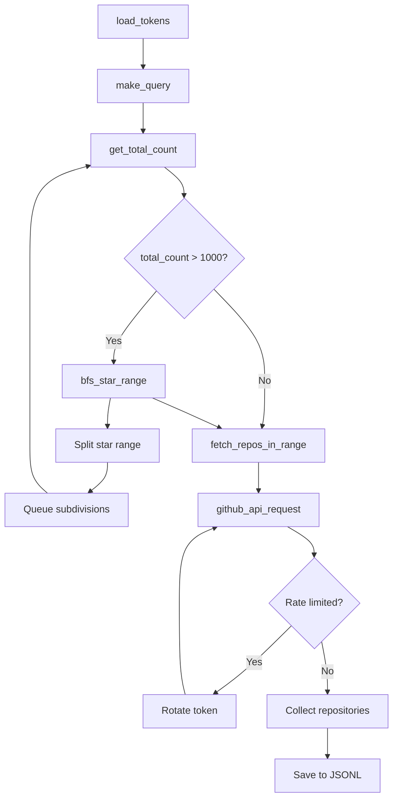
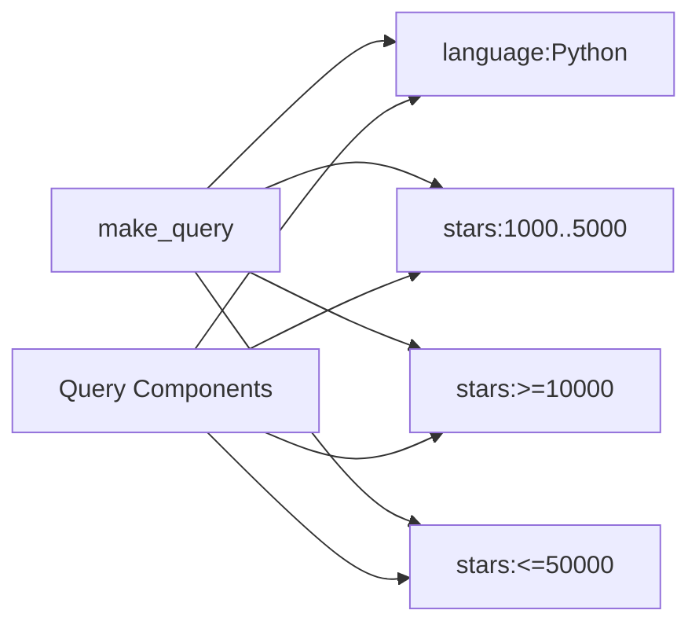
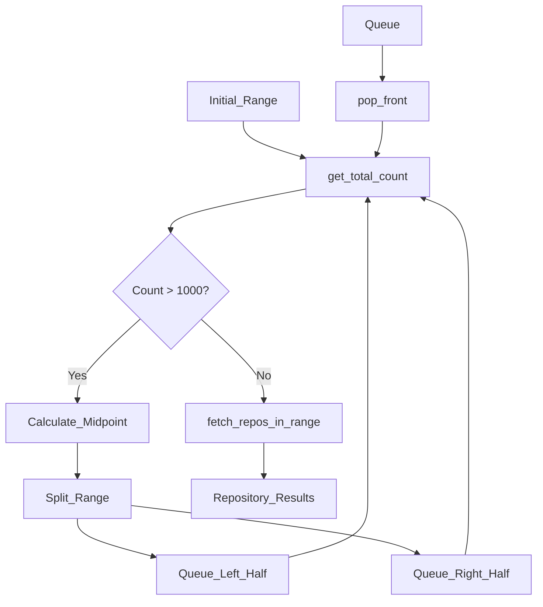
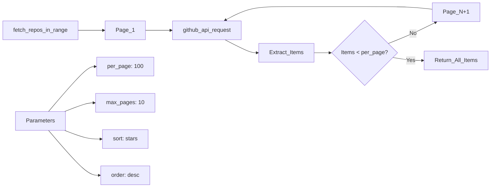
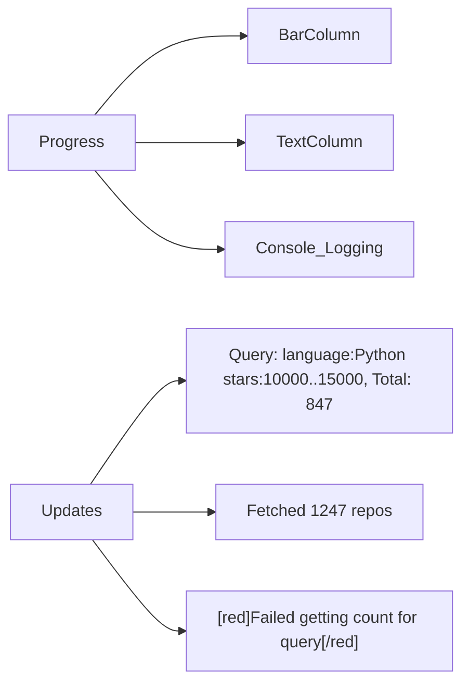

<!-- source: DeepWiki mcp.deepwiki.com · repo microsoft/SWE-bench-Live · page 4.1 Repository Discovery · fetched 2026-10-26 -->

# Repository Discovery

Relevant source files

The following files were used as context for generating this wiki page:

- [curation/crawl_repo.py](curation/crawl_repo.py)

This document explains the GitHub repository crawling system that automatically discovers repositories based on programming language and star count criteria. The system uses GitHub's Search API with token rotation and breadth-first search (BFS) exploration to systematically collect repository data for the SWE-bench-Live dataset curation pipeline.

For information about filtering the discovered repositories, see [Repository Filtering](#4.2). For the overall curation pipeline context, see [Dataset Curation Pipeline](#2.2).

## System Overview

The repository discovery system (`crawl_repo.py`) implements a sophisticated GitHub API crawler that overcomes API limitations through intelligent search space partitioning and token rotation.

### Repository Discovery Workflow

Sources: [curation/crawl_repo.py:1-181]()

## Core Components

### Token Management System

The crawler implements a token rotation mechanism to handle GitHub API rate limits efficiently:

| Component | Function | Purpose |
|-----------|----------|---------|
| Token Loading | `load_tokens()` | Loads GitHub API tokens from file |
| Token Cycling | `cycle()` iterator | Rotates through available tokens |
| Rate Limit Handling | `github_api_request()` | Automatically switches tokens on 403 errors |

The system loads tokens from a file and creates a cycling iterator to rotate through them when rate limits are encountered.

Sources: [curation/crawl_repo.py:13-18](), [curation/crawl_repo.py:34-49]()

### Query Construction

The `make_query()` function builds GitHub search queries with the following parameters:

Query parameters are combined using GitHub's search syntax to filter repositories by programming language and star count ranges.

Sources: [curation/crawl_repo.py:21-31]()

### BFS Star Range Exploration

The core innovation is the `bfs_star_range()` function that implements breadth-first search to handle GitHub's 1000-result limit per search query:

The algorithm recursively subdivides star ranges until each range contains fewer than 1000 repositories, enabling complete coverage of the search space.

Sources: [curation/crawl_repo.py:85-130]()

## API Interaction Layer

### GitHub API Request Handler

The `github_api_request()` function provides robust API interaction with the following features:

| Feature | Implementation | Benefit |
|---------|---------------|---------|
| Token Rotation | Automatic token switching on 403 | Handles rate limits |
| Retry Logic | Continuous retry with different tokens | Ensures request completion |
| Standard Headers | GitHub API v2022-11-28 compliance | Consistent API usage |
| Error Handling | `raise_for_status()` on success | Proper error propagation |

Sources: [curation/crawl_repo.py:34-49]()

### Repository Fetching Strategy

The `fetch_repos_in_range()` function implements paginated repository retrieval:

The function fetches up to 1000 repositories (10 pages × 100 per page) sorted by star count in descending order.

Sources: [curation/crawl_repo.py:58-82]()

## Configuration and Usage

### Main Function Interface

The `crawl_github_repos()` function serves as the primary entry point with configurable parameters:

| Parameter | Default | Purpose |
|-----------|---------|---------|
| `language` | "Python" | Target programming language |
| `min_stars` | 10000 | Minimum star count threshold |
| `max_stars` | None | Maximum star count (unbounded if None) |
| `tokens_file` | ".cache/tokens.txt" | Path to GitHub API tokens |
| `output_file` | "repos.jsonl" | Output file for discovered repositories |

The function orchestrates the entire discovery process with progress tracking and console output.

Sources: [curation/crawl_repo.py:133-177]()

### Output Format

Discovered repositories are saved in JSONL format, with each line containing a complete GitHub repository object as returned by the GitHub API. This format enables efficient streaming processing for subsequent filtering operations.

Sources: [curation/crawl_repo.py:169-172]()

### Progress Tracking

The system uses the `rich` library to provide real-time progress feedback:

Progress updates include query details, repository counts, and error messages with color coding for different message types.

Sources: [curation/crawl_repo.py:145-156](), [curation/crawl_repo.py:97-101]()

---

