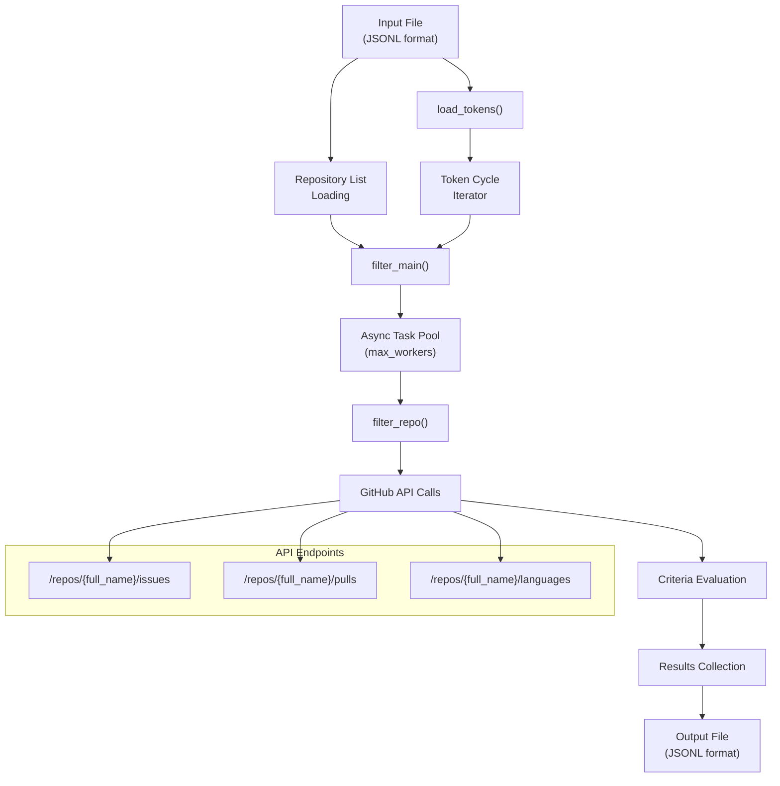
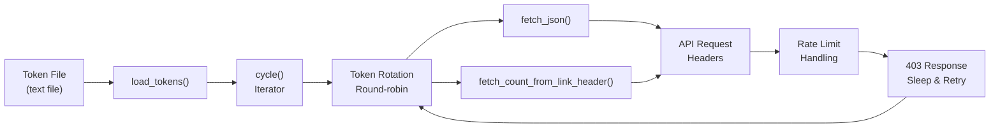
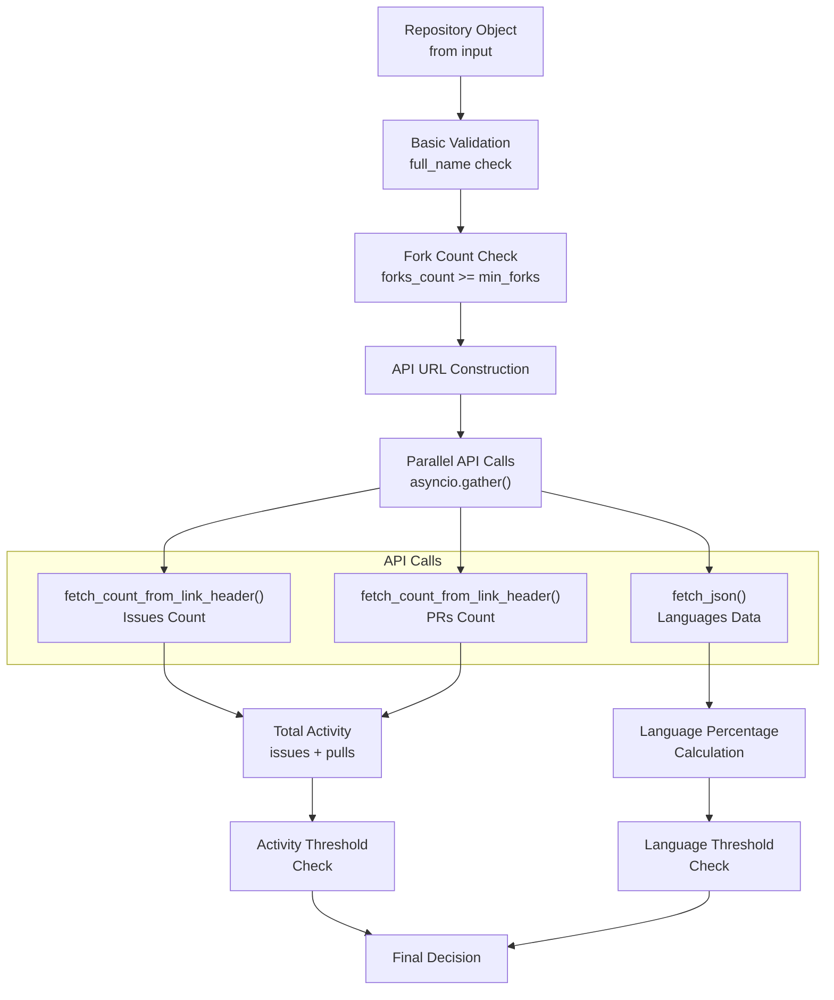
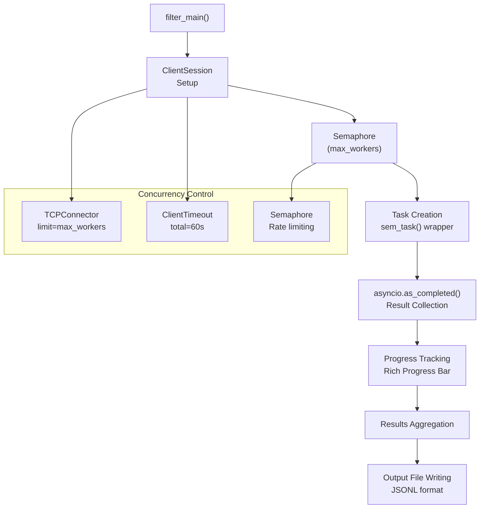

<!-- source: DeepWiki mcp.deepwiki.com · repo microsoft/SWE-bench-Live · page 4.2 Repository Filtering · fetched 2026-10-26 -->

# Repository Filtering

<details>
<summary>Relevant source files</summary>

The following files were used as context for generating this wiki page:

- [curation/filter_repo.py](curation/filter_repo.py)

</details>


This document covers the repository filtering system that evaluates GitHub repositories against specific criteria to determine their suitability for inclusion in the SWE-bench-Live dataset. The filtering process occurs after repository discovery (see [Repository Discovery](#4.1)) and before environment setup with RepoLaunch.

The filtering system applies quantitative criteria based on repository activity, community engagement, and programming language composition to ensure that selected repositories represent active, well-maintained projects suitable for software engineering benchmarks.

## Overview

The repository filtering system is implemented in `curation/filter_repo.py` and operates as an asynchronous pipeline that processes repositories discovered during the crawling phase. The system evaluates each repository against four primary criteria:

| Criterion | Purpose | Default Threshold |
|-----------|---------|-------------------|
| Fork Count | Indicates community interest and project maturity | 200 forks |
| Total Issues + PRs | Measures project activity and maintenance | 200 combined |
| Language Percentage | Ensures target language dominance | 60% of codebase |
| Language Type | Filters for specific programming language | Python |

The filtering process uses the GitHub API to gather detailed repository metrics and applies these criteria to create a curated subset of repositories suitable for benchmark tasks.

**Sources:** [curation/filter_repo.py:1-6]()

## Filtering Architecture

The filtering system follows an asynchronous architecture designed for high-throughput processing of repository lists:



**Sources:** [curation/filter_repo.py:127-196]()

## Token Management System

The filtering system implements GitHub API token rotation to handle rate limiting and maximize throughput:



The `load_tokens()` function reads GitHub personal access tokens from a file and creates a cyclic iterator using `itertools.cycle()`. Each API request uses the next token in rotation, and when rate limits are hit (HTTP 403), the system sleeps briefly and retries with the next token.

**Sources:** [curation/filter_repo.py:23-28](), [curation/filter_repo.py:34-50]()

## Filtering Criteria Implementation

### Repository Metrics Collection

The `filter_repo()` function orchestrates the collection of repository metrics through parallel API calls:



**Sources:** [curation/filter_repo.py:80-124]()

### Count Extraction from Pagination

The system uses GitHub's Link header pagination to efficiently determine total counts without fetching all items:

```mermaid
sequenceDiagram
    participant FC as "fetch_count_from_link_header()"
    participant API as "GitHub API"
    participant LH as "Link Header Parser"
    
    FC->>API: GET /repos/{owner}/{repo}/issues?per_page=1&state=all
    API->>FC: Response with Link header
    FC->>LH: Extract 'rel="last"' link
    LH->>FC: Parse page number from URL
    FC->>FC: Return page number as total count
    
    Note over FC,LH: Regex: r'&page=(\d+)>; rel="last"'
```

The `fetch_count_from_link_header()` function requests only the first page with `per_page=1` and extracts the total count from the `Link` header's `rel="last"` page number, avoiding the need to paginate through all results.

**Sources:** [curation/filter_repo.py:53-77]()

## Language Analysis System

The language percentage calculation determines the proportion of target language code in the repository:

| Field | Source | Calculation |
|-------|--------|-------------|
| `total_bytes` | Sum of all language bytes from `/languages` endpoint | `sum(langs_data.values())` |
| `target_bytes` | Bytes for specified language | `langs_data.get(criteria["language"], 0)` |
| `percentage` | Target language percentage | `(target_bytes / total_bytes) * 100` |

The system fetches language statistics from the GitHub API `/repos/{owner}/{repo}/languages` endpoint, which returns byte counts for each detected programming language. Repositories must have at least 60% (configurable) of their codebase in the target language to pass filtering.

**Sources:** [curation/filter_repo.py:115-122]()

## Asynchronous Processing Pipeline

The filtering system uses asyncio for concurrent processing with configurable worker limits:



The system creates a pool of async tasks controlled by a semaphore to limit concurrent GitHub API requests. Each repository is processed by a `sem_task()` wrapper that ensures the semaphore is properly acquired and released.

**Sources:** [curation/filter_repo.py:154-184]()

## Configuration Parameters

The filtering system accepts the following configuration parameters:

| Parameter | Type | Default | Description |
|-----------|------|---------|-------------|
| `input_file` | str | Required | Path to repository list (JSONL) |
| `output_file` | str | Required | Path for filtered results (JSONL) |
| `token_file` | str | Required | Path to GitHub tokens file |
| `min_total_pr_issues` | int | 200 | Minimum combined issues + PRs |
| `min_forks` | int | 200 | Minimum fork count |
| `language` | str | "Python" | Target programming language |
| `min_lang_percent` | float | 60.0 | Minimum language percentage |
| `max_workers` | int | 5 | Concurrent request limit |

These parameters are passed to `filter_main()` and can be configured via command-line arguments through the Fire library integration.

**Sources:** [curation/filter_repo.py:127-136]()

## Error Handling and Resilience

The filtering system implements several resilience mechanisms:

### API Error Recovery
- **Rate Limit Handling**: HTTP 403 responses trigger sleep and retry with token rotation
- **Request Timeouts**: 60-second timeout prevents hanging requests
- **Exception Logging**: All API errors are logged with rich formatting
- **Graceful Degradation**: Failed requests return empty data structures instead of crashing

### Data Validation
- **Repository Validation**: Checks for required `full_name` field
- **Numeric Defaults**: Uses default values (0) for missing numeric fields
- **Safe Division**: Prevents division by zero in percentage calculations

**Sources:** [curation/filter_repo.py:42-50](), [curation/filter_repo.py:75-77]()

## Command-Line Interface

The filtering system provides a Fire-based CLI through the `run_filter()` function:

```bash
python curation/filter_repo.py \
    --input_file repos_discovered.jsonl \
    --output_file repos_filtered.jsonl \
    --token_file github_tokens.txt \
    --min_total_pr_issues 200 \
    --min_forks 200 \
    --language Python \
    --min_lang_percent 60.0 \
    --max_workers 5
```

The `run_filter()` function serves as an asyncio wrapper that executes `filter_main()` with the provided arguments.

**Sources:** [curation/filter_repo.py:195-200]()

---

