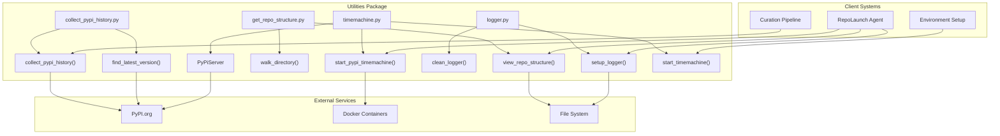
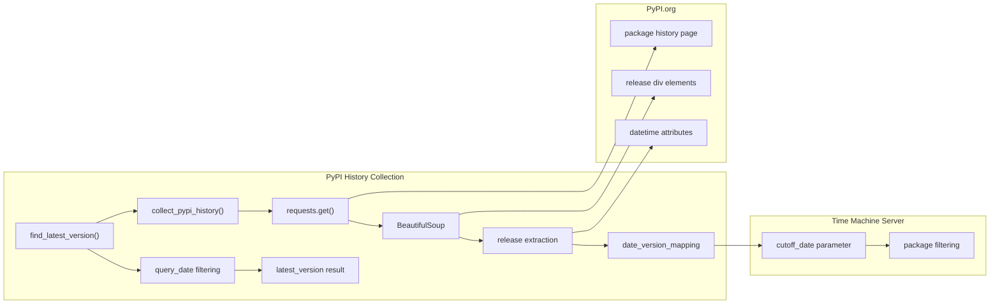
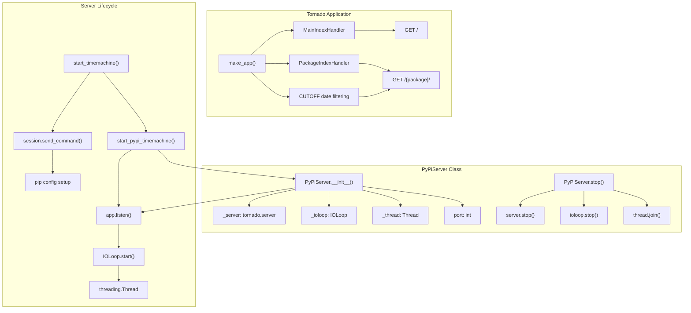
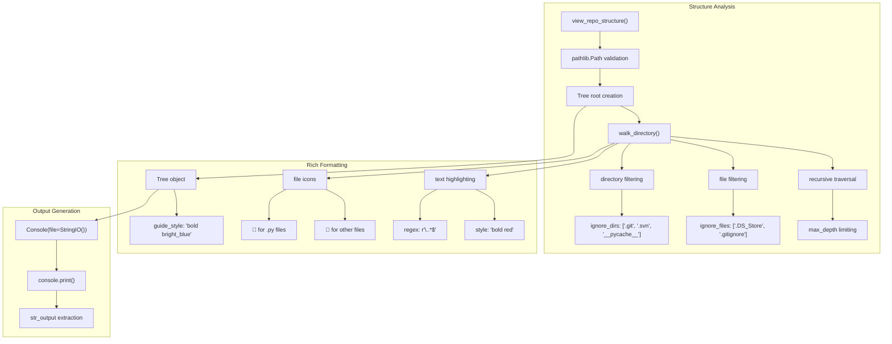
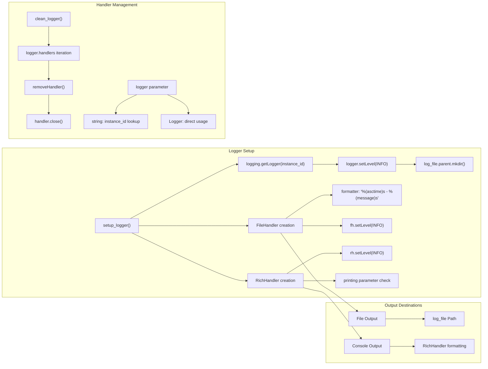

<!-- source: DeepWiki mcp.deepwiki.com · repo microsoft/SWE-bench-Live · page 5 Utilities & Infrastructure · fetched 2026-10-26 -->

# Utilities & Infrastructure

<details>
<summary>Relevant source files</summary>

The following files were used as context for generating this wiki page:

- [launch/git_launch/utilities/collect_pypi_history.py](launch/git_launch/utilities/collect_pypi_history.py)
- [launch/git_launch/utilities/get_repo_structure.py](launch/git_launch/utilities/get_repo_structure.py)
- [launch/git_launch/utilities/logger.py](launch/git_launch/utilities/logger.py)
- [launch/git_launch/utilities/timemachine.py](launch/git_launch/utilities/timemachine.py)

</details>


This section documents the supporting utility modules that enable core SWE-bench-Live functionality, including repository structure analysis, historical package resolution, and logging infrastructure. These utilities support the RepoLaunch tool and curation pipeline by providing essential services for environment setup, debugging, and reproducibility.

For information about the RepoLaunch tool that uses these utilities, see [RepoLaunch Deep Dive](#3). For details about the curation pipeline that leverages this infrastructure, see [Curation Pipeline Components](#4).

## Utility Module Architecture

The utilities are organized into focused modules within the `launch/git_launch/utilities/` directory, each serving specific infrastructure needs:



**Utility Integration Flow**

Sources: [launch/git_launch/utilities/collect_pypi_history.py:1-52](), [launch/git_launch/utilities/get_repo_structure.py:1-76](), [launch/git_launch/utilities/logger.py:1-56](), [launch/git_launch/utilities/timemachine.py:1-194]()

## PyPI Package History System

The PyPI history collection system enables temporal package resolution by scraping release dates from PyPI.org:



**PyPI History Data Flow**

The `collect_pypi_history()` function scrapes PyPI package history pages to extract release dates and versions. It parses HTML elements with class `release` to build chronological mappings [launch/git_launch/utilities/collect_pypi_history.py:21-40](). The `find_latest_version()` function uses this data to resolve the most recent package version available before a specified date [launch/git_launch/utilities/collect_pypi_history.py:7-18]().

| Function | Purpose | Input | Output |
|----------|---------|-------|--------|
| `collect_pypi_history()` | Scrape package release history | `package_name` | List of `(date, version)` tuples |
| `find_latest_version()` | Find latest version before date | `package_name`, `query_date` | Version string or None |

Sources: [launch/git_launch/utilities/collect_pypi_history.py:7-52]()

## PyPI Time Machine Server

The time machine server provides a local PyPI proxy that only serves packages released before a specified cutoff date, ensuring reproducible environment setup:



**PyPI Time Machine Architecture**

The server uses Tornado web framework with two main handlers: `MainIndexHandler` serves the main PyPI index, while `PackageIndexHandler` filters package releases by upload date [launch/git_launch/utilities/timemachine.py:67-94](). The `PyPiServer` class manages server lifecycle with proper cleanup of threads and IOLoop [launch/git_launch/utilities/timemachine.py:104-134]().

The `start_timemachine()` function integrates with `SetupRuntime` containers by configuring pip to use the time machine server as index URL [launch/git_launch/utilities/timemachine.py:170-187]():

```
pip config set global.index-url http://host.docker.internal:{port}
pip config set global.trusted-host host.docker.internal
```

Sources: [launch/git_launch/utilities/timemachine.py:54-194]()

## Repository Structure Visualization

The repository structure system provides rich tree visualization of directory layouts using the Rich library:



**Repository Structure Processing**

The `view_repo_structure()` function creates a string representation of directory trees with configurable depth limiting [launch/git_launch/utilities/get_repo_structure.py:49-75](). The `walk_directory()` function recursively traverses directories while filtering ignored paths and applying Rich formatting [launch/git_launch/utilities/get_repo_structure.py:13-47]().

File type detection adds appropriate icons (🐍 for Python files, 📄 for others) and applies syntax highlighting to file extensions. The system ignores common directories like `.git`, `__pycache__` and files like `.DS_Store` to focus on relevant project structure.

Sources: [launch/git_launch/utilities/get_repo_structure.py:1-76]()

## Logging Infrastructure

The logging system provides structured logging with both file and console output using Rich formatting:



**Logging System Flow**

The `setup_logger()` function creates named logger instances with dual output: file logging for persistence and optional Rich console output for interactive use [launch/git_launch/utilities/logger.py:10-41](). Each logger uses a unique `instance_id` to prevent conflicts during parallel operations.

The logging system includes proper resource management through `clean_logger()` which removes and closes all handlers to prevent resource leaks [launch/git_launch/utilities/logger.py:44-55](). This is critical for long-running processes that create many logger instances.

| Component | Purpose | Configuration |
|-----------|---------|---------------|
| `FileHandler` | Persistent log storage | `%(asctime)s - %(message)s` format |
| `RichHandler` | Formatted console output | INFO level with Rich styling |
| `Logger` cleanup | Resource management | Handler removal and closure |

Sources: [launch/git_launch/utilities/logger.py:1-56]()

## Integration with Core Systems

These utilities integrate with RepoLaunch and curation systems through well-defined interfaces:

- **Repository Analysis**: `view_repo_structure()` provides directory layout information to RepoLaunch agents for understanding project organization
- **Package Resolution**: The time machine server ensures reproducible pip installations by restricting package versions to historical cutoff dates
- **Logging**: Per-instance loggers track operations across parallel RepoLaunch executions with unique identifiers
- **History Collection**: PyPI history data supports both time machine filtering and manual package version resolution

The modular design allows each utility to be used independently while supporting the broader SWE-bench-Live infrastructure requirements for reproducibility, observability, and automated environment setup.

Sources: [launch/git_launch/utilities/collect_pypi_history.py:1-52](), [launch/git_launch/utilities/get_repo_structure.py:1-76](), [launch/git_launch/utilities/logger.py:1-56](), [launch/git_launch/utilities/timemachine.py:1-194]()

---

