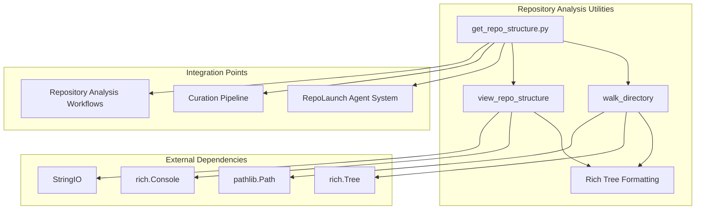
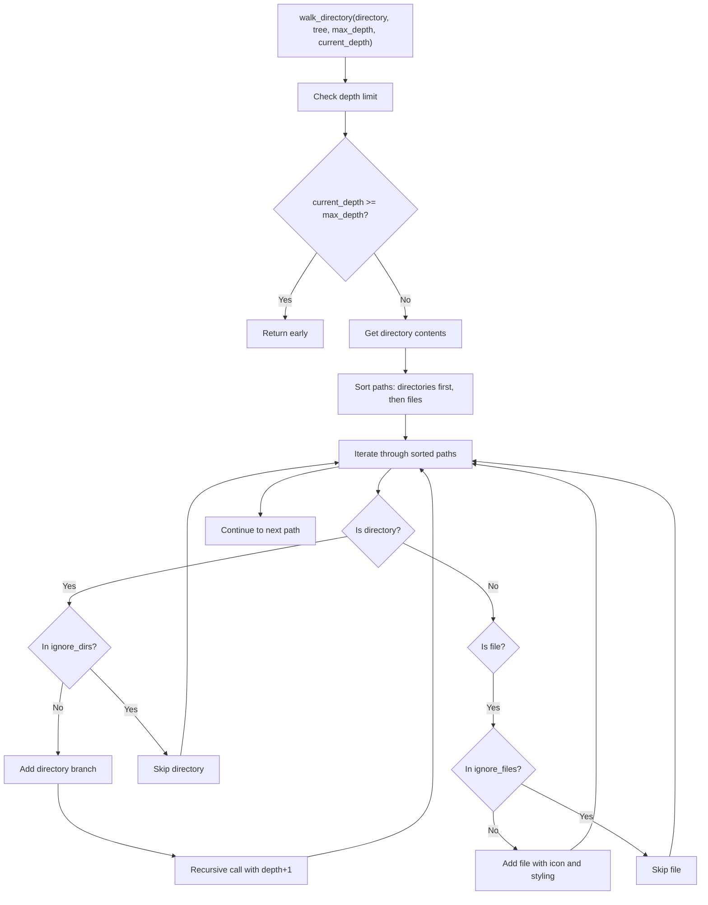
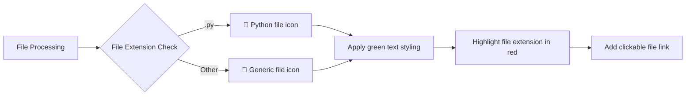
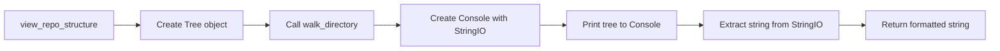

<!-- source: DeepWiki mcp.deepwiki.com · repo microsoft/SWE-bench-Live · page 5.1 Repository Structure Analysis · fetched 2026-10-26 -->

# Repository Structure Analysis

<details>
<summary>Relevant source files</summary>

The following files were used as context for generating this wiki page:

- [launch/git_launch/utilities/get_repo_structure.py](launch/git_launch/utilities/get_repo_structure.py)

</details>


## Purpose and Scope

The Repository Structure Analysis system provides utilities for visualizing and analyzing repository directory structures using rich tree formatting. This component serves as a foundational utility within the SWE-bench-Live system, enabling automated repository analysis during the curation pipeline and within the RepoLaunch tool's environment setup process.

This documentation covers the structure visualization utilities that generate human-readable directory trees. For information about the broader curation pipeline, see [4.2](#4.2). For details about how this integrates with RepoLaunch's repository analysis workflow, see [3.2](#3.2).

## System Overview

The repository structure analysis system centers around the `get_repo_structure.py` module, which provides two primary functions for directory traversal and visualization. The system uses the `rich` library to create formatted, interactive directory trees with file type icons and styling.

### Core Component Architecture



*Sources: [launch/git_launch/utilities/get_repo_structure.py:1-76]()*

## Core Functions

### Directory Walking Algorithm

The `walk_directory` function implements a recursive directory traversal algorithm with depth control and filtering capabilities. The function builds a `Tree` object by recursively exploring directories while respecting specified depth limits and ignoring common version control and cache directories.



*Sources: [launch/git_launch/utilities/get_repo_structure.py:13-47]()*

### Directory Filtering Rules

The system implements filtering logic to exclude common directories and files that are typically not relevant for repository structure analysis:

| Filter Type | Items | Purpose |
|------------|-------|---------|
| `ignore_dirs` | `.git`, `.svn`, `__pycache__` | Exclude version control and cache directories |
| `ignore_files` | `.DS_Store`, `.gitignore`, `.gitattributes` | Exclude system and configuration files |

*Sources: [launch/git_launch/utilities/get_repo_structure.py:26-27]()*

### File Type Styling

The visualization system applies different styling and icons based on file characteristics:



*Sources: [launch/git_launch/utilities/get_repo_structure.py:43-47]()*

## Public Interface

### `view_repo_structure` Function

The primary public interface is the `view_repo_structure` function, which generates a string representation of a repository's directory structure:

**Function Signature:**
```python
def view_repo_structure(directory: str, max_depth: int = -1) -> str
```

**Parameters:**
- `directory`: Path to the directory to visualize
- `max_depth`: Maximum traversal depth (-1 for unlimited)

**Return Value:**
- String representation of the directory tree structure

**Error Handling:**
- Raises `ValueError` if the provided directory path is invalid

*Sources: [launch/git_launch/utilities/get_repo_structure.py:49-75]()*

### Output Format and Console Integration

The function uses a `StringIO` buffer with a `rich.Console` to capture the formatted tree output as a string, making it suitable for logging, file output, or further processing within the SWE-bench-Live system.



*Sources: [launch/git_launch/utilities/get_repo_structure.py:66-75]()*

## Integration with SWE-bench-Live System

The repository structure analysis utilities integrate with several components of the SWE-bench-Live system:

### RepoLaunch Integration

Within the RepoLaunch tool, these utilities help agents understand repository layouts during environment setup, enabling more intelligent decision-making about build configurations and dependency management.

### Curation Pipeline Support

The structure analysis capabilities support the automated curation pipeline by providing insights into repository organization, helping to identify key configuration files, test directories, and project structure patterns.

### Logging and Debugging

The formatted output serves as valuable debugging information during automated repository processing, providing human-readable summaries of repository contents in log files and console output.

*Sources: [launch/git_launch/utilities/get_repo_structure.py:1-76]()*

---

