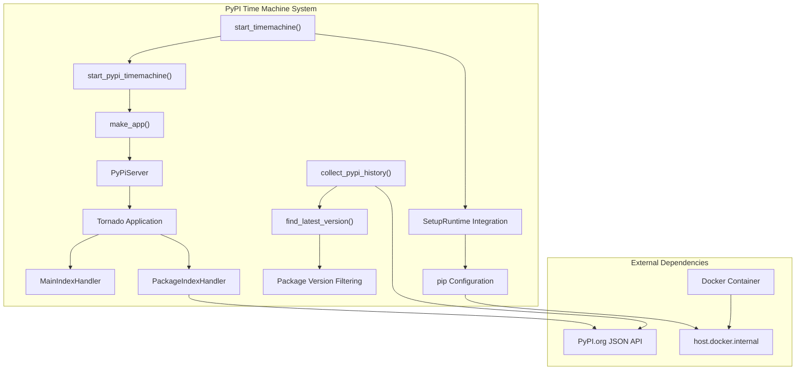
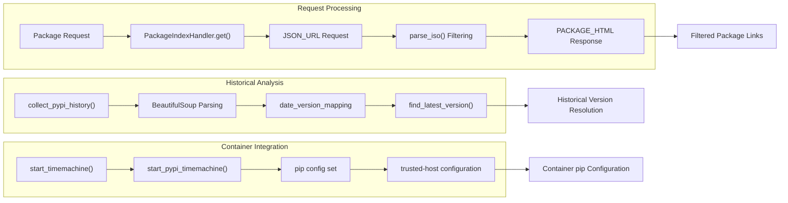
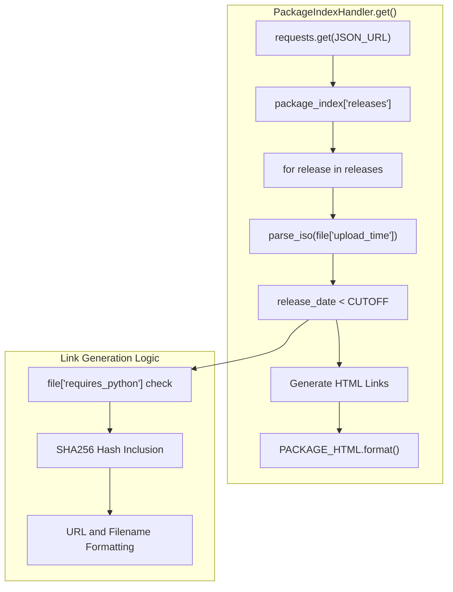
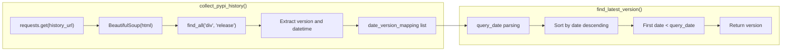
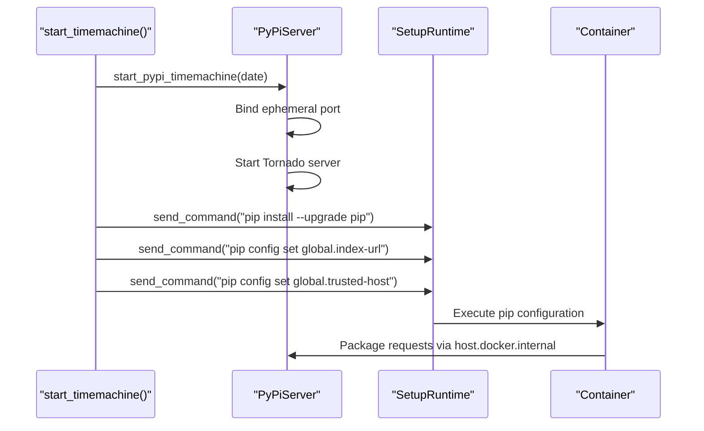
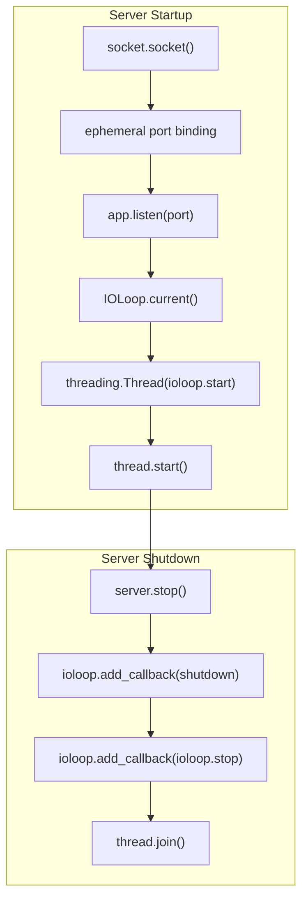

<!-- source: DeepWiki mcp.deepwiki.com · repo microsoft/SWE-bench-Live · page 5.2 PyPI Time Machine · fetched 2026-10-26 -->

# PyPI Time Machine

<details>
<summary>Relevant source files</summary>

The following files were used as context for generating this wiki page:

- [launch/git_launch/utilities/collect_pypi_history.py](launch/git_launch/utilities/collect_pypi_history.py)
- [launch/git_launch/utilities/timemachine.py](launch/git_launch/utilities/timemachine.py)

</details>


## Purpose and Scope

The PyPI Time Machine is a local PyPI server implementation that serves historical package versions to ensure reproducible environment setup in SWE-bench-Live. This system provides a time-bounded package index that only exposes packages released before a specified cutoff date, preventing dependency drift and ensuring consistent builds across different execution times.

This document covers the server implementation, package history collection utilities, and integration with the container runtime system. For information about the broader container runtime environment, see [Runtime Environment](#3.3).

## System Architecture

The PyPI Time Machine operates as a local proxy server that filters PyPI's package index based on temporal constraints. It integrates with Docker containers to provide isolated, reproducible Python package environments.

### Core Architecture



**Sources:** [launch/git_launch/utilities/timemachine.py:54-101](), [launch/git_launch/utilities/timemachine.py:136-167](), [launch/git_launch/utilities/timemachine.py:170-187]()

### Data Flow



**Sources:** [launch/git_launch/utilities/timemachine.py:71-94](), [launch/git_launch/utilities/collect_pypi_history.py:21-40](), [launch/git_launch/utilities/timemachine.py:170-187]()

## Core Components

### Server Implementation

The time machine server is implemented using Tornado web framework with two main request handlers:

| Component | Purpose | Key Methods |
|-----------|---------|-------------|
| `PyPiServer` | Server lifecycle management | `stop()` |
| `MainIndexHandler` | Serves PyPI main index | `get()` |
| `PackageIndexHandler` | Serves filtered package listings | `get(package)` |

The `PackageIndexHandler` performs the core filtering logic by:

1. Fetching package metadata from PyPI's JSON API
2. Parsing upload timestamps using `parse_iso()`
3. Filtering releases based on the cutoff date
4. Generating HTML links with SHA256 hashes and Python requirements



**Sources:** [launch/git_launch/utilities/timemachine.py:71-94](), [launch/git_launch/utilities/timemachine.py:18-32]()

### Historical Package Resolution

The package history collection system scrapes PyPI's web interface to build version chronologies:



**Sources:** [launch/git_launch/utilities/collect_pypi_history.py:7-18](), [launch/git_launch/utilities/collect_pypi_history.py:21-40]()

## Integration with Container Runtime

The time machine integrates with `SetupRuntime` containers through the `start_timemachine()` function, which:

1. Starts the PyPI server on an ephemeral port
2. Configures pip to use `host.docker.internal` as the index URL
3. Sets trusted host configuration for SSL bypass

### Container Configuration Sequence



**Sources:** [launch/git_launch/utilities/timemachine.py:170-187](), [launch/git_launch/utilities/timemachine.py:136-167]()

## Server Lifecycle Management

The `PyPiServer` class provides controlled server lifecycle with thread-safe shutdown:

| Method | Purpose | Implementation |
|--------|---------|----------------|
| `__init__()` | Initialize server wrapper | Store server, IOLoop, thread references |
| `stop()` | Graceful shutdown | Add shutdown callback, stop IOLoop, join thread |

### Thread Management



**Sources:** [launch/git_launch/utilities/timemachine.py:104-134](), [launch/git_launch/utilities/timemachine.py:150-167]()

## Usage Patterns

### Standalone Server Usage

```python
server = start_pypi_timemachine("2023-10-01")
# Server runs on ephemeral port
server.stop()
```

### Container Integration Usage

```python
server = start_timemachine(session, "2023-10-01")
# Configures pip in container session
# Server accessible via host.docker.internal
```

The time machine ensures that package installations within containers only access packages that were available at the specified cutoff date, providing temporal isolation for reproducible builds.

**Sources:** [launch/git_launch/utilities/timemachine.py:190-193](), [launch/git_launch/utilities/timemachine.py:170-187]()

---

