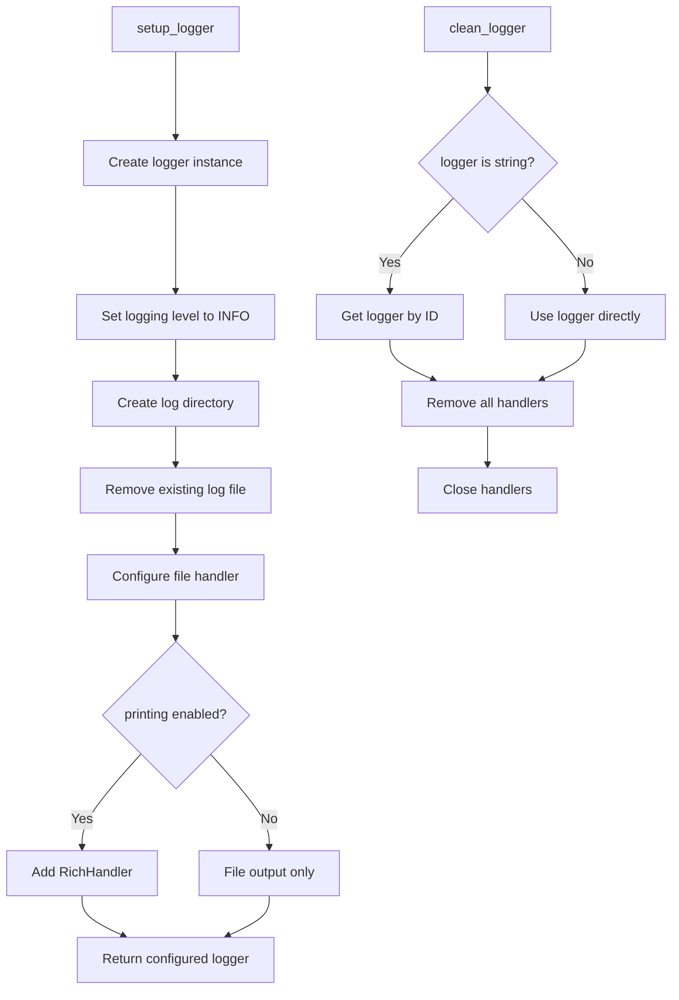
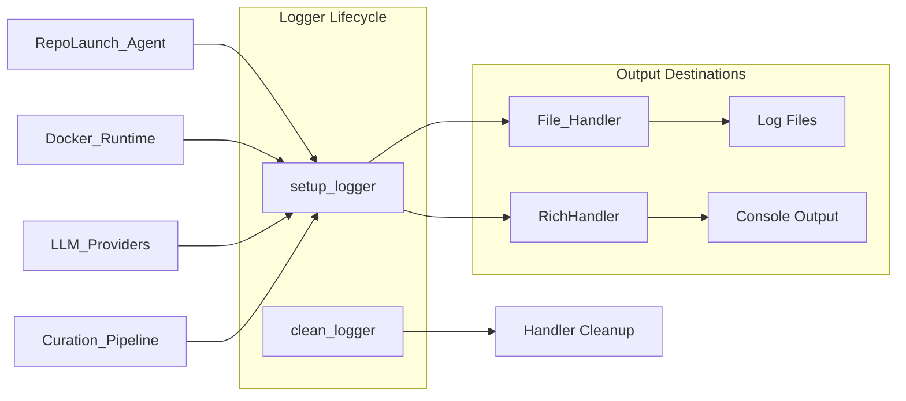

<!-- source: DeepWiki mcp.deepwiki.com · repo microsoft/SWE-bench-Live · page 5.3 Logging System · fetched 2026-10-26 -->

# Logging System

Relevant source files

The following files were used as context for generating this wiki page:

- [launch/git_launch/utilities/logger.py](launch/git_launch/utilities/logger.py)

## Purpose and Scope

The logging system provides centralized logging infrastructure for the SWE-bench-Live project, enabling structured output to both files and console with rich formatting capabilities. This system is primarily used by the RepoLaunch tool and other pipeline components to track operations, debug issues, and monitor automated processes.

For information about the broader infrastructure utilities, refer to other sections under [Utilities & Infrastructure](#5). For RepoLaunch-specific runtime operations, see [Runtime Environment](#3.3).

## Core Architecture

The logging system is built around a unified logger configuration that supports multiple output destinations and rich console formatting. The system manages logger lifecycles to prevent resource leaks during long-running operations.

### Logger Configuration Flow

Sources: [launch/git_launch/utilities/logger.py:10-41](), [launch/git_launch/utilities/logger.py:44-55]()

## Logger Setup

The `setup_logger` function creates configured logger instances with both file and optional console output. Each logger is identified by a unique `instance_id` that allows for proper isolation between concurrent operations.

### Configuration Parameters

| Parameter | Type | Description |
|-----------|------|-------------|
| `instance_id` | str | Unique identifier for the logger instance |
| `log_file` | Path | Target file path for log output |
| `printing` | bool | Enable rich console output (default: True) |

The logger configuration includes:
- **Log Level**: Set to `INFO` level for operational visibility [launch/git_launch/utilities/logger.py:23]()
- **File Handler**: Writes timestamped messages to specified file [launch/git_launch/utilities/logger.py:28-31]()
- **Rich Handler**: Provides formatted console output when enabled [launch/git_launch/utilities/logger.py:37-40]()

Sources: [launch/git_launch/utilities/logger.py:10-21]()

## Output Destinations

The logging system supports two primary output destinations that can operate simultaneously:

### File Output

File logging uses a standard formatter with timestamp prefixes. The system automatically:
- Creates parent directories if they don't exist [launch/git_launch/utilities/logger.py:24]()
- Removes existing log files to start fresh [launch/git_launch/utilities/logger.py:25-26]()
- Applies consistent timestamp formatting: `"%(asctime)s - %(message)s"` [launch/git_launch/utilities/logger.py:27]()

### Console Output

Console output leverages the `RichHandler` from the rich library to provide enhanced formatting with:
- Syntax highlighting for structured data
- Better readability for debug information
- Consistent styling across different terminal environments

The console handler is conditionally added based on the `printing` parameter [launch/git_launch/utilities/logger.py:37-40]().

Sources: [launch/git_launch/utilities/logger.py:24-31](), [launch/git_launch/utilities/logger.py:37-40]()

## Logger Integration

The logging system integrates with the broader SWE-bench-Live architecture to provide visibility across different components:

Sources: [launch/git_launch/utilities/logger.py:1-56]()

## Lifecycle Management

The logging system includes proper cleanup mechanisms to prevent resource leaks during long-running operations or batch processing scenarios.

### Logger Cleanup

The `clean_logger` function handles proper resource deallocation:
- Accepts either logger instances or string identifiers [launch/git_launch/utilities/logger.py:49]()
- Retrieves loggers by ID when string identifiers are provided [launch/git_launch/utilities/logger.py:51-52]()
- Removes and closes all handlers to free file descriptors [launch/git_launch/utilities/logger.py:53-55]()

This cleanup is particularly important in scenarios where multiple repository instances are processed sequentially, ensuring that file handles and other resources are properly released.

Sources: [launch/git_launch/utilities/logger.py:44-55]()

## Implementation Details

The logging system is implemented as a lightweight utility module with minimal dependencies:

- **Core Dependencies**: Uses Python's standard `logging` module [launch/git_launch/utilities/logger.py:4]()
- **Rich Integration**: Leverages `RichHandler` for enhanced console output [launch/git_launch/utilities/logger.py:7]()
- **Path Handling**: Uses `pathlib.Path` for cross-platform file operations [launch/git_launch/utilities/logger.py:5]()

The module provides a simple but effective interface for creating isolated logging contexts that can operate independently across different system components.

Sources: [launch/git_launch/utilities/logger.py:1-8]()

---

