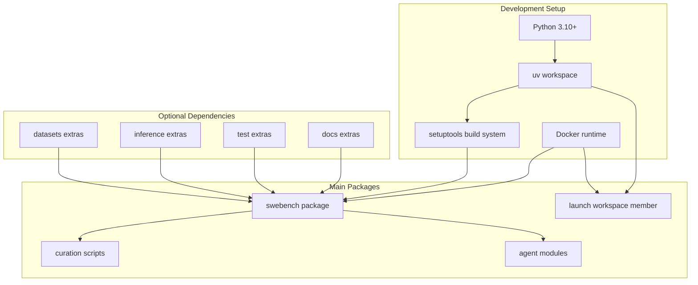
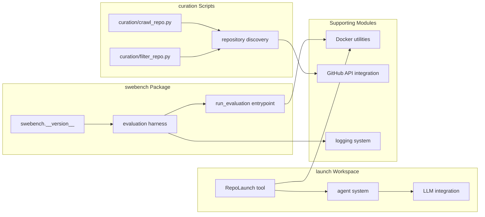
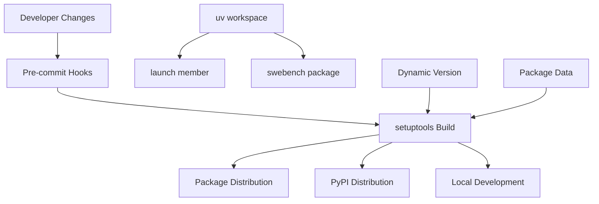
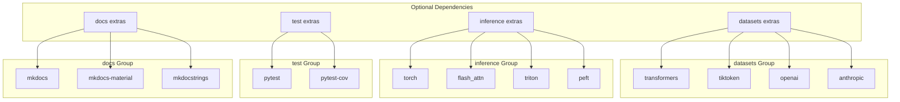

<!-- source: DeepWiki mcp.deepwiki.com · repo microsoft/SWE-bench-Live · page 6 Development & Contributing · fetched 2026-10-26 -->

# Development & Contributing

Relevant source files

The following files were used as context for generating this wiki page:

- [.gitignore](.gitignore)
- [SECURITY.md](SECURITY.md)
- [SUPPORT.md](SUPPORT.md)
- [pyproject.toml](pyproject.toml)

This document provides information for developers working on the SWE-bench-Live project, including project structure, development workflow, and contribution guidelines. It covers the technical aspects of setting up a development environment and understanding how the codebase is organized.

For detailed information about project dependencies and structure, see [Project Structure & Dependencies](#6.1). For support and security information, see [Support & Security](#6.2). For licensing and community guidelines, see [License & Code of Conduct](#6.3).

## Overview

SWE-bench-Live is a Python-based system that combines multiple components: an evaluation harness (`swebench` package), a dataset curation pipeline, and the RepoLaunch tool for automated environment setup. The project uses modern Python tooling and supports multiple deployment scenarios.

## Development Environment Architecture

**Development Environment Structure**
Sources: [pyproject.toml:1-99]()

## Code Organization

The codebase follows a modular architecture with clear separation between evaluation, curation, and tooling components:

**Primary Code Modules and Their Relationships**
Sources: [pyproject.toml:79-92](), [pyproject.toml:6-11]()

## Development Workflow

### Build System Configuration

The project uses `setuptools` as the build backend with dynamic versioning from the `swebench.__version__` attribute. The build system is configured to include package data and supports namespace packages.

**Build and Distribution Workflow**
Sources: [pyproject.toml:1-4](), [pyproject.toml:79-88]()

## Dependency Management

### Core Dependencies

The project has several categories of dependencies managed through `pyproject.toml`:

| Category | Key Dependencies | Purpose |
|----------|------------------|---------|
| Core | `docker`, `requests`, `rich` | Container management, HTTP, UI |
| Data | `datasets`, `GitPython`, `ghapi` | Dataset handling, Git operations |
| LLM | `openai`, `anthropic` | AI model integration |
| Utils | `tenacity`, `tqdm`, `unidiff` | Retry logic, progress, diff parsing |

### Optional Dependency Groups

**Optional Dependency Structure for Different Use Cases**
Sources: [pyproject.toml:40-77]()

## Development Environment Setup

### Python Version Requirements

The project requires Python 3.10 or higher, supporting both 3.10 and 3.11. This requirement ensures compatibility with modern Python features used throughout the codebase.

### Workspace Configuration

The project uses `uv.workspace` configuration with the `launch` directory as a workspace member, enabling coordinated development across the main package and the RepoLaunch tool.

### Ignored Files and Directories

The development environment excludes numerous file types and directories through `.gitignore`, including:

- Python bytecode (`__pycache__/`, `*.pyc`)
- Build artifacts (`build/`, `dist/`, `*.egg-info/`)
- IDE files (`.vscode/`, except specific configurations)
- Log files and temporary data
- Playground directories for experimentation

Sources: [.gitignore:329-430](), [pyproject.toml:89-92](), [pyproject.toml:17-22]()

## Project Metadata and Links

The project maintains several important URLs for community engagement:

- **Documentation**: GitHub repository link
- **Bug Reports**: GitHub issues
- **Source Code**: GitHub repository
- **Website**: swebench.com

The project is licensed under the MIT License and classified as supporting Python 3.10+ on any operating system.

Sources: [pyproject.toml:94-98](), [pyproject.toml:15-22]()

---

