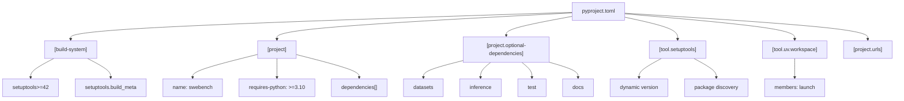
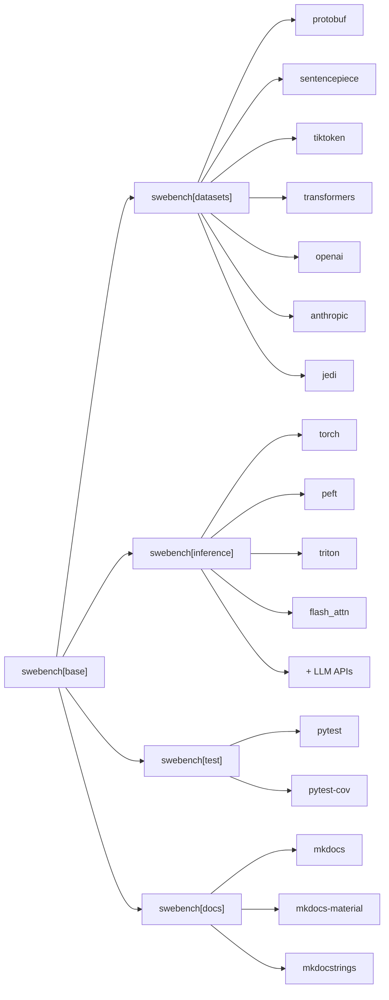
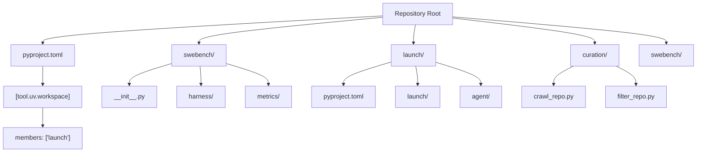

<!-- source: DeepWiki mcp.deepwiki.com · repo microsoft/SWE-bench-Live · page 6.1 Project Structure & Dependencies · fetched 2026-10-26 -->

# Project Structure & Dependencies

<details>
<summary>Relevant source files</summary>

The following files were used as context for generating this wiki page:

- [.gitignore](.gitignore)
- [pyproject.toml](pyproject.toml)

</details>


This document explains the Python project configuration, dependency management, and development environment setup for SWE-bench-Live. It covers the `pyproject.toml` configuration file, core and optional dependencies, workspace structure, and development environment setup procedures.

For information about the overall system architecture and component relationships, see [System Architecture](#2). For details about setting up and contributing to the project, see [Support & Security](#6.2) and [License & Code of Conduct](#6.3).

## Project Configuration Overview

SWE-bench-Live is configured as a modern Python package using the `pyproject.toml` standard. The project follows a workspace-based structure with the main `swebench` package and a separate `launch` workspace member for the RepoLaunch tool.

### Configuration Structure Diagram



**Sources:** [pyproject.toml:1-99]()

## Core Dependencies

The `swebench` package requires Python 3.10 or higher and includes essential dependencies for repository analysis, containerization, and evaluation harness functionality.

| Dependency | Purpose | Usage Context |
|------------|---------|---------------|
| `beautifulsoup4` | HTML/XML parsing | Web scraping and content extraction |
| `chardet` | Character encoding detection | Text file processing |
| `datasets` | HuggingFace datasets integration | Loading SWE-bench-Live dataset |
| `docker` | Docker container management | Environment isolation and testing |
| `ghapi` | GitHub API client | Repository discovery and metadata |
| `GitPython` | Git repository operations | Version control interactions |
| `modal` | Distributed computing platform | Scalable evaluation execution |
| `pre-commit` | Code quality hooks | Development workflow |
| `python-dotenv` | Environment variable management | Configuration loading |
| `requests` | HTTP client library | API communications |
| `rich` | Terminal formatting and display | User interface and logging |
| `tenacity` | Retry logic and resilience | LLM API call reliability |
| `tqdm` | Progress bars | Long-running operation feedback |
| `unidiff` | Unified diff parsing | Git patch analysis |

**Sources:** [pyproject.toml:23-38]()

## Optional Dependencies

The project defines four optional dependency groups that can be installed based on specific use cases. These groups support different aspects of the system's functionality.

### Optional Dependency Groups Diagram



### Datasets Group
The `datasets` optional dependencies enable enhanced dataset processing and LLM integration capabilities:

- **LLM APIs**: `openai`, `anthropic` for model access
- **Tokenization**: `tiktoken`, `sentencepiece`, `protobuf` for text processing
- **Code Analysis**: `jedi` for Python code intelligence
- **Model Loading**: `transformers` for HuggingFace model integration

### Inference Group  
The `inference` dependencies support local model execution and advanced AI capabilities:

- **Deep Learning**: `torch` for PyTorch models
- **Performance**: `triton`, `flash_attn` for optimized inference
- **Fine-tuning**: `peft` for parameter-efficient training
- **All dataset group dependencies** for complete LLM pipeline

### Test Group
Development and testing dependencies:

- **Testing Framework**: `pytest` for unit and integration tests
- **Coverage**: `pytest-cov` for test coverage reporting

### Documentation Group
Documentation generation dependencies:

- **Site Generator**: `mkdocs` with `mkdocs-material` theme
- **API Docs**: `mkdocstrings` with Python support
- **Extensions**: `pymdown-extensions`, `mkdocs-glightbox` for enhanced features
- **Versioning**: `mike` for documentation versioning

**Sources:** [pyproject.toml:40-77]()

## Workspace Structure

SWE-bench-Live uses a UV workspace configuration to manage multiple related packages within the same repository. This enables shared development workflows while maintaining package separation.

### Workspace Architecture



The workspace structure separates concerns:

- **Root `swebench` package**: Core evaluation harness and metrics
- **`launch` workspace member**: Independent RepoLaunch tool with its own dependencies
- **`curation` directory**: Dataset curation scripts and utilities
- **Shared configuration**: Common development tools and standards

**Sources:** [pyproject.toml:89-92]()

## Project Metadata and Distribution

The project configuration includes comprehensive metadata for package distribution and community engagement:

### Package Metadata
- **Name**: `swebench` (matches the main package directory)
- **Dynamic Versioning**: Version extracted from `swebench.__version__`
- **Python Compatibility**: 3.10+ with explicit classifier support for 3.10 and 3.11
- **License**: MIT License with file reference
- **Keywords**: `nlp`, `benchmark`, `code` for discoverability

### Project URLs
- **Documentation**: Links to the original SWE-bench repository
- **Bug Reports**: GitHub issues for community feedback
- **Source Code**: Repository access for contributors
- **Website**: Official SWE-bench website

**Sources:** [pyproject.toml:5-22](), [pyproject.toml:94-98]()

## Development Environment Setup

### Package Installation Options

```bash
# Basic installation with core dependencies
pip install swebench

# Install with dataset processing capabilities
pip install swebench[datasets]

# Install with local inference support
pip install swebench[inference]

# Install with development and testing tools
pip install swebench[test]

# Install with documentation generation
pip install swebench[docs]

# Install all optional dependencies
pip install swebench[datasets,inference,test,docs]
```

### Workspace Development Setup

For contributors working on both the main package and RepoLaunch tool:

```bash
# Install with UV workspace support
uv sync

# Develop both packages simultaneously
uv run python -m swebench.harness.run_evaluation
uv run python -m launch.main
```

### Build System Configuration

The project uses modern Python packaging standards:
- **Build Backend**: `setuptools.build_meta` for reliable package building
- **Package Discovery**: Automatic detection from root directory
- **Include Package Data**: Enabled for non-Python files
- **Dynamic Version**: Extracted from source code to maintain single source of truth

**Sources:** [pyproject.toml:1-4](), [pyproject.toml:79-87]()

---

