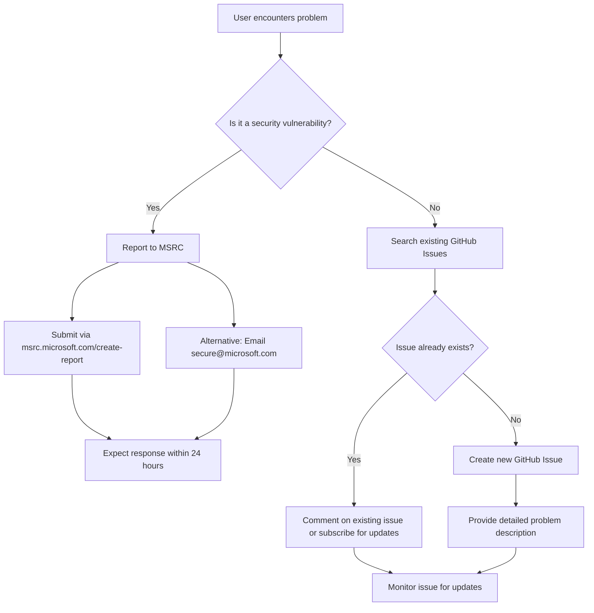
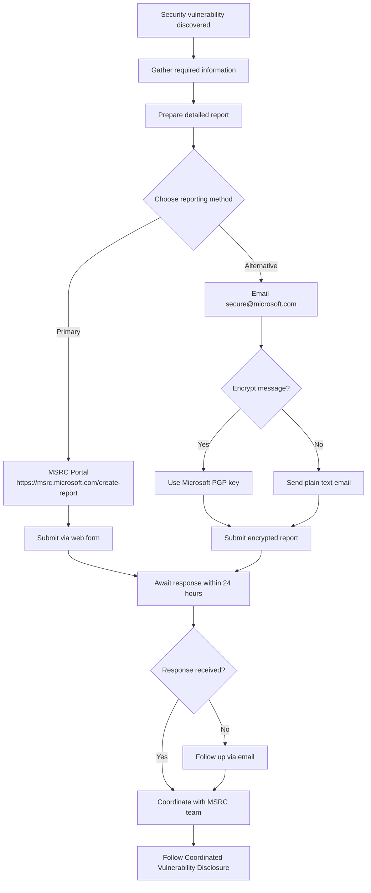

<!-- source: DeepWiki mcp.deepwiki.com · repo microsoft/SWE-bench-Live · page 6.2 Support & Security · fetched 2026-10-26 -->

# Support & Security

Relevant source files

The following files were used as context for generating this wiki page:

- [SECURITY.md](SECURITY.md)
- [SUPPORT.md](SUPPORT.md)

This document covers how to get help with SWE-bench-Live and how to report security vulnerabilities. It outlines the official support channels, issue reporting processes, and Microsoft's security policies that apply to this project.

## Getting Support

### GitHub Issues for Bugs and Features

SWE-bench-Live uses GitHub Issues as the primary mechanism for tracking bugs and feature requests. Before filing a new issue, users should search existing issues to avoid duplicates.

**Process:**
1. Search existing GitHub Issues to check if your problem has already been reported
2. File a new Issue for bugs or feature requests if no existing issue covers your case
3. Provide detailed information about the problem or requested feature

**Current Status:** The project's support documentation indicates that community support channels are still being configured. The [SUPPORT.md:19-21]() file contains placeholder text noting that repository maintainers need to specify where users can get help and ask questions.

Sources: [SUPPORT.md:13-21]()

### Microsoft Support Policy

Support for SWE-bench-Live is limited to the resources documented in the project's support files. As a Microsoft-owned project, it follows Microsoft's standard support policies for open source projects.

Sources: [SUPPORT.md:23-25]()

## Security Vulnerability Reporting

Microsoft takes security seriously across all repositories in their GitHub organizations, including this project. There is a specific process for reporting security vulnerabilities that differs from regular bug reporting.

### Do NOT Use Public GitHub Issues

**Important:** Security vulnerabilities should never be reported through public GitHub Issues, as this could expose the vulnerability before it can be addressed.

Sources: [SECURITY.md:11]()

### Microsoft Security Response Center (MSRC)

All security vulnerabilities should be reported through the Microsoft Security Response Center using one of these methods:

**Primary Method:**
- Submit reports via the MSRC portal: https://msrc.microsoft.com/create-report

**Alternative Method:**
- Email: secure@microsoft.com
- Optional: Encrypt messages using Microsoft's PGP key (available at Microsoft Security Response Center PGP Key page)

**Response Time:** You should receive a response within 24 hours. If you don't receive a response, follow up via email to ensure your report was received.

Sources: [SECURITY.md:13-17]()

### Information to Include in Security Reports

When reporting a security vulnerability, include as much of the following information as possible:

| Information Type | Description |
|------------------|-------------|
| Issue Type | Buffer overflow, SQL injection, cross-site scripting, etc. |
| Source Files | Full paths of files related to the vulnerability |
| Code Location | Tag/branch/commit or direct URL of affected code |
| Configuration | Special configuration needed to reproduce the issue |
| Reproduction Steps | Step-by-step instructions to reproduce the vulnerability |
| Proof of Concept | Exploit code if available |
| Impact Assessment | How an attacker might exploit the issue |

More complete reports may contribute to higher bug bounty awards under Microsoft's Bug Bounty Program.

Sources: [SECURITY.md:19-31]()

## Support Channel Workflow

Sources: [SUPPORT.md:13-21](), [SECURITY.md:11-17]()

## Security Reporting Process

Sources: [SECURITY.md:9-39]()

### Security Policy Framework

Microsoft follows the principle of Coordinated Vulnerability Disclosure for all security issues. This means that:

- Vulnerabilities are disclosed in a coordinated manner between Microsoft and the reporter
- Public disclosure is timed to allow for proper fixes to be developed and deployed
- The process protects users while allowing for transparent security practices

**Language Preference:** Microsoft prefers all security communications to be conducted in English.

**Scope:** This security policy applies to any Microsoft-owned repository that meets Microsoft's definition of a security vulnerability.

Sources: [SECURITY.md:35-39]()

---

