# Page: Overview

# Overview

<details>
<summary>Relevant source files</summary>

The following files were used as context for generating this wiki page:

- [README.md](README.md)

</details>


## Purpose and Scope

This document provides a high-level introduction to SWE-bench-Live, explaining its purpose as a continuously updated benchmark for evaluating AI systems on real-world software engineering tasks. It covers the three main system components: the evaluation harness, dataset curation pipeline, and RepoLaunch tool, and how they work together to provide contamination-free evaluation.

For detailed information about specific components, see [System Architecture](#2), [RepoLaunch Deep Dive](#3), and [Curation Pipeline Components](#4).

## What is SWE-bench-Live

SWE-bench-Live is a live benchmark for issue resolving that evaluates AI systems' ability to complete real-world software engineering tasks. Unlike static benchmarks, SWE-bench-Live updates monthly through an automated curation pipeline to provide up-to-date task instances and support rigorous, contamination-free evaluation.

The system includes **1,319 task instances** covering **93 repositories**, with each instance paired with an instance-level Docker image for test execution. All task instances are created after 2024 to ensure freshness and reduce contamination risk.

**Key Features:**
- Continuous monthly updates via automated pipeline
- Docker-based isolated test execution
- Instance-level containerized environments
- Integration with major repositories and package ecosystems
- LLM-powered environment setup automation

Sources: [README.md:31-33]()

## System Architecture Overview

SWE-bench-Live consists of three primary components that work together to provide a comprehensive benchmarking solution:

### High-Level System Components

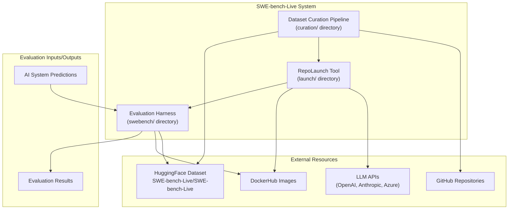

**System Component Details:**

| Component | Primary Location | Purpose |
|-----------|------------------|---------|
| **Evaluation Harness** | `swebench/` | Executes AI system predictions against test instances using Docker containers |
| **Dataset Curation Pipeline** | `curation/` | Automates discovery, filtering, and processing of GitHub repositories into benchmark tasks |
| **RepoLaunch Tool** | `launch/` | LLM-powered agent that creates testable containerized environments for any GitHub repository |

Sources: [README.md:35-44]()

### Core Data Flow

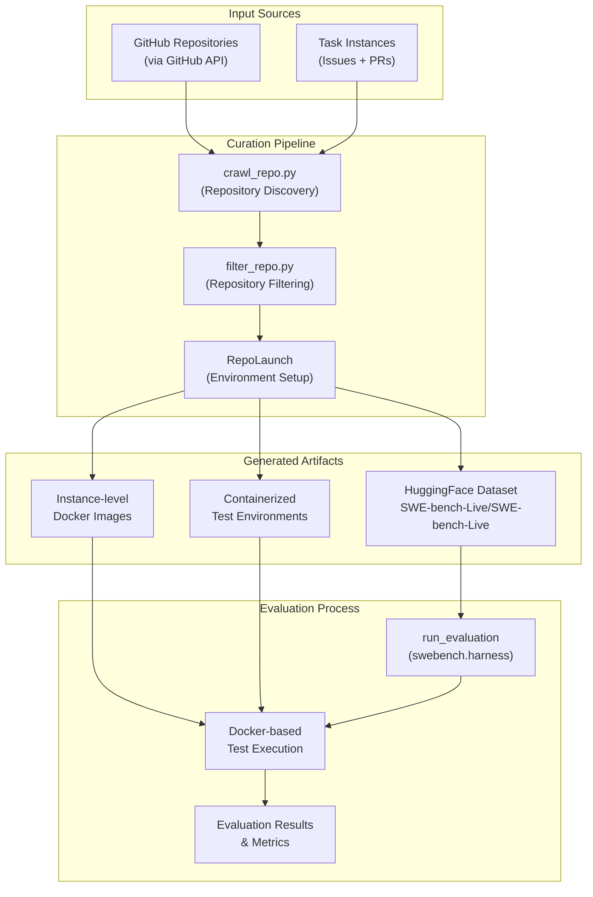

Sources: [README.md:38-44](), [README.md:81-95]()

## Component Integration

### Evaluation Harness
The evaluation harness is built on a fork of the original SWE-bench codebase, located in the `swebench/` directory. It provides the `run_evaluation` entrypoint for executing AI system predictions against task instances using Docker containers.

**Key Entry Points:**
- `swebench.harness.run_evaluation` - Main evaluation command
- Docker-based test execution with instance-level containers
- Integration with HuggingFace dataset `SWE-bench-Live/SWE-bench-Live`

### Dataset Curation Pipeline  
The curation pipeline automates the creation and updating of benchmark datasets through scripts in the `curation/` directory. It handles repository discovery, filtering, and processing to generate fresh task instances monthly.

**Core Pipeline Scripts:**
- Repository crawling and discovery
- Quality-based filtering of candidate repositories  
- Integration with RepoLaunch for environment setup

### RepoLaunch Tool
RepoLaunch is an LLM-powered agentic tool in the `launch/` directory that automates the setup of testable containerized environments for GitHub repositories. It bridges the gap between raw repositories and executable test environments.

**LLM Integration:**
- Support for OpenAI, Anthropic, and Azure OpenAI models
- Automated environment analysis and setup
- Docker container generation with test capabilities

For detailed information about each component, see [Evaluation Harness](#2.1), [Dataset Curation Pipeline](#2.2), and [RepoLaunch Tool Overview](#2.3).

Sources: [README.md:28-29](), [README.md:55-77](), [README.md:91-95]()

## Getting Started

To set up SWE-bench-Live for evaluation:

```bash
# Install the package (Python >= 3.10 required)
pip install -e .

# Test installation with a sample evaluation
python -m swebench.harness.run_evaluation \
    --dataset_name SWE-bench-Live/SWE-bench-Live \
    --split lite \
    --instance_ids amoffat__sh-744 \
    --namespace starryzhang \
    --predictions_path gold \
    --max_workers 1 \
    --run_id validate-gold
```

The system automatically pulls task instances from the HuggingFace dataset and corresponding Docker images from DockerHub for isolated test execution.

Sources: [README.md:46-63]()

---

# Page: System Architecture

# System Architecture

<details>
<summary>Relevant source files</summary>

The following files were used as context for generating this wiki page:

- [README.md](README.md)
- [launch/README.md](launch/README.md)
- [pyproject.toml](pyproject.toml)

</details>


This document provides a comprehensive overview of the SWE-bench-Live system architecture, detailing how the three main components work together: the evaluation harness, dataset curation pipeline, and RepoLaunch tool. It covers the overall system design, data flow patterns, component relationships, and external dependencies.

For specific implementation details of individual components, see [Evaluation Harness](#2.1), [Dataset Curation Pipeline](#2.2), and [RepoLaunch Tool Overview](#2.3). For deep technical details of the RepoLaunch system, see [RepoLaunch Deep Dive](#3).

## High-Level System Overview

SWE-bench-Live consists of three primary components that work together to provide a continuously updated benchmark for AI systems on software engineering tasks.

### System Components Overview

```mermaid
graph TB
    subgraph "SWE-bench-Live System"
        subgraph "swebench_package["swebench Package"]"
            A["run_evaluation"]
            B["Docker Test Execution"]
            C["Results Processing"]
        end
        
        subgraph "curation_pipeline["Curation Pipeline"]"
            D["crawl_repo.py"]
            E["filter_repo.py"]
            F["Dataset Creation"]
        end
        
        subgraph "launch_tool["RepoLaunch Tool"]"
            G["git_launch.run"]
            H["LLM Agent Workflow"]
            I["Docker Environment Setup"]
        end
    end
    
    subgraph "External Systems"
        J["GitHub Repositories"]
        K["HuggingFace Datasets"]
        L["DockerHub Registry"]
        M["LLM APIs"]
    end
    
    D --> J
    E --> F
    F --> K
    G --> H
    H --> M
    I --> L
    A --> B
    B --> L
    F --> G
    
    style swebench_package fill:#f9f9f9
    style curation_pipeline fill:#f9f9f9
    style launch_tool fill:#f9f9f9
```

Sources: [README.md:35-44](), [launch/README.md:7-11](), [pyproject.toml:5-6]()

## Component Relationships and Data Flow

The system operates through a coordinated workflow where each component serves specific functions in the benchmark lifecycle.

### Data Flow Architecture

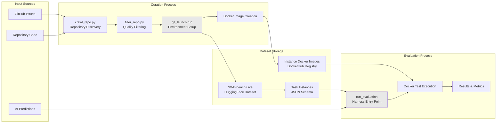

Sources: [README.md:83-93](), [launch/README.md:22-23](), [README.md:55-63]()

## Component Integration Points

### Evaluation Harness Integration

The `swebench` package serves as the core evaluation engine, providing the `run_evaluation` entry point that coordinates test execution across Docker containers.

| Component | File Path | Function |
|-----------|-----------|----------|
| Main Entry Point | `swebench.harness.run_evaluation` | Orchestrates evaluation workflow |
| Docker Integration | `swebench` package modules | Manages containerized test execution |
| Dataset Loading | HuggingFace integration | Loads task instances from `SWE-bench-Live/SWE-bench-Live` |

### Curation Pipeline Integration

The curation pipeline automates dataset creation through repository discovery, filtering, and environment setup.

| Component | File Path | Function |
|-----------|-----------|----------|
| Repository Discovery | `curation/crawl_repo.py` | Searches GitHub for candidate repositories |
| Quality Filtering | `curation/filter_repo.py` | Applies quality criteria to repositories |
| Environment Setup | `launch/` directory | Automated containerization via RepoLaunch |

### RepoLaunch Tool Integration

RepoLaunch provides automated environment setup capabilities using LLM-based agents to create testable containerized environments.

| Component | File Path | Function |
|-----------|-----------|----------|
| Main Runner | `git_launch.run` | Entry point for environment setup |
| Agent Workflow | `launch/` modules | LLM-powered environment automation |
| Docker Output | Container registry | Produces instance-level Docker images |

Sources: [README.md:38-44](), [launch/README.md:18-23](), [README.md:55-63]()

## External Dependencies and Integrations

### Core Dependencies

The system relies on several external services and libraries for its operation:

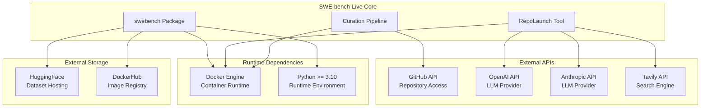

### Dependency Configuration

The project dependencies are managed through `pyproject.toml` with the following key packages:

| Package Category | Dependencies | Purpose |
|------------------|--------------|---------|
| Core Runtime | `docker`, `requests`, `datasets` | Container management and data access |
| LLM Integration | `openai`, `anthropic` | AI model API access |
| Data Processing | `GitPython`, `ghapi`, `beautifulsoup4` | Repository and web data handling |
| UI/Logging | `rich`, `tqdm` | Progress reporting and formatted output |
| Reliability | `tenacity` | Retry logic for external API calls |

Sources: [pyproject.toml:23-38](), [pyproject.toml:40-63](), [launch/README.md:14]()

## System Configuration and Execution

### Workspace Organization

The system organizes its work through a structured workspace layout:

```
├── swebench/             # Evaluation harness (forked from SWE-bench)
├── launch/               # RepoLaunch tool and configuration
├── curation/             # Dataset curation scripts
├── assets/               # Static resources and documentation
└── README.md             # Project documentation
```

### Evaluation Workflow

The evaluation process follows a standardized pattern using the `run_evaluation` module:

```bash
python -m swebench.harness.run_evaluation \
    --dataset_name SWE-bench-Live/SWE-bench-Live \
    --split <lite/full> \
    --namespace starryzhang \
    --predictions_path <predictions_file> \
    --max_workers <worker_count> \
    --run_id <evaluation_run_id>
```

### RepoLaunch Configuration

RepoLaunch operates through JSON configuration files that specify LLM providers, workspace settings, and execution parameters:

| Configuration Field | Type | Purpose |
|---------------------|------|---------|
| `llm_provider_name` | string | Specifies LLM provider (OpenAI, AOAI, etc.) |
| `workspace_root` | string | Base directory for processing |
| `dataset` | string | Path to input dataset file |
| `max_workers` | integer | Parallel processing worker count |
| `overwrite` | boolean | Controls result overwriting behavior |

Sources: [README.md:35-44](), [README.md:69-77](), [launch/README.md:40-54]()

## Data Schema and Interfaces

### Input Data Schema

The system processes task instances with the following required fields:

| Field | Type | Description |
|-------|------|-------------|
| `repo` | string | Full repository name (e.g., `owner/repo`) |
| `base_commit` | string | Git commit hash for environment setup |
| `instance_id` | string | Unique task instance identifier |
| `created_at` | string (optional) | Instance creation timestamp |
| `language` | string (optional) | Primary programming language |

### Output Data Schema

RepoLaunch produces structured results with environment setup information:

| Field | Type | Description |
|-------|------|-------------|
| `instance_id` | string | Task instance identifier |
| `base_image` | string | Docker base image specification |
| `setup_commands` | array | Shell commands for environment setup |
| `test_commands` | array | Shell commands for test execution |
| `duration` | number | Setup time in minutes |
| `completed` | boolean | Success status indicator |
| `exception` | string/null | Error message if setup failed |

Sources: [launch/README.md:27-37](), [launch/README.md:55-67]()

---

# Page: Evaluation Harness

# Evaluation Harness

<details>
<summary>Relevant source files</summary>

The following files were used as context for generating this wiki page:

- [README.md](README.md)
- [pyproject.toml](pyproject.toml)

</details>


## Purpose and Scope

The Evaluation Harness is the core component responsible for executing and evaluating AI system predictions against task instances in the SWE-bench-Live dataset. This document covers the `swebench` package structure, the `run_evaluation` entrypoint, Docker-based test execution, and the evaluation methodology.

For information about how task instances are created and maintained, see [Dataset Curation Pipeline](#2.2). For details about environment setup and containerization, see [RepoLaunch Tool Overview](#2.3).

## System Overview

The Evaluation Harness operates as a forked and minimally modified version of the original SWE-bench evaluation system, adapted specifically for the SWE-bench-Live dataset while maintaining compatibility with existing evaluation workflows.

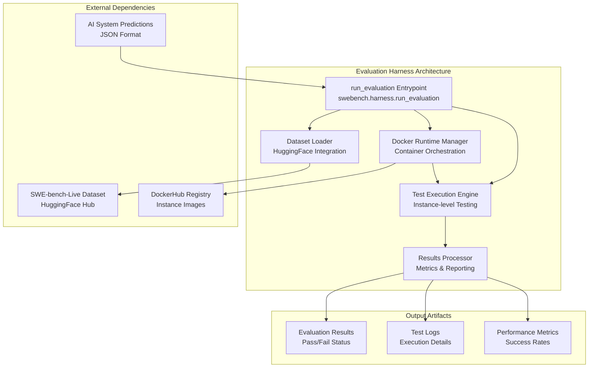

Sources: [README.md:1-150](), [pyproject.toml:1-99]()

## Package Structure

The `swebench` package serves as the primary evaluation framework, organized to support scalable and reproducible evaluation workflows.

| Component | Purpose | Location |
|-----------|---------|----------|
| Core Evaluation | Main evaluation logic forked from SWE-bench | `swebench/` |
| Harness Module | Entry point and orchestration | `swebench.harness` |
| Dataset Integration | HuggingFace dataset loading | `swebench.datasets` |
| Docker Management | Container lifecycle management | `swebench.docker` |

The package maintains backward compatibility with the original SWE-bench while adding support for the continuously updated SWE-bench-Live dataset format.

Sources: [README.md:28-44](), [pyproject.toml:79-88]()

## Evaluation Entrypoint

The primary interface for running evaluations is the `run_evaluation` module, accessible through Python's module execution syntax.

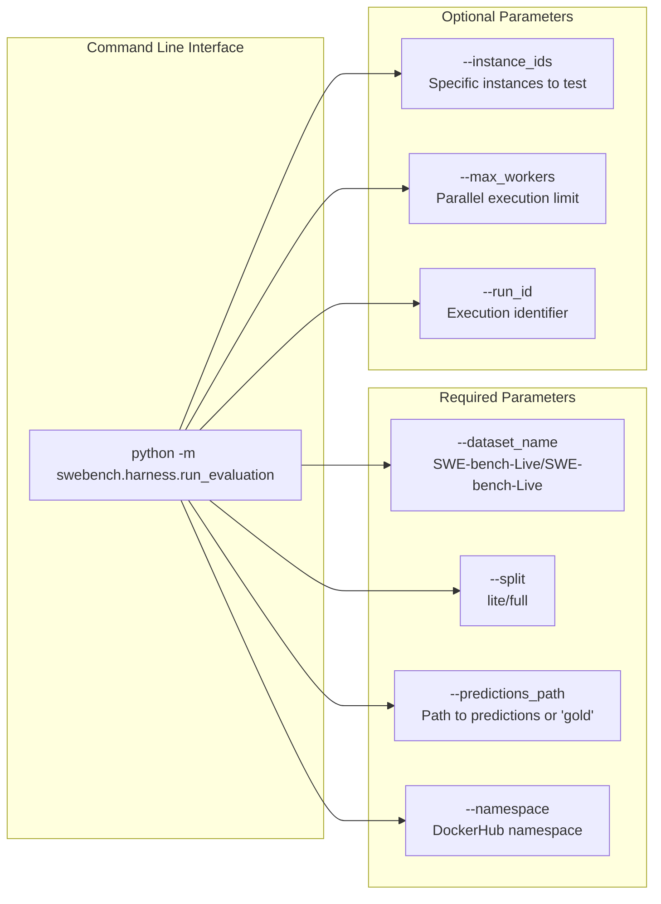

### Key Parameters

| Parameter | Description | Example |
|-----------|-------------|---------|
| `dataset_name` | HuggingFace dataset identifier | `SWE-bench-Live/SWE-bench-Live` |
| `split` | Dataset split to evaluate | `lite` or `full` |
| `predictions_path` | Path to predictions JSON or `gold` for reference | `path/to/predictions.json` |
| `namespace` | DockerHub namespace for images | `starryzhang` |
| `instance_ids` | Comma-separated list of specific instances | `amoffat__sh-744` |
| `max_workers` | Number of parallel workers | `4` |
| `run_id` | Unique identifier for the evaluation run | `validate-gold` |

Sources: [README.md:55-77]()

## Docker-Based Test Execution

The evaluation system leverages instance-level Docker images to provide isolated, reproducible test environments for each task instance.

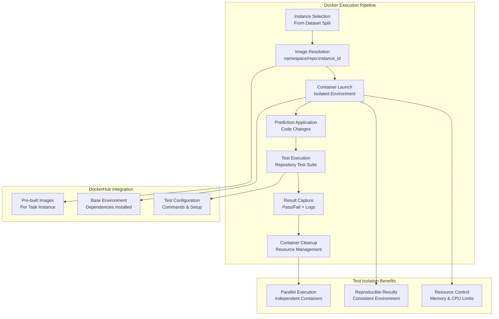

### Image Naming Convention

Docker images follow a structured naming pattern that maps directly to dataset instances:

- **Format**: `{namespace}/{repository}:{instance_id}`
- **Example**: `starryzhang/amoffat__sh:744`
- **Registry**: DockerHub public registry

This naming scheme enables automatic image resolution based on the task instance metadata from the SWE-bench-Live dataset.

Sources: [README.md:79-80]()

## Evaluation Methodology

The evaluation process follows a systematic approach to measure AI system performance on real-world software engineering tasks.

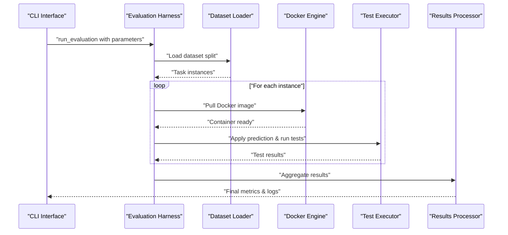

### Evaluation Workflow

1. **Dataset Loading**: Retrieves task instances from the specified HuggingFace dataset split
2. **Instance Processing**: Iterates through selected instances, supporting parallel execution
3. **Environment Setup**: Pulls and launches pre-configured Docker containers
4. **Prediction Application**: Applies AI system predictions to the codebase
5. **Test Execution**: Runs the repository's test suite within the container
6. **Result Collection**: Captures test outcomes, logs, and performance metrics
7. **Metrics Calculation**: Aggregates results to compute success rates and other metrics

### Gold Standard Testing

The system supports "gold" predictions for validation purposes, where known-correct solutions are evaluated to verify the testing infrastructure's reliability.

```bash
python -m swebench.harness.run_evaluation \
    --dataset_name SWE-bench-Live/SWE-bench-Live \
    --split lite \
    --predictions_path gold \
    --namespace starryzhang \
    --run_id validate-gold
```

Sources: [README.md:53-63](), [README.md:65-77]()

## Integration with SWE-bench-Live Dataset

The evaluation harness is specifically designed to work with the continuously updated SWE-bench-Live dataset, which provides fresh task instances covering recent GitHub issues and pull requests.

| Dataset Feature | Evaluation Support |
|-----------------|-------------------|
| Monthly Updates | Automatic dataset refresh support |
| Instance-level Images | Direct Docker image mapping |
| 1,319 Task Instances | Comprehensive test coverage |
| 93 Repositories | Diverse codebase evaluation |
| Contamination-free | Post-2024 task instances |

The system maintains consistency with the original SWE-bench evaluation methodology while supporting the dynamic nature of the Live dataset through automated Docker image management and flexible instance selection.

Sources: [README.md:31-34](), [README.md:28-30]()

---

# Page: Dataset Curation Pipeline

# Dataset Curation Pipeline

<details>
<summary>Relevant source files</summary>

The following files were used as context for generating this wiki page:

- [README.md](README.md)
- [curation/crawl_repo.py](curation/crawl_repo.py)
- [curation/filter_repo.py](curation/filter_repo.py)

</details>


This document describes the automated pipeline that creates and maintains the SWE-bench-Live dataset. The pipeline discovers GitHub repositories, filters them based on quality criteria, and uses the RepoLaunch tool to create testable containerized environments for task instances.

For details about the RepoLaunch environment setup tool, see [RepoLaunch Tool Overview](#2.3). For information about how the curated dataset is used for evaluation, see [Evaluation Harness](#2.1).

## Pipeline Overview

The dataset curation pipeline operates as an automated system that transforms raw GitHub repository data into structured task instances ready for AI system evaluation. The pipeline consists of three main stages: repository discovery, repository filtering, and environment setup.

**Curation Pipeline Architecture**

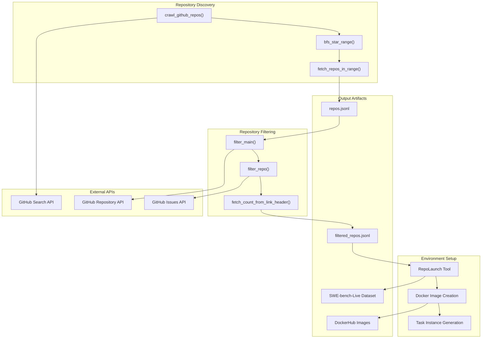

Sources: [README.md:81-96](), [curation/crawl_repo.py:133-180](), [curation/filter_repo.py:127-196]()

## Repository Discovery Process

The repository discovery stage uses the `crawl_repo.py` script to systematically search GitHub for repositories matching specified criteria. The process implements a breadth-first search strategy to work around GitHub's API limitations.

**Repository Crawling Workflow**

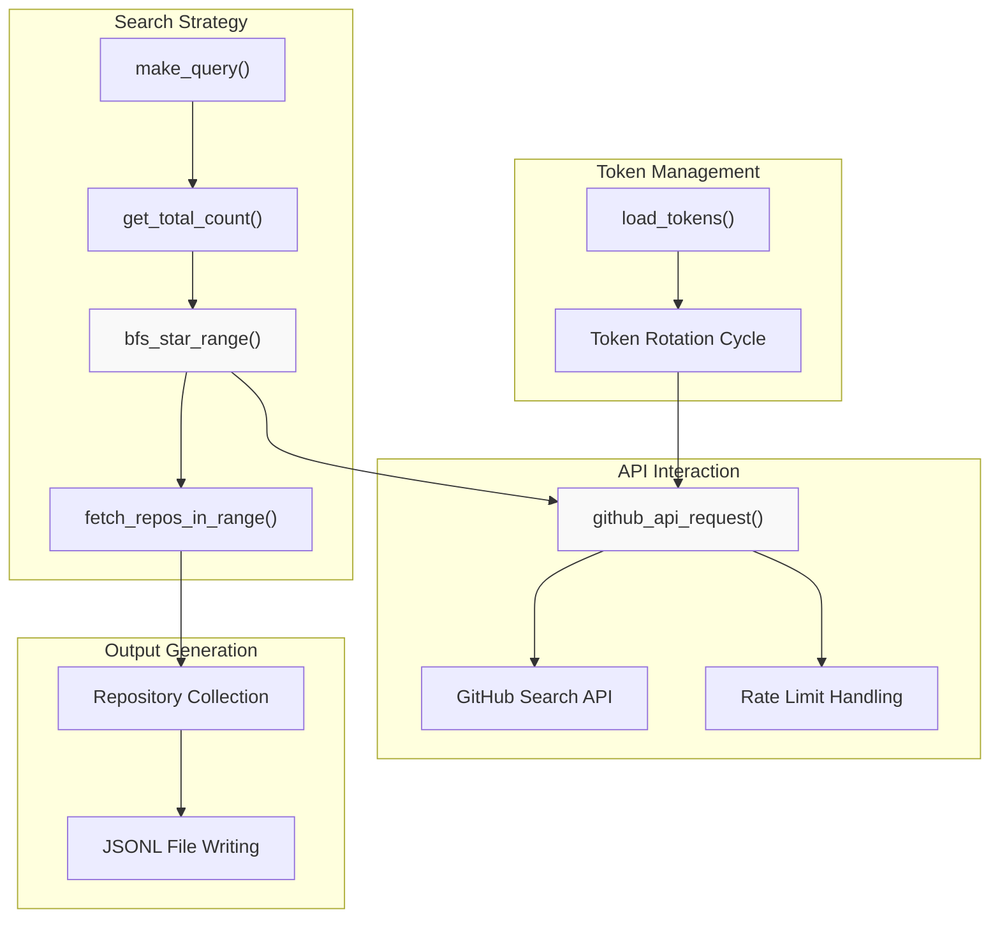

The discovery process implements several key mechanisms:

| Component | Function | Implementation |
|-----------|----------|----------------|
| **Token Rotation** | `load_tokens()` | Cycles through multiple GitHub API tokens to handle rate limits [curation/crawl_repo.py:13-18]() |
| **Query Construction** | `make_query()` | Builds GitHub search queries with language and star count filters [curation/crawl_repo.py:21-31]() |
| **BFS Search** | `bfs_star_range()` | Recursively divides star ranges when result count exceeds 1000 [curation/crawl_repo.py:85-130]() |
| **Batch Fetching** | `fetch_repos_in_range()` | Retrieves up to 1000 repositories per query with pagination [curation/crawl_repo.py:58-82]() |

The BFS strategy addresses GitHub's 1000-result limit by automatically subdividing star ranges when the total count exceeds this threshold [curation/crawl_repo.py:107-120]().

Sources: [curation/crawl_repo.py:1-181]()

## Repository Filtering Process

The filtering stage uses `filter_repo.py` to evaluate repositories against quality criteria using asynchronous processing for efficiency. The system fetches additional repository metadata to make filtering decisions.

**Repository Filtering Architecture**

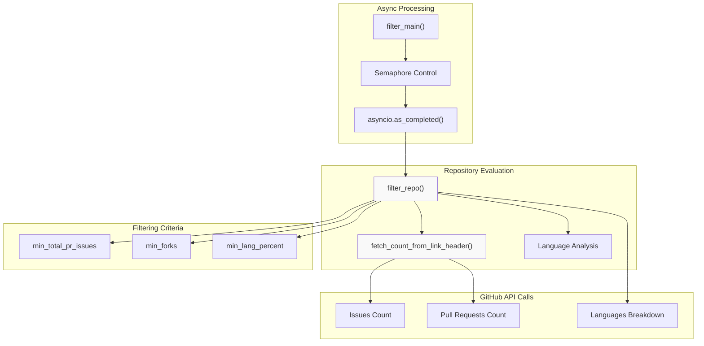

The filtering system evaluates repositories using these criteria:

| Criterion | Default Value | Purpose |
|-----------|---------------|---------|
| **Minimum Forks** | 200 | Ensures repository has community adoption [curation/filter_repo.py:94-97]() |
| **Total PR/Issues** | 200 | Indicates active development and issue resolution [curation/filter_repo.py:110-113]() |
| **Language Percentage** | 60% | Ensures repository is primarily in target language [curation/filter_repo.py:115-122]() |

The filtering process uses link header parsing to efficiently count issues and pull requests without fetching full result sets [curation/filter_repo.py:53-77]().

Sources: [curation/filter_repo.py:1-201]()

## Integration with RepoLaunch

After repository filtering, the pipeline integrates with RepoLaunch to create testable environments for each repository. This integration transforms filtered repositories into complete task instances with working development environments.

**RepoLaunch Integration Flow**

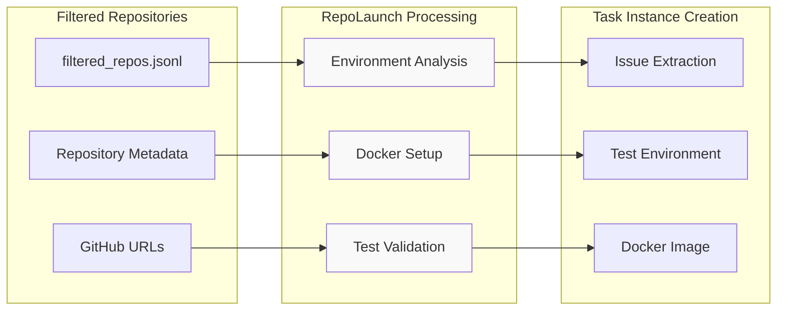

The integration process creates:

- **Task Instances**: Each repository generates multiple task instances from recent issues and pull requests
- **Docker Images**: Instance-level containerized environments hosted on DockerHub [README.md:79]()
- **Test Validation**: Verified execution environments for reliable evaluation

Sources: [README.md:91-96](), [README.md:33-34]()

## Output Artifacts and Dataset Structure

The curation pipeline produces several key artifacts that enable contamination-free evaluation of AI systems on software engineering tasks.

**Dataset Output Structure**

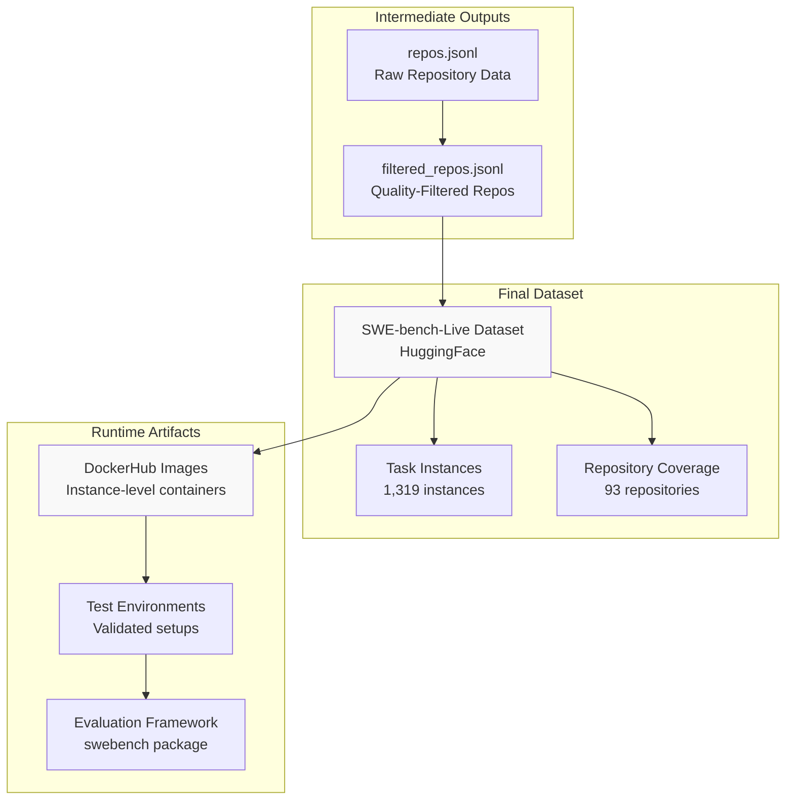

The pipeline generates these key outputs:

| Artifact Type | Description | Location |
|---------------|-------------|----------|
| **Raw Repository Data** | Unfiltered GitHub repository metadata | `repos.jsonl` |
| **Filtered Repositories** | Quality-validated repository subset | `filtered_repos.jsonl` |
| **Task Dataset** | Structured task instances with issue/PR context | HuggingFace Dataset |
| **Docker Images** | Instance-specific containerized environments | DockerHub namespace |

The initial release contains 1,319 task instances covering 93 repositories, all created after 2024 to ensure freshness and reduce contamination risk [README.md:33]().

Sources: [README.md:21-24](), [README.md:33-34](), [README.md:79]()

---

# Page: RepoLaunch Tool Overview

# RepoLaunch Tool Overview

<details>
<summary>Relevant source files</summary>

The following files were used as context for generating this wiki page:

- [README.md](README.md)
- [launch/README.md](launch/README.md)

</details>


This document provides a high-level introduction to RepoLaunch, the LLM-based agentic tool that automates environment setup for GitHub repositories within the SWE-bench-Live system. RepoLaunch addresses the critical bottleneck of creating testable containerized environments by leveraging large language models to intelligently analyze repository structure, identify dependencies, and configure Docker environments.

For detailed implementation specifics including agent architecture and LLM integration patterns, see [RepoLaunch Deep Dive](#3). For information about how RepoLaunch integrates into the broader dataset creation process, see [Dataset Curation Pipeline](#2.2).

## System Role and Integration

RepoLaunch serves as the automated environment setup component within the SWE-bench-Live curation pipeline. It transforms raw GitHub repositories into testable, containerized environments that can be used for evaluation.

**RepoLaunch Integration Architecture**
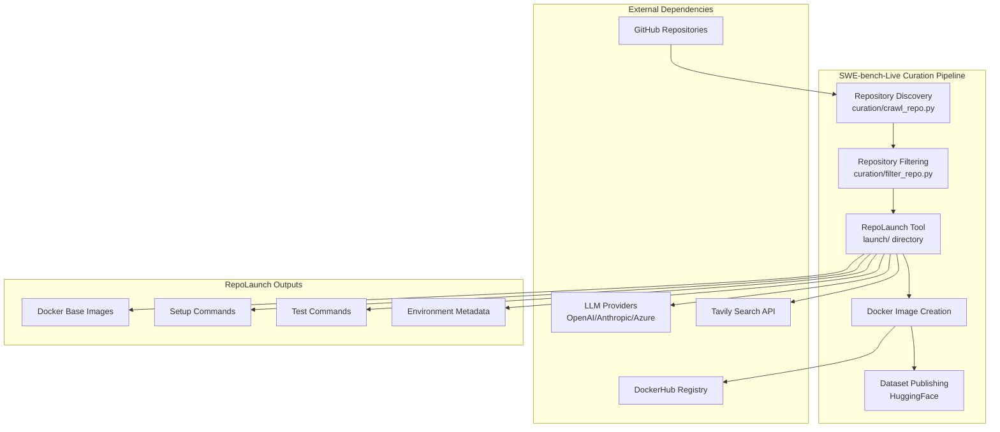

Sources: [README.md:91-96](), [launch/README.md:7-11]()

## Core Functionality

RepoLaunch operates as an intelligent agent that can analyze any GitHub repository and automatically determine the steps needed to create a working development and testing environment. The tool handles the complexity of dependency management, environment configuration, and test execution setup without requiring manual intervention.

**RepoLaunch Core Components**
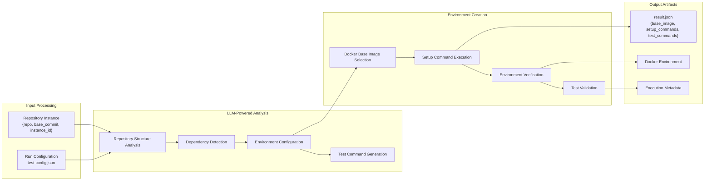

Sources: [launch/README.md:25-67](), [README.md:91-95]()

## Data Schema and Interface

RepoLaunch operates through a well-defined input/output interface that integrates seamlessly with the broader curation pipeline.

### Input Schema

| Field | Type | Required | Description |
|-------|------|----------|-------------|
| `repo` | string | Yes | Full repository name (e.g., "microsoft/SWE-bench-Live") |
| `base_commit` | string | Yes | Git commit hash to checkout for environment setup |
| `instance_id` | string | Yes | Unique identifier for the task instance |
| `created_at` | string | No | Creation timestamp for time-aware package resolution |
| `language` | string | No | Primary programming language of the repository |

### Configuration Schema

| Field | Type | Description |
|-------|------|-------------|
| `llm_provider_name` | string | LLM provider ("OpenAI", "AOAI", "Anthropic") |
| `model_config` | object | Contains `model_name` and `temperature` settings |
| `workspace_root` | string | Working directory for environment setup |
| `dataset` | string | Path to input dataset file |
| `max_workers` | integer | Parallel processing worker count |
| `overwrite` | boolean | Whether to recreate existing environments |

### Output Schema

| Field | Type | Description |
|-------|------|-------------|
| `instance_id` | string | Task instance identifier |
| `base_image` | string | Selected Docker base image |
| `setup_commands` | array | Shell commands for environment setup |
| `test_commands` | array | Shell commands for running tests |
| `duration` | number | Processing time in minutes |
| `completed` | boolean | Success status of environment creation |
| `exception` | string | Error message if setup failed |

Sources: [launch/README.md:27-67]()

## Workflow Overview

RepoLaunch follows an intelligent, multi-stage workflow that leverages LLM reasoning to make decisions about environment setup. The process is designed to handle the diverse landscape of open-source repositories with minimal manual configuration.

**RepoLaunch Execution Workflow**
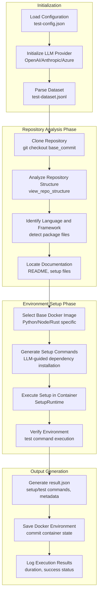

The workflow integrates external services including Tavily search API for documentation lookup and PyPI Time Machine for historical package resolution, ensuring reproducible environment creation even for older repositories.

Sources: [launch/README.md:13-23](), [launch/README.md:55-67]()

## Command Line Interface

RepoLaunch provides a straightforward command-line interface for execution:

```bash
cd launch
pip install -e .
python -m git_launch.run --config-path test-config.json
```

The tool processes repositories in parallel based on the `max_workers` configuration and can be configured to process specific instances or entire datasets. Results are saved in structured JSON format under the configured workspace directory.

Sources: [launch/README.md:18-23]()

---

# Page: RepoLaunch Deep Dive

# RepoLaunch Deep Dive

<details>
<summary>Relevant source files</summary>

The following files were used as context for generating this wiki page:

- [launch/README.md](launch/README.md)
- [launch/test-config.json](launch/test-config.json)
- [launch/test-result.json](launch/test-result.json)

</details>


This document provides a comprehensive technical overview of the RepoLaunch system, an LLM-based agentic tool that automates the setup of testable containerized environments for any GitHub repository. RepoLaunch serves as a critical component in the SWE-bench-Live curation pipeline, enabling automated environment preparation for software engineering benchmarks.

For information about the overall system architecture, see [System Architecture](#2). For details about LLM provider integration, see [LLM Integration](#3.1). For agent system internals, see [Agent System](#3.2). For runtime environment details, see [Runtime Environment](#3.3). For configuration and execution guidance, see [Configuration & Execution](#3.4).

## System Architecture Overview

RepoLaunch transforms any GitHub repository into a testable sandbox environment through an automated workflow that combines repository analysis, LLM-powered decision making, and Docker containerization.

### RepoLaunch Core Architecture

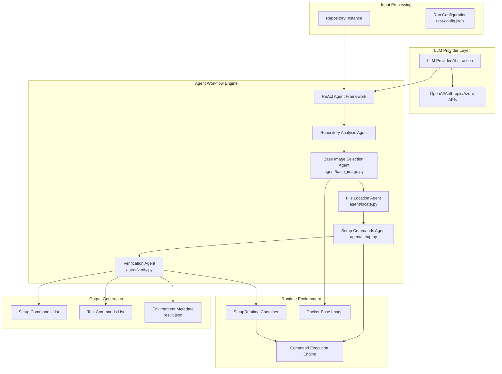

Sources: [launch/README.md:11](), [launch/test-config.json:1-11](), [launch/test-result.json:1-17]()

### Agent-Based Environment Setup Process

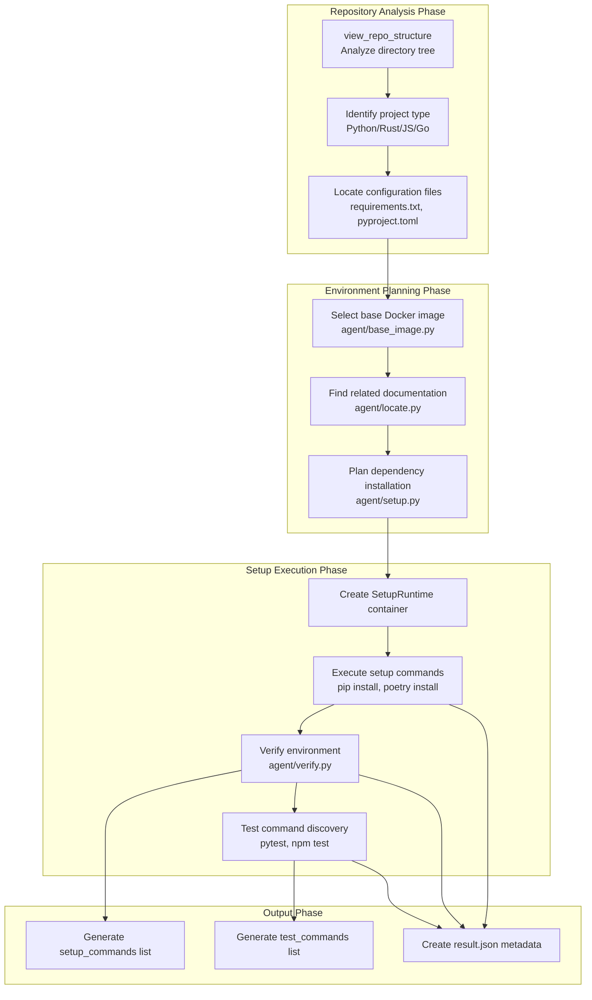

Sources: [launch/README.md:25-67](), [launch/test-result.json:2-16]()

## Core Workflow Components

RepoLaunch operates through a series of specialized agents, each responsible for a specific aspect of environment setup. The system uses a ReAct (Reasoning + Acting) framework to iteratively analyze repositories and make setup decisions.

### Input Data Schema

The system accepts repository instances with the following structure:

| Field | Type | Description | Required |
|-------|------|-------------|----------|
| `repo` | string | Full repository name (owner/repo) | Yes |
| `base_commit` | string | Git commit hash to checkout | Yes |
| `instance_id` | string | Unique identifier for this instance | Yes |
| `created_at` | string | ISO timestamp for time-aware setup | No |
| `language` | string | Primary programming language | No |

### Configuration Schema

RepoLaunch uses a JSON configuration file with these parameters:

| Field | Type | Description | Default |
|-------|------|-------------|---------|
| `llm_provider_name` | string | LLM provider ("OpenAI", "AOAI", "Anthropic") | Required |
| `model_config` | object | Model name and temperature settings | Required |
| `workspace_root` | string | Directory for output files | Required |
| `dataset` | string | Path to input JSONL file | Required |
| `instance_id` | string | Specific instance to process (null for all) | null |
| `first_N_repos` | integer | Limit to first N repositories (-1 for all) | -1 |
| `max_workers` | integer | Parallel processing worker count | 1 |
| `overwrite` | boolean | Skip existing results if false | false |

### Output Data Schema

Each repository processing generates a `result.json` file containing:

| Field | Type | Description |
|-------|------|-------------|
| `instance_id` | string | Unique identifier matching input |
| `base_image` | string | Selected Docker base image |
| `setup_commands` | array | Shell commands for environment setup |
| `test_commands` | array | Shell commands for running tests |
| `duration` | integer | Processing time in minutes |
| `completed` | boolean | Success status of the operation |
| `exception` | string\|null | Error message if processing failed |

Sources: [launch/README.md:25-67](), [launch/test-config.json:1-11](), [launch/test-result.json:1-17]()

## Agent Workflow Integration

RepoLaunch integrates multiple specialized agents through a coordinated workflow that leverages LLM capabilities for intelligent decision-making at each step.

### LLM-Powered Decision Points

The system makes several critical decisions using LLM analysis:

1. **Base Image Selection**: Analyzes project structure to choose appropriate Docker base image (Python 3.x, Node.js, Rust, etc.)
2. **Dependency Resolution**: Identifies and installs project dependencies from various sources (pip, poetry, npm, cargo)
3. **Test Discovery**: Locates and configures test frameworks and commands
4. **Environment Verification**: Validates that the setup successfully creates a working environment

### External Service Integration

RepoLaunch integrates with several external services:

- **Tavily Search API**: Provides web search capabilities for finding documentation and solutions
- **PyPI Time Machine**: Serves historical package versions for reproducible builds
- **Docker Registry**: Pulls and manages base container images
- **LLM APIs**: Powers the agent reasoning and decision-making process

The system handles API rate limiting, token rotation, and retry logic to ensure robust operation across different service providers and usage patterns.

Sources: [launch/README.md:11-24](), [launch/test-config.json:2-6]()

---

# Page: LLM Integration

# LLM Integration

<details>
<summary>Relevant source files</summary>

The following files were used as context for generating this wiki page:

- [launch/git_launch/agent/base_image.py](launch/git_launch/agent/base_image.py)
- [launch/git_launch/utilities/llm.py](launch/git_launch/utilities/llm.py)

</details>


This document covers the LLM (Large Language Model) integration system that provides a unified abstraction layer for multiple AI model providers within the RepoLaunch tool. The system supports OpenAI, Anthropic, and Azure OpenAI services with automatic logging, retry logic, and token management capabilities.

For information about how these LLM integrations are used within the ReAct agent workflow, see [Agent System](#3.2). For details on configuration and execution of RepoLaunch with different LLM providers, see [Configuration & Execution](#3.4).

## Architecture Overview

The LLM integration system provides a unified interface across multiple AI model providers, enabling consistent usage patterns throughout the RepoLaunch codebase while supporting provider-specific configurations and authentication methods.

**LLM Provider Abstraction Architecture**
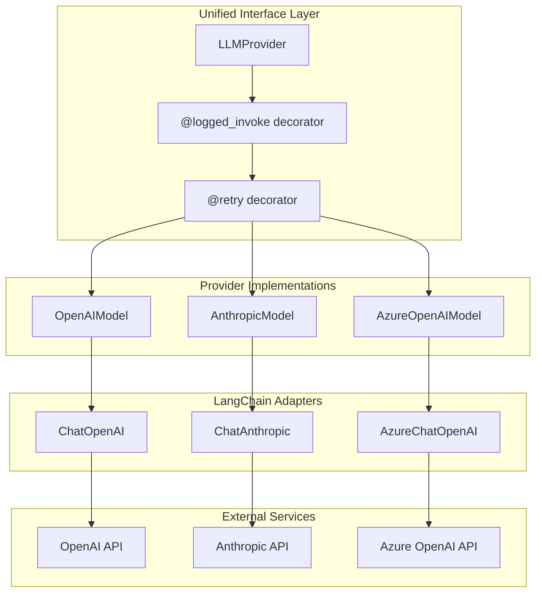

Sources: [launch/git_launch/utilities/llm.py:48-93]()

## LLMProvider Class

The `LLMProvider` class serves as the primary interface for all LLM interactions, abstracting away provider-specific implementation details while providing consistent logging and error handling capabilities.

**Core LLMProvider Implementation**
```mermaid
classDiagram
    class LLMProvider {
        -llm_provider: str
        -log_folder: str
        -llm_instance: Model
        +__init__(llm_provider, log_folder, **kwargs)
        +invoke(messages: List[BaseMessage])
    }
    
    class OpenAIModel {
        -model_name: str
        -temperature: float
        -llm: ChatOpenAI
        +invoke(messages)
    }
    
    class AnthropicModel {
        -model_name: str
        -temperature: float
        -llm: ChatAnthropic
        +invoke(messages)
    }
    
    class AzureOpenAIModel {
        -model_name: str
        -temperature: float
        -llm: AzureChatOpenAI
        +invoke(messages)
    }
    
    LLMProvider --> OpenAIModel
    LLMProvider --> AnthropicModel
    LLMProvider --> AzureOpenAIModel
```

The `LLMProvider` constructor accepts three provider types through the `llm_provider` parameter:

| Provider String | Model Class | Authentication Method |
|----------------|-------------|----------------------|
| `"OpenAI"` | `OpenAIModel` | `OPENAI_API_KEY` environment variable |
| `"Anthropic"` | `AnthropicModel` | `ANTHROPIC_API_KEY` environment variable |
| `"AOAI"` | `AzureOpenAIModel` | Azure token-based authentication |

Sources: [launch/git_launch/utilities/llm.py:55-74]()

## Provider Implementations

Each model provider implements a consistent `invoke()` method interface while handling provider-specific authentication and configuration requirements.

### OpenAI Integration

The `OpenAIModel` class integrates with OpenAI's API through the LangChain `ChatOpenAI` adapter:

```python
# Example configuration from codebase
OpenAIModel(
    model_name="gpt-4o-20241120",
    temperature=0.0
)
```

Authentication relies on the `OPENAI_API_KEY` environment variable being set prior to instantiation.

Sources: [launch/git_launch/utilities/llm.py:94-125]()

### Anthropic Integration

The `AnthropicModel` class provides access to Anthropic's Claude models through the LangChain `ChatAnthropic` adapter:

```python
# Example usage pattern
AnthropicModel(
    model_name="claude-3-opus-20240229", 
    temperature=0.0
)
```

Authentication requires the `ANTHROPIC_API_KEY` environment variable.

Sources: [launch/git_launch/utilities/llm.py:128-159]()

### Azure OpenAI Integration

The `AzureOpenAIModel` class connects to Azure's OpenAI service using the `AzureChatOpenAI` adapter with token-based authentication:

```python
# Example Azure configuration
AzureOpenAIModel(
    model_name="gpt-4o-20241120",
    temperature=0.0
)
```

Sources: [launch/git_launch/utilities/llm.py:162-192]()

## Logging System

The `@logged_invoke` decorator provides comprehensive interaction logging for debugging and audit purposes. When logging is enabled, all LLM inputs and outputs are automatically saved to numbered markdown files.

**Logging Workflow**
```mermaid
flowchart LR
    subgraph "LLM Invocation Process"
        invoke_start["invoke() called"]
        check_logging["Check if log_folder exists"]
        create_dirs["Create log directories"]
        find_next_num["Find next log file number"]
        call_llm["Execute LLM request"]
        write_log["Write input/output to {number}.md"]
    end
    
    invoke_start --> check_logging
    check_logging -->|"log_folder is None"| call_llm
    check_logging -->|"log_folder exists"| create_dirs
    create_dirs --> find_next_num
    find_next_num --> call_llm
    call_llm --> write_log
```

The logging system creates sequentially numbered markdown files containing both input messages and LLM responses:

```markdown
##### LLM INPUT #####
Human: What is the capital of France?
##### LLM OUTPUT #####
AI: The capital of France is Paris.
```

Log file numbering automatically continues from the highest existing number in the log directory.

Sources: [launch/git_launch/utilities/llm.py:11-45]()

## Retry Mechanism

The system implements robust error handling through the tenacity library, providing exponential backoff with jitter for failed LLM requests:

| Retry Parameter | Value | Purpose |
|----------------|-------|---------|
| `stop_after_attempt` | 5 | Maximum retry attempts |
| `initial` | 5 seconds | Initial wait time |
| `max` | 120 seconds | Maximum wait time |
| `jitter` | 3 seconds | Random variance |

The retry decorator is applied to the `invoke()` method, automatically handling transient network issues, rate limiting, and temporary service unavailability.

Sources: [launch/git_launch/utilities/llm.py:77-81]()

## Usage Patterns

The LLM integration is used throughout the RepoLaunch agent system for various automated tasks. Here's how the system is typically instantiated and used:

**Example Usage in Base Image Selection**
```mermaid
sequenceDiagram
    participant Agent as "select_base_image()"
    participant LLMProvider as "LLMProvider"
    participant Model as "OpenAIModel/AnthropicModel/AzureOpenAIModel"
    participant API as "External LLM API"
    
    Agent->>LLMProvider: invoke(messages)
    LLMProvider->>LLMProvider: @logged_invoke decorator
    LLMProvider->>LLMProvider: @retry decorator
    LLMProvider->>Model: invoke(messages)
    Model->>API: HTTP request
    API-->>Model: Response
    Model-->>LLMProvider: BaseMessage
    LLMProvider->>LLMProvider: Log interaction to file
    LLMProvider-->>Agent: BaseMessage
```

In the `select_base_image` function, the LLM is accessed through the agent state and used to analyze repository documentation:

```python
llm = state["llm"]  # LLMProvider instance
response = llm.invoke(messages)  # Automatic logging and retry
```

The system supports multi-turn conversations by maintaining message history and allows for iterative refinement based on LLM responses.

Sources: [launch/git_launch/agent/base_image.py:29-53](), [launch/git_launch/utilities/llm.py:194-203]()

---

# Page: Agent System

# Agent System

<details>
<summary>Relevant source files</summary>

The following files were used as context for generating this wiki page:

- [launch/git_launch/agent/__init__.py](launch/git_launch/agent/__init__.py)
- [launch/git_launch/agent/locate.py](launch/git_launch/agent/locate.py)
- [launch/git_launch/agent/prompt.py](launch/git_launch/agent/prompt.py)
- [launch/git_launch/agent/setup.py](launch/git_launch/agent/setup.py)
- [launch/git_launch/agent/state.py](launch/git_launch/agent/state.py)
- [launch/git_launch/agent/verify.py](launch/git_launch/agent/verify.py)

</details>


The Agent System implements the core ReAct (Reasoning + Acting) agent architecture that powers RepoLaunch's automated environment setup workflow. This system orchestrates multiple specialized agents to analyze repositories, set up development environments, and verify successful configuration through conversational interactions with LLM providers.

For information about the underlying LLM provider abstraction, see [LLM Integration](#3.1). For details about the Docker runtime environment where agents execute commands, see [Runtime Environment](#3.3).

## Overview and Architecture

The Agent System consists of three main components: state management through `AgentState`, specialized ReAct agents for different workflow stages, and structured action parsing for LLM interactions.

### Agent System Architecture

```mermaid
graph TB
    subgraph "Agent State Management"
        AS["AgentState"]
        AS --> SM["State Management"]
        AS --> EM["Exception Handling"]
        AS --> TM["Tool Management"]
    end
    
    subgraph "ReAct Agent Pipeline"
        LA["locate_related_file"]
        SA["setup"]
        VA["verify"]
        LA --> SA --> VA
    end
    
    subgraph "Action System"
        AP["Action Parsing"]
        AE["Action Execution"]
        OG["Observation Generation"]
        AP --> AE --> OG
    end
    
    subgraph "External Integration"
        LLM["LLMProvider"]
        RT["SetupRuntime"]
        TS["TavilySearchResults"]
        PY["PyPiServer"]
    end
    
    AS --> LA
    AS --> SA
    AS --> VA
    
    SA --> AP
    VA --> AP
    
    AS --> LLM
    AS --> RT
    AS --> TS
    AS --> PY
    
    style AS fill:#e1f5fe
    style SA fill:#fff3e0
    style VA fill:#f3e5f5
```

Sources: [launch/git_launch/agent/state.py:32-126](), [launch/git_launch/agent/setup.py:162-241](), [launch/git_launch/agent/verify.py:117-199]()

## State Management

The `AgentState` class serves as the central state container for the entire repository setup workflow, tracking all necessary information, tools, and progress through multiple agent interactions.

### AgentState Structure

| Field | Type | Purpose |
|-------|------|---------|
| `instance` | dict | SWE-bench instance data |
| `llm` | LLMProvider | LLM provider for agent interactions |
| `language` | LANGUAGE | Programming language (python/rust/javascript/bash) |
| `logger` | Logger | Logging instance for this workflow |
| `messages` | List[Message] | Complete conversation history |
| `setup_messages` | List[Message] | Setup-specific conversation history |
| `verify_messages` | List[Message] | Verification-specific conversation history |
| `setup_commands` | List[str] | Commands executed during setup |
| `test_commands` | List[str] | Commands executed during verification |
| `session` | SetupRuntime | Docker container session |
| `pypiserver` | PyPiServer | Time machine server for Python packages |
| `search_tool` | TavilySearchResults | Web search integration |
| `success` | bool | Final workflow success status |

The state uses `auto_catch` decorator for exception handling, automatically capturing and storing exceptions in the state for graceful error recovery.

Sources: [launch/git_launch/agent/state.py:32-126](), [launch/git_launch/agent/state.py:129-149]()

## Repository Analysis Agent

The `locate_related_file` function implements the first stage of the agent pipeline, analyzing repository structure to identify files relevant for environment setup.

### Repository Analysis Flow

```mermaid
flowchart TD
    subgraph "Repository Analysis"
        RS["repo_structure"] --> LP["LLM Prompt"]
        LP --> LLM1["LLM Invoke"]
        LLM1 --> PF["Parse File Paths"]
        PF --> VF["Validate File Existence"]
    end
    
    subgraph "Relevance Determination"
        VF --> RF["For Each File"]
        RF --> RC["Read Content"]
        RC --> DP["Determine Prompt"]
        DP --> LLM2["LLM Invoke"]
        LLM2 --> PR["Parse Relevance"]
        PR --> AF["Add to docs if relevant"]
    end
    
    subgraph "Output"
        AF --> DOC["Documentation String"]
        AF --> RFL["Related Files List"]
    end
    
    style LP fill:#e1f5fe
    style DP fill:#f3e5f5
```

The agent uses a two-stage process: first identifying potential files using repository structure, then determining relevance through individual file analysis with content size limits (`THRESHOLD = 128 * 1000 * 3`).

Sources: [launch/git_launch/agent/locate.py:46-132]()

## Setup Agent

The setup agent implements a ReAct loop for environment configuration, executing commands in Docker containers while maintaining conversational context with the LLM.

### Setup Agent Actions

The setup agent supports three structured action types defined in `SetupAction`:

- **Command**: Execute bash commands in the container (`<command>bash command</command>`)
- **Search**: Web search for information (`<search>search query</search>`)  
- **Stop**: Terminate setup process (`<stop></stop>`)

### Setup Agent Workflow

```mermaid
stateDiagram-v2
    [*] --> InitContainer: "start_bash_session"
    InitContainer --> StartTimeMachine: "Python projects only"
    StartTimeMachine --> InitMessages: "Setup conversation"
    InitMessages --> LLMInvoke: "ReAct prompt with context"
    
    LLMInvoke --> ParseAction: "Extract action from response"
    ParseAction --> ExecuteCommand: "action == command"
    ParseAction --> WebSearch: "action == search"
    ParseAction --> StopSetup: "action == stop"
    
    ExecuteCommand --> CommandResult: "session.send_command"
    WebSearch --> SearchResult: "search_tool.invoke"
    CommandResult --> UpdateState: "Add to commands list"
    SearchResult --> UpdateState
    
    UpdateState --> CheckSteps: "step < max_steps"
    CheckSteps --> LLMInvoke: "Continue conversation"
    CheckSteps --> TimeoutCheck: "step >= max_steps"
    TimeoutCheck --> StopSetup: "30 minute timeout"
    
    StopSetup --> [*]: "Return setup results"
```

The agent maintains conversation windows (`SETUP_CONVERSATION_WINDOW = 5`) to manage context length, preserving initial messages while sliding recent conversation history.

Sources: [launch/git_launch/agent/setup.py:162-241](), [launch/git_launch/agent/setup.py:35-54](), [launch/git_launch/agent/setup.py:116-156]()

## Verification Agent

The verification agent validates environment setup success by executing tests and analyzing their output for detailed pass/fail status.

### Verification Requirements

The verification agent has strict requirements for test output parsing:

```
Your test command must output detailed pass/fail status for each test item. 
This is mandatory. For example, with pytest, use the -rA option to get output like:
PASSED tests/test_resources.py::test_fetch_centromeres  
PASSED tests/test_vis.py::test_to_ucsc_colorstring
```

### Verification Actions

The `VerifyAction` model defines two action types:

- **Command**: Execute test commands (`<command>pytest -rA</command>`)
- **Issue**: Report setup status (`<issue>None</issue>` for success, `<issue>error description</issue>` for failure)

### Verification Agent Flow

```mermaid
graph TB
    subgraph "Verification Setup"
        VM["verify_messages"] --> SM["System Message"]
        SC["setup_commands"] --> SM
        SM --> RP["ReAct Prompt"]
    end
    
    subgraph "Verification Loop"
        RP --> LI["LLM Invoke"]
        LI --> PA["Parse Action"]
        PA --> EC["Execute Command"]
        PA --> RI["Report Issue"]
        EC --> TC["Add to test_commands"]
        TC --> OB["Generate Observation"]
        RI --> CS["Check Success"]
        OB --> CW["Conversation Window"]
        CW --> LI
    end
    
    subgraph "Results"
        CS --> SS["success = True"]
        CS --> SF["success = False"]
        SS --> ER["End with no issue"]  
        SF --> ER2["End with issue description"]
    end
    
    style LI fill:#e1f5fe
    style CS fill:#f3e5f5
```

The verification agent uses a larger conversation window (`VERIFY_CONVERSATION_WINDOW = 10`) to maintain more context about test execution attempts.

Sources: [launch/git_launch/agent/verify.py:117-199](), [launch/git_launch/agent/verify.py:40-56]()

## ReAct Prompt Framework

The ReAct prompt framework provides the conversational structure for both setup and verification agents, implementing the Think-Act-Observe pattern.

### ReAct Prompt Structure

```mermaid
graph LR
    subgraph "ReAct Pattern"
        T["Thought: Analysis"]
        A["Action: Tool Use"]
        O["Observation: Result"]
        T --> A --> O --> T
    end
    
    subgraph "Prompt Components"
        PS["Project Structure"]
        RF["Related Files"]  
        TL["Tool List"]
        ES["Environment Spec"]
    end
    
    subgraph "Context Integration"
        PS --> RP["ReAct Prompt"]
        RF --> RP
        TL --> RP
        ES --> RP
    end
    
    RP --> T
```

The framework includes environment specifications that define success criteria: correctly exported environment variables, successful source compilation/installation, and ability to run tests without errors.

Sources: [launch/git_launch/agent/prompt.py:2-43]()

## Action Parsing and Execution

The agent system implements structured action parsing to extract specific commands and parameters from LLM responses.

### Action Parsing Implementation

Both setup and verification agents use similar parsing patterns:

```python
# Setup action parsing
if "<command>" in response:
    command = response.split("<command>")[1].split("</command>")[0].strip()
    return SetupAction(action="command", args=command)
elif "<search>" in response:
    query = response.split("<search>")[1].split("</search>")[0].strip()  
    return SetupAction(action="search", args=query)
```

### Observation Generation

Each action type generates specific observation formats:

- **Command execution**: Uses `session.send_command(args).to_observation()` for formatted command output
- **Web search**: Returns JSON-formatted search results from `search_tool.invoke(args)`
- **Stop/Issue actions**: Generate success/failure status with optional error descriptions

Sources: [launch/git_launch/agent/setup.py:63-113](), [launch/git_launch/agent/verify.py:64-111]()

## Integration Points

The Agent System integrates with several external components through the `AgentState`:

- **LLMProvider**: Unified interface for OpenAI, Anthropic, and Azure models
- **SetupRuntime**: Docker container session for command execution  
- **TavilySearchResults**: Web search tool for environment setup information
- **PyPiServer**: Time machine server for historical Python package versions

The `auto_catch` decorator ensures graceful error handling across all agent functions, storing exceptions in the state for upstream handling.

Sources: [launch/git_launch/agent/state.py:129-149](), [launch/git_launch/agent/setup.py:115-156]()

---

# Page: Runtime Environment

# Runtime Environment

<details>
<summary>Relevant source files</summary>

The following files were used as context for generating this wiki page:

- [launch/git_launch/runtime.py](launch/git_launch/runtime.py)
- [launch/test-result.json](launch/test-result.json)

</details>


This document details the Docker container runtime system that provides isolated execution environments for repository testing and command execution. The runtime manages containerized bash sessions, captures command output with metadata, handles file operations, and formats test results for evaluation.

For information about the LLM integration that drives the runtime, see [LLM Integration](#3.1). For details about the agent system that orchestrates runtime operations, see [Agent System](#3.2).

## Container Runtime Architecture

The runtime environment is built around the `SetupRuntime` class, which manages Docker containers with persistent bash sessions and provides command execution capabilities with comprehensive output capture.

### Runtime Components

```mermaid
classDiagram
    class SetupRuntime {
        +Container container
        +Socket sock
        +Queue output_queue
        +Thread output_thread
        +bool stopped
        +__init__(container)
        +send_command(command, timeout) CommandResult
        +copy_to_container(src, dest)
        +copy_dir_to_container(src, dest)
        +commit(image_name, tag, push) str
        +cleanup()
    }
    
    class CommandResult {
        +str output
        +CmdOutputMetadata metadata
        +to_observation(strip) str
    }
    
    class CmdOutputMetadata {
        +int exit_code
        +str username
        +str hostname
        +str working_dir
        +str py_interpreter_path
        +to_ps1_prompt() str
        +from_ps1_match(match) CmdOutputMetadata
        +matches_ps1_metadata(output) list
    }
    
    SetupRuntime --> CommandResult : returns
    CommandResult --> CmdOutputMetadata : contains
    SetupRuntime --> CmdOutputMetadata : uses
```

Sources: [launch/git_launch/runtime.py:159-356]()

### Container Session Lifecycle

The runtime follows a specific lifecycle for managing Docker container sessions:

```mermaid
flowchart TD
    A["start_session()"] --> B["pull_image()"]
    B --> C["docker.containers.run()"]
    C --> D["SetupRuntime.__init__()"]
    D --> E["attach_socket()"]
    E --> F["_start_output_thread()"]
    F --> G["_clear_initial_prompt()"]
    G --> H["Setup PS1 prompt"]
    H --> I["Install git"]
    I --> J["Clone repository"]
    J --> K["Ready for commands"]
    K --> L["send_command() loops"]
    L --> M["cleanup()"]
    M --> N["container.stop()"]
    N --> O["container.remove()"]
```

Sources: [launch/git_launch/runtime.py:376-432](), [launch/git_launch/runtime.py:166-197](), [launch/git_launch/runtime.py:325-339]()

## Command Execution System

The runtime provides robust command execution with timeout handling, output capture, and metadata extraction through a customized bash prompt system.

### Command Execution Flow

```mermaid
sequenceDiagram
    participant Client
    participant SetupRuntime
    participant Container
    participant OutputThread
    
    Client->>SetupRuntime: send_command(command, timeout)
    SetupRuntime->>Container: sock.send(command)
    Container->>OutputThread: generates output
    OutputThread->>SetupRuntime: output_queue.put(chunk)
    SetupRuntime->>SetupRuntime: _read_raw_output(timeout)
    SetupRuntime->>SetupRuntime: parse PS1 metadata
    SetupRuntime->>Client: CommandResult(output, metadata)
    
    Note over SetupRuntime: If timeout exceeded
    SetupRuntime->>Container: sock.send(SIGINT)
    SetupRuntime->>Client: CommandResult with TIMEOUT_EXIT_CODE
```

Sources: [launch/git_launch/runtime.py:256-284](), [launch/git_launch/runtime.py:217-238]()

### PS1 Prompt System

The runtime uses a custom PS1 prompt to capture execution metadata in JSON format:

| Metadata Field | Shell Variable | Purpose |
|----------------|----------------|---------|
| `exit_code` | `$?` | Last command exit status |
| `username` | `\u` | Current user context |
| `hostname` | `\h` | Container hostname |
| `working_dir` | `$(pwd)` | Current working directory |
| `py_interpreter_path` | `$(which python)` | Active Python interpreter |

The PS1 prompt format uses delimiter markers:
- Begin: `\n###PS1JSON###\n`
- End: `\n###PS1END###`

Sources: [launch/git_launch/runtime.py:24-29](), [launch/git_launch/runtime.py:53-75](), [launch/git_launch/runtime.py:181-194]()

## Output Capture and Processing

### Output Metadata Extraction

```mermaid
flowchart TD
    A["Raw command output"] --> B["CMD_OUTPUT_METADATA_PS1_REGEX"]
    B --> C{"PS1 markers found?"}
    C -->|Yes| D["Extract JSON between markers"]
    C -->|No| E["Return None metadata"]
    D --> F["json.loads() parse"]
    F --> G["CmdOutputMetadata.from_ps1_match()"]
    G --> H["Process exit_code as int"]
    H --> I["Return CmdOutputMetadata instance"]
```

Sources: [launch/git_launch/runtime.py:78-108](), [launch/git_launch/runtime.py:225-237]()

### Command Result Formatting

The `CommandResult.to_observation()` method formats output for agent consumption:

1. **ANSI Code Stripping**: Removes color codes and carriage returns
2. **Length Truncation**: Limits output to 8KB with middle truncation
3. **Context Addition**: Appends shell prompt and exit code information

```
Output content here...
username@hostname:/working/dir $

exit code: 0
```

Sources: [launch/git_launch/runtime.py:123-156]()

## File Operations

The runtime provides file transfer capabilities between the host and container:

### File Transfer Methods

| Method | Purpose | Implementation |
|--------|---------|----------------|
| `copy_to_container()` | Copy single file/directory | Uses tarfile with arcname handling |
| `copy_dir_to_container()` | Copy directory recursively | Path.rglob() with relative paths |

Both methods use tarfile streams and Docker's `put_archive()` API for efficient transfer.

Sources: [launch/git_launch/runtime.py:286-324]()

## Container Configuration

### Resource Limits

The runtime applies the following resource constraints:

```python
MEM_LIMIT = "8g"
CPU_CORES = 4
```

### Container Setup Parameters

| Parameter | Value | Purpose |
|-----------|--------|---------|
| `mem_limit` | `"8g"` | Memory limit |
| `cpu_quota` | `400000` | CPU time quota (4 cores) |
| `working_dir` | `"/testbed"` | Default working directory |
| `environment.TERM` | `"xterm-mono"` | Terminal type |
| `extra_hosts` | `host.docker.internal` | Host access |

Sources: [launch/git_launch/runtime.py:33-34](), [launch/git_launch/runtime.py:402-418]()

## Test Result Format

The runtime produces structured test results in JSON format:

### Result Schema

```mermaid
classDiagram
    class TestResult {
        +str instance_id
        +str base_image
        +list setup_commands
        +list test_commands
        +int duration
        +bool completed
        +str exception
    }
```

### Example Output Structure

```json
{
    "instance_id": "repo__project-123",
    "base_image": "python:3.10",
    "setup_commands": ["pip install poetry", "poetry install"],
    "test_commands": ["poetry run pytest -rA"],
    "duration": 3,
    "completed": true,
    "exception": null
}
```

Sources: [launch/test-result.json:1-17]()

## Error Handling and Timeouts

### Timeout Management

The runtime implements a two-stage timeout system:

1. **Command Timeout**: Default 20 minutes per command
2. **Kill Timeout**: 5 seconds for cleanup after SIGINT

When a timeout occurs:
- Sets exit code to `TIMEOUT_EXIT_CODE` (124)
- Appends `"**Exited due to timeout**"` to output
- Attempts graceful termination with SIGINT

Sources: [launch/git_launch/runtime.py:31](), [launch/git_launch/runtime.py:269-284]()

### Container Cleanup

The `cleanup()` method ensures proper resource management:
- Stops the container gracefully
- Removes the container with force if needed
- Sets `stopped` flag to prevent double cleanup
- Handles exceptions during cleanup process

Sources: [launch/git_launch/runtime.py:325-339]()

---

# Page: Configuration & Execution

# Configuration & Execution

<details>
<summary>Relevant source files</summary>

The following files were used as context for generating this wiki page:

- [launch/git_launch/launch.py](launch/git_launch/launch.py)
- [launch/git_launch/run.py](launch/git_launch/run.py)
- [launch/git_launch/utilities/config.py](launch/git_launch/utilities/config.py)
- [launch/test-config.json](launch/test-config.json)

</details>


This document covers how to configure and execute RepoLaunch operations, including configuration file management, command-line interfaces, and parallel processing capabilities. For details about the underlying agent workflows and runtime environments, see [Agent System](#3.2) and [Runtime Environment](#3.3).

## Configuration System

RepoLaunch uses a JSON-based configuration system managed by the `Config` dataclass. The configuration controls LLM provider settings, workspace management, dataset processing, and execution parameters.

### Configuration Structure

```mermaid
flowchart TD
    A["config.json File"] --> B["load_config()"]
    B --> C["Config Dataclass"]
    C --> D["llm_provider_name"]
    C --> E["model_config"]
    C --> F["workspace_root"]
    C --> G["dataset"]
    C --> H["execution_params"]
    
    E --> E1["model_name"]
    E --> E2["temperature"]
    
    H --> H1["first_N_repos"]
    H --> H2["max_workers"]
    H --> H3["overwrite"]
    H --> H4["instance_id"]
```

Sources: [launch/git_launch/utilities/config.py:1-67](), [launch/test-config.json:1-11]()

### Configuration Parameters

| Parameter | Type | Default | Description |
|-----------|------|---------|-------------|
| `llm_provider_name` | str | "AOAI" | LLM provider identifier |
| `model_config` | dict | `{"model_name": "gpt-4o-20241120", "temperature": 0.0}` | Model configuration |
| `workspace_root` | str | Required | Root directory for workspace creation |
| `dataset` | str | Required | Path to JSONL dataset file |
| `first_N_repos` | int | -1 | Limit processing to first N repos (-1 for all) |
| `max_workers` | int | 5 | Number of parallel workers |
| `overwrite` | bool | false | Whether to overwrite existing results |
| `instance_id` | str | null | Specific instance ID to run |
| `print_to_console` | bool | true | Enable console logging |

Sources: [launch/git_launch/utilities/config.py:8-35]()

### Configuration Loading

The `load_config()` function processes JSON configuration files with validation and default value assignment:

```mermaid
flowchart LR
    A["JSON File"] --> B["json.load()"]
    B --> C["Config()"]
    C --> D["Validation"]
    D --> E["Default Values"]
    E --> F["Config Object"]
    
    G["config_data.get()"] --> C
    H["Error Handling"] --> D
```

Sources: [launch/git_launch/utilities/config.py:37-66]()

## Execution Architecture

RepoLaunch supports both single-instance and parallel batch execution modes through the `run_launch()` orchestration system.

### Execution Flow

```mermaid
flowchart TD
    A["run_launch()"] --> B["load_config()"]
    B --> C["Load Dataset"]
    C --> D["Filter Instances"]
    D --> E["ThreadPoolExecutor"]
    
    E --> F["process_instance()"]
    F --> G["prepare_workspace()"]
    G --> H["launch()"]
    H --> I["AgentState.create()"]
    I --> J["workflow.stream()"]
    
    K["Progress Tracking"] --> E
    L["Result Collection"] --> F
    M["Error Handling"] --> F
```

Sources: [launch/git_launch/run.py:73-147](), [launch/git_launch/launch.py:12-36]()

### Instance Processing

The `process_instance()` function handles individual repository launches with workspace management and error recovery:

```mermaid
flowchart TD
    A["process_instance()"] --> B["check_workspace_exists()"]
    B --> C{Overwrite?}
    C -->|No| D["Load Existing Result"]
    C -->|Yes| E["prepare_workspace()"]
    D --> F{Completed?}
    F -->|Yes| G["Return Success"]
    F -->|No| H["Return Fail"]
    E --> I["launch()"]
    I --> J["Read Result"]
    J --> K{Success?}
    K -->|Yes| L["Return Success"]
    K -->|No| M["Return Fail"]
    
    N["Exception Handling"] --> H
    N --> M
```

Sources: [launch/git_launch/run.py:28-71]()

## Command Line Interface

RepoLaunch provides a command-line entry point through the `main()` function with argparse configuration.

### CLI Structure

```mermaid
flowchart LR
    A["repo-launch"] --> B["argparse"]
    B --> C["--config-path"]
    C --> D["run_launch()"]
    D --> E["Config Loading"]
    E --> F["Parallel Execution"]
    F --> G["Progress Display"]
```

Sources: [launch/git_launch/run.py:149-167]()

### Usage Example

```bash
repo-launch --config-path launch/test-config.json
```

The CLI supports the following argument:
- `--config-path`: Required path to JSON configuration file

Sources: [launch/git_launch/run.py:155-163]()

## Parallel Processing

RepoLaunch implements thread-based parallel processing using `ThreadPoolExecutor` for efficient batch operations.

### Concurrency Architecture

```mermaid
flowchart TD
    A["ThreadPoolExecutor"] --> B["max_workers Config"]
    B --> C["Future Submission"]
    C --> D["process_instance() Tasks"]
    
    E["as_completed()"] --> F["Result Collection"]
    F --> G["Progress Update"]
    G --> H["Status Tracking"]
    
    I["Thread Lock"] --> G
    J["Success Counter"] --> H
    K["Fail Counter"] --> H
```

Sources: [launch/git_launch/run.py:116-144]()

### Progress Tracking

The system uses Rich library components for real-time progress visualization:

| Component | Purpose |
|-----------|---------|
| `SpinnerColumn` | Visual activity indicator |
| `TextColumn` | Success/fail counters |
| `BarColumn` | Progress bar visualization |
| `TimeElapsedColumn` | Execution time tracking |

Sources: [launch/git_launch/run.py:98-114]()

## Workspace Management

RepoLaunch manages workspace creation and result persistence through the workspace root directory structure.

### Workspace Structure

```mermaid
flowchart TD
    A["workspace_root/"] --> B["instance_id/"]
    B --> C["repo/"]
    B --> D["result.json"]
    B --> E["logs/"]
    
    F["check_workspace_exists()"] --> B
    G["prepare_workspace()"] --> C
    H["Result Persistence"] --> D
```

Sources: [launch/git_launch/run.py:47-48](), [launch/git_launch/utilities/utils.py]()

### Result Format

Each instance generates a `result.json` file with execution status and metadata:

```json
{
    "completed": true,
    "exception": null,
    "duration": 120.5,
    "setup_commands": [...],
    "test_commands": [...]
}
```

Sources: [launch/git_launch/run.py:49-50](), [launch/git_launch/run.py:59-68]()

## Error Handling and Recovery

The execution system implements comprehensive error handling with graceful degradation and skip logic.

### Error Flow

```mermaid
flowchart TD
    A["Exception Occurs"] --> B["Catch in process_instance()"]
    B --> C["Log Error Details"]
    C --> D["Return Fail Status"]
    D --> E["Update Progress Counters"]
    E --> F["Continue Processing"]
    
    G["Workspace Exists"] --> H["Load Previous Result"]
    H --> I{Completed?}
    I -->|Yes| J["Skip Instance"]
    I -->|No| K["Retry Instance"]
```

Sources: [launch/git_launch/run.py:69-70](), [launch/git_launch/run.py:125-144]()

---

# Page: Curation Pipeline Components

# Curation Pipeline Components

<details>
<summary>Relevant source files</summary>

The following files were used as context for generating this wiki page:

- [curation/crawl_repo.py](curation/crawl_repo.py)
- [curation/filter_repo.py](curation/filter_repo.py)

</details>


This document covers the automated dataset curation pipeline that discovers, filters, and prepares GitHub repositories for inclusion in the SWE-bench-Live dataset. The pipeline consists of two primary stages: repository discovery through GitHub API crawling and quality-based filtering. For detailed information about the RepoLaunch tool used for environment setup after filtering, see [RepoLaunch Deep Dive](#3). For the overall system architecture context, see [System Architecture](#2).

## Overview

The curation pipeline automatically maintains the SWE-bench-Live dataset by continuously discovering and evaluating GitHub repositories. The pipeline operates in distinct stages, each implemented as standalone Python modules that can be executed independently or as part of an automated workflow.

## Pipeline Architecture

The curation pipeline follows a linear workflow where each stage produces output consumed by the next stage:

**Curation Pipeline Workflow**
```mermaid
flowchart LR
    A["GitHub API"] --> B["crawl_repo.py"]
    B --> C["repos.jsonl"]
    C --> D["filter_repo.py"] 
    D --> E["filtered_repos.jsonl"]
    E --> F["RepoLaunch Tool"]
    F --> G["SWE-bench-Live Dataset"]
    
    subgraph "Stage 1: Discovery"
        B
        H["Token Rotation"]
        I["BFS Star Range"]
        J["Rate Limit Handling"]
        B --> H
        B --> I  
        B --> J
    end
    
    subgraph "Stage 2: Filtering"
        D
        K["Language Analysis"]
        L["Fork Count Check"]
        M["Issue/PR Count"]
        D --> K
        D --> L
        D --> M
    end
    
    subgraph "Stage 3: Environment Setup"
        F
        N["Docker Image Creation"]
        O["Dependency Resolution"]
        P["Test Validation"]
        F --> N
        F --> O
        F --> P
    end
```

Sources: [curation/crawl_repo.py:1-181](), [curation/filter_repo.py:1-201]()

## Core Components

### Repository Discovery Module

The `crawl_repo.py` module implements intelligent GitHub repository discovery using the GitHub Search API. It employs a breadth-first search strategy to handle API rate limits and result pagination constraints.

**Key Functions and Classes**
```mermaid
graph TB
    A["crawl_github_repos()"] --> B["load_tokens()"]
    A --> C["bfs_star_range()"]
    C --> D["make_query()"]
    C --> E["get_total_count()"]  
    C --> F["fetch_repos_in_range()"]
    F --> G["github_api_request()"]
    E --> G
    
    subgraph "Token Management"
        B --> H["cycle(tokens)"]
        G --> H
    end
    
    subgraph "Query Construction"
        D --> I["language:Python"]
        D --> J["stars:min..max"]
    end
    
    subgraph "BFS Algorithm"
        C --> K["Queue Management"]
        C --> L["Range Splitting"]
        C --> M["Result Collection"]
    end
```

Sources: [curation/crawl_repo.py:13-18](), [curation/crawl_repo.py:21-31](), [curation/crawl_repo.py:85-130]()

### Repository Filtering Module  

The `filter_repo.py` module implements asynchronous repository evaluation based on configurable quality criteria. It uses concurrent HTTP requests to efficiently gather repository metadata.

**Filtering Criteria and Implementation**
```mermaid
graph LR
    A["Repository Input"] --> B["filter_repo()"]
    B --> C["Fork Count Check"]
    B --> D["fetch_count_from_link_header()"]
    B --> E["Language Analysis"]
    
    C --> F{"forks >= min_forks"}
    D --> G["Issues Count"]
    D --> H["PRs Count"] 
    G --> I["Total = Issues + PRs"]
    H --> I
    I --> J{"total >= min_total_pr_issues"}
    
    E --> K["fetch_json(languages_url)"]
    K --> L["Calculate Language %"]
    L --> M{"lang_percent >= min_lang_percent"}
    
    F --> N{"All Criteria Met?"}
    J --> N
    M --> N
    N --> O["Accept Repository"]
    N --> P["Reject Repository"]
```

Sources: [curation/filter_repo.py:80-124](), [curation/filter_repo.py:53-77](), [curation/filter_repo.py:127-193]()

## Data Flow and Processing

### Repository Discovery Data Flow

The crawling process transforms GitHub search parameters into a comprehensive repository dataset:

| Stage | Input | Processing | Output |
|-------|-------|------------|--------|
| **Token Loading** | `.cache/tokens.txt` | `load_tokens()` | `cycle(tokens)` |
| **Query Construction** | Language, star range | `make_query()` | GitHub search query string |
| **BFS Exploration** | Query, API limits | `bfs_star_range()` | Repository list |
| **Result Storage** | Repository objects | JSON serialization | `repos.jsonl` |

### Repository Filtering Data Flow

The filtering process evaluates each repository against multiple quality criteria:

| Criterion | API Endpoint | Processing Function | Threshold Check |
|-----------|-------------|-------------------|-----------------|
| **Fork Count** | Repository metadata | Direct field access | `>= min_forks` |
| **Issues Count** | `/repos/{owner}/{repo}/issues` | `fetch_count_from_link_header()` | Combined with PRs |
| **PRs Count** | `/repos/{owner}/{repo}/pulls` | `fetch_count_from_link_header()` | Combined with Issues |
| **Language %** | `/repos/{owner}/{repo}/languages` | `fetch_json()` + calculation | `>= min_lang_percent` |

Sources: [curation/filter_repo.py:94-124](), [curation/filter_repo.py:147-152]()

## Configuration and Execution

### Discovery Configuration

The `crawl_github_repos()` function accepts the following parameters:

```python
# Key parameters from crawl_repo.py
language="Python"          # Target programming language
min_stars=10000            # Minimum star count
max_stars=None             # Maximum star count (None = unlimited)
tokens_file=".cache/tokens.txt"  # GitHub API tokens
output_file="repos.jsonl"  # Output file path
```

### Filtering Configuration

The `filter_main()` function provides comprehensive filtering controls:

```python
# Key parameters from filter_repo.py
min_total_pr_issues=200    # Minimum combined issues + PRs
min_forks=200              # Minimum fork count
language="Python"          # Target language for percentage check
min_lang_percent=60.0      # Minimum language percentage
max_workers=5              # Concurrent request limit
```

Sources: [curation/crawl_repo.py:133-139](), [curation/filter_repo.py:127-136]()

## Technical Implementation Details

### Rate Limiting and Token Management

Both modules implement sophisticated rate limiting strategies:

- **Token Rotation**: Multiple GitHub API tokens are cycled using `itertools.cycle()`
- **Backoff Strategy**: 403 responses trigger immediate token rotation with 1-second delay
- **Request Retry**: Failed requests are automatically retried with different tokens

### Concurrent Processing

The filtering module uses `asyncio` and `aiohttp` for high-performance concurrent processing:

- **Semaphore Control**: Limits concurrent requests via `asyncio.Semaphore(max_workers)`
- **Connection Pooling**: `aiohttp.TCPConnector(limit=max_workers)` manages HTTP connections
- **Progress Tracking**: Real-time progress display using `rich.progress`

### Error Handling and Resilience

Both modules implement comprehensive error handling:

- **API Errors**: HTTP errors are caught and logged, with automatic retry for transient failures  
- **Data Validation**: Input validation ensures required fields are present
- **Graceful Degradation**: Failed requests don't halt the entire pipeline

Sources: [curation/crawl_repo.py:34-49](), [curation/filter_repo.py:31-51](), [curation/filter_repo.py:154-184]()

---

# Page: Repository Discovery

# Repository Discovery

<details>
<summary>Relevant source files</summary>

The following files were used as context for generating this wiki page:

- [curation/crawl_repo.py](curation/crawl_repo.py)

</details>


This document explains the GitHub repository crawling system that automatically discovers repositories based on programming language and star count criteria. The system uses GitHub's Search API with token rotation and breadth-first search (BFS) exploration to systematically collect repository data for the SWE-bench-Live dataset curation pipeline.

For information about filtering the discovered repositories, see [Repository Filtering](#4.2). For the overall curation pipeline context, see [Dataset Curation Pipeline](#2.2).

## System Overview

The repository discovery system (`crawl_repo.py`) implements a sophisticated GitHub API crawler that overcomes API limitations through intelligent search space partitioning and token rotation.

### Repository Discovery Workflow

```mermaid
flowchart TD
    A[load_tokens] --> B[make_query]
    B --> C[get_total_count]
    C --> D{total_count > 1000?}
    D -->|Yes| E[bfs_star_range]
    D -->|No| F[fetch_repos_in_range]
    E --> G[Split star range]
    G --> H[Queue subdivisions]
    H --> C
    F --> I[github_api_request]
    I --> J{Rate limited?}
    J -->|Yes| K[Rotate token]
    K --> I
    J -->|No| L[Collect repositories]
    L --> M[Save to JSONL]
    
    E --> F
```

Sources: [curation/crawl_repo.py:1-181]()

## Core Components

### Token Management System

The crawler implements a token rotation mechanism to handle GitHub API rate limits efficiently:

| Component | Function | Purpose |
|-----------|----------|---------|
| Token Loading | `load_tokens()` | Loads GitHub API tokens from file |
| Token Cycling | `cycle()` iterator | Rotates through available tokens |
| Rate Limit Handling | `github_api_request()` | Automatically switches tokens on 403 errors |

The system loads tokens from a file and creates a cycling iterator to rotate through them when rate limits are encountered.

Sources: [curation/crawl_repo.py:13-18](), [curation/crawl_repo.py:34-49]()

### Query Construction

The `make_query()` function builds GitHub search queries with the following parameters:

```mermaid
graph LR
    A[make_query] --> B["language:Python"]
    A --> C["stars:1000..5000"]
    A --> D["stars:>=10000"]
    A --> E["stars:<=50000"]
    
    F[Query Components] --> B
    F --> C
    F --> D
    F --> E
```

Query parameters are combined using GitHub's search syntax to filter repositories by programming language and star count ranges.

Sources: [curation/crawl_repo.py:21-31]()

### BFS Star Range Exploration

The core innovation is the `bfs_star_range()` function that implements breadth-first search to handle GitHub's 1000-result limit per search query:

```mermaid
graph TD
    A[Initial_Range] --> B[get_total_count]
    B --> C{Count > 1000?}
    C -->|No| D[fetch_repos_in_range]
    C -->|Yes| E[Calculate_Midpoint]
    E --> F[Split_Range]
    F --> G[Queue_Left_Half]
    F --> H[Queue_Right_Half]
    G --> B
    H --> B
    D --> I[Repository_Results]
    
    J[Queue] --> K[pop_front]
    K --> B
```

The algorithm recursively subdivides star ranges until each range contains fewer than 1000 repositories, enabling complete coverage of the search space.

Sources: [curation/crawl_repo.py:85-130]()

## API Interaction Layer

### GitHub API Request Handler

The `github_api_request()` function provides robust API interaction with the following features:

| Feature | Implementation | Benefit |
|---------|---------------|---------|
| Token Rotation | Automatic token switching on 403 | Handles rate limits |
| Retry Logic | Continuous retry with different tokens | Ensures request completion |
| Standard Headers | GitHub API v2022-11-28 compliance | Consistent API usage |
| Error Handling | `raise_for_status()` on success | Proper error propagation |

Sources: [curation/crawl_repo.py:34-49]()

### Repository Fetching Strategy

The `fetch_repos_in_range()` function implements paginated repository retrieval:

```mermaid
flowchart LR
    A[fetch_repos_in_range] --> B[Page_1]
    B --> C[github_api_request]
    C --> D[Extract_Items]
    D --> E{Items < per_page?}
    E -->|No| F[Page_N+1]
    F --> C
    E -->|Yes| G[Return_All_Items]
    
    H[Parameters] --> I["per_page: 100"]
    H --> J["max_pages: 10"]
    H --> K["sort: stars"]
    H --> L["order: desc"]
```

The function fetches up to 1000 repositories (10 pages × 100 per page) sorted by star count in descending order.

Sources: [curation/crawl_repo.py:58-82]()

## Configuration and Usage

### Main Function Interface

The `crawl_github_repos()` function serves as the primary entry point with configurable parameters:

| Parameter | Default | Purpose |
|-----------|---------|---------|
| `language` | "Python" | Target programming language |
| `min_stars` | 10000 | Minimum star count threshold |
| `max_stars` | None | Maximum star count (unbounded if None) |
| `tokens_file` | ".cache/tokens.txt" | Path to GitHub API tokens |
| `output_file` | "repos.jsonl" | Output file for discovered repositories |

The function orchestrates the entire discovery process with progress tracking and console output.

Sources: [curation/crawl_repo.py:133-177]()

### Output Format

Discovered repositories are saved in JSONL format, with each line containing a complete GitHub repository object as returned by the GitHub API. This format enables efficient streaming processing for subsequent filtering operations.

Sources: [curation/crawl_repo.py:169-172]()

### Progress Tracking

The system uses the `rich` library to provide real-time progress feedback:

```mermaid
graph LR
    A[Progress] --> B[BarColumn]
    A --> C[TextColumn]
    A --> D[Console_Logging]
    
    E[Updates] --> F["Query: language:Python stars:10000..15000, Total: 847"]
    E --> G["Fetched 1247 repos"]
    E --> H["[red]Failed getting count for query[/red]"]
```

Progress updates include query details, repository counts, and error messages with color coding for different message types.

Sources: [curation/crawl_repo.py:145-156](), [curation/crawl_repo.py:97-101]()

---

# Page: Repository Filtering

# Repository Filtering

<details>
<summary>Relevant source files</summary>

The following files were used as context for generating this wiki page:

- [curation/filter_repo.py](curation/filter_repo.py)

</details>


This document covers the repository filtering system that evaluates GitHub repositories against specific criteria to determine their suitability for inclusion in the SWE-bench-Live dataset. The filtering process occurs after repository discovery (see [Repository Discovery](#4.1)) and before environment setup with RepoLaunch.

The filtering system applies quantitative criteria based on repository activity, community engagement, and programming language composition to ensure that selected repositories represent active, well-maintained projects suitable for software engineering benchmarks.

## Overview

The repository filtering system is implemented in `curation/filter_repo.py` and operates as an asynchronous pipeline that processes repositories discovered during the crawling phase. The system evaluates each repository against four primary criteria:

| Criterion | Purpose | Default Threshold |
|-----------|---------|-------------------|
| Fork Count | Indicates community interest and project maturity | 200 forks |
| Total Issues + PRs | Measures project activity and maintenance | 200 combined |
| Language Percentage | Ensures target language dominance | 60% of codebase |
| Language Type | Filters for specific programming language | Python |

The filtering process uses the GitHub API to gather detailed repository metrics and applies these criteria to create a curated subset of repositories suitable for benchmark tasks.

**Sources:** [curation/filter_repo.py:1-6]()

## Filtering Architecture

The filtering system follows an asynchronous architecture designed for high-throughput processing of repository lists:

```mermaid
flowchart TD
    A["Input File<br/>(JSONL format)"] --> B["load_tokens()"]
    B --> C["Token Cycle<br/>Iterator"]
    A --> D["Repository List<br/>Loading"]
    D --> E["filter_main()"]
    C --> E
    E --> F["Async Task Pool<br/>(max_workers)"]
    F --> G["filter_repo()"]
    G --> H["GitHub API Calls"]
    H --> I["Criteria Evaluation"]
    I --> J["Results Collection"]
    J --> K["Output File<br/>(JSONL format)"]
    
    subgraph "API Endpoints"
        L["/repos/{full_name}/issues"]
        M["/repos/{full_name}/pulls"] 
        N["/repos/{full_name}/languages"]
    end
    
    H --> L
    H --> M
    H --> N
```

**Sources:** [curation/filter_repo.py:127-196]()

## Token Management System

The filtering system implements GitHub API token rotation to handle rate limiting and maximize throughput:

```mermaid
flowchart LR
    A["Token File<br/>(text file)"] --> B["load_tokens()"]
    B --> C["cycle()<br/>Iterator"]
    C --> D["Token Rotation<br/>Round-robin"]
    D --> E["fetch_json()"]
    D --> F["fetch_count_from_link_header()"]
    E --> G["API Request<br/>Headers"]
    F --> G
    G --> H["Rate Limit<br/>Handling"]
    H --> I["403 Response<br/>Sleep & Retry"]
    I --> D
```

The `load_tokens()` function reads GitHub personal access tokens from a file and creates a cyclic iterator using `itertools.cycle()`. Each API request uses the next token in rotation, and when rate limits are hit (HTTP 403), the system sleeps briefly and retries with the next token.

**Sources:** [curation/filter_repo.py:23-28](), [curation/filter_repo.py:34-50]()

## Filtering Criteria Implementation

### Repository Metrics Collection

The `filter_repo()` function orchestrates the collection of repository metrics through parallel API calls:

```mermaid
flowchart TD
    A["Repository Object<br/>from input"] --> B["Basic Validation<br/>full_name check"]
    B --> C["Fork Count Check<br/>forks_count >= min_forks"]
    C --> D["API URL Construction"]
    D --> E["Parallel API Calls<br/>asyncio.gather()"]
    
    subgraph "API Calls"
        F["fetch_count_from_link_header()<br/>Issues Count"]
        G["fetch_count_from_link_header()<br/>PRs Count"] 
        H["fetch_json()<br/>Languages Data"]
    end
    
    E --> F
    E --> G
    E --> H
    
    F --> I["Total Activity<br/>issues + pulls"]
    G --> I
    H --> J["Language Percentage<br/>Calculation"]
    I --> K["Activity Threshold<br/>Check"]
    J --> L["Language Threshold<br/>Check"]
    K --> M["Final Decision"]
    L --> M
```

**Sources:** [curation/filter_repo.py:80-124]()

### Count Extraction from Pagination

The system uses GitHub's Link header pagination to efficiently determine total counts without fetching all items:

```mermaid
sequenceDiagram
    participant FC as "fetch_count_from_link_header()"
    participant API as "GitHub API"
    participant LH as "Link Header Parser"
    
    FC->>API: GET /repos/{owner}/{repo}/issues?per_page=1&state=all
    API->>FC: Response with Link header
    FC->>LH: Extract 'rel="last"' link
    LH->>FC: Parse page number from URL
    FC->>FC: Return page number as total count
    
    Note over FC,LH: Regex: r'&page=(\d+)>; rel="last"'
```

The `fetch_count_from_link_header()` function requests only the first page with `per_page=1` and extracts the total count from the `Link` header's `rel="last"` page number, avoiding the need to paginate through all results.

**Sources:** [curation/filter_repo.py:53-77]()

## Language Analysis System

The language percentage calculation determines the proportion of target language code in the repository:

| Field | Source | Calculation |
|-------|--------|-------------|
| `total_bytes` | Sum of all language bytes from `/languages` endpoint | `sum(langs_data.values())` |
| `target_bytes` | Bytes for specified language | `langs_data.get(criteria["language"], 0)` |
| `percentage` | Target language percentage | `(target_bytes / total_bytes) * 100` |

The system fetches language statistics from the GitHub API `/repos/{owner}/{repo}/languages` endpoint, which returns byte counts for each detected programming language. Repositories must have at least 60% (configurable) of their codebase in the target language to pass filtering.

**Sources:** [curation/filter_repo.py:115-122]()

## Asynchronous Processing Pipeline

The filtering system uses asyncio for concurrent processing with configurable worker limits:

```mermaid
flowchart TD
    A["filter_main()"] --> B["ClientSession<br/>Setup"]
    B --> C["Semaphore<br/>(max_workers)"]
    C --> D["Task Creation<br/>sem_task() wrapper"]
    D --> E["asyncio.as_completed()<br/>Result Collection"]
    E --> F["Progress Tracking<br/>Rich Progress Bar"]
    F --> G["Results Aggregation"]
    G --> H["Output File Writing<br/>JSONL format"]
    
    subgraph "Concurrency Control"
        I["TCPConnector<br/>limit=max_workers"]
        J["ClientTimeout<br/>total=60s"]
        K["Semaphore<br/>Rate limiting"]
    end
    
    B --> I
    B --> J
    C --> K
```

The system creates a pool of async tasks controlled by a semaphore to limit concurrent GitHub API requests. Each repository is processed by a `sem_task()` wrapper that ensures the semaphore is properly acquired and released.

**Sources:** [curation/filter_repo.py:154-184]()

## Configuration Parameters

The filtering system accepts the following configuration parameters:

| Parameter | Type | Default | Description |
|-----------|------|---------|-------------|
| `input_file` | str | Required | Path to repository list (JSONL) |
| `output_file` | str | Required | Path for filtered results (JSONL) |
| `token_file` | str | Required | Path to GitHub tokens file |
| `min_total_pr_issues` | int | 200 | Minimum combined issues + PRs |
| `min_forks` | int | 200 | Minimum fork count |
| `language` | str | "Python" | Target programming language |
| `min_lang_percent` | float | 60.0 | Minimum language percentage |
| `max_workers` | int | 5 | Concurrent request limit |

These parameters are passed to `filter_main()` and can be configured via command-line arguments through the Fire library integration.

**Sources:** [curation/filter_repo.py:127-136]()

## Error Handling and Resilience

The filtering system implements several resilience mechanisms:

### API Error Recovery
- **Rate Limit Handling**: HTTP 403 responses trigger sleep and retry with token rotation
- **Request Timeouts**: 60-second timeout prevents hanging requests
- **Exception Logging**: All API errors are logged with rich formatting
- **Graceful Degradation**: Failed requests return empty data structures instead of crashing

### Data Validation
- **Repository Validation**: Checks for required `full_name` field
- **Numeric Defaults**: Uses default values (0) for missing numeric fields
- **Safe Division**: Prevents division by zero in percentage calculations

**Sources:** [curation/filter_repo.py:42-50](), [curation/filter_repo.py:75-77]()

## Command-Line Interface

The filtering system provides a Fire-based CLI through the `run_filter()` function:

```bash
python curation/filter_repo.py \
    --input_file repos_discovered.jsonl \
    --output_file repos_filtered.jsonl \
    --token_file github_tokens.txt \
    --min_total_pr_issues 200 \
    --min_forks 200 \
    --language Python \
    --min_lang_percent 60.0 \
    --max_workers 5
```

The `run_filter()` function serves as an asyncio wrapper that executes `filter_main()` with the provided arguments.

**Sources:** [curation/filter_repo.py:195-200]()

---

# Page: Utilities & Infrastructure

# Utilities & Infrastructure

<details>
<summary>Relevant source files</summary>

The following files were used as context for generating this wiki page:

- [launch/git_launch/utilities/collect_pypi_history.py](launch/git_launch/utilities/collect_pypi_history.py)
- [launch/git_launch/utilities/get_repo_structure.py](launch/git_launch/utilities/get_repo_structure.py)
- [launch/git_launch/utilities/logger.py](launch/git_launch/utilities/logger.py)
- [launch/git_launch/utilities/timemachine.py](launch/git_launch/utilities/timemachine.py)

</details>


This section documents the supporting utility modules that enable core SWE-bench-Live functionality, including repository structure analysis, historical package resolution, and logging infrastructure. These utilities support the RepoLaunch tool and curation pipeline by providing essential services for environment setup, debugging, and reproducibility.

For information about the RepoLaunch tool that uses these utilities, see [RepoLaunch Deep Dive](#3). For details about the curation pipeline that leverages this infrastructure, see [Curation Pipeline Components](#4).

## Utility Module Architecture

The utilities are organized into focused modules within the `launch/git_launch/utilities/` directory, each serving specific infrastructure needs:

```mermaid
graph TB
    subgraph "Utilities Package"
        A[collect_pypi_history.py] --> B["collect_pypi_history()"]
        A --> C["find_latest_version()"]
        
        D[get_repo_structure.py] --> E["view_repo_structure()"]
        D --> F["walk_directory()"]
        
        G[logger.py] --> H["setup_logger()"]
        G --> I["clean_logger()"] 
        
        J[timemachine.py] --> K["PyPiServer"]
        J --> L["start_pypi_timemachine()"]
        J --> M["start_timemachine()"]
    end
    
    subgraph "Client Systems"
        N["RepoLaunch Agent"]
        O["Curation Pipeline"]
        P["Environment Setup"]
    end
    
    subgraph "External Services"
        Q["PyPI.org"]
        R["Docker Containers"]
        S["File System"]
    end
    
    B --> Q
    C --> Q
    E --> S
    H --> S
    K --> Q
    L --> R
    
    N --> E
    N --> H
    N --> L
    O --> B
    P --> M
```

**Utility Integration Flow**

Sources: [launch/git_launch/utilities/collect_pypi_history.py:1-52](), [launch/git_launch/utilities/get_repo_structure.py:1-76](), [launch/git_launch/utilities/logger.py:1-56](), [launch/git_launch/utilities/timemachine.py:1-194]()

## PyPI Package History System

The PyPI history collection system enables temporal package resolution by scraping release dates from PyPI.org:

```mermaid
graph LR
    subgraph "PyPI History Collection"
        A["collect_pypi_history()"] --> B["requests.get()"]
        B --> C["BeautifulSoup"]
        C --> D["release extraction"]
        D --> E["date_version_mapping"]
        
        F["find_latest_version()"] --> A
        F --> G["query_date filtering"]
        G --> H["latest_version result"]
    end
    
    subgraph "PyPI.org"
        I["package history page"]
        J["release div elements"]
        K["datetime attributes"]
    end
    
    subgraph "Time Machine Server"
        L["cutoff_date parameter"]
        M["package filtering"]
    end
    
    B --> I
    C --> J
    D --> K
    E --> L
    L --> M
```

**PyPI History Data Flow**

The `collect_pypi_history()` function scrapes PyPI package history pages to extract release dates and versions. It parses HTML elements with class `release` to build chronological mappings [launch/git_launch/utilities/collect_pypi_history.py:21-40](). The `find_latest_version()` function uses this data to resolve the most recent package version available before a specified date [launch/git_launch/utilities/collect_pypi_history.py:7-18]().

| Function | Purpose | Input | Output |
|----------|---------|-------|--------|
| `collect_pypi_history()` | Scrape package release history | `package_name` | List of `(date, version)` tuples |
| `find_latest_version()` | Find latest version before date | `package_name`, `query_date` | Version string or None |

Sources: [launch/git_launch/utilities/collect_pypi_history.py:7-52]()

## PyPI Time Machine Server

The time machine server provides a local PyPI proxy that only serves packages released before a specified cutoff date, ensuring reproducible environment setup:

```mermaid
graph TB
    subgraph "PyPiServer Class"
        A["PyPiServer.__init__()"] --> B["_server: tornado.server"]
        A --> C["_ioloop: IOLoop"]  
        A --> D["_thread: Thread"]
        A --> E["port: int"]
        
        F["PyPiServer.stop()"] --> G["server.stop()"]
        F --> H["ioloop.stop()"]
        F --> I["thread.join()"]
    end
    
    subgraph "Tornado Application" 
        J["MainIndexHandler"] --> K["GET /"]
        L["PackageIndexHandler"] --> M["GET /{package}/"]
        
        N["make_app()"] --> J
        N --> L
        N --> O["CUTOFF date filtering"]
    end
    
    subgraph "Server Lifecycle"
        P["start_pypi_timemachine()"] --> Q["app.listen()"]
        Q --> R["IOLoop.start()"]
        R --> S["threading.Thread"]
        
        T["start_timemachine()"] --> P
        T --> U["session.send_command()"]
        U --> V["pip config setup"]
    end
    
    A --> Q
    P --> A
    O --> M
```

**PyPI Time Machine Architecture**

The server uses Tornado web framework with two main handlers: `MainIndexHandler` serves the main PyPI index, while `PackageIndexHandler` filters package releases by upload date [launch/git_launch/utilities/timemachine.py:67-94](). The `PyPiServer` class manages server lifecycle with proper cleanup of threads and IOLoop [launch/git_launch/utilities/timemachine.py:104-134]().

The `start_timemachine()` function integrates with `SetupRuntime` containers by configuring pip to use the time machine server as index URL [launch/git_launch/utilities/timemachine.py:170-187]():

```
pip config set global.index-url http://host.docker.internal:{port}
pip config set global.trusted-host host.docker.internal
```

Sources: [launch/git_launch/utilities/timemachine.py:54-194]()

## Repository Structure Visualization

The repository structure system provides rich tree visualization of directory layouts using the Rich library:

```mermaid
graph TB
    subgraph "Structure Analysis"
        A["view_repo_structure()"] --> B["pathlib.Path validation"]
        B --> C["Tree root creation"]
        C --> D["walk_directory()"]
        
        D --> E["directory filtering"]
        D --> F["file filtering"] 
        D --> G["recursive traversal"]
        
        E --> H["ignore_dirs: ['.git', '.svn', '__pycache__']"]
        F --> I["ignore_files: ['.DS_Store', '.gitignore']"]
        G --> J["max_depth limiting"]
    end
    
    subgraph "Rich Formatting"
        K["Tree object"] --> L["guide_style: 'bold bright_blue'"]
        M["file icons"] --> N["🐍 for .py files"]
        M --> O["📄 for other files"]
        
        P["text highlighting"] --> Q["regex: r'\..*$'"]
        P --> R["style: 'bold red'"]
    end
    
    subgraph "Output Generation"
        S["Console(file=StringIO())"] --> T["console.print()"]
        T --> U["str_output extraction"]
    end
    
    C --> K
    D --> M
    D --> P
    K --> S
```

**Repository Structure Processing**

The `view_repo_structure()` function creates a string representation of directory trees with configurable depth limiting [launch/git_launch/utilities/get_repo_structure.py:49-75](). The `walk_directory()` function recursively traverses directories while filtering ignored paths and applying Rich formatting [launch/git_launch/utilities/get_repo_structure.py:13-47]().

File type detection adds appropriate icons (🐍 for Python files, 📄 for others) and applies syntax highlighting to file extensions. The system ignores common directories like `.git`, `__pycache__` and files like `.DS_Store` to focus on relevant project structure.

Sources: [launch/git_launch/utilities/get_repo_structure.py:1-76]()

## Logging Infrastructure

The logging system provides structured logging with both file and console output using Rich formatting:

```mermaid
graph LR
    subgraph "Logger Setup"
        A["setup_logger()"] --> B["logging.getLogger(instance_id)"]
        B --> C["logger.setLevel(INFO)"]
        C --> D["log_file.parent.mkdir()"]
        
        E["FileHandler creation"] --> F["formatter: '%(asctime)s - %(message)s'"]
        E --> G["fh.setLevel(INFO)"]
        
        H["RichHandler creation"] --> I["rh.setLevel(INFO)"]
        H --> J["printing parameter check"]
    end
    
    subgraph "Handler Management"
        K["clean_logger()"] --> L["logger.handlers iteration"]
        L --> M["removeHandler()"]
        M --> N["handler.close()"]
        
        O["logger parameter"] --> P["string: instance_id lookup"]
        O --> Q["Logger: direct usage"]
    end
    
    subgraph "Output Destinations"
        R["File Output"] --> S["log_file Path"]
        T["Console Output"] --> U["RichHandler formatting"]
    end
    
    E --> R
    H --> T
    A --> E
    A --> H
```

**Logging System Flow**

The `setup_logger()` function creates named logger instances with dual output: file logging for persistence and optional Rich console output for interactive use [launch/git_launch/utilities/logger.py:10-41](). Each logger uses a unique `instance_id` to prevent conflicts during parallel operations.

The logging system includes proper resource management through `clean_logger()` which removes and closes all handlers to prevent resource leaks [launch/git_launch/utilities/logger.py:44-55](). This is critical for long-running processes that create many logger instances.

| Component | Purpose | Configuration |
|-----------|---------|---------------|
| `FileHandler` | Persistent log storage | `%(asctime)s - %(message)s` format |
| `RichHandler` | Formatted console output | INFO level with Rich styling |
| `Logger` cleanup | Resource management | Handler removal and closure |

Sources: [launch/git_launch/utilities/logger.py:1-56]()

## Integration with Core Systems

These utilities integrate with RepoLaunch and curation systems through well-defined interfaces:

- **Repository Analysis**: `view_repo_structure()` provides directory layout information to RepoLaunch agents for understanding project organization
- **Package Resolution**: The time machine server ensures reproducible pip installations by restricting package versions to historical cutoff dates
- **Logging**: Per-instance loggers track operations across parallel RepoLaunch executions with unique identifiers
- **History Collection**: PyPI history data supports both time machine filtering and manual package version resolution

The modular design allows each utility to be used independently while supporting the broader SWE-bench-Live infrastructure requirements for reproducibility, observability, and automated environment setup.

Sources: [launch/git_launch/utilities/collect_pypi_history.py:1-52](), [launch/git_launch/utilities/get_repo_structure.py:1-76](), [launch/git_launch/utilities/logger.py:1-56](), [launch/git_launch/utilities/timemachine.py:1-194]()

---

# Page: Repository Structure Analysis

# Repository Structure Analysis

<details>
<summary>Relevant source files</summary>

The following files were used as context for generating this wiki page:

- [launch/git_launch/utilities/get_repo_structure.py](launch/git_launch/utilities/get_repo_structure.py)

</details>


## Purpose and Scope

The Repository Structure Analysis system provides utilities for visualizing and analyzing repository directory structures using rich tree formatting. This component serves as a foundational utility within the SWE-bench-Live system, enabling automated repository analysis during the curation pipeline and within the RepoLaunch tool's environment setup process.

This documentation covers the structure visualization utilities that generate human-readable directory trees. For information about the broader curation pipeline, see [4.2](#4.2). For details about how this integrates with RepoLaunch's repository analysis workflow, see [3.2](#3.2).

## System Overview

The repository structure analysis system centers around the `get_repo_structure.py` module, which provides two primary functions for directory traversal and visualization. The system uses the `rich` library to create formatted, interactive directory trees with file type icons and styling.

### Core Component Architecture

```mermaid
graph TB
    subgraph "Repository Analysis Utilities"
        A[get_repo_structure.py]
        B[walk_directory]
        C[view_repo_structure]
        D[Rich Tree Formatting]
    end
    
    subgraph "External Dependencies"
        E[rich.Tree]
        F[rich.Console]
        G[pathlib.Path]
        H[StringIO]
    end
    
    subgraph "Integration Points"
        I["RepoLaunch Agent System"]
        J["Curation Pipeline"]
        K["Repository Analysis Workflows"]
    end
    
    A --> B
    A --> C
    B --> D
    C --> D
    
    B --> E
    C --> F
    C --> H
    B --> G
    
    A --> I
    A --> J
    A --> K
```

*Sources: [launch/git_launch/utilities/get_repo_structure.py:1-76]()*

## Core Functions

### Directory Walking Algorithm

The `walk_directory` function implements a recursive directory traversal algorithm with depth control and filtering capabilities. The function builds a `Tree` object by recursively exploring directories while respecting specified depth limits and ignoring common version control and cache directories.

```mermaid
flowchart TD
    A["walk_directory(directory, tree, max_depth, current_depth)"] --> B["Check depth limit"]
    B --> C{"current_depth >= max_depth?"}
    C -->|Yes| D["Return early"]
    C -->|No| E["Get directory contents"]
    
    E --> F["Sort paths: directories first, then files"]
    F --> G["Iterate through sorted paths"]
    
    G --> H{"Is directory?"}
    H -->|Yes| I{"In ignore_dirs?"}
    I -->|No| J["Add directory branch"]
    I -->|Yes| K["Skip directory"]
    J --> L["Recursive call with depth+1"]
    
    H -->|No| M{"Is file?"}
    M -->|Yes| N{"In ignore_files?"}
    N -->|No| O["Add file with icon and styling"]
    N -->|Yes| P["Skip file"]
    
    L --> G
    K --> G
    O --> G
    P --> G
    
    G --> Q["Continue to next path"]
```

*Sources: [launch/git_launch/utilities/get_repo_structure.py:13-47]()*

### Directory Filtering Rules

The system implements filtering logic to exclude common directories and files that are typically not relevant for repository structure analysis:

| Filter Type | Items | Purpose |
|------------|-------|---------|
| `ignore_dirs` | `.git`, `.svn`, `__pycache__` | Exclude version control and cache directories |
| `ignore_files` | `.DS_Store`, `.gitignore`, `.gitattributes` | Exclude system and configuration files |

*Sources: [launch/git_launch/utilities/get_repo_structure.py:26-27]()*

### File Type Styling

The visualization system applies different styling and icons based on file characteristics:

```mermaid
graph LR
    A["File Processing"] --> B{"File Extension Check"}
    B -->|.py| C["🐍 Python file icon"]
    B -->|Other| D["📄 Generic file icon"]
    
    C --> E["Apply green text styling"]
    D --> E
    E --> F["Highlight file extension in red"]
    F --> G["Add clickable file link"]
```

*Sources: [launch/git_launch/utilities/get_repo_structure.py:43-47]()*

## Public Interface

### `view_repo_structure` Function

The primary public interface is the `view_repo_structure` function, which generates a string representation of a repository's directory structure:

**Function Signature:**
```python
def view_repo_structure(directory: str, max_depth: int = -1) -> str
```

**Parameters:**
- `directory`: Path to the directory to visualize
- `max_depth`: Maximum traversal depth (-1 for unlimited)

**Return Value:**
- String representation of the directory tree structure

**Error Handling:**
- Raises `ValueError` if the provided directory path is invalid

*Sources: [launch/git_launch/utilities/get_repo_structure.py:49-75]()*

### Output Format and Console Integration

The function uses a `StringIO` buffer with a `rich.Console` to capture the formatted tree output as a string, making it suitable for logging, file output, or further processing within the SWE-bench-Live system.

```mermaid
graph LR
    A["view_repo_structure"] --> B["Create Tree object"]
    B --> C["Call walk_directory"]
    C --> D["Create Console with StringIO"]
    D --> E["Print tree to Console"]
    E --> F["Extract string from StringIO"]
    F --> G["Return formatted string"]
```

*Sources: [launch/git_launch/utilities/get_repo_structure.py:66-75]()*

## Integration with SWE-bench-Live System

The repository structure analysis utilities integrate with several components of the SWE-bench-Live system:

### RepoLaunch Integration

Within the RepoLaunch tool, these utilities help agents understand repository layouts during environment setup, enabling more intelligent decision-making about build configurations and dependency management.

### Curation Pipeline Support

The structure analysis capabilities support the automated curation pipeline by providing insights into repository organization, helping to identify key configuration files, test directories, and project structure patterns.

### Logging and Debugging

The formatted output serves as valuable debugging information during automated repository processing, providing human-readable summaries of repository contents in log files and console output.

*Sources: [launch/git_launch/utilities/get_repo_structure.py:1-76]()*

---

# Page: PyPI Time Machine

# PyPI Time Machine

<details>
<summary>Relevant source files</summary>

The following files were used as context for generating this wiki page:

- [launch/git_launch/utilities/collect_pypi_history.py](launch/git_launch/utilities/collect_pypi_history.py)
- [launch/git_launch/utilities/timemachine.py](launch/git_launch/utilities/timemachine.py)

</details>


## Purpose and Scope

The PyPI Time Machine is a local PyPI server implementation that serves historical package versions to ensure reproducible environment setup in SWE-bench-Live. This system provides a time-bounded package index that only exposes packages released before a specified cutoff date, preventing dependency drift and ensuring consistent builds across different execution times.

This document covers the server implementation, package history collection utilities, and integration with the container runtime system. For information about the broader container runtime environment, see [Runtime Environment](#3.3).

## System Architecture

The PyPI Time Machine operates as a local proxy server that filters PyPI's package index based on temporal constraints. It integrates with Docker containers to provide isolated, reproducible Python package environments.

### Core Architecture

```mermaid
graph TB
    subgraph "PyPI Time Machine System"
        A["start_pypi_timemachine()"] --> B["make_app()"]
        B --> C["PyPiServer"]
        C --> D["Tornado Application"]
        D --> E["MainIndexHandler"]
        D --> F["PackageIndexHandler"]
        
        G["collect_pypi_history()"] --> H["find_latest_version()"]
        H --> I["Package Version Filtering"]
        
        J["start_timemachine()"] --> A
        J --> K["SetupRuntime Integration"]
        K --> L["pip Configuration"]
    end
    
    subgraph "External Dependencies"
        M["PyPI.org JSON API"]
        N["Docker Container"]
        O["host.docker.internal"]
    end
    
    F --> M
    G --> M
    L --> O
    N --> O
```

**Sources:** [launch/git_launch/utilities/timemachine.py:54-101](), [launch/git_launch/utilities/timemachine.py:136-167](), [launch/git_launch/utilities/timemachine.py:170-187]()

### Data Flow

```mermaid
flowchart LR
    subgraph "Request Processing"
        A["Package Request"] --> B["PackageIndexHandler.get()"]
        B --> C["JSON_URL Request"]
        C --> D["parse_iso() Filtering"]
        D --> E["PACKAGE_HTML Response"]
    end
    
    subgraph "Historical Analysis"
        F["collect_pypi_history()"] --> G["BeautifulSoup Parsing"]
        G --> H["date_version_mapping"]
        H --> I["find_latest_version()"]
    end
    
    subgraph "Container Integration"
        J["start_timemachine()"] --> K["start_pypi_timemachine()"]
        K --> L["pip config set"]
        L --> M["trusted-host configuration"]
    end
    
    E --> N["Filtered Package Links"]
    I --> O["Historical Version Resolution"]
    M --> P["Container pip Configuration"]
```

**Sources:** [launch/git_launch/utilities/timemachine.py:71-94](), [launch/git_launch/utilities/collect_pypi_history.py:21-40](), [launch/git_launch/utilities/timemachine.py:170-187]()

## Core Components

### Server Implementation

The time machine server is implemented using Tornado web framework with two main request handlers:

| Component | Purpose | Key Methods |
|-----------|---------|-------------|
| `PyPiServer` | Server lifecycle management | `stop()` |
| `MainIndexHandler` | Serves PyPI main index | `get()` |
| `PackageIndexHandler` | Serves filtered package listings | `get(package)` |

The `PackageIndexHandler` performs the core filtering logic by:

1. Fetching package metadata from PyPI's JSON API
2. Parsing upload timestamps using `parse_iso()`
3. Filtering releases based on the cutoff date
4. Generating HTML links with SHA256 hashes and Python requirements

```mermaid
graph TB
    subgraph "PackageIndexHandler.get()"
        A["requests.get(JSON_URL)"] --> B["package_index['releases']"]
        B --> C["for release in releases"]
        C --> D["parse_iso(file['upload_time'])"]
        D --> E["release_date < CUTOFF"]
        E --> F["Generate HTML Links"]
        F --> G["PACKAGE_HTML.format()"]
    end
    
    subgraph "Link Generation Logic"
        H["file['requires_python'] check"]
        I["SHA256 Hash Inclusion"]
        J["URL and Filename Formatting"]
        H --> I --> J
    end
    
    E --> H
```

**Sources:** [launch/git_launch/utilities/timemachine.py:71-94](), [launch/git_launch/utilities/timemachine.py:18-32]()

### Historical Package Resolution

The package history collection system scrapes PyPI's web interface to build version chronologies:

```mermaid
graph LR
    subgraph "collect_pypi_history()"
        A["requests.get(history_url)"] --> B["BeautifulSoup(html)"]
        B --> C["find_all('div', 'release')"]
        C --> D["Extract version and datetime"]
        D --> E["date_version_mapping list"]
    end
    
    subgraph "find_latest_version()"
        F["query_date parsing"] --> G["Sort by date descending"]
        G --> H["First date < query_date"]
        H --> I["Return version"]
    end
    
    E --> F
```

**Sources:** [launch/git_launch/utilities/collect_pypi_history.py:7-18](), [launch/git_launch/utilities/collect_pypi_history.py:21-40]()

## Integration with Container Runtime

The time machine integrates with `SetupRuntime` containers through the `start_timemachine()` function, which:

1. Starts the PyPI server on an ephemeral port
2. Configures pip to use `host.docker.internal` as the index URL
3. Sets trusted host configuration for SSL bypass

### Container Configuration Sequence

```mermaid
sequenceDiagram
    participant S as "start_timemachine()"
    participant PS as "PyPiServer"
    participant SR as "SetupRuntime"
    participant C as "Container"
    
    S->>PS: start_pypi_timemachine(date)
    PS->>PS: Bind ephemeral port
    PS->>PS: Start Tornado server
    S->>SR: send_command("pip install --upgrade pip")
    S->>SR: send_command("pip config set global.index-url")
    S->>SR: send_command("pip config set global.trusted-host")
    SR->>C: Execute pip configuration
    C->>PS: Package requests via host.docker.internal
```

**Sources:** [launch/git_launch/utilities/timemachine.py:170-187](), [launch/git_launch/utilities/timemachine.py:136-167]()

## Server Lifecycle Management

The `PyPiServer` class provides controlled server lifecycle with thread-safe shutdown:

| Method | Purpose | Implementation |
|--------|---------|----------------|
| `__init__()` | Initialize server wrapper | Store server, IOLoop, thread references |
| `stop()` | Graceful shutdown | Add shutdown callback, stop IOLoop, join thread |

### Thread Management

```mermaid
graph TB
    subgraph "Server Startup"
        A["socket.socket()"] --> B["ephemeral port binding"]
        B --> C["app.listen(port)"]
        C --> D["IOLoop.current()"]
        D --> E["threading.Thread(ioloop.start)"]
        E --> F["thread.start()"]
    end
    
    subgraph "Server Shutdown"
        G["server.stop()"] --> H["ioloop.add_callback(shutdown)"]
        H --> I["ioloop.add_callback(ioloop.stop)"]
        I --> J["thread.join()"]
    end
    
    F --> G
```

**Sources:** [launch/git_launch/utilities/timemachine.py:104-134](), [launch/git_launch/utilities/timemachine.py:150-167]()

## Usage Patterns

### Standalone Server Usage

```python
server = start_pypi_timemachine("2023-10-01")
# Server runs on ephemeral port
server.stop()
```

### Container Integration Usage

```python
server = start_timemachine(session, "2023-10-01")
# Configures pip in container session
# Server accessible via host.docker.internal
```

The time machine ensures that package installations within containers only access packages that were available at the specified cutoff date, providing temporal isolation for reproducible builds.

**Sources:** [launch/git_launch/utilities/timemachine.py:190-193](), [launch/git_launch/utilities/timemachine.py:170-187]()

---

# Page: Logging System

# Logging System

<details>
<summary>Relevant source files</summary>

The following files were used as context for generating this wiki page:

- [launch/git_launch/utilities/logger.py](launch/git_launch/utilities/logger.py)

</details>


## Purpose and Scope

The logging system provides centralized logging infrastructure for the SWE-bench-Live project, enabling structured output to both files and console with rich formatting capabilities. This system is primarily used by the RepoLaunch tool and other pipeline components to track operations, debug issues, and monitor automated processes.

For information about the broader infrastructure utilities, refer to other sections under [Utilities & Infrastructure](#5). For RepoLaunch-specific runtime operations, see [Runtime Environment](#3.3).

## Core Architecture

The logging system is built around a unified logger configuration that supports multiple output destinations and rich console formatting. The system manages logger lifecycles to prevent resource leaks during long-running operations.

### Logger Configuration Flow

```mermaid
flowchart TD
    A[setup_logger] --> B["Create logger instance"]
    B --> C["Set logging level to INFO"]
    C --> D["Create log directory"]
    D --> E["Remove existing log file"]
    E --> F["Configure file handler"]
    F --> G{"printing enabled?"}
    G -->|Yes| H["Add RichHandler"]
    G -->|No| I["File output only"]
    H --> J["Return configured logger"]
    I --> J
    
    K[clean_logger] --> L{"logger is string?"}
    L -->|Yes| M["Get logger by ID"]
    L -->|No| N["Use logger directly"]
    M --> O["Remove all handlers"]
    N --> O
    O --> P["Close handlers"]
```

Sources: [launch/git_launch/utilities/logger.py:10-41](), [launch/git_launch/utilities/logger.py:44-55]()

## Logger Setup

The `setup_logger` function creates configured logger instances with both file and optional console output. Each logger is identified by a unique `instance_id` that allows for proper isolation between concurrent operations.

### Configuration Parameters

| Parameter | Type | Description |
|-----------|------|-------------|
| `instance_id` | str | Unique identifier for the logger instance |
| `log_file` | Path | Target file path for log output |
| `printing` | bool | Enable rich console output (default: True) |

The logger configuration includes:
- **Log Level**: Set to `INFO` level for operational visibility [launch/git_launch/utilities/logger.py:23]()
- **File Handler**: Writes timestamped messages to specified file [launch/git_launch/utilities/logger.py:28-31]()
- **Rich Handler**: Provides formatted console output when enabled [launch/git_launch/utilities/logger.py:37-40]()

Sources: [launch/git_launch/utilities/logger.py:10-21]()

## Output Destinations

The logging system supports two primary output destinations that can operate simultaneously:

### File Output

File logging uses a standard formatter with timestamp prefixes. The system automatically:
- Creates parent directories if they don't exist [launch/git_launch/utilities/logger.py:24]()
- Removes existing log files to start fresh [launch/git_launch/utilities/logger.py:25-26]()
- Applies consistent timestamp formatting: `"%(asctime)s - %(message)s"` [launch/git_launch/utilities/logger.py:27]()

### Console Output

Console output leverages the `RichHandler` from the rich library to provide enhanced formatting with:
- Syntax highlighting for structured data
- Better readability for debug information
- Consistent styling across different terminal environments

The console handler is conditionally added based on the `printing` parameter [launch/git_launch/utilities/logger.py:37-40]().

Sources: [launch/git_launch/utilities/logger.py:24-31](), [launch/git_launch/utilities/logger.py:37-40]()

## Logger Integration

The logging system integrates with the broader SWE-bench-Live architecture to provide visibility across different components:

```mermaid
graph LR
    A[RepoLaunch_Agent] --> B[setup_logger]
    C[Docker_Runtime] --> B
    D[LLM_Providers] --> B
    E[Curation_Pipeline] --> B
    
    B --> F[File_Handler]
    B --> G[RichHandler]
    
    F --> H["Log Files"]
    G --> I["Console Output"]
    
    J[clean_logger] --> K["Handler Cleanup"]
    
    subgraph "Logger Lifecycle"
        B
        J
    end
    
    subgraph "Output Destinations"
        F
        G
        H
        I
    end
```

Sources: [launch/git_launch/utilities/logger.py:1-56]()

## Lifecycle Management

The logging system includes proper cleanup mechanisms to prevent resource leaks during long-running operations or batch processing scenarios.

### Logger Cleanup

The `clean_logger` function handles proper resource deallocation:
- Accepts either logger instances or string identifiers [launch/git_launch/utilities/logger.py:49]()
- Retrieves loggers by ID when string identifiers are provided [launch/git_launch/utilities/logger.py:51-52]()
- Removes and closes all handlers to free file descriptors [launch/git_launch/utilities/logger.py:53-55]()

This cleanup is particularly important in scenarios where multiple repository instances are processed sequentially, ensuring that file handles and other resources are properly released.

Sources: [launch/git_launch/utilities/logger.py:44-55]()

## Implementation Details

The logging system is implemented as a lightweight utility module with minimal dependencies:

- **Core Dependencies**: Uses Python's standard `logging` module [launch/git_launch/utilities/logger.py:4]()
- **Rich Integration**: Leverages `RichHandler` for enhanced console output [launch/git_launch/utilities/logger.py:7]()
- **Path Handling**: Uses `pathlib.Path` for cross-platform file operations [launch/git_launch/utilities/logger.py:5]()

The module provides a simple but effective interface for creating isolated logging contexts that can operate independently across different system components.

Sources: [launch/git_launch/utilities/logger.py:1-8]()

---

# Page: Development & Contributing

# Development & Contributing

<details>
<summary>Relevant source files</summary>

The following files were used as context for generating this wiki page:

- [.gitignore](.gitignore)
- [SECURITY.md](SECURITY.md)
- [SUPPORT.md](SUPPORT.md)
- [pyproject.toml](pyproject.toml)

</details>


This document provides information for developers working on the SWE-bench-Live project, including project structure, development workflow, and contribution guidelines. It covers the technical aspects of setting up a development environment and understanding how the codebase is organized.

For detailed information about project dependencies and structure, see [Project Structure & Dependencies](#6.1). For support and security information, see [Support & Security](#6.2). For licensing and community guidelines, see [License & Code of Conduct](#6.3).

## Overview

SWE-bench-Live is a Python-based system that combines multiple components: an evaluation harness (`swebench` package), a dataset curation pipeline, and the RepoLaunch tool for automated environment setup. The project uses modern Python tooling and supports multiple deployment scenarios.

## Development Environment Architecture

```mermaid
graph TB
    subgraph "Development Setup"
        A["Python 3.10+"]
        B["uv workspace"]
        C["setuptools build system"]
        D["Docker runtime"]
    end
    
    subgraph "Main Packages"
        E["swebench package"]
        F["launch workspace member"]
        G["curation scripts"]
        H["agent modules"]
    end
    
    subgraph "Optional Dependencies"
        I["datasets extras"]
        J["inference extras"] 
        K["test extras"]
        L["docs extras"]
    end
    
    A --> B
    B --> C
    B --> F
    C --> E
    E --> G
    E --> H
    
    I --> E
    J --> E
    K --> E
    L --> E
    
    D --> E
    D --> F
```

**Development Environment Structure**
Sources: [pyproject.toml:1-99]()

## Code Organization

The codebase follows a modular architecture with clear separation between evaluation, curation, and tooling components:

```mermaid
graph LR
    subgraph "swebench Package"
        A["swebench.__version__"]
        B["evaluation harness"]
        C["run_evaluation entrypoint"]
    end
    
    subgraph "launch Workspace"
        D["RepoLaunch tool"]
        E["agent system"]
        F["LLM integration"]
    end
    
    subgraph "curation Scripts"
        G["curation/crawl_repo.py"]
        H["curation/filter_repo.py"]
        I["repository discovery"]
    end
    
    subgraph "Supporting Modules"
        J["Docker utilities"]
        K["GitHub API integration"]
        L["logging system"]
    end
    
    A --> B
    B --> C
    D --> E
    E --> F
    G --> I
    H --> I
    
    C --> J
    D --> J
    I --> K
    B --> L
```

**Primary Code Modules and Their Relationships**
Sources: [pyproject.toml:79-92](), [pyproject.toml:6-11]()

## Development Workflow

### Build System Configuration

The project uses `setuptools` as the build backend with dynamic versioning from the `swebench.__version__` attribute. The build system is configured to include package data and supports namespace packages.

```mermaid
flowchart TD
    A["Developer Changes"] --> B["Pre-commit Hooks"]
    B --> C["setuptools Build"]
    C --> D["Package Distribution"]
    
    E["uv workspace"] --> F["launch member"]
    E --> G["swebench package"]
    
    H["Dynamic Version"] --> C
    I["Package Data"] --> C
    
    C --> J["PyPI Distribution"]
    C --> K["Local Development"]
```

**Build and Distribution Workflow**
Sources: [pyproject.toml:1-4](), [pyproject.toml:79-88]()

## Dependency Management

### Core Dependencies

The project has several categories of dependencies managed through `pyproject.toml`:

| Category | Key Dependencies | Purpose |
|----------|------------------|---------|
| Core | `docker`, `requests`, `rich` | Container management, HTTP, UI |
| Data | `datasets`, `GitPython`, `ghapi` | Dataset handling, Git operations |
| LLM | `openai`, `anthropic` | AI model integration |
| Utils | `tenacity`, `tqdm`, `unidiff` | Retry logic, progress, diff parsing |

### Optional Dependency Groups

```mermaid
graph TB
    subgraph "Optional Dependencies"
        A["datasets extras"]
        B["inference extras"]
        C["test extras"] 
        D["docs extras"]
    end
    
    subgraph "datasets Group"
        E["transformers"]
        F["tiktoken"]
        G["openai"]
        H["anthropic"]
    end
    
    subgraph "inference Group"
        I["torch"]
        J["flash_attn"]
        K["triton"]
        L["peft"]
    end
    
    subgraph "test Group"
        M["pytest"]
        N["pytest-cov"]
    end
    
    subgraph "docs Group"
        O["mkdocs"]
        P["mkdocs-material"]
        Q["mkdocstrings"]
    end
    
    A --> E
    A --> F
    A --> G
    A --> H
    
    B --> I
    B --> J
    B --> K
    B --> L
    
    C --> M
    C --> N
    
    D --> O
    D --> P
    D --> Q
```

**Optional Dependency Structure for Different Use Cases**
Sources: [pyproject.toml:40-77]()

## Development Environment Setup

### Python Version Requirements

The project requires Python 3.10 or higher, supporting both 3.10 and 3.11. This requirement ensures compatibility with modern Python features used throughout the codebase.

### Workspace Configuration

The project uses `uv.workspace` configuration with the `launch` directory as a workspace member, enabling coordinated development across the main package and the RepoLaunch tool.

### Ignored Files and Directories

The development environment excludes numerous file types and directories through `.gitignore`, including:

- Python bytecode (`__pycache__/`, `*.pyc`)
- Build artifacts (`build/`, `dist/`, `*.egg-info/`)
- IDE files (`.vscode/`, except specific configurations)
- Log files and temporary data
- Playground directories for experimentation

Sources: [.gitignore:329-430](), [pyproject.toml:89-92](), [pyproject.toml:17-22]()

## Project Metadata and Links

The project maintains several important URLs for community engagement:

- **Documentation**: GitHub repository link
- **Bug Reports**: GitHub issues
- **Source Code**: GitHub repository
- **Website**: swebench.com

The project is licensed under the MIT License and classified as supporting Python 3.10+ on any operating system.

Sources: [pyproject.toml:94-98](), [pyproject.toml:15-22]()

---

# Page: Project Structure & Dependencies

# Project Structure & Dependencies

<details>
<summary>Relevant source files</summary>

The following files were used as context for generating this wiki page:

- [.gitignore](.gitignore)
- [pyproject.toml](pyproject.toml)

</details>


This document explains the Python project configuration, dependency management, and development environment setup for SWE-bench-Live. It covers the `pyproject.toml` configuration file, core and optional dependencies, workspace structure, and development environment setup procedures.

For information about the overall system architecture and component relationships, see [System Architecture](#2). For details about setting up and contributing to the project, see [Support & Security](#6.2) and [License & Code of Conduct](#6.3).

## Project Configuration Overview

SWE-bench-Live is configured as a modern Python package using the `pyproject.toml` standard. The project follows a workspace-based structure with the main `swebench` package and a separate `launch` workspace member for the RepoLaunch tool.

### Configuration Structure Diagram

```mermaid
graph TD
    A["pyproject.toml"] --> B["[build-system]"]
    A --> C["[project]"]
    A --> D["[project.optional-dependencies]"]
    A --> E["[tool.setuptools]"]
    A --> F["[tool.uv.workspace]"]
    A --> G["[project.urls]"]
    
    B --> B1["setuptools>=42"]
    B --> B2["setuptools.build_meta"]
    
    C --> C1["name: swebench"]
    C --> C2["requires-python: >=3.10"]
    C --> C3["dependencies[]"]
    
    D --> D1["datasets"]
    D --> D2["inference"] 
    D --> D3["test"]
    D --> D4["docs"]
    
    F --> F1["members: launch"]
    
    E --> E1["dynamic version"]
    E --> E2["package discovery"]
```

**Sources:** [pyproject.toml:1-99]()

## Core Dependencies

The `swebench` package requires Python 3.10 or higher and includes essential dependencies for repository analysis, containerization, and evaluation harness functionality.

| Dependency | Purpose | Usage Context |
|------------|---------|---------------|
| `beautifulsoup4` | HTML/XML parsing | Web scraping and content extraction |
| `chardet` | Character encoding detection | Text file processing |
| `datasets` | HuggingFace datasets integration | Loading SWE-bench-Live dataset |
| `docker` | Docker container management | Environment isolation and testing |
| `ghapi` | GitHub API client | Repository discovery and metadata |
| `GitPython` | Git repository operations | Version control interactions |
| `modal` | Distributed computing platform | Scalable evaluation execution |
| `pre-commit` | Code quality hooks | Development workflow |
| `python-dotenv` | Environment variable management | Configuration loading |
| `requests` | HTTP client library | API communications |
| `rich` | Terminal formatting and display | User interface and logging |
| `tenacity` | Retry logic and resilience | LLM API call reliability |
| `tqdm` | Progress bars | Long-running operation feedback |
| `unidiff` | Unified diff parsing | Git patch analysis |

**Sources:** [pyproject.toml:23-38]()

## Optional Dependencies

The project defines four optional dependency groups that can be installed based on specific use cases. These groups support different aspects of the system's functionality.

### Optional Dependency Groups Diagram

```mermaid
graph LR
    A["swebench[base]"] --> B["swebench[datasets]"]
    A --> C["swebench[inference]"]
    A --> D["swebench[test]"]
    A --> E["swebench[docs]"]
    
    B --> B1["protobuf"]
    B --> B2["sentencepiece"]
    B --> B3["tiktoken"]
    B --> B4["transformers"]
    B --> B5["openai"]
    B --> B6["anthropic"]
    B --> B7["jedi"]
    
    C --> C1["torch"]
    C --> C2["peft"]
    C --> C3["triton"]
    C --> C4["flash_attn"]
    C --> C5["+ LLM APIs"]
    
    D --> D1["pytest"]
    D --> D2["pytest-cov"]
    
    E --> E1["mkdocs"]
    E --> E2["mkdocs-material"]
    E --> E3["mkdocstrings"]
```

### Datasets Group
The `datasets` optional dependencies enable enhanced dataset processing and LLM integration capabilities:

- **LLM APIs**: `openai`, `anthropic` for model access
- **Tokenization**: `tiktoken`, `sentencepiece`, `protobuf` for text processing
- **Code Analysis**: `jedi` for Python code intelligence
- **Model Loading**: `transformers` for HuggingFace model integration

### Inference Group  
The `inference` dependencies support local model execution and advanced AI capabilities:

- **Deep Learning**: `torch` for PyTorch models
- **Performance**: `triton`, `flash_attn` for optimized inference
- **Fine-tuning**: `peft` for parameter-efficient training
- **All dataset group dependencies** for complete LLM pipeline

### Test Group
Development and testing dependencies:

- **Testing Framework**: `pytest` for unit and integration tests
- **Coverage**: `pytest-cov` for test coverage reporting

### Documentation Group
Documentation generation dependencies:

- **Site Generator**: `mkdocs` with `mkdocs-material` theme
- **API Docs**: `mkdocstrings` with Python support
- **Extensions**: `pymdown-extensions`, `mkdocs-glightbox` for enhanced features
- **Versioning**: `mike` for documentation versioning

**Sources:** [pyproject.toml:40-77]()

## Workspace Structure

SWE-bench-Live uses a UV workspace configuration to manage multiple related packages within the same repository. This enables shared development workflows while maintaining package separation.

### Workspace Architecture

```mermaid
graph TD
    A["Repository Root"] --> B["swebench/"]
    A --> C["launch/"]
    A --> D["pyproject.toml"]
    A --> E["curation/"]
    A --> F["swebench/"]
    
    D --> D1["[tool.uv.workspace]"]
    D1 --> D2["members: ['launch']"]
    
    B --> B1["__init__.py"]
    B --> B2["harness/"]
    B --> B3["metrics/"]
    
    C --> C1["pyproject.toml"]
    C --> C2["launch/"]
    C --> C3["agent/"]
    
    E --> E1["crawl_repo.py"]
    E --> E2["filter_repo.py"]
```

The workspace structure separates concerns:

- **Root `swebench` package**: Core evaluation harness and metrics
- **`launch` workspace member**: Independent RepoLaunch tool with its own dependencies
- **`curation` directory**: Dataset curation scripts and utilities
- **Shared configuration**: Common development tools and standards

**Sources:** [pyproject.toml:89-92]()

## Project Metadata and Distribution

The project configuration includes comprehensive metadata for package distribution and community engagement:

### Package Metadata
- **Name**: `swebench` (matches the main package directory)
- **Dynamic Versioning**: Version extracted from `swebench.__version__`
- **Python Compatibility**: 3.10+ with explicit classifier support for 3.10 and 3.11
- **License**: MIT License with file reference
- **Keywords**: `nlp`, `benchmark`, `code` for discoverability

### Project URLs
- **Documentation**: Links to the original SWE-bench repository
- **Bug Reports**: GitHub issues for community feedback
- **Source Code**: Repository access for contributors
- **Website**: Official SWE-bench website

**Sources:** [pyproject.toml:5-22](), [pyproject.toml:94-98]()

## Development Environment Setup

### Package Installation Options

```bash
# Basic installation with core dependencies
pip install swebench

# Install with dataset processing capabilities
pip install swebench[datasets]

# Install with local inference support
pip install swebench[inference]

# Install with development and testing tools
pip install swebench[test]

# Install with documentation generation
pip install swebench[docs]

# Install all optional dependencies
pip install swebench[datasets,inference,test,docs]
```

### Workspace Development Setup

For contributors working on both the main package and RepoLaunch tool:

```bash
# Install with UV workspace support
uv sync

# Develop both packages simultaneously
uv run python -m swebench.harness.run_evaluation
uv run python -m launch.main
```

### Build System Configuration

The project uses modern Python packaging standards:
- **Build Backend**: `setuptools.build_meta` for reliable package building
- **Package Discovery**: Automatic detection from root directory
- **Include Package Data**: Enabled for non-Python files
- **Dynamic Version**: Extracted from source code to maintain single source of truth

**Sources:** [pyproject.toml:1-4](), [pyproject.toml:79-87]()

---

# Page: Support & Security

# Support & Security

<details>
<summary>Relevant source files</summary>

The following files were used as context for generating this wiki page:

- [SECURITY.md](SECURITY.md)
- [SUPPORT.md](SUPPORT.md)

</details>


This document covers how to get help with SWE-bench-Live and how to report security vulnerabilities. It outlines the official support channels, issue reporting processes, and Microsoft's security policies that apply to this project.

## Getting Support

### GitHub Issues for Bugs and Features

SWE-bench-Live uses GitHub Issues as the primary mechanism for tracking bugs and feature requests. Before filing a new issue, users should search existing issues to avoid duplicates.

**Process:**
1. Search existing GitHub Issues to check if your problem has already been reported
2. File a new Issue for bugs or feature requests if no existing issue covers your case
3. Provide detailed information about the problem or requested feature

**Current Status:** The project's support documentation indicates that community support channels are still being configured. The [SUPPORT.md:19-21]() file contains placeholder text noting that repository maintainers need to specify where users can get help and ask questions.

Sources: [SUPPORT.md:13-21]()

### Microsoft Support Policy

Support for SWE-bench-Live is limited to the resources documented in the project's support files. As a Microsoft-owned project, it follows Microsoft's standard support policies for open source projects.

Sources: [SUPPORT.md:23-25]()

## Security Vulnerability Reporting

Microsoft takes security seriously across all repositories in their GitHub organizations, including this project. There is a specific process for reporting security vulnerabilities that differs from regular bug reporting.

### Do NOT Use Public GitHub Issues

**Important:** Security vulnerabilities should never be reported through public GitHub Issues, as this could expose the vulnerability before it can be addressed.

Sources: [SECURITY.md:11]()

### Microsoft Security Response Center (MSRC)

All security vulnerabilities should be reported through the Microsoft Security Response Center using one of these methods:

**Primary Method:**
- Submit reports via the MSRC portal: https://msrc.microsoft.com/create-report

**Alternative Method:**
- Email: secure@microsoft.com
- Optional: Encrypt messages using Microsoft's PGP key (available at Microsoft Security Response Center PGP Key page)

**Response Time:** You should receive a response within 24 hours. If you don't receive a response, follow up via email to ensure your report was received.

Sources: [SECURITY.md:13-17]()

### Information to Include in Security Reports

When reporting a security vulnerability, include as much of the following information as possible:

| Information Type | Description |
|------------------|-------------|
| Issue Type | Buffer overflow, SQL injection, cross-site scripting, etc. |
| Source Files | Full paths of files related to the vulnerability |
| Code Location | Tag/branch/commit or direct URL of affected code |
| Configuration | Special configuration needed to reproduce the issue |
| Reproduction Steps | Step-by-step instructions to reproduce the vulnerability |
| Proof of Concept | Exploit code if available |
| Impact Assessment | How an attacker might exploit the issue |

More complete reports may contribute to higher bug bounty awards under Microsoft's Bug Bounty Program.

Sources: [SECURITY.md:19-31]()

## Support Channel Workflow

```mermaid
flowchart TD
    A["User encounters problem"] --> B{"Is it a security vulnerability?"}
    B -->|Yes| C["Report to MSRC"]
    B -->|No| D["Search existing GitHub Issues"]
    D --> E{"Issue already exists?"}
    E -->|Yes| F["Comment on existing issue or subscribe for updates"]
    E -->|No| G["Create new GitHub Issue"]
    C --> H["Submit via msrc.microsoft.com/create-report"]
    C --> I["Alternative: Email secure@microsoft.com"]
    H --> J["Expect response within 24 hours"]
    I --> J
    G --> K["Provide detailed problem description"]
    F --> L["Monitor issue for updates"]
    K --> L
```

Sources: [SUPPORT.md:13-21](), [SECURITY.md:11-17]()

## Security Reporting Process

```mermaid
flowchart TD
    A["Security vulnerability discovered"] --> B["Gather required information"]
    B --> C["Prepare detailed report"]
    C --> D{"Choose reporting method"}
    D -->|Primary| E["MSRC Portal<br/>https://msrc.microsoft.com/create-report"]
    D -->|Alternative| F["Email secure@microsoft.com"]
    F --> G{"Encrypt message?"}
    G -->|Yes| H["Use Microsoft PGP key"]
    G -->|No| I["Send plain text email"]
    H --> J["Submit encrypted report"]
    I --> J
    E --> K["Submit via web form"]
    K --> L["Await response within 24 hours"]
    J --> L
    L --> M{"Response received?"}
    M -->|No| N["Follow up via email"]
    M -->|Yes| O["Coordinate with MSRC team"]
    N --> O
    O --> P["Follow Coordinated Vulnerability Disclosure"]
```

Sources: [SECURITY.md:9-39]()

### Security Policy Framework

Microsoft follows the principle of Coordinated Vulnerability Disclosure for all security issues. This means that:

- Vulnerabilities are disclosed in a coordinated manner between Microsoft and the reporter
- Public disclosure is timed to allow for proper fixes to be developed and deployed
- The process protects users while allowing for transparent security practices

**Language Preference:** Microsoft prefers all security communications to be conducted in English.

**Scope:** This security policy applies to any Microsoft-owned repository that meets Microsoft's definition of a security vulnerability.

Sources: [SECURITY.md:35-39]()

---

# Page: License & Code of Conduct

# License & Code of Conduct

<details>
<summary>Relevant source files</summary>

The following files were used as context for generating this wiki page:

- [CODE_OF_CONDUCT.md](CODE_OF_CONDUCT.md)
- [LICENSE](LICENSE)

</details>


This document presents the legal framework and community guidelines governing the SWE-bench-Live project. It covers the MIT license terms under which the software is distributed and the code of conduct that applies to all project participants. For information about contributing to the project, see [Development & Contributing](#6).

## License Terms

SWE-bench-Live is released under the MIT License with Microsoft Corporation as the copyright holder. The license grants broad permissions for use, modification, and distribution of the software.

### MIT License Details

The software is licensed under the standard MIT License terms as defined in [LICENSE:1-21](). Key aspects include:

| Permission | Description |
|------------|-------------|
| **Use** | Free to use for any purpose |
| **Modify** | Right to modify the source code |
| **Distribute** | Right to distribute copies |
| **Sublicense** | Right to grant sublicenses |
| **Sell** | Right to sell copies |

### Copyright and Attribution

The copyright is held by Microsoft Corporation as specified in [LICENSE:3](). All copies or substantial portions of the software must include the copyright notice and permission notice from [LICENSE:12-13]().

### Warranty Disclaimer

The software is provided "AS IS" without warranty of any kind, as stated in [LICENSE:15-21](). This includes disclaimers for merchantability, fitness for purpose, and non-infringement.

**License Framework**
```mermaid
graph TB
    subgraph "SWE-bench-Live Project"
        A["Microsoft Corporation<br/>(Copyright Holder)"]
        B["MIT License<br/>(LICENSE file)"]
        C["Source Code<br/>(All .py files)"]
        D["Documentation<br/>(README, Wiki)"]
        E["Configuration<br/>(pyproject.toml)"]
    end
    
    subgraph "License Permissions"
        F["Commercial Use"]
        G["Modification"]
        H["Distribution"]
        I["Private Use"]
    end
    
    subgraph "License Conditions"
        J["Include Copyright"]
        K["Include License Text"]
    end
    
    A --> B
    B --> C
    B --> D
    B --> E
    
    B --> F
    B --> G
    B --> H
    B --> I
    
    B --> J
    B --> K
```

Sources: [LICENSE:1-21]()

## Code of Conduct

The project has adopted the Microsoft Open Source Code of Conduct as documented in [CODE_OF_CONDUCT.md:3](). This establishes community standards and behavioral expectations for all project participants.

### Adoption and Scope

The Microsoft Open Source Code of Conduct applies to all project spaces, including:
- GitHub repository interactions
- Issue and pull request discussions  
- Community forums and communications
- Project events and meetups

### Resources and Support

The code of conduct framework provides several resources for participants:

| Resource | Purpose | Reference |
|----------|---------|-----------|
| **Main Guidelines** | Core conduct principles | [Microsoft Open Source Code of Conduct](https://opensource.microsoft.com/codeofconduct/) |
| **FAQ** | Common questions and clarifications | [Microsoft Code of Conduct FAQ](https://opensource.microsoft.com/codeofconduct/faq/) |
| **Contact** | Report concerns or ask questions | opencode@microsoft.com |

### Reporting and Enforcement

Questions, concerns, or violations should be reported to [opencode@microsoft.com](mailto:opencode@microsoft.com) as specified in [CODE_OF_CONDUCT.md:9](). Microsoft's conduct team handles enforcement and resolution.

**Governance and Conduct Structure**
```mermaid
graph TB
    subgraph "SWE-bench-Live Community"
        A["Contributors"]
        B["Maintainers"] 
        C["Users"]
        D["Issue Reporters"]
    end
    
    subgraph "Microsoft Code of Conduct"
        E["Core Guidelines<br/>(opensource.microsoft.com)"]
        F["FAQ Resources<br/>(conduct/faq)"]
        G["Enforcement Team<br/>(opencode@microsoft.com)"]
    end
    
    subgraph "Project Interactions"
        H["GitHub Issues"]
        I["Pull Requests"]
        J["Discussions"]
        K["Documentation"]
    end
    
    A --> H
    B --> I
    C --> H
    D --> H
    A --> I
    B --> J
    
    E --> A
    E --> B
    E --> C
    E --> D
    
    F --> A
    F --> B
    
    G --> H
    G --> I
    G --> J
```

Sources: [CODE_OF_CONDUCT.md:1-9]()

## Legal Compliance

The combination of MIT licensing and Microsoft's code of conduct creates a framework that balances open source accessibility with professional community standards. This supports the project's goal of providing a continuously updated benchmark while maintaining a welcoming environment for contributors.

### Attribution Requirements

When using or distributing SWE-bench-Live, the following attribution elements must be preserved:
- Copyright notice: "Copyright (c) Microsoft Corporation" from [LICENSE:3]()
- Full license text from [LICENSE:5-21]()
- This applies to substantial portions of the software per [LICENSE:13]()

### Community Standards

All community interactions must align with Microsoft's open source principles, ensuring respectful and inclusive participation across the global software engineering research community.

Sources: [LICENSE:1-21](), [CODE_OF_CONDUCT.md:1-9]()