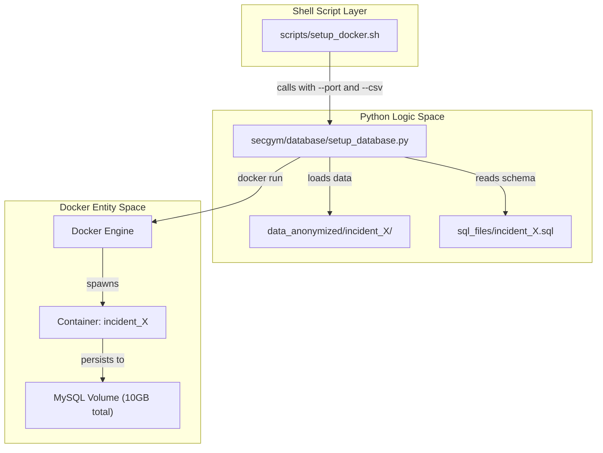
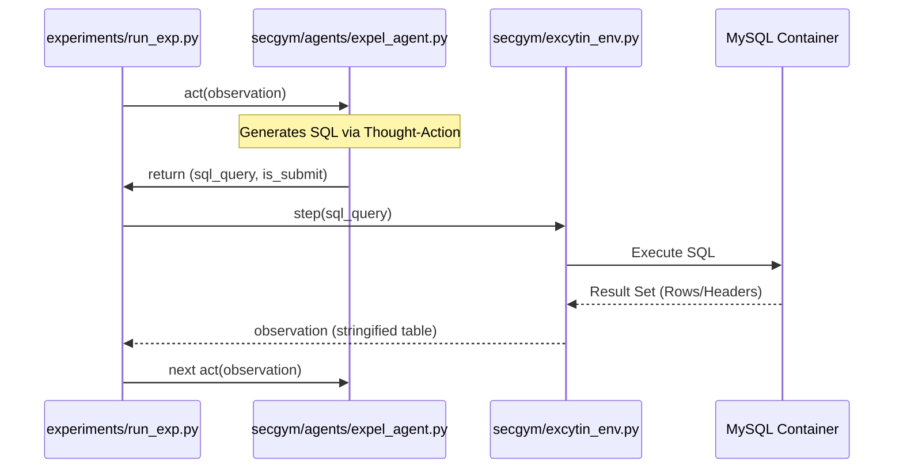

<!-- source: DeepWiki mcp.deepwiki.com · repo microsoft/SecRL · page 1.1 Getting Started & Setup · fetched 2026-10-26 -->

# Getting Started & Setup

<details>
<summary>Relevant source files</summary>

The following files were used as context for generating this wiki page:

- [.gitignore](.gitignore)
- [README.md](README.md)
- [experiments/run_qa_gen.py](experiments/run_qa_gen.py)
- [experiments/run_reevaluation.py](experiments/run_reevaluation.py)
- [requirements.txt](requirements.txt)
- [requirements_freeze.txt](requirements_freeze.txt)
- [scripts/setup_alert_only.sh](scripts/setup_alert_only.sh)
- [scripts/setup_docker.sh](scripts/setup_docker.sh)
- [scripts/to_run.sh](scripts/to_run.sh)
- [secgym/agents/expel_agent.py](secgym/agents/expel_agent.py)
- [secgym/assets/updated_eval_results_09_25.png](secgym/assets/updated_eval_results_09_25.png)
- [secgym/assets/updated_eval_results_10_25.png](secgym/assets/updated_eval_results_10_25.png)
- [secgym/assets/updated_eval_results_11_25.png](secgym/assets/updated_eval_results_11_25.png)
- [secgym/assets/updated_eval_results_12_25.png](secgym/assets/updated_eval_results_12_25.png)
- [secgym/database/README.md](secgym/database/README.md)
- [secgym/evaluator.py](secgym/evaluator.py)
- [secgym/myconfig.py](secgym/myconfig.py)
- [setup.py](setup.py)

</details>


This page provides a technical walkthrough for onboarding onto the **ExCyTIn-Bench** framework. The setup involves preparing the Python environment, configuring LLM providers via `AG2` (formerly AutoGen), spinning up the MySQL-based security incident databases using Docker, and verifying the installation with a trial experiment.

## 1. Environment Preparation

The framework requires **Python 3.11** and several data science and security-specific libraries.

### Installation Steps
1. **Clone the repository** and navigate to the root directory.
2. **Create a virtual environment**:
   ```bash
   conda create -n excytin python=3.11
   conda activate excytin
   ```
3. **Install dependencies**: Use the editable install flag to ensure the `secgym` package is discoverable by the experiment scripts.
   ```bash
   pip install -e . --use-pep517
   ```
   *Note: If you encounter version conflicts, a frozen requirement list is available in `requirements_freeze.txt` [README.md:56-56]().*

### Core Dependencies
| Package | Purpose |
| :--- | :--- |
| `gymnasium` | Core RL-style environment interface [requirements.txt:5-5](). |
| `pyautogen` | Unified LLM API calling via the `AG2` wrapper [requirements.txt:9-9](). |
| `mysql-connector-python` | Database connectivity for the `SecGym` environment [requirements.txt:12-12](). |
| `networkx` | Used for building attack graphs from incident logs [requirements.txt:2-2](). |

**Sources:** [README.md:49-57](), [requirements.txt:1-21](), [setup.py:18-31]()

---

## 2. MySQL Incident Database Setup

ExCyTIn-Bench uses Docker containers to host 8 distinct MySQL databases, each representing a specific security incident (e.g., Ransomware, BEC).

### Data Acquisition
The telemetry data must be downloaded from Hugging Face:
1. Download `data_anonymized.tar.gz` from the [ExCyTIn-Bench dataset](https://huggingface.co/datasets/anandmudgerikar/excytin-bench).
2. Extract the contents into `secgym/database/data_anonymized/` [README.md:29-31]().

### Docker Orchestration
The framework uses a `mysql:9.0` image [README.md:35-35](). The setup script `scripts/setup_docker.sh` iterates through the 8 incidents and invokes `secgym/database/setup_database.py` for each.

**Database Initialization Flow:**
The following diagram maps the setup script to the underlying code entities.

**Title: Database Provisioning Workflow**

**Sources:** [README.md:33-45](), [scripts/setup_docker.sh:1-73](), [scripts/setup_alert_only.sh:9-72]()

To initialize the environment, run:
```bash
bash scripts/setup_docker.sh
```
This binds local CSV files to the containers. By default, this takes ~10GB of disk space. To create a single database containing all 8 attacks (33GB), modify the flags in `setup_docker.sh` [README.md:44-47]().

---

## 3. LLM Configuration (`myconfig.py`)

ExCyTIn-Bench leverages `AG2` (AutoGen) for provider-agnostic LLM interaction. You must configure your API keys in `secgym/myconfig.py`.

### Configuration Structure
The `CONFIG_LIST` variable stores a list of dictionaries containing model details and credentials. The `tags` key is critical; it is used by the agent registry and experiment scripts to filter which model configuration to use [secgym/myconfig.py:12-25]().

**Example Configuration (`secgym/myconfig.py`):**
```python
CONFIG_LIST = [
    {
        "model": "gpt-4o",
        "api_key": "YOUR_OPENAI_KEY",
        "tags": ["gpt-4o"],
    },
    {
        "model": "claude-3-5-sonnet",
        "api_key": "YOUR_ANTHROPIC_KEY",
        "tags": ["claude-3-5-sonnet"],
    }
]
```
**Sources:** [secgym/myconfig.py:28-45](), [README.md:58-61]()

---

## 4. Verifying the Environment

Once the Python environment is ready and Docker containers are running, you can run a "trial" experiment to verify the end-to-end data flow (Agent -> SecGym -> MySQL).

### Trial Run Execution
The `experiments/run_exp.py` script includes a `--trial_run` flag. This executes only **2 questions from 1 incident** to minimize cost and time during verification [README.md:65-68]().

```bash
python experiments/run_exp.py --trial_run --model gpt-4o
```

### Data Flow during Trial
The following diagram illustrates how the system components interact during a single investigation step.

**Title: Investigation Step Data Flow**

**Sources:** [experiments/run_exp.py:67-67](), [secgym/agents/expel_agent.py:97-129](), [README.md:18-20]()

### Results Output
After the trial, results are saved in the `experiments/final_results` folder [README.md:65-65](). You should see JSON files containing:
1. **Agent Trajectory**: The sequence of thoughts and SQL actions.
2. **Environment Observations**: The data returned by the database.
3. **Rewards**: 0 or 1 based on the `LLMEvaluator`'s assessment of the final answer [secgym/evaluator.py:1-20]().

**Sources:** [README.md:65-68](), [experiments/run_exp.py:1-100]()

---

