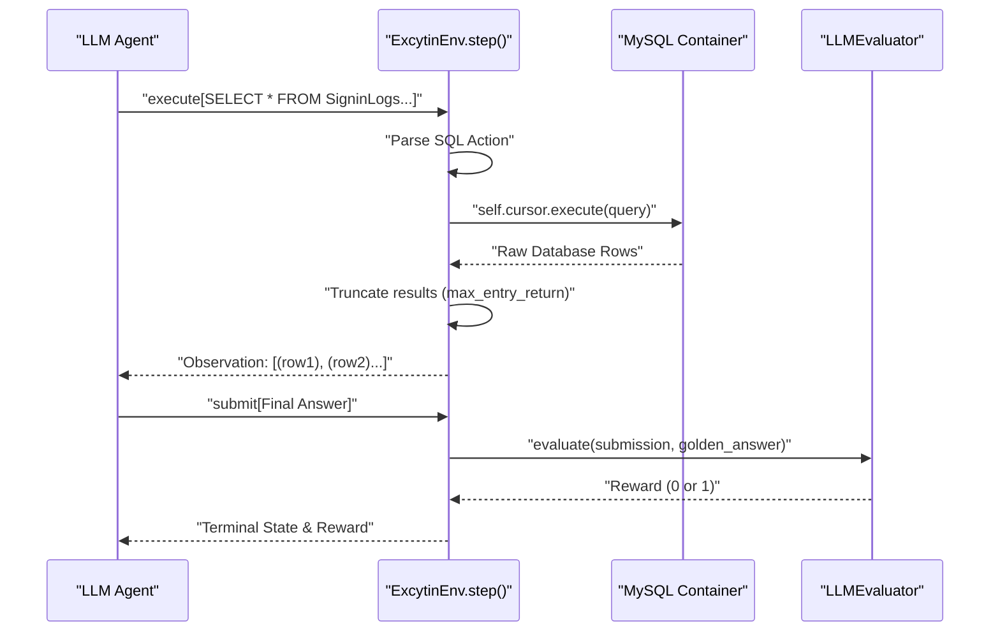
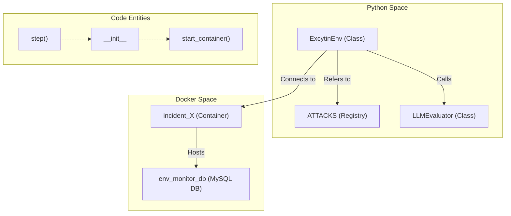

<!-- source: DeepWiki mcp.deepwiki.com · repo microsoft/SecRL · page 2.1 ExcytinEnv: The Gymnasium Interface · fetched 2026-10-26 -->

# ExcytinEnv: The Gymnasium Interface

Relevant source files

The following files were used as context for generating this wiki page:

- [latest_experiments/BaselineAgent_o3_c106_alert_level_t0_s25_trial1/agent_incident_5.json](latest_experiments/BaselineAgent_o3_c106_alert_level_t0_s25_trial1/agent_incident_5.json)
- [latest_experiments/BaselineAgent_o3_c106_alert_level_t0_s25_trial1/agent_incident_55.json](latest_experiments/BaselineAgent_o3_c106_alert_level_t0_s25_trial1/agent_incident_55.json)
- [latest_experiments/BaselineAgent_o3_c106_alert_level_t0_s25_trial1/env_incident_134.json](latest_experiments/BaselineAgent_o3_c106_alert_level_t0_s25_trial1/env_incident_134.json)
- [latest_experiments/BaselineAgent_o3_c106_alert_level_t0_s25_trial1/env_incident_166.json](latest_experiments/BaselineAgent_o3_c106_alert_level_t0_s25_trial1/env_incident_166.json)
- [secgym/database/process_logs.py](secgym/database/process_logs.py)
- [secgym/excytin_env.py](secgym/excytin_env.py)

The `ExcytinEnv` class is the core Gymnasium interface for the ExCyTIn-Bench framework. It mediates the interaction between LLM agents and the containerized MySQL security telemetry databases. It handles the lifecycle of Docker containers, manages SQL query execution, enforces observation limits, and facilitates the evaluation of agent responses against ground-truth answers.

## The ATTACKS Registry

The environment uses a centralized registry, `ATTACKS`, to map incident identifiers to their respective metadata, including question files, network ports, and Docker container names.

| Incident ID | QA File (o1 test) | Port | Container Name |
| :--- | :--- | :--- | :--- |
| `incident_5` | `o1/test/incident_5_qa_incident_o1-ga_c42.json` | 3306 | `incident_5` |
| `incident_38` | `o1/test/incident_38_qa_incident_o1-ga_c42.json` | 3307 | `incident_38` |
| `incident_34` | `o1/test/incident_34_qa_incident_o1-ga_c42.json` | 3308 | `incident_34` |
| `incident_39` | `o1/test/incident_39_qa_incident_o1-ga_c42.json` | 3309 | `incident_39` |
| `incident_55` | `o1/test/incident_55_qa_incident_o1-ga_c42.json` | 3310 | `incident_55` |
| `incident_134` | `o1/test/incident_134_qa_incident_o1-ga_c42.json` | 3311 | `incident_134` |
| `incident_166` | `o1/test/incident_166_qa_incident_o1-ga_c42.json` | 3312 | `incident_166` |
| `incident_322` | `o1/test/incident_322_qa_incident_o1-ga_c42.json` | 3313 | `incident_322` |

Sources: `[secgym/excytin_env.py:17-58]()`

## Environment Initialization and Lifecycle

When `ExcytinEnv` is instantiated, it performs several critical setup tasks:
1.  **Container Management**: It ensures the required Docker container is running via `start_container` `[secgym/excytin_env.py:65-75]()`.
2.  **Database Connection**: It establishes a connection to the MySQL instance using `mysql.connector` `[secgym/excytin_env.py:144-155]()`.
3.  **Question Loading**: It loads the synthetic QA pairs from the path specified in the `ATTACKS` registry based on the chosen `split` `[secgym/excytin_env.py:132-140]()`.
4.  **Layer Validation**: It validates the telemetry layer using `check_layer` to ensure the requested visibility level is supported `[secgym/excytin_env.py:167-167]()`.

### Docker Container Management
The environment utilizes the `docker` Python SDK to manage the backend. If a container is stopped, the `start_container` function restarts it and waits for 3 seconds to allow the MySQL service to initialize `[secgym/excytin_env.py:65-75]()`.

### Telemetry Layers
The `layer` parameter controls the scope of data available to the agent:
*   **alert**: Standard access to the full telemetry database.
*   **log**: Access to raw logs.
*   **alert_only**: Restricts the agent to a specific container version (suffixed with `_alert_only`) that contains limited tables `[secgym/excytin_env.py:128-130]()`.

Sources: `[secgym/excytin_env.py:78-168]()`

## The Step-Query-Observation Loop

The environment follows the standard Gymnasium `step()` pattern. Agents provide an "action" (either a SQL query or a final answer submission), and the environment returns an "observation" (query results or evaluation feedback).

### Execution Flow: Natural Language to SQL
The following diagram illustrates how a natural language question is processed through the `ExcytinEnv` loop.

**Diagram: ExcytinEnv Interaction Flow**

Sources: `[secgym/excytin_env.py:218-280]()`, `[secgym/evaluator.py:15-40]()`

### Result Truncation and Logic
To prevent context window overflow in LLMs, `ExcytinEnv` implements strict truncation logic:
*   **`max_entry_return`**: Limits the number of rows returned from a SQL query (default: 15) `[secgym/excytin_env.py:85-85]()`.
*   **`max_str_len`**: Limits the total character length of the observation string (default: 100,000) `[secgym/excytin_env.py:87-87]()`.

## Data Flow and Schema Validation

The environment ensures that the database schema is consistent with the agent's expectations through the `check_layer` mechanism and internal metadata tracking.

**Diagram: System Entity Mapping**

Sources: `[secgym/excytin_env.py:78-168]()`

### Key Functions and Data Members

| Entity | Role | Source |
| :--- | :--- | :--- |
| `self.cursor` | MySQL cursor used to execute queries against the active incident container. | `[secgym/excytin_env.py:151-153]()` |
| `step(action)` | Main loop; handles `execute[]` for SQL and `submit[]` for final answers. | `[secgym/excytin_env.py:218-280]()` |
| `reset()` | Re-initializes the environment for a new question or trial. | `[secgym/excytin_env.py:188-216]()` |
| `check_layer(layer)` | Validates that the provided layer string is within allowed parameters. | `[secgym/excytin_env.py:167-167]()` |
| `get_logging()` | Compiles success metrics, step counts, and query success rates for logging. | `[secgym/excytin_env.py:188-202]()` |

### Observation Format
Observations returned to the agent are strings. For SQL queries, the environment returns a string representation of a list of tuples `[secgym/excytin_env.py:240-250]()`. If a query fails, the environment catches the `mysql.connector.Error` and returns the error message as the observation, allowing the agent to self-correct `[secgym/excytin_env.py:245-255]()`.

Sources: `[secgym/excytin_env.py:218-280]()`, `[latest_experiments/BaselineAgent_o3_c106_alert_level_t0_s25_trial1/env_incident_166.json:30-50]()`

---

