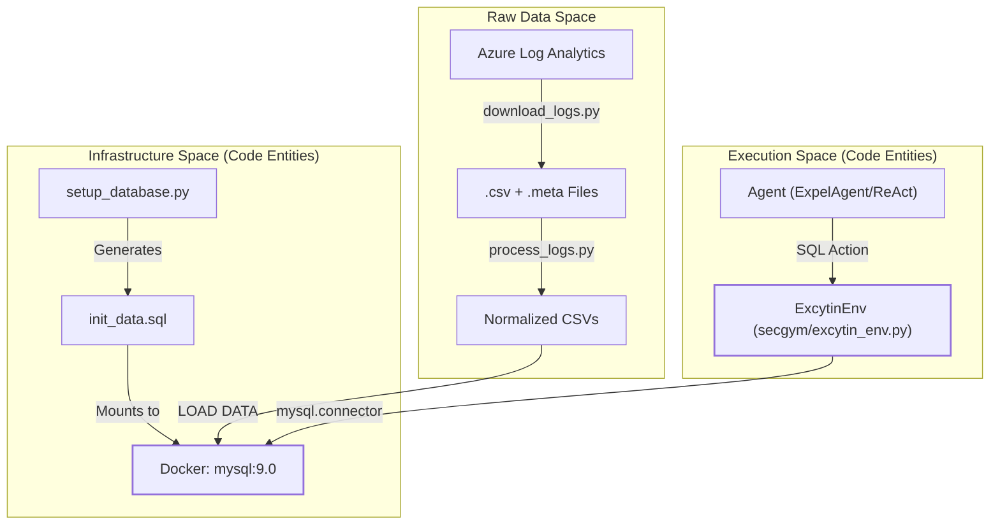
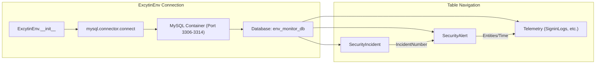

<!-- source: DeepWiki mcp.deepwiki.com · repo microsoft/SecRL · page 2.2 Database Layer: Setup, Schema & Data Pipeline · fetched 2026-10-26 -->

# Database Layer: Setup, Schema & Data Pipeline

Relevant source files

The following files were used as context for generating this wiki page:

- [requirements_freeze.txt](requirements_freeze.txt)
- [scripts/setup_alert_only.sh](scripts/setup_alert_only.sh)
- [scripts/setup_docker.sh](scripts/setup_docker.sh)
- [scripts/to_run.sh](scripts/to_run.sh)
- [secgym/agents/expel_agent.py](secgym/agents/expel_agent.py)
- [secgym/database/__init__.py](secgym/database/__init__.py)
- [secgym/database/download_logs.py](secgym/database/download_logs.py)
- [secgym/database/pii_anony/pii_col_identify.py](secgym/database/pii_anony/pii_col_identify.py)
- [secgym/database/pii_anony/pii_replace.py](secgym/database/pii_anony/pii_replace.py)
- [secgym/database/process_logs.py](secgym/database/process_logs.py)
- [secgym/database/setup_database.py](secgym/database/setup_database.py)
- [secgym/excytin_env.py](secgym/excytin_env.py)

The Database Layer provides the foundational telemetry data required for security incident investigation. It manages the full lifecycle of security logs—from ingestion via Azure Monitor to containerized MySQL deployment—enabling LLM agents to perform SQL-based threat hunting.

## Data Lifecycle & Pipeline

The data pipeline consists of three primary stages: downloading raw telemetry, processing/normalizing the data, and initializing the database environment.

### 1. Ingestion (download_logs.py)
Raw logs are pulled from Azure Log Analytics workspaces. The system handles large-scale telemetry by calculating entry sizes and segmenting queries to avoid API limits [secgym/database/download_logs.py:46-97]().
*   **Segmented Querying**: If a table exceeds 60MB or 500,000 rows, the pipeline automatically splits the request into time-based chunks [secgym/database/download_logs.py:128-158]().
*   **Metadata Generation**: Each downloaded table includes a `.meta` file containing column types (e.g., `dynamic` for JSON-like fields), which is later used for SQL schema generation [secgym/database/download_logs.py:107-112]().

### 2. Processing & Normalization (process_logs.py)
Security logs often contain special characters that conflict with standard CSV parsing. 
*   **Separator Handling**: The pipeline uses a unique separator `❖` and quote character `"` to ensure data integrity [secgym/database/process_logs.py:107-108]().
*   **JSON Normalization**: Columns marked as `dynamic` in metadata are pre-processed to ensure empty values are represented as `{}` for consistent SQL loading [secgym/database/process_logs.py:33-38]().

### 3. Setup & Containerization (setup_database.py)
The system uses Docker to provide isolated MySQL environments for each incident.
*   **SQL Generation**: `generate_create_table_sql` and `generate_load_data_sql` dynamically create the schema based on `.meta` files [secgym/database/setup_database.py:171-176]().
*   **Container Lifecycle**: The script `setup_database.py` automates the creation of MySQL 9.0 containers, mounting the processed CSVs into `/var/lib/mysql-files` for high-speed loading via `LOAD DATA INFILE` [secgym/database/setup_database.py:69-92]().

**Sources:** [secgym/database/download_logs.py:1-160](), [secgym/database/process_logs.py:1-121](), [secgym/database/setup_database.py:35-130]().

---

## System Architecture: Data to Code Mapping

The following diagram illustrates how the raw log files and scripts relate to the core `ExcytinEnv` used by agents.

### Data Flow to Environment

**Sources:** [secgym/database/setup_database.py:69-92](), [secgym/excytin_env.py:142-155](), [secgym/agents/expel_agent.py:125-129]().

---

## Database Schema & Multi-Table Structure

The benchmark utilizes a multi-table schema representing diverse telemetry sources. This allows agents to pivot from an initial alert to deep forensic logs.

### Core Telemetry Tables
| Table Name | Description | Key Columns |
| :--- | :--- | :--- |
| `SecurityIncident` | High-level incident metadata. | `IncidentNumber`, `Title`, `Severity` |
| `SecurityAlert` | Specific alerts within an incident. | `AlertId`, `AlertName`, `Entities` |
| `SigninLogs` | AAD/Identity login attempts. | `UserPrincipalName`, `IPAddress`, `ResultType` |
| `DeviceProcessEvents` | Endpoint process execution logs. | `DeviceName`, `FileName`, `ProcessCommandLine` |
| `OfficeActivity` | O365/SaaS activity logs. | `UserId`, `Operation`, `ClientIP` |
| `EmailEvents` | Mail flow and security logs. | `SenderIPv4`, `RecipientEmailAddress`, `Subject` |

### Database Initialization Logic
The initialization process converts Kusto-derived types into MySQL-compatible types:
*   `datetime` -> `DATETIME(6)`
*   `dynamic` -> `JSON` or `LONGTEXT`
*   `string` -> `LONGTEXT` [secgym/database/setup_database.py:214-228]().

### Database Access Layer

**Sources:** [secgym/excytin_env.py:17-58](), [secgym/excytin_env.py:144-153](), [secgym/database/setup_database.py:214-230]().

---

## Setup Execution

The environment is typically initialized using shell scripts that orchestrate `setup_database.py` across different incident IDs.

### Standard Setup (`setup_docker.sh`)
This script initializes the full telemetry environment for 8 incidents, assigning each to a specific local port (3306 through 3313) [scripts/setup_docker.sh:8-63]().

### Alert-Only Setup (`setup_alert_only.sh`)
For experiments focusing on high-level reasoning without raw log access, this script uses the `--layer alert_only` flag. This restricts the database schema to `SecurityAlert` and `SecurityIncident` tables [scripts/setup_alert_only.sh:9-72]().

### Key Functions in `setup_database.py`
*   `create_container()`: Manages the Docker Python SDK to pull images, set environment variables (`MYSQL_ROOT_PASSWORD`), and mount volumes [secgym/database/setup_database.py:35-118]().
*   `generate_create_table_sql()`: Iterates through the `.meta` JSON to build valid `CREATE TABLE` statements with appropriate MySQL data types [secgym/database/setup_database.py:214-235]().
*   `generate_load_data_sql()`: Formats the `LOAD DATA INFILE` command, specifically handling the `❖` separator and mapping JSON columns [secgym/database/setup_database.py:238-261]().

**Sources:** [secgym/database/setup_database.py:1-261](), [scripts/setup_docker.sh:1-65](), [scripts/setup_alert_only.sh:1-73]().

---

