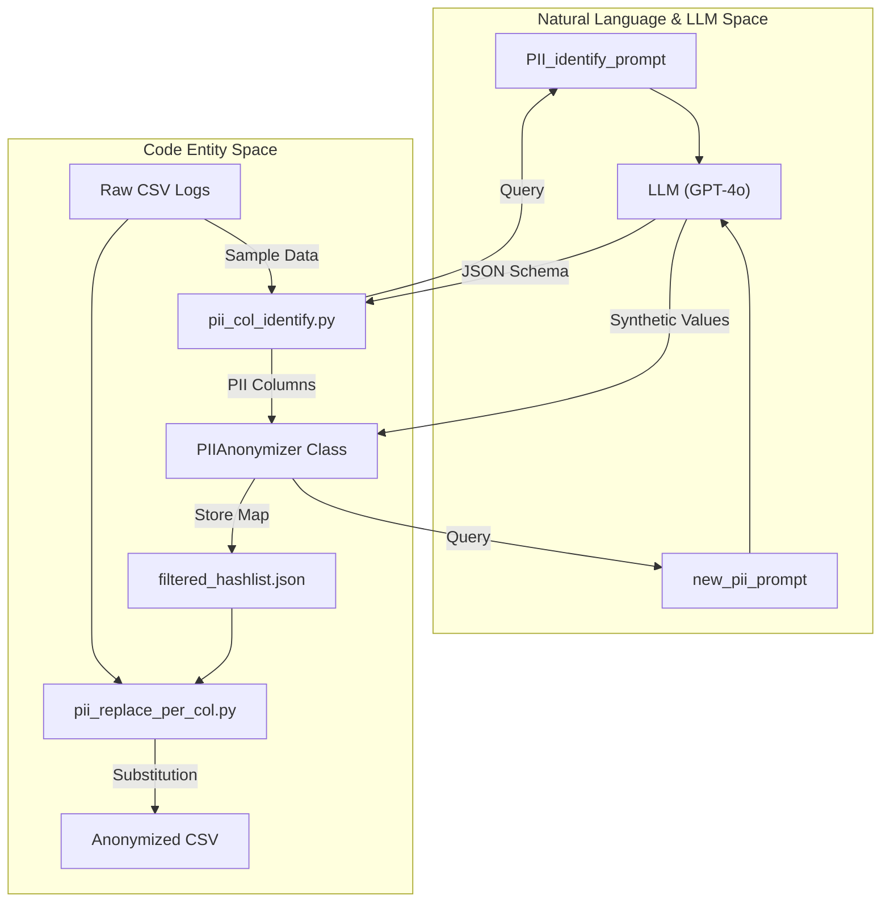
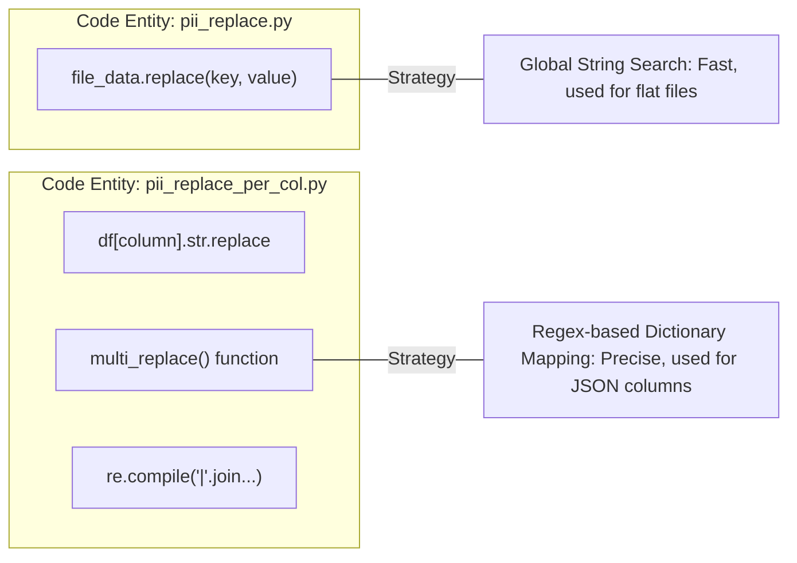

<!-- source: DeepWiki mcp.deepwiki.com · repo microsoft/SecRL · page 2.3 PII Anonymization Pipeline · fetched 2026-10-26 -->

# PII Anonymization Pipeline

<details>
<summary>Relevant source files</summary>

The following files were used as context for generating this wiki page:

- [secgym/database/__init__.py](secgym/database/__init__.py)
- [secgym/database/download_logs.py](secgym/database/download_logs.py)
- [secgym/database/pii_anony/pii_col_identify.py](secgym/database/pii_anony/pii_col_identify.py)
- [secgym/database/pii_anony/pii_mapper.py](secgym/database/pii_anony/pii_mapper.py)
- [secgym/database/pii_anony/pii_replace.py](secgym/database/pii_anony/pii_replace.py)
- [secgym/database/pii_anony/pii_replace_per_col.py](secgym/database/pii_anony/pii_replace_per_col.py)
- [secgym/database/setup_database.py](secgym/database/setup_database.py)

</details>


The PII Anonymization Pipeline is a critical preprocessing subsystem designed to protect sensitive information within raw security logs before they are ingested into the SecGym environment. This pipeline automates the identification of Personally Identifiable Information (PII), generates realistic synthetic replacements, and performs large-scale substitution across CSV telemetry files while maintaining data integrity and referential consistency.

## Pipeline Workflow

The anonymization process follows a multi-stage sequence from raw log ingestion to the production of anonymized CSVs ready for database loading.

### 1. Column Identification (`pii_col_identify.py`)
The pipeline first identifies which columns in the telemetry tables contain sensitive data.
- **Sampling**: It takes 5-10 random samples from each column to provide context [secgym/database/pii_anony/pii_col_identify.py:61-72]().
- **LLM Analysis**: It uses a specialized prompt `PII_identify_prompt` to ask an LLM (GPT-4o) if a column contains PII like names, IP addresses, or emails [secgym/database/pii_anony/pii_col_identify.py:21-41]().
- **Structure Detection**: A second pass determines if the column is a flat string or a JSON/dynamic object containing nested PII fields [secgym/database/pii_anony/pii_col_identify.py:153-169]().

### 2. Mapping Generation (`pii_mapper.py`)
Once PII columns are identified, the `PIIAnonymizer` class builds a global replacement map (`hashlist`) to ensure that the same raw value (e.g., a specific username) is replaced by the same synthetic value across all tables.
- **Regex Extraction**: Uses standard patterns to find IPs, UUIDs, MAC addresses, and SIDs [secgym/database/pii_anony/pii_mapper.py:47-86]().
- **Synthetic Generation**:
    - **IPs**: Generated via `generate_ip()` using random octets [secgym/database/pii_anony/pii_mapper.py:44-45]().
    - **Names/Emails**: Uses LLM-based generation via `new_pii_prompt` to create realistic but fake identities [secgym/database/pii_anony/pii_mapper.py:14-42]().
    - **UUIDs**: Generated using `uuid.uuid4()` [secgym/database/pii_anony/pii_mapper.py:69-70]().
- **Exemption List**: Skips common system strings like `.exe`, `.dll`, or service account prefixes to avoid breaking log logic [secgym/database/pii_anony/pii_mapper.py:153]().

### 3. Substitution (`pii_replace.py` & `pii_replace_per_col.py`)
The final stage applies the mapping to the raw data.
- **Global Replace**: `pii_replace.py` performs a bulk text replacement across files using the `hashlist` [secgym/database/pii_anony/pii_replace.py:57-58]().
- **Targeted Replace**: `pii_replace_per_col.py` uses Pandas for more granular control, specifically handling JSON columns by parsing the string and replacing values only within identified PII fields [secgym/database/pii_anony/pii_replace_per_col.py:177-200]().

### Implementation Logic Flow

Title: PII Anonymization Data Flow

Sources: [secgym/database/pii_anony/pii_col_identify.py:21-41](), [secgym/database/pii_anony/pii_mapper.py:14-42](), [secgym/database/pii_anony/pii_replace_per_col.py:106-121](), [secgym/database/pii_anony/pii_replace.py:93-109]()

## Key Components

### PIIAnonymizer Class
Located in `pii_mapper.py`, this class manages the state of the anonymization session, including the cumulative cost of LLM calls and the reverse mapping to prevent collisions.

| Method | Role |
| :--- | :--- |
| `__init__` | Loads identified PII columns and existing `hashlist` [secgym/database/pii_anony/pii_mapper.py:125-154](). |
| `match_one_csv` | Extracts all unique PII values from a specific CSV file [secgym/database/pii_anony/pii_mapper.py:170-200](). |
| `match_field_dict` | Uses regex to extract values from nested JSON strings based on identified fields [secgym/database/pii_anony/pii_mapper.py:155-167](). |

### Replacement Strategies
The pipeline supports two primary replacement modes to balance performance and precision.

Title: Substitution Logic Mapping

Sources: [secgym/database/pii_anony/pii_replace.py:57-58](), [secgym/database/pii_anony/pii_replace_per_col.py:189-197]()

## Data Formats

### Column Identification Schema
The `pii_col_identify.py` script outputs a JSON structure (e.g., `second_filter.json`) that guides the mapper:
```json
{
    "RemoteIP": {
        "is_dict": false,
        "is_pii": true,
        "pii_fields": []
    },
    "ExtendedProperties": {
        "is_dict": true,
        "is_pii": true,
        "pii_fields": ["UserAccount", "ClientIP"]
    }
}
```
Sources: [secgym/database/pii_anony/pii_col_identify.py:162-169]()

### Anonymization Map (`hashlist`)
The mapping file maintains the relationship between original and synthetic values:
```json
{
    "192.168.1.50": "172.16.254.1",
    "j.doe@company.com": "a.smith@company.com",
    "S-1-5-21-1234": "S-1-5-21-9876"
}
```
Sources: [secgym/database/pii_anony/pii_mapper.py:135-144]()

## Integration with Database Setup
After the anonymization pipeline produces the `data_anonymized/` directory, the files are passed to `setup_database.py`. This script uses the anonymized CSVs to build the MySQL Docker containers [secgym/database/setup_database.py:85-91](). It handles the specific `❖` separator used during the anonymization process to ensure data is correctly loaded into the SQL tables [secgym/database/setup_database.py:15-16]().

Sources: [secgym/database/setup_database.py:35-42](), [secgym/database/pii_anony/pii_replace.py:105-109]()

---

