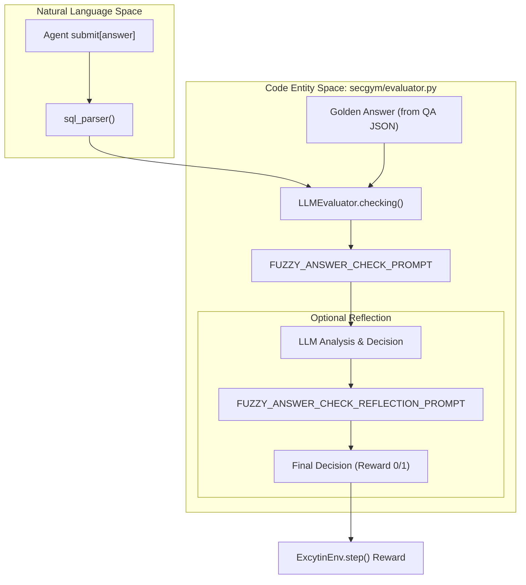
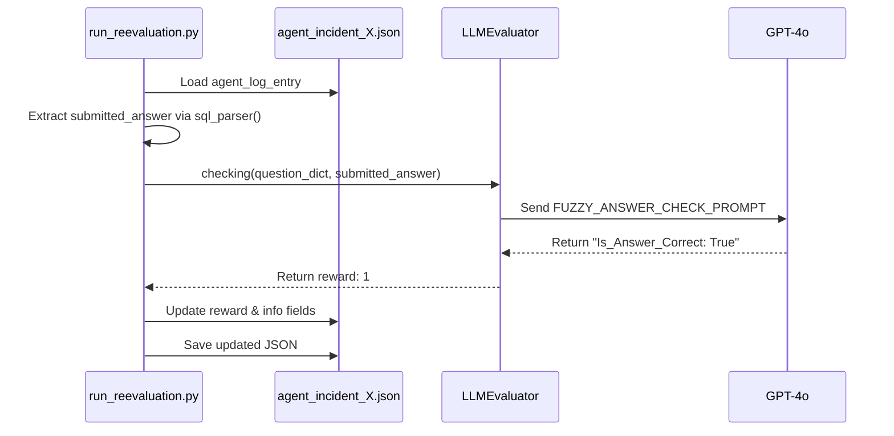

<!-- source: DeepWiki mcp.deepwiki.com · repo microsoft/SecRL · page 2.4 LLM Evaluator · fetched 2026-10-26 -->

# LLM Evaluator

Relevant source files

The following files were used as context for generating this wiki page:

- [experiments/run_qa_gen.py](experiments/run_qa_gen.py)
- [experiments/run_reevaluation.py](experiments/run_reevaluation.py)
- [latest_experiments/BaselineAgent_o3_c106_alert_level_t0_s25_trial1/agent_incident_5.json](latest_experiments/BaselineAgent_o3_c106_alert_level_t0_s25_trial1/agent_incident_5.json)
- [latest_experiments/BaselineAgent_o3_c106_alert_level_t0_s25_trial1/agent_incident_55.json](latest_experiments/BaselineAgent_o3_c106_alert_level_t0_s25_trial1/agent_incident_55.json)
- [latest_experiments/BaselineAgent_o3_c106_alert_level_t0_s25_trial1/env_incident_134.json](latest_experiments/BaselineAgent_o3_c106_alert_level_t0_s25_trial1/env_incident_134.json)
- [latest_experiments/BaselineAgent_o3_c106_alert_level_t0_s25_trial1/env_incident_166.json](latest_experiments/BaselineAgent_o3_c106_alert_level_t0_s25_trial1/env_incident_166.json)
- [secgym/database/process_logs.py](secgym/database/process_logs.py)
- [secgym/evaluator.py](secgym/evaluator.py)
- [secgym/excytin_env.py](secgym/excytin_env.py)
- [setup.py](setup.py)

The LLM Evaluator is a critical component of the SecGym environment responsible for scoring agent submissions against "golden" ground-truth answers. Because security investigation answers often involve complex strings (SIDs, file paths, IP addresses) or descriptive text, the system utilizes a fuzzy matching logic powered by an LLM to determine if an agent's response is semantically correct, even if it is not an exact string match.

### Purpose and Scope
The evaluator ensures that agents are rewarded for finding the correct technical evidence within the MySQL telemetry logs. It handles the transition from the agent's natural language or structured output to a binary reward (0 or 1) used by the Gymnasium environment [secgym/excytin_env.py:101]().

---

### Core Classes and Logic

The evaluation logic is primarily contained within `secgym/evaluator.py`. It uses `OpenAIWrapper` from the `autogen` library to interface with LLMs for decision-making [secgym/evaluator.py:4]().

#### 1. Evaluator Base Class
The `Evaluator` class serves as the interface for checking answers. It defines the `checking` method which takes a question dictionary and a submitted answer, returning a result dictionary containing the reward and the LLM's reasoning [secgym/evaluator.py:117-124]().

#### 2. LLMEvaluator Class
The `LLMEvaluator` is the concrete implementation that uses prompts to perform "fuzzy" checking. It supports several modes:
*   **Fuzzy Check**: Allows for variations in capitalization, trailing slashes in URLs, and additional context [secgym/evaluator.py:16-54]().
*   **Strict Check**: Requires unambiguous matches and penalizes agents that provide multiple possible answers [secgym/evaluator.py:97-109]().
*   **Reflection**: If `ans_check_reflection` is enabled, a second LLM pass reviews the first evaluation to ensure accuracy [secgym/evaluator.py:56-95]().

**Key Prompt Logic (Fuzzy Match):**
The evaluator is instructed to consider the following as **True**:
*   File names missing extensions (e.g., `notepad` vs `notepad.exe`) [secgym/evaluator.py:32-36]().
*   Answers containing the golden answer plus useful context [secgym/evaluator.py:38-43]().
*   Small enumerations (< 10 items) that include the correct answer [secgym/evaluator.py:25]().

It is instructed to consider the following as **False**:
*   Overly large enumerations (> 15 items) that likely result from "dumping" table contents [secgym/evaluator.py:25, 44-48]().

**Sources:** [secgym/evaluator.py:10-115](), [secgym/evaluator.py:117-150]()

---

### Evaluation Data Flow

The following diagram illustrates how an agent's submission is processed by the `ExcytinEnv` and passed to the `LLMEvaluator` to produce a reward.

**Submission Evaluation Pipeline**

**Sources:** [secgym/evaluator.py:16-95](), [secgym/excytin_env.py:200-210](), [secgym/agents/agent_utils.py:12]()

---

### Re-evaluation Pipeline

The repository provides `run_reevaluation.py` to allow researchers to update scores in existing experiment logs without re-running the entire agent trajectory. This is useful when updating the evaluation model (e.g., moving from GPT-4 to GPT-4o) or refining the evaluation prompts.

#### Workflow of `run_reevaluation.py`:
1.  **Load Logs**: Loads `agent_incident_X.json` and `env_incident_X.json` from a results directory [experiments/run_reevaluation.py:26-30]().
2.  **Match Questions**: Maps agent trajectories to environment logs using the `nodes` identifier (representing the start/end alert IDs in the attack graph) [experiments/run_reevaluation.py:35-48]().
3.  **Execute Check**: Calls `evaluator.checking()` with the original submitted answer and the golden answer [experiments/run_reevaluation.py:66]().
4.  **Update Records**: If the reward changes, it updates the JSON logs and prints the delta for manual review [experiments/run_reevaluation.py:70-97]().

**Re-evaluation Logic Diagram**

**Sources:** [experiments/run_reevaluation.py:16-107](), [secgym/evaluator.py:117-150]()

---

### Key Evaluation Metrics

When the evaluator processes a submission, it populates an `info` dictionary that is stored in the environment logs. This data is used by analysis scripts to track performance:

| Field | Description |
| :--- | :--- |
| `submitted_answer` | The raw string extracted from the agent's `submit[]` action [experiments/run_reevaluation.py:61](). |
| `check_ans_response` | The raw text analysis from the LLM evaluator explaining its decision [latest_experiments/BaselineAgent_o3_c106_alert_level_t0_s25_trial1/agent_incident_5.json:34](). |
| `check_ans_reflection` | The secondary review analysis (if reflection is enabled) [latest_experiments/BaselineAgent_o3_c106_alert_level_t0_s25_trial1/agent_incident_5.json:36](). |
| `reward` | Binary 1 (Correct) or 0 (Incorrect) [secgym/excytin_env.py:198](). |

**Sources:** [secgym/excytin_env.py:188-205](), [latest_experiments/BaselineAgent_o3_c106_alert_level_t0_s25_trial1/agent_incident_5.json:30-40]()

---

