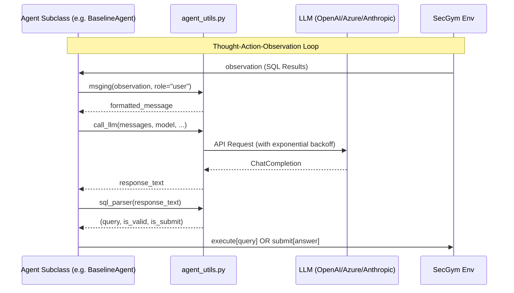
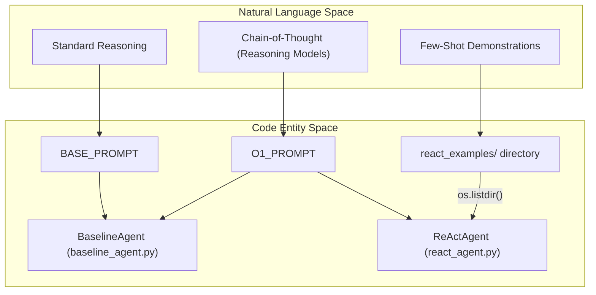

<!-- source: DeepWiki mcp.deepwiki.com · repo microsoft/SecRL · page 3.1 Agent Utilities & Base Classes · fetched 2026-10-26 -->

# Agent Utilities & Base Classes

<details>
<summary>Relevant source files</summary>

The following files were used as context for generating this wiki page:

- [secgym/agents/agent.py](secgym/agents/agent.py)
- [secgym/agents/agent_utils.py](secgym/agents/agent_utils.py)
- [secgym/agents/baseline_agent.py](secgym/agents/baseline_agent.py)
- [secgym/agents/prompt_sauce_agent.py](secgym/agents/prompt_sauce_agent.py)
- [secgym/agents/react_agent.py](secgym/agents/react_agent.py)
- [secgym/agents/react_examples/react_example_1.txt](secgym/agents/react_examples/react_example_1.txt)
- [secgym/agents/react_examples/react_example_2.txt](secgym/agents/react_examples/react_example_2.txt)
- [secgym/agents/react_examples/react_example_3.txt](secgym/agents/react_examples/react_example_3.txt)

</details>


This page documents the core agent abstractions and utility functions within the ExCyTIn-Bench framework. It covers the base `Agent` class, the shared Thought-Action-Observation loop contract, and the robust LLM interaction utilities including retry logic, SQL parsing, and token usage tracking.

## 1. Base Agent Abstraction

The `Agent` class in `secgym/agents/agent.py` serves as the abstract foundation for all specific agent implementations (e.g., `BaselineAgent`, `ReActAgent`). It defines the interface required to interact with the `SecGym` environment.

### Key Class Components
- **`__init__`**: Initializes the agent with a configuration list, maximum steps, and retry parameters. It creates an `OpenAIWrapper` client for LLM interactions `[secgym/agents/agent.py:9-24]()`.
- **`act(observation)`**: An abstract method that must be implemented by subclasses. It takes a string observation (database results or error messages) and returns a tuple of `(action_string, is_submit_flag)` `[secgym/agents/agent.py:34-35]()`.
- **`get_logging()`**: Standardizes the extraction of agent trajectories (messages) and cumulative token usage for experiment logging `[secgym/agents/agent.py:37-41]()`.

**Sources:** `[secgym/agents/agent.py:1-50]()`

---

## 2. Shared Thought-Action-Observation Loop

All agents follow a strict contract where they output reasoning followed by a structured action. The environment then provides an observation, closing the loop.

### Loop Data Flow
The diagram below illustrates how the `Agent` subclasses interact with the `agent_utils` and the LLM providers to maintain the stateful investigation.

**Agent-LLM Interaction Flow**

**Sources:** `[secgym/agents/agent.py:30-45]()`, `[secgym/agents/agent_utils.py:15-36]()`, `[secgym/agents/baseline_agent.py:119-158]()`

---

## 3. Agent Utilities (`agent_utils.py`)

The `agent_utils.py` module provides critical helper functions that decouple LLM provider specifics from the agent logic.

### SQL Parsing (`sql_parser`)
This function uses regular expressions to extract SQL queries or final answers from the LLM's raw text output. It supports two primary formats:
1.  **Execution**: Extracts content inside `execute[...]` or ` ```sql ... ``` ` blocks `[secgym/agents/agent_utils.py:25-27]()`.
2.  **Submission**: Extracts content inside `submit[...]` blocks `[secgym/agents/agent_utils.py:21-23]()`.

It handles cleaning (removing backticks) and truncating queries at the first semicolon to prevent multi-statement injection `[secgym/agents/agent_utils.py:18-36]()`.

### LLM Invocation & Robustness
The utilities provide two main entry points for model calls:
- **`call_llm`**: Wraps the `OpenAIWrapper`. It includes specialized handling for different model families:
    - **O1/O3**: Forces the system prompt into a user message role if necessary `[secgym/agents/agent_utils.py:107-111]()`.
    - **Claude**: Enables "thinking" tokens with a specific budget `[secgym/agents/agent_utils.py:115-117]()`.
    - **Retries**: Implements exponential backoff for `OpenAIRateLimitError` and `AnthropicAPIStatusError` `[secgym/agents/agent_utils.py:118-135]()`.
- **`call_llm_foundry`**: A dedicated wrapper for `ChatCompletionsClient` used with Azure AI Foundry endpoints `[secgym/agents/agent_utils.py:38-54]()`.

### Usage Tracking
To facilitate cost analysis, the utilities track token usage across multiple steps and trials:
- **`update_model_usage`**: Aggregates usage statistics (prompt tokens, completion tokens) keyed by model name `[secgym/agents/agent_utils.py:76-93]()`.
- **`update_total_usage`**: A recursive helper that sums nested usage dictionaries `[secgym/agents/agent_utils.py:56-74]()`.

**Sources:** `[secgym/agents/agent_utils.py:1-142]()`

---

## 4. Prompting Contracts

Agents utilize specific system prompts defined in their respective files to enforce the Thought-Action format. 

| Prompt Constant | Target Models | Key Instructions |
| :--- | :--- | :--- |
| `BASE_PROMPT` | GPT-4, standard LLMs | "Your response should always be a thought-action pair" `[secgym/agents/baseline_agent.py:16-29]()` |
| `O1_PROMPT` | o1, o3, Llama-3 | "Only give one thought-action per response... Follow the format exactly" `[secgym/agents/baseline_agent.py:32-49]()` |
| `R1_PROMPT` | DeepSeek R1, Qwen | Reasoning inside `<think>` and action inside `<answer>` tags `[secgym/agents/baseline_agent.py:51-62]()` |

### Code-to-Logic Mapping
The following diagram maps high-level prompting strategies to their specific code entities.

**Prompting Logic Map**

**Sources:** `[secgym/agents/baseline_agent.py:16-62]()`, `[secgym/agents/react_agent.py:11-57]()`

---

## 5. Few-Shot Integration (ReAct)

The `ReActAgent` extends the base utility pattern by dynamically loading demonstrations from `secgym/agents/react_examples/`. 

- **Loading Mechanism**: At initialization, the agent iterates through all files in the `react_examples` directory and appends their content to the `BASE_PROMPT` and `O1_PROMPT` `[secgym/agents/react_agent.py:50-56]()`.
- **Stop Sequences**: During `_call_llm`, it explicitly passes `stop=["Observation:", "observation:"]` to prevent the LLM from hallucinating environment responses `[secgym/agents/react_agent.py:109-120]()`.

**Sources:** `[secgym/agents/react_agent.py:1-125]()`, `[secgym/agents/react_examples/react_example_1.txt:1-55]()`

---

