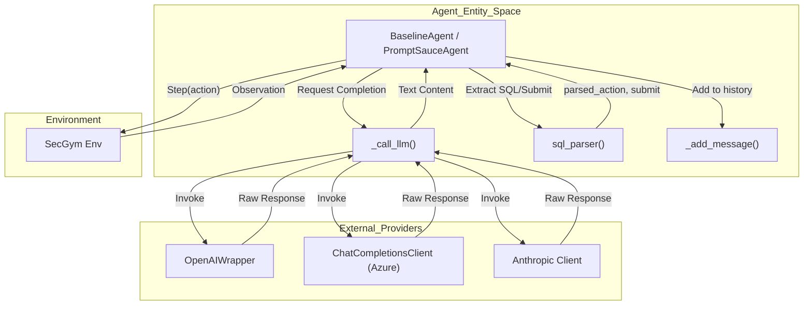
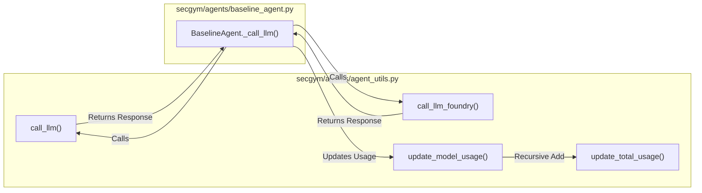

<!-- source: DeepWiki mcp.deepwiki.com · repo microsoft/SecRL · page 3.2 BaselineAgent & PromptSauceAgent · fetched 2026-10-26 -->

# BaselineAgent & PromptSauceAgent

Relevant source files

The following files were used as context for generating this wiki page:

- [secgym/agents/__init__.py](secgym/agents/__init__.py)
- [secgym/agents/agent_utils.py](secgym/agents/agent_utils.py)
- [secgym/agents/baseline_agent.py](secgym/agents/baseline_agent.py)
- [secgym/agents/expel_train/README.md](secgym/agents/expel_train/README.md)
- [secgym/agents/expel_train/__init__.py](secgym/agents/expel_train/__init__.py)
- [secgym/agents/expel_train/experience_recall.py](secgym/agents/expel_train/experience_recall.py)
- [secgym/agents/prompt_sauce_agent.py](secgym/agents/prompt_sauce_agent.py)
- [secgym/agents/react_agent.py](secgym/agents/react_agent.py)

This page documents the core agent implementations within the ExCyTIn-Bench framework: `BaselineAgent` and `PromptSauceAgent`. These agents represent the primary interfaces for LLM-driven security investigation, handling the iterative cycle of reasoning, SQL generation, and result processing.

## Overview and Purpose

The `BaselineAgent` and `PromptSauceAgent` provide a standard "Thought-Action-Observation" loop. They are designed to interact with the `SecGym` environment by generating SQL queries to explore security telemetry and ultimately submitting a final answer to a given security question. While `BaselineAgent` uses a general security analyst persona, `PromptSauceAgent` incorporates domain-specific heuristics regarding how security incidents are structured (e.g., relationship between alerts and entities).

### Key Components
*   **Act Loop**: The primary method `act()` that takes an observation and returns a parsed action [secgym/agents/baseline_agent.py:176-218]().
*   **Prompt Routing**: Dynamic selection of system prompts (e.g., `BASE_PROMPT`, `O1_PROMPT`, `R1_PROMPT`) based on the underlying model's architecture [secgym/agents/baseline_agent.py:97-106]().
*   **LLM Integration**: Support for multiple providers including OpenAI, Azure AI Foundry, Anthropic (Claude), and DeepSeek [secgym/agents/baseline_agent.py:87-95]().
*   **Retry Logic**: Handling malformed model outputs where the "Action" is missing by performing a targeted retry [secgym/agents/baseline_agent.py:191-200]().

---

## Agent Architecture and Data Flow

The following diagram illustrates the interaction between the Agent classes, the LLM providers, and the environment.

### Agent-Environment Interaction Flow
"This diagram shows how BaselineAgent and PromptSauceAgent manage the lifecycle of a single step."

**Sources:** [secgym/agents/baseline_agent.py:119-174](), [secgym/agents/baseline_agent.py:176-218](), [secgym/agents/agent_utils.py:18-36]()

---

## BaselineAgent Implementation

`BaselineAgent` is the fundamental implementation used for zero-shot or basic chain-of-thought evaluations.

### Model-Specific Prompting
The agent detects the model type during initialization and selects the appropriate system prompt to ensure the LLM follows the strict "Thought: ... Action: ..." format required by the parser.

| Prompt Constant | Target Models | Format Characteristics |
| :--- | :--- | :--- |
| `BASE_PROMPT` | Standard GPT-4, GPT-3.5 | Basic "Thought-Action" pair [secgym/agents/baseline_agent.py:16-29](). |
| `O1_PROMPT` | OpenAI o1/o3, Llama, R1 | Explicit instructions not to make assumptions and wait for execution [secgym/agents/baseline_agent.py:32-49](). |
| `R1_PROMPT` | DeepSeek R1, Qwen | Uses `<think>` and `<answer>` tags for reasoning-heavy models [secgym/agents/baseline_agent.py:51-62](). |

### The Act Loop and Retry-Split Logic
The `act()` function in `BaselineAgent` processes the latest observation from the environment [secgym/agents/baseline_agent.py:176](). A critical feature is the **Retry Split Action** logic: if the LLM provides a thought but fails to provide a formatted action (e.g., forgets the `Action:` prefix), the agent detects the failure and makes a second LLM call, appending the partial response to force the completion of the action block [secgym/agents/baseline_agent.py:191-200]().

**Sources:** [secgym/agents/baseline_agent.py:65-114](), [secgym/agents/baseline_agent.py:176-218]()

---

## PromptSauceAgent: Domain-Knowledge Prompting

`PromptSauceAgent` extends the baseline logic but utilizes a specialized `BASE_PROMPT` and `O1_PROMPT` that embed cybersecurity domain knowledge.

### Strategy Injection
The PromptSauce strategy instructs the agent on the hierarchical nature of security logs:
1.  **Incident Centricity**: Start by querying the `SecurityIncident` table to find related alerts [secgym/agents/prompt_sauce_agent.py:15-16]().
2.  **Entity Correlation**: Use entities (IPs, Users, Hosts) shared between alerts to pivot into raw telemetry tables like `DeviceProcessEvents` or `SigninLogs` [secgym/agents/prompt_sauce_agent.py:17-18]().
3.  **Schema Exploration**: Explicitly encourages using `DESCRIBE` or checking example entries due to the 20+ table schema [secgym/agents/prompt_sauce_agent.py:11]().

**Sources:** [secgym/agents/prompt_sauce_agent.py:8-27](), [secgym/agents/prompt_sauce_agent.py:30-52]()

---

## Multi-Provider LLM Integration

The agents utilize `secgym/agents/agent_utils.py` to abstract the complexities of different LLM providers.

### Call Abstraction
*   **`call_llm`**: Handles `OpenAIWrapper` (OpenAI/Azure OpenAI) and Anthropic. It includes exponential backoff for `OpenAIRateLimitError` [secgym/agents/agent_utils.py:95-141]().
*   **`call_llm_foundry`**: Specifically for Azure AI Foundry models using `ChatCompletionsClient` [secgym/agents/agent_utils.py:38-54]().
*   **Usage Tracking**: Both agents maintain a `total_usage` dictionary. `update_model_usage` and `update_total_usage` recursively aggregate token counts across multiple turns [secgym/agents/agent_utils.py:56-93]().

### SQL Parsing
The `sql_parser` function in `agent_utils.py` is the bridge between the LLM's natural language response and the database. It uses regex to extract content within `execute[...]` or `submit[...]` blocks, strips backticks, and handles trailing semicolons [secgym/agents/agent_utils.py:18-36]().

### LLM Call Flow and Usage Tracking
"This diagram maps the code entities involved in the LLM communication and token accounting."

**Sources:** [secgym/agents/agent_utils.py:38-141](), [secgym/agents/baseline_agent.py:119-155]()

---

## Technical Details: Class Members

### BaselineAgent Attributes
| Attribute | Description |
| :--- | :--- |
| `self.messages` | List of dictionaries representing the conversation history [secgym/agents/baseline_agent.py:100](). |
| `self.max_steps` | The maximum number of Thought-Action turns allowed (default: 15) [secgym/agents/baseline_agent.py:69](). |
| `self.step_count` | Counter for the current step in the trajectory [secgym/agents/baseline_agent.py:110](). |
| `self.totoal_usage` | Dictionary tracking cumulative token usage by model name [secgym/agents/baseline_agent.py:113](). |

**Sources:** [secgym/agents/baseline_agent.py:66-114](), [secgym/agents/prompt_sauce_agent.py:56-77]()

---

