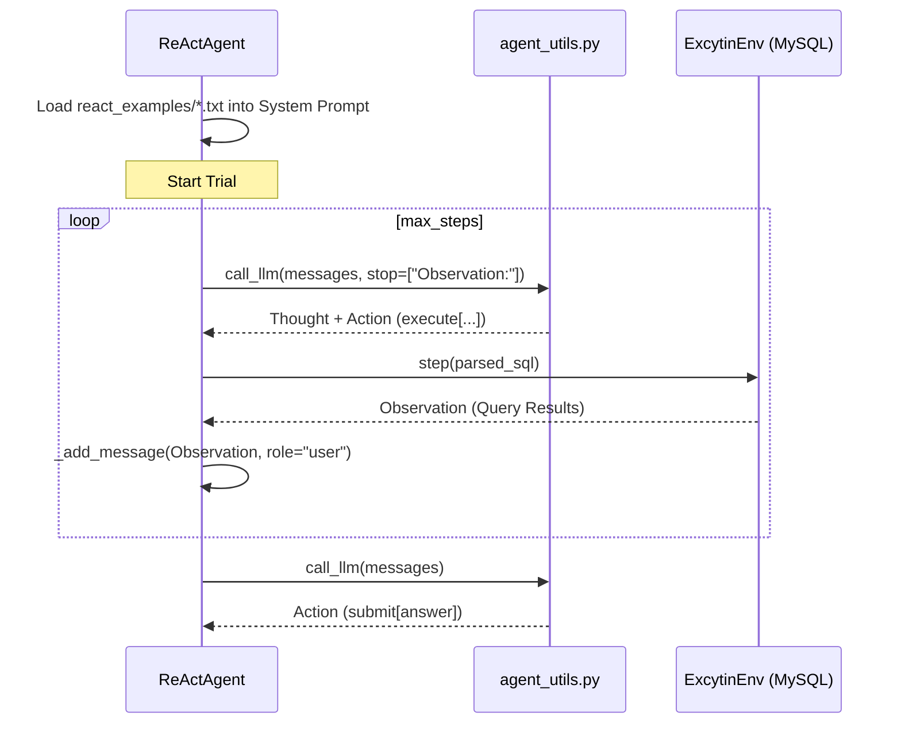
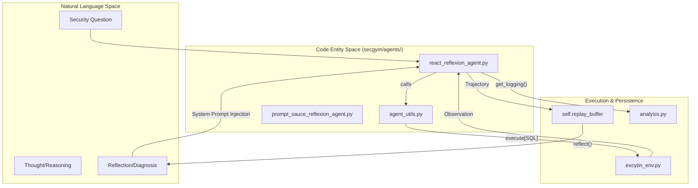

<!-- source: DeepWiki mcp.deepwiki.com · repo microsoft/SecRL · page 3.3 ReAct & Reflexion Agents · fetched 2026-10-26 -->

# ReAct & Reflexion Agents

Relevant source files

The following files were used as context for generating this wiki page:

- [experiments/result_analysis/analysis.py](experiments/result_analysis/analysis.py)
- [secgym/agents/agent.py](secgym/agents/agent.py)
- [secgym/agents/agent_utils.py](secgym/agents/agent_utils.py)
- [secgym/agents/baseline_agent.py](secgym/agents/baseline_agent.py)
- [secgym/agents/expel_train/insight_extraction.py](secgym/agents/expel_train/insight_extraction.py)
- [secgym/agents/prompt_sauce_agent.py](secgym/agents/prompt_sauce_agent.py)
- [secgym/agents/prompt_sauce_reflexion_agent.py](secgym/agents/prompt_sauce_reflexion_agent.py)
- [secgym/agents/react_agent.py](secgym/agents/react_agent.py)
- [secgym/agents/react_examples/react_example_1.txt](secgym/agents/react_examples/react_example_1.txt)
- [secgym/agents/react_examples/react_example_2.txt](secgym/agents/react_examples/react_example_2.txt)
- [secgym/agents/react_examples/react_example_3.txt](secgym/agents/react_examples/react_example_3.txt)
- [secgym/agents/react_reflexion_agent.py](secgym/agents/react_reflexion_agent.py)

This page documents the implementation of advanced reasoning agents within the SecRL framework, specifically focusing on the ReAct (Reason + Act) and Reflexion paradigms. These agents leverage few-shot demonstrations, iterative thought-action loops, and self-reflection mechanisms to solve complex cybersecurity investigation tasks.

## ReAct Architecture

The ReAct agents follow a structured loop where the model generates a "Thought" followed by an "Action". The action is executed against the SecGym environment (typically a SQL query), and the resulting "Observation" is fed back into the prompt for the next iteration [secgym/agents/react_agent.py:126-158]().

### Key Components

*   **Few-Shot Demonstrations**: Unlike baseline agents, ReAct agents include detailed multi-step examples in their system prompt to guide the reasoning process [secgym/agents/react_agent.py:50-56](). These examples are sourced from the `react_examples/` directory.
*   **Stop Sequences**: To prevent the LLM from hallucinating the environment's response, the `_call_llm` method utilizes stop sequences such as `Observation:` and `observation:` [secgym/agents/react_agent.py:109-120]().
*   **Prompt Routing**: The agent selects between `BASE_PROMPT` and `O1_PROMPT` based on the model type (e.g., standard GPT-4o vs. reasoning models like O1/O3) [secgym/agents/react_agent.py:82-86]().

### ReAct Execution Flow

The following diagram illustrates the interaction between the `ReActAgent` and the `ExcytinEnv`.

**Diagram: ReAct Agent Loop**

Sources: `[secgym/agents/react_agent.py:50-56]()`, `[secgym/agents/react_agent.py:109-120]()`, `[secgym/agents/react_agent.py:126-158]()`

---

## Reflexion Mechanism

The Reflexion agents (`ReActReflexionAgent` and `PromptSauceReflexionAgent`) extend the ReAct pattern by adding a linguistic self-reflection step between trials. If an agent fails a task, it analyzes its own trajectory to identify errors and creates a plan for the next attempt [secgym/agents/react_reflexion_agent.py:110-131]().

### Implementation Details

1.  **Replay Buffer**: The agent maintains a `replay_buffer` which stores the message history and rewards of previous trials [secgym/agents/react_reflexion_agent.py:90]().
2.  **The `reflect()` Method**: When triggered, this method samples up to 3 previous trials from the buffer. It constructs a `REFLECT_PROMPT` that asks the LLM to diagnose failure reasons (e.g., wrong SQL logic, phrasing discrepancies) and devise a high-level plan [secgym/agents/react_reflexion_agent.py:118-131]().
3.  **Prompt Injection**: The resulting reflection is injected into the system prompt of the subsequent trial to guide the agent away from previous mistakes.

### Comparison of Reflexion Variants

| Feature | ReActReflexionAgent | PromptSauceReflexionAgent |
| :--- | :--- | :--- |
| **Prompt Base** | General ReAct instructions [secgym/agents/react_reflexion_agent.py:12-28]() | Domain-specific security analyst guidance [secgym/agents/prompt_sauce_reflexion_agent.py:9-28]() |
| **Demonstrations** | Uses `react_examples/` [secgym/agents/react_reflexion_agent.py:57-61]() | No few-shot examples (zero-shot + domain knowledge) |
| **Reflection Logic** | Samples from `replay_buffer` [secgym/agents/react_reflexion_agent.py:110]() | Samples from `replay_buffer` [secgym/agents/prompt_sauce_reflexion_agent.py:95]() |

Sources: `[secgym/agents/react_reflexion_agent.py:110-131]()`, `[secgym/agents/prompt_sauce_reflexion_agent.py:95-116]()`

---

## Code Entity & Data Flow

The following diagram maps the logical flow of a Reflexion-based experiment to the specific code entities responsible for each stage.

**Diagram: Reflexion Data Flow and Code Mapping**

Sources: `[secgym/agents/react_reflexion_agent.py:90-131]()`, `[secgym/agents/agent_utils.py:18-36]()`, `[experiments/result_analysis/analysis.py:58-125]()`

---

## Demonstration Examples (`react_examples/`)

The few-shot demonstrations provide templates for how the agent should interact with the database. These files (e.g., `react_example_1.txt`) follow a strict pattern:

1.  **Question**: The task description.
2.  **Thought**: The agent's reasoning (e.g., "I will start by listing all the tables").
3.  **Action**: The command (e.g., `execute[SHOW TABLES]`).
4.  **Observation**: The environment output (e.g., `[('SecurityAlert',), ...]`).

These examples teach the agent to handle errors, such as `ProgrammingError: Unknown column`, by inspecting the schema using `DESCRIBE` before re-attempting queries [secgym/agents/react_examples/react_example_1.txt:12-17]().

### Common Patterns in Examples

*   **Schema Discovery**: Using `SHOW TABLES` and `DESCRIBE <table_name>` to understand available telemetry [secgym/agents/react_examples/react_example_2.txt:4-12]().
*   **Correlation**: Joining tables like `EmailPostDeliveryEvents` and `EmailUrlInfo` using identifiers like `NetworkMessageId` [secgym/agents/react_examples/react_example_2.txt:41-49]().
*   **Fuzzy Searching**: Using `LIKE` operators to find relevant alerts when exact names are unknown [secgym/agents/react_examples/react_example_1.txt:29-32]().

Sources: `[secgym/agents/react_examples/react_example_1.txt:1-55]()`, `[secgym/agents/react_examples/react_example_2.txt:1-52]()`

---

