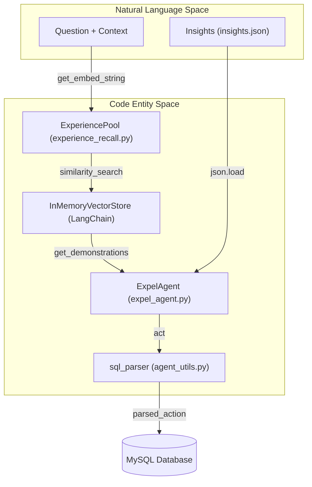
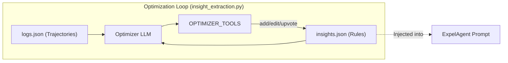

<!-- source: DeepWiki mcp.deepwiki.com · repo microsoft/SecRL · page 3.4 ExPeL Agent: Experience-Based Learning · fetched 2026-10-26 -->

# ExPeL Agent: Experience-Based Learning

Relevant source files

The following files were used as context for generating this wiki page:

- [experiments/result_analysis/analysis.py](experiments/result_analysis/analysis.py)
- [requirements_freeze.txt](requirements_freeze.txt)
- [scripts/setup_alert_only.sh](scripts/setup_alert_only.sh)
- [scripts/setup_docker.sh](scripts/setup_docker.sh)
- [scripts/to_run.sh](scripts/to_run.sh)
- [secgym/agents/__init__.py](secgym/agents/__init__.py)
- [secgym/agents/expel_agent.py](secgym/agents/expel_agent.py)
- [secgym/agents/expel_train/README.md](secgym/agents/expel_train/README.md)
- [secgym/agents/expel_train/__init__.py](secgym/agents/expel_train/__init__.py)
- [secgym/agents/expel_train/corrects.jsonl](secgym/agents/expel_train/corrects.jsonl)
- [secgym/agents/expel_train/experience_recall.py](secgym/agents/expel_train/experience_recall.py)
- [secgym/agents/expel_train/insight_extraction.py](secgym/agents/expel_train/insight_extraction.py)
- [secgym/agents/expel_train/insights.json](secgym/agents/expel_train/insights.json)
- [secgym/agents/expel_train/logs.json](secgym/agents/expel_train/logs.json)
- [secgym/agents/prompt_sauce_reflexion_agent.py](secgym/agents/prompt_sauce_reflexion_agent.py)
- [secgym/agents/react_reflexion_agent.py](secgym/agents/react_reflexion_agent.py)

The ExPeL (Experience-Based Learning) framework is an advanced agent architecture designed to improve cybersecurity investigation performance by autonomously extracting and recalling cross-task insights and successful trajectories. Unlike static ReAct agents, ExPeL utilizes a vector-database-backed experience pool and a rule-optimization pipeline to refine its reasoning capabilities over time.

## Overview of ExPeL Architecture

The ExPeL system consists of three primary components:
1.  **ExpelAgent**: The runtime agent that integrates retrieved experiences and global insights into its prompting cycle [secgym/agents/expel_agent.py:43-54]().
2.  **ExperiencePool**: A retrieval-augmented generation (RAG) component that uses vector embeddings to find relevant historical trajectories [secgym/agents/expel_train/experience_recall.py:25-33]().
3.  **Insight Extraction**: An offline training-time process that analyzes successful and failed trials to update a persistent set of investigative rules [secgym/agents/expel_train/insight_extraction.py:21-53]().

### Data Flow: Natural Language to Code Entities

The following diagram illustrates how natural language questions and investigation contexts are transformed into vector embeddings for experience retrieval and eventually into SQL actions.

**ExPeL Knowledge Retrieval and Execution Flow**

Sources: [secgym/agents/expel_agent.py:75-80](), [secgym/agents/expel_train/experience_recall.py:55-68](), [secgym/agents/agent_utils.py:126-126]()

---

## Experience Retrieval (ExperiencePool)

The `ExperiencePool` class manages the storage and retrieval of "correct" trajectories. These are stored in `corrects.jsonl`, where each entry contains a `key` (the question and context) and a `value` (the full message history of a successful investigation) [secgym/agents/expel_train/experience_recall.py:37-43]().

### Implementation Details
- **Embedding Strategy**: The pool supports three embedding types: `both` (Context + Question), `question`, or `context` [secgym/agents/expel_train/experience_recall.py:55-63]().
- **Vector Store**: Uses `langchain_core.vectorstores.InMemoryVectorStore` with `HuggingFaceEmbeddings` (defaulting to `all-mpnet-base-v2`) [secgym/agents/expel_train/experience_recall.py:31-52]().
- **Demonstration Formatting**: The `format_demonstration` function converts raw JSON trajectories back into a string format that includes `Thought`, `Action`, and truncated `Observation` blocks to fit within LLM context windows [secgym/agents/expel_train/experience_recall.py:70-77]().

Sources: [secgym/agents/expel_train/experience_recall.py:25-77](), [secgym/agents/expel_train/corrects.jsonl:1-1]()

---

## Insight Extraction and Rule Optimization

The `insight_extraction.py` module implements a training-time loop where an "Optimizer LLM" critiques previous agent performances. It maintains a list of global rules in `insights.json` [secgym/agents/expel_train/insight_extraction.py:33-34]().

### Optimization Operations
The optimizer uses a set of tools (`OPTIMIZER_TOOLS`) to modify the rule base [secgym/agents/expel_train/insight_extraction.py:83-153]():
- `add_insight`: Creates a new general rule based on a successful trajectory.
- `edit_insight`: Refines an existing rule for better clarity or accuracy.
- `upvote_insight` / `downvote_insight`: Adjusts the "confidence" or "importance" of a rule based on its utility in a given trial.
- `remove_insight`: Deletes rules that are no longer applicable or have too many downvotes.

### Comparison Logic
The extraction process often uses paired trajectories: one successful and one unsuccessful trial for the same question. The system prompt (`EXPEL_PAIRED_SYSTEM_MESSAGE`) instructs the LLM to contrast these to identify high-level critiques of the failed "Thought" and "Action" sequences [secgym/agents/expel_train/insight_extraction.py:76-79]().

**Insight Optimization Loop**

Sources: [secgym/agents/expel_train/insight_extraction.py:76-153](), [secgym/agents/expel_train/insights.json:1-10]()

---

## ExpelAgent Execution

At runtime, `ExpelAgent` inherits the standard Thought-Action-Observation loop but modifies the `reset` and `act` phases to incorporate learned knowledge.

### Prompt Injection
When the agent is initialized or reset:
1.  **Insights**: It loads all rules from `insights.json` and appends them to the system prompt as a numbered list [secgym/agents/expel_agent.py:64-67]().
2.  **Experiences**: It queries the `ExperiencePool` for the top-K (usually K=1) most similar successful trajectories based on the current question's context [secgym/agents/expel_agent.py:145-150]().

### Logic and Error Handling
The `act` method handles the interaction with the LLM and the environment [secgym/agents/expel_agent.py:97-129]():
- **Action Parsing**: It uses `sql_parser` to extract SQL queries from the LLM's `Action: execute[...]` block [secgym/agents/expel_agent.py:126-126]().
- **Retry Mechanism**: If the LLM fails to provide a properly formatted `Action` string, the agent performs a "Retry Split Action" by re-prompting the model with the current `Thought` and a forced `Action:` prefix [secgym/agents/expel_agent.py:113-120]().
- **Step Management**: It tracks `step_count` against `max_steps` and can inject a summary prompt if the limit is reached [secgym/agents/expel_agent.py:102-104]().

### Comparison of Agent Prompts
| Prompt Component | ExpelAgent | ReActReflexionAgent |
| :--- | :--- | :--- |
| **System Role** | Security Analyst [secgym/agents/expel_agent.py:8]() | Security Analyst [secgym/agents/react_reflexion_agent.py:12]() |
| **Static Demos** | None (Retrieved dynamically) | Hardcoded in `react_examples/` [secgym/agents/react_reflexion_agent.py:57-60]() |
| **Learning** | Persistent `insights.json` | Ephemeral `replay_buffer` per trial [secgym/agents/react_reflexion_agent.py:110-131]() |

Sources: [secgym/agents/expel_agent.py:43-154](), [secgym/agents/react_reflexion_agent.py:67-131]()

---

## Data Structures

### corrects.jsonl
Stores successful trajectories. Each line is a JSON object:
- `key`: `{"context": "...", "question": "..."}`
- `value`: `{"reward": 1, "messages": [...]}`
- **Source**: [secgym/agents/expel_train/corrects.jsonl:1-1]()

### insights.json
A flat list of strings representing the current rule base. Examples include:
- "Prioritize examining all relevant user-related fields, such as `InitiatingProcessAccountName` and `AccountName`..."
- "Avoid relying solely on identifiers like InternetMessageId... prioritize NetworkMessageId."
- **Source**: [secgym/agents/expel_train/insights.json:1-26]()

### logs.json
Contains the detailed history of the insight extraction process, including which tools were called and the specific trajectories analyzed during training [secgym/agents/expel_train/logs.json:1-1]().

---

