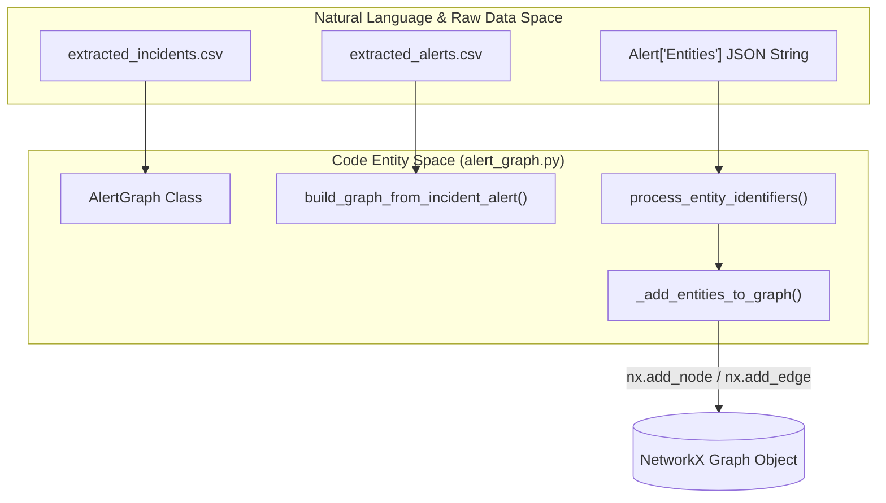
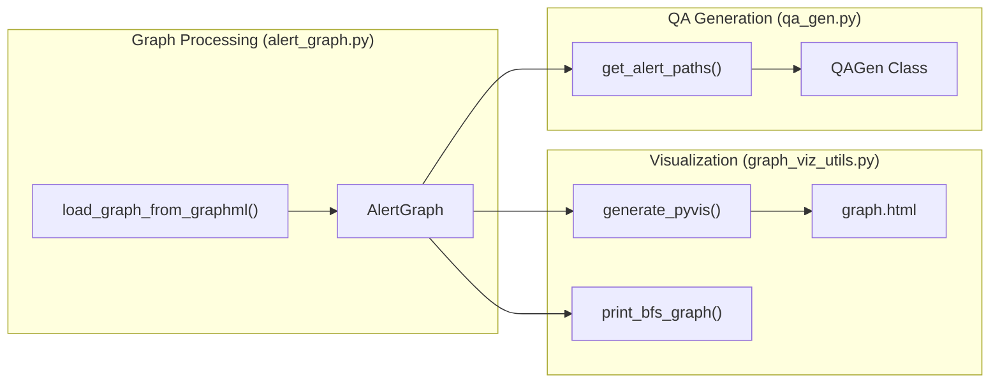

<!-- source: DeepWiki mcp.deepwiki.com · repo microsoft/SecRL · page 4.1 AlertGraph: Incident Graph Construction · fetched 2026-10-26 -->

# AlertGraph: Incident Graph Construction

Relevant source files

The following files were used as context for generating this wiki page:

- [secgym/qagen/alert_graph.py](secgym/qagen/alert_graph.py)
- [secgym/qagen/extracted_alerts.csv](secgym/qagen/extracted_alerts.csv)
- [secgym/qagen/extracted_incidents.csv](secgym/qagen/extracted_incidents.csv)
- [secgym/qagen/graph_files/incident_134.graphml](secgym/qagen/graph_files/incident_134.graphml)
- [secgym/qagen/graph_files/incident_166.graphml](secgym/qagen/graph_files/incident_166.graphml)
- [secgym/qagen/graph_files/incident_322.graphml](secgym/qagen/graph_files/incident_322.graphml)
- [secgym/qagen/graph_files/incident_34.graphml](secgym/qagen/graph_files/incident_34.graphml)
- [secgym/qagen/graph_files/incident_38.graphml](secgym/qagen/graph_files/incident_38.graphml)
- [secgym/qagen/graph_files/incident_39.graphml](secgym/qagen/graph_files/incident_39.graphml)
- [secgym/qagen/graph_files/incident_5.graphml](secgym/qagen/graph_files/incident_5.graphml)
- [secgym/qagen/graph_files/incident_55.graphml](secgym/qagen/graph_files/incident_55.graphml)
- [secgym/qagen/qa_gen.py](secgym/qagen/qa_gen.py)
- [secgym/qagen/qa_gen_prompts.py](secgym/qagen/qa_gen_prompts.py)
- [secgym/utils/graph_viz_utils.py](secgym/utils/graph_viz_utils.py)
- [secgym/utils/utils.py](secgym/utils/utils.py)

The **AlertGraph** system is responsible for transforming raw security telemetry—specifically `SecurityIncident` and `SecurityAlert` records—into a structured, navigable graph representation using the NetworkX library. This graph serves as the topological foundation for the synthetic Question-Answer (QA) generation pipeline, allowing the system to identify attack paths and correlate entities across disparate security signals.

## Core Architecture and Data Flow

The construction process maps security alerts and their embedded entities (extracted from JSON strings) into a heterogeneous graph where nodes represent either **Alerts** or **Entities**, and edges represent the association between an alert and the evidence it contains.

### Graph Construction Workflow

1.  **Initialization**: The `AlertGraph` class is initialized, maintaining a `networkx.Graph` and mapping structures to track unique entities [secgym/qagen/alert_graph.py:14-26]().
2.  **Alert Processing**: For each alert in an incident, a node of type `alert` is created. Metadata such as `AlertName`, `Description`, and the full raw `entry` are stored as node attributes [secgym/qagen/alert_graph.py:41-54]().
3.  **Entity Extraction**: The `process_entity_identifiers` utility parses the complex `Entities` JSON field from the alert record [secgym/utils/utils.py:48-77]().
4.  **Normalization**: Entities are normalized based on their type (e.g., Account, Host, IP, File). This ensures that the same physical entity (like a specific `AadUserId`) is represented by a single node across multiple alerts [secgym/utils/utils.py:85-163]().
5.  **Edge Creation**: Edges are drawn between the Alert node and every Entity node extracted from it [secgym/qagen/alert_graph.py:119]().
6.  **Pruning**: To ensure graph traversal is meaningful for QA generation, the graph is pruned to keep only the largest connected component [secgym/qagen/alert_graph.py:60-67]().

### Incident Graph Data Flow
The following diagram illustrates how raw CSV data is transformed into a NetworkX graph structure.

**Data Flow: CSV to AlertGraph**

Sources: [secgym/qagen/alert_graph.py:29-59](), [secgym/utils/utils.py:48-163]()

## Key Implementation Details

### Entity Normalization (`process_entity_identifiers`)
The system uses a sophisticated normalization logic to ensure graph connectivity. Since different security providers might refer to the same entity using different fields, the utility maps them to a consistent `identifier_field` and `value` pair.

| Entity Type | Primary Identifiers Used | Logic |
| :--- | :--- | :--- |
| **Account** | `AadUserId`, `Email`, `Sid`, `Name` | Filters out generic accounts like "system" or "guest" [secgym/utils/utils.py:90-101](). |
| **Host** | `AadDeviceId`, `HostName`, `AzureID` | Maps various cloud and on-prem IDs to a single host node [secgym/utils/utils.py:133-150](). |
| **IP** | `Address` | Excludes loopback (`127.0.0.1`) and broadcast (`0.0.0.0`) addresses [secgym/utils/utils.py:162-163](). |
| **Process** | `ProcessId`, `CommandLine`, `CreationTimeUtc` | Combines fields to create unique process instances [secgym/utils/utils.py:182-187](). |

Sources: [secgym/utils/utils.py:85-200]()

### Graph Topology and Path Finding
The `AlertGraph` provides methods to extract attack trajectories, which are used as the "ground truth" for generating reasoning questions.

*   **`get_alert_paths`**: Identifies paths between alerts. It specifically looks for "farthest" entities—those with the greatest shortest-path distance—to create challenging "Difficulty Ratio" questions [secgym/qagen/alert_graph.py:48-49]().
*   **Path Composition**: A typical path in the graph alternates between nodes: `(Alert A) -> (Entity X) -> (Alert B) -> (Entity Y)`. This structure represents how an attacker moves from one activity to another via a shared asset [secgym/qagen/qa_gen.py:104-127]().

## Serialization and Persistence

Graphs are serialized using the **GraphML** format, which preserves both the topology and the rich attribute dictionaries (JSON-encoded) for each node.

*   **Saving**: `save_to_graphml(filepath)` writes the NetworkX object to disk [secgym/qagen/alert_graph.py:121-127]().
*   **Loading**: `load_graph_from_graphml(filepath)` restores the graph and rebuilds internal maps like `entity_node_map` and `alert_node_ids` [secgym/qagen/alert_graph.py:68-89]().

Stored graphs for the 8 benchmark incidents are located in `secgym/qagen/graph_files/` (e.g., `incident_5.graphml`, `incident_322.graphml`) [secgym/qagen/graph_files/incident_166.graphml:1-11]().

## Visualization Utilities

The codebase includes utilities for both static and interactive visualization of the constructed graphs.

### PyVis Integration
The `secgym/utils/graph_viz_utils.py` module provides `generate_pyvis()`, which creates an interactive HTML representation of the graph.
*   **Alert Nodes**: Rendered as large red squares [secgym/utils/graph_viz_utils.py:114-126]().
*   **Entity Nodes**: Rendered as smaller blue circles [secgym/utils/graph_viz_utils.py:128-139]().
*   **Hover Data**: Displays detailed metadata (IDs, Names, Values) using `get_hover_attributes()` [secgym/utils/graph_viz_utils.py:78-99]().

### Context Extraction
For LLM consumption, the `get_graph_context()` function converts a node's neighborhood into a natural language description using BFS or DFS traversal [secgym/utils/graph_viz_utils.py:51-75]().

**Graph Interaction Architecture**

Sources: [secgym/qagen/alert_graph.py:68-89](), [secgym/utils/graph_viz_utils.py:100-165](), [secgym/qagen/qa_gen.py:44-49]()

---

