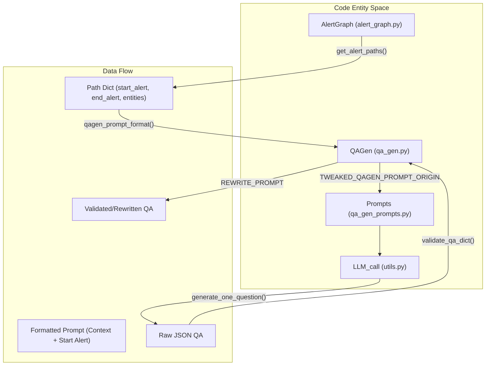
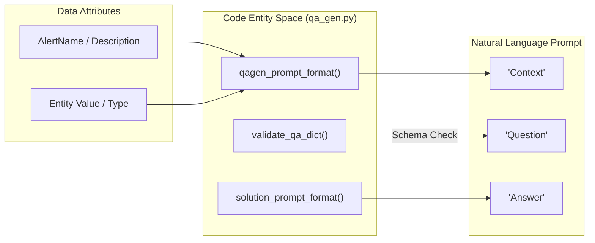

<!-- source: DeepWiki mcp.deepwiki.com · repo microsoft/SecRL · page 4.2 QAGen: Synthetic Question Generation · fetched 2026-10-26 -->

# QAGen: Synthetic Question Generation

Relevant source files

The following files were used as context for generating this wiki page:

- [experiments/run_qa_gen.py](experiments/run_qa_gen.py)
- [experiments/run_reevaluation.py](experiments/run_reevaluation.py)
- [secgym/evaluator.py](secgym/evaluator.py)
- [secgym/qagen/alert_graph.py](secgym/qagen/alert_graph.py)
- [secgym/qagen/qa_gen.py](secgym/qagen/qa_gen.py)
- [secgym/qagen/qa_gen_prompts.py](secgym/qagen/qa_gen_prompts.py)
- [secgym/utils/graph_viz_utils.py](secgym/utils/graph_viz_utils.py)
- [secgym/utils/utils.py](secgym/utils/utils.py)
- [setup.py](setup.py)

The **QAGen** subsystem is responsible for transforming raw security incident data and graph-based attack paths into high-quality, synthetic question-answer pairs. These pairs serve as the benchmark tasks for LLM agents. The pipeline utilizes a multi-stage prompting strategy to ensure that questions are contextually relevant, have deterministic answers, and do not inadvertently leak the solution within the question text.

### Overview and Data Flow

The generation process begins with an `AlertGraph` which provides paths between security alerts and entities. The `QAGen` class orchestrates the interaction with LLMs to produce the final dataset.

#### Synthetic QA Generation Pipeline
"The following diagram illustrates the flow from graph entities to the final JSON-formatted question."

Sources: [secgym/qagen/qa_gen.py:13-53](), [secgym/qagen/qa_gen.py:145-151](), [secgym/qagen/alert_graph.py:220-250](), [secgym/utils/utils.py:25-46]()

---

### Core Implementation: The QAGen Class

The `QAGen` class in `secgym/qagen/qa_gen.py` manages the lifecycle of question generation. It filters configurations for specific models (e.g., GPT-4o or O1) using `autogen.filter_config` [secgym/qagen/qa_gen.py:35-42]() and processes paths extracted from the `AlertGraph`.

#### Key Methods

| Method | Purpose | Source |
| :--- | :--- | :--- |
| `qagen_prompt_format` | Constructs the text prompt by combining incident details, start alerts, and placeholder entities (`???`) for the end alert. | [secgym/qagen/qa_gen.py:96-127]() |
| `generate_one_question` | The primary entry point for generating a single QA pair from a path dictionary. | [secgym/qagen/qa_gen.py:145-151]() |
| `validate_qa_dict` | A static method that enforces the JSON schema, ensuring `context`, `question`, and `answer` fields are present. | [secgym/qagen/qa_gen.py:139-143]() |
| `solution_prompt_format` | Formats the specific path of alerts and entities into a string for solution generation. | [secgym/qagen/qa_gen.py:129-137]() |

Sources: [secgym/qagen/qa_gen.py:13-151]()

---

### Prompting Strategy and JSON Schema

The pipeline uses specialized prompts defined in `secgym/qagen/qa_gen_prompts.py` to guide the LLM. The generation is structured into four distinct phases:

1.  **Initial Generation**: Uses `TWEAKED_QAGEN_PROMPT_ORIGIN` to create a question based on an alert-entity path. It instructs the model to select the "most meaningful entity" as the answer [secgym/qagen/qa_gen_prompts.py:5-20]().
2.  **Answer-Leakage Validation**: The LLM is tasked with ensuring the `answer` is not present in the `context` or `question` fields [secgym/qagen/qa_gen_prompts.py:19]().
3.  **Rewriting**: If the initial output is suboptimal or fails validation, `REWRITE_PROMPT` is used to refine the natural language and clarity [secgym/qagen/qa_gen.py:10]().
4.  **Solution Generation**: `SOLUTIN_GEN_PROMPT` is used to generate the "Golden Answer" and the reasoning path that a human analyst would follow [secgym/qagen/qa_gen.py:10]().

#### Natural Language to Code Entity Mapping
"Mapping of prompt concepts to the underlying data structures."

Sources: [secgym/qagen/qa_gen.py:61-94](), [secgym/qagen/qa_gen_prompts.py:13-20]()

---

### CLI Entrypoint: run_qa_gen.py

The script `experiments/run_qa_gen.py` provides a command-line interface to execute the generation pipeline at scale across multiple security incidents.

#### Arguments and Usage
The script supports several flags to customize the generation behavior:
*   `--model (-m)`: Specifies the LLM for QA generation (default: `o1`) [experiments/run_qa_gen.py:17]().
*   `--split`: Determines whether to generate for `train` or `test` sets [experiments/run_qa_gen.py:20]().
*   `--relevant_type`: Filters paths by relevance score (`low`, `high`, `median`) based on pre-computed split files [experiments/run_qa_gen.py:54-61]().
*   `--include_entry`: If set, includes the full raw JSON alert entry in the prompt for more context [experiments/run_qa_gen.py:16]().

#### Execution Flow
The script iterates through a hardcoded list of incident files (e.g., `incident_34.graphml`, `incident_322.graphml`) [experiments/run_qa_gen.py:27-36](). It checks for existing questions in the target directory to support resuming interrupted runs [experiments/run_qa_gen.py:84-89]().

Sources: [experiments/run_qa_gen.py:11-120]()

---

### Evaluation Integration

Generated questions are evaluated using the `LLMEvaluator` in `secgym/evaluator.py`. This component uses `FUZZY_ANSWER_CHECK_PROMPT` to compare an agent's submitted answer against the "Golden Answer" generated by `QAGen`.

The evaluator handles:
*   **Fuzzy Matching**: Allows for minor variations in file extensions or casing [secgym/evaluator.py:23-28]().
*   **Enumeration Limits**: Penalizes "hallucination" or "shotgun" answering where an agent lists more than 15 items [secgym/evaluator.py:25]().
*   **Reflection**: Optionally performs a second pass (`FUZZY_ANSWER_CHECK_REFLECTION_PROMPT`) to double-check the evaluation logic [secgym/evaluator.py:56-95]().

Sources: [secgym/evaluator.py:16-54](), [experiments/run_reevaluation.py:119-127]()

---

