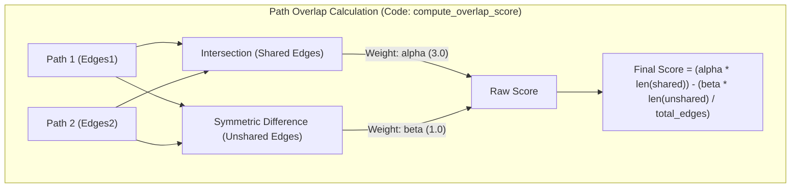
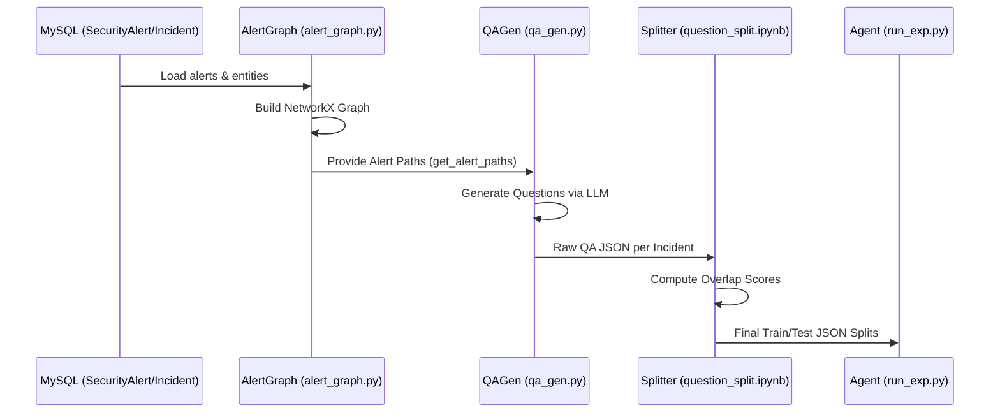

<!-- source: DeepWiki mcp.deepwiki.com · repo microsoft/SecRL · page 4.3 Question Dataset & Train/Test Splits · fetched 2026-10-26 -->

# Question Dataset & Train/Test Splits

<details>
<summary>Relevant source files</summary>

The following files were used as context for generating this wiki page:

- [notebooks/explore_graph_questions.ipynb](notebooks/explore_graph_questions.ipynb)
- [notebooks/extract_construct_graph.ipynb](notebooks/extract_construct_graph.ipynb)
- [notebooks/question_split.ipynb](notebooks/question_split.ipynb)
- [notebooks/react_example.ipynb](notebooks/react_example.ipynb)
- [secgym/questions/o1/test/incident_134_qa_incident_o1-ga_c42.json](secgym/questions/o1/test/incident_134_qa_incident_o1-ga_c42.json)
- [secgym/questions/o1/test/incident_166_qa_incident_o1-ga_c42.json](secgym/questions/o1/test/incident_166_qa_incident_o1-ga_c42.json)
- [secgym/questions/o1/test/incident_322_qa_incident_o1-ga_c42.json](secgym/questions/o1/test/incident_322_qa_incident_o1-ga_c42.json)
- [secgym/questions/o1/test/incident_34_qa_incident_o1-ga_c42.json](secgym/questions/o1/test/incident_34_qa_incident_o1-ga_c42.json)
- [secgym/questions/o1/test/incident_38_qa_incident_o1-ga_c42.json](secgym/questions/o1/test/incident_38_qa_incident_o1-ga_c42.json)
- [secgym/questions/o1/test/incident_39_qa_incident_o1-ga_c42.json](secgym/questions/o1/test/incident_39_qa_incident_o1-ga_c42.json)
- [secgym/questions/o1/test/incident_55_qa_incident_o1-ga_c42.json](secgym/questions/o1/test/incident_55_qa_incident_o1-ga_c42.json)
- [secgym/questions/o1/test/incident_5_qa_incident_o1-ga_c42.json](secgym/questions/o1/test/incident_5_qa_incident_o1-ga_c42.json)
- [secgym/questions/o1/train/incident_134_qa_incident_o1-ga_c42.json](secgym/questions/o1/train/incident_134_qa_incident_o1-ga_c42.json)
- [secgym/questions/o1/train/incident_166_qa_incident_o1-ga_c42.json](secgym/questions/o1/train/incident_166_qa_incident_o1-ga_c42.json)
- [secgym/questions/o3/test/incident_134_qa_incident_o3_c100.json](secgym/questions/o3/test/incident_134_qa_incident_o3_c100.json)
- [secgym/questions/o3/train/incident_134_qa_incident_o3_c101_train.json](secgym/questions/o3/train/incident_134_qa_incident_o3_c101_train.json)

</details>


This page provides a technical deep dive into the **ExCyTIn-Bench** question dataset and the logic used to partition these questions into training and testing sets. The dataset is derived from 8 distinct security incidents, where questions are synthetically generated based on paths within an attack graph.

## Directory Structure

The questions are stored in `secgym/questions/` and are categorized by the LLM model used for generation (e.g., `o1` or `o3`) and their split assignment.

```text
secgym/questions/
├── o1/
│   ├── train/
│   │   ├── incident_134_qa_incident_o1-ga_c42.json
│   │   ├── incident_166_qa_incident_o1-ga_c42.json
│   │   └── ...
│   └── test/
│       ├── incident_5_qa_incident_o1-ga_c42.json
│       ├── incident_38_qa_incident_o1-ga_c42.json
│       └── ...
└── o3/
    ├── train/ ...
    └── test/ ...
```

### Question Schema
Each JSON file contains a list of question objects. These objects bridge the **Natural Language Space** (Question/Context) with the **Code Entity Space** (Alert IDs/Entities).

| Field | Description |
| :--- | :--- |
| `context` | Background information provided to the agent. |
| `question` | The specific inquiry the agent must answer. |
| `answer` | The golden answer string used for evaluation. |
| `solution` | Step-by-step reasoning used for ground truth. |
| `start_alert` | The `SystemAlertId` where the investigation begins. |
| `end_alert` | The `SystemAlertId` containing the target evidence. |
| `shortest_alert_path` | The sequence of alert IDs connecting the start and end. |

**Sources:** `[secgym/questions/o1/train/incident_134_qa_incident_o1-ga_c42.json:1-40]()`, `[secgym/questions/o1/test/incident_38_qa_incident_o1-ga_c42.json:1-27]()`

---

## Path-Relevance-Score Splitting Logic

To ensure that the test set evaluates the agent's ability to generalize to new attack patterns rather than memorizing training paths, a sophisticated splitting logic is implemented in `notebooks/question_split.ipynb`.

### Overlap Score Computation
The function `compute_overlap_score` calculates how much two paths (sequences of alerts) share in common.



**Sources:** `[notebooks/question_split.ipynb:14-46]()`

### Splitting Algorithm
The `split_train_test` function uses a randomized approach to find splits with specific characteristics (Low, Median, or High overlap).

1.  **Path Extraction**: It extracts the `shortest_alert_path` from the generated questions `[notebooks/question_split.ipynb:61-65]()`.
2.  **Length Weighting**: It calculates weights based on path length to ensure a distribution of difficulty `[notebooks/question_split.ipynb:75-80]()`.
3.  **Randomized Trials**: It performs multiple trials (default 50) of random splits `[notebooks/question_split.ipynb:101-122]()`.
4.  **Score Summation**: For each trial, it sums the overlap scores between every pair of (Train Path, Test Path) `[notebooks/question_split.ipynb:114-118]()`.

**Sources:** `[notebooks/question_split.ipynb:47-124]()`, `[notebooks/question_split.ipynb:135-135]()`

---

## Split Types: Low, Median, High

The framework generates three distinct types of splits to test different aspects of agent performance:

| Split Type | Logic | Purpose |
| :--- | :--- | :--- |
| **Low Score** | Minimizes overlap between train and test paths. | Tests generalization to completely novel attack sequences. |
| **Median Score** | Uses a split with a score closest to the median of all trials. | Represents a standard "average" difficulty split. |
| **High Score** | Maximizes overlap between train and test paths. | Tests the agent's ability to apply known patterns to slightly varied contexts. |

The splitting script saves these into `experiments/split_files/` under `low_score/`, `median_score/`, and `high_score/` directories `[notebooks/question_split.ipynb:140-147]()`.

**Sources:** `[notebooks/question_split.ipynb:175-180]()`

---

## Data Flow: From Graph to Dataset

The following diagram illustrates how raw incident data is transformed into the final split dataset used by agents in `run_exp.py`.



### Code Entity Mapping
Questions specifically reference database entities to ground the LLM's natural language understanding in the SQL schema.

*   **Hostnames**: Maps to `DeviceProcessEvents.DeviceName` or `SecurityAlert.ComputerName`.
*   **User IDs**: Maps to `AadUserId` in `SigninLogs` or `IdentityLogonEvents`.
*   **Process IDs**: Maps to `ProcessId` in `DeviceProcessEvents`.
*   **IP Addresses**: Maps to `IPAddress` in `SigninLogs` or `RemoteIP` in `DeviceNetworkEvents`.

**Sources:** `[secgym/questions/o1/test/incident_5_qa_incident_o1-ga_c42.json:3-5]()`, `[secgym/questions/o1/test/incident_322_qa_incident_o1-ga_c42.json:112-114]()`, `[notebooks/extract_construct_graph.ipynb:33-43]()`

---

