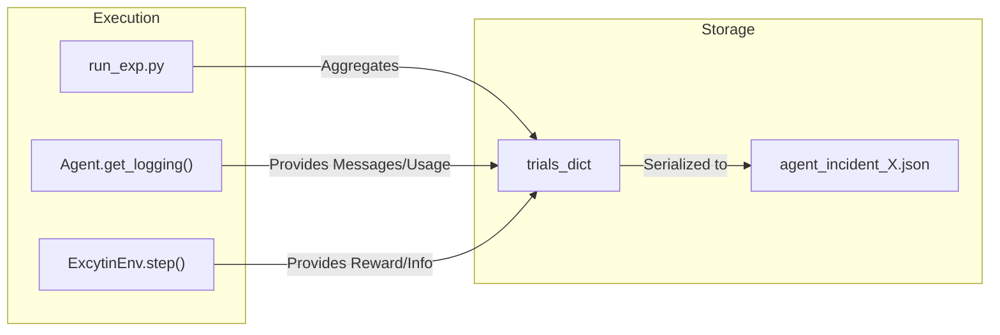

<!-- source: DeepWiki mcp.deepwiki.com · repo microsoft/SecRL · page 5 Running Experiments · fetched 2026-10-26 -->

# Running Experiments

<details>
<summary>Relevant source files</summary>

The following files were used as context for generating this wiki page:

- [experiments/run_exp.py](experiments/run_exp.py)
- [requirements_freeze.txt](requirements_freeze.txt)
- [scripts/setup_alert_only.sh](scripts/setup_alert_only.sh)
- [scripts/setup_docker.sh](scripts/setup_docker.sh)
- [scripts/to_run.sh](scripts/to_run.sh)
- [secgym/agents/expel_agent.py](secgym/agents/expel_agent.py)

</details>


The **ExCyTIn-Bench** framework provides a standardized entry point for evaluating LLM agents on cyber threat hunting tasks. This page provides a high-level overview of the experiment lifecycle, from executing the `run_exp.py` entrypoint to managing multi-trial evaluations and logging results.

### Experiment Workflow Overview

Experiments are orchestrated by the `run_experiment()` function, which manages the interaction loop between an agent and the `ExcytinEnv` environment. The system supports various agent architectures, telemetry layers, and iterative trial logic.

#### Experiment Loop Diagram
This diagram illustrates how the `run_exp.py` script bridges the natural language questions with the code-level environment execution.

```mermaid
graph TD
    subgraph "Natural Language Space"
        Q["Question (e.g., 'Find the ransomware entry point')"]
        A["Agent Reasoning (Thoughts)"]
    end

    subgraph "Code Entity Space"
        RE["run_exp.py (run_experiment)"]
        ENV["secgym/excytin_env.py (ExcytinEnv)"]
        AGENT["secgym/agents/ (Agent classes)"]
        LOG["latest_experiments/ (JSON logs)"]
    end

    RE -->|1. Load Question| ENV
    ENV -->|2. Observation| AGENT
    AGENT -->|3. Thought/Action| RE
    RE -->|4. execute[SQL]| ENV
    ENV -->|5. SQL Result| AGENT
    RE -->|6. Save Trajectory| LOG
    
    Q -.->|Defines| ENV
    A -.->|Generated by| AGENT
```
**Sources:** [experiments/run_exp.py:18-154](), [secgym/excytin_env.py:9-10]()

---

### Experiment Execution (run_exp.py)

The primary entry point for all evaluations is `experiments/run_exp.py`. It allows researchers to configure the model, agent type, and environment settings via CLI arguments.

**Key Execution Features:**
*   **Agent Selection:** Supports `baseline`, `react`, `prompt_sauce`, `expel`, and `reflexion` variants [experiments/run_exp.py:158-180]().
*   **Checkpointing:** Automatically detects existing log files to resume experiments from the last completed question, preventing redundant API calls [experiments/run_exp.py:39-46]().
*   **Trial Management:** If a question is not solved in the first attempt, the script can run multiple trials (controlled by `--num_trials`) to test agent consistency or allow for reflection-based learning [experiments/run_exp.py:56-130]().
*   **Rate Limit Handling:** Built-in logic to handle API rate limits (e.g., Anthropic 429 errors) by pausing execution [experiments/run_exp.py:89-95]().

For detailed documentation on CLI arguments and the execution loop, see **[Experiment Execution (run_exp.py)](#5.1)**.

**Sources:** [experiments/run_exp.py:1-180]()

---

### Result Analysis & Benchmarking

Once an experiment completes, the framework produces structured logs used for performance analysis. The evaluation is not just based on binary success (reward 0 or 1), but also on the efficiency and cost of the investigation.

| Metric Type | Description |
| :--- | :--- |
| **Success Rate** | Percentage of questions where the agent found the correct answer. |
| **Query Efficiency** | Analysis of empty results, SQL errors, and query length. |
| **Cost Tracking** | Token usage and financial cost per incident/agent. |
| **Step Count** | Number of actions taken before reaching a conclusion. |

Analysis is performed using `experiments/result_analysis/analysis.py`, which aggregates data across different incidents and telemetry layers.

For details on metrics and plotting, see **[Result Analysis & Benchmarking](#5.2)**.

**Sources:** [experiments/run_exp.py:135-147](), [secgym/agents/expel_agent.py:131-135]()

---

### Experiment Logs & Trajectory Format

The framework generates detailed JSON logs for every experiment run. These logs capture the full "Thought-Action-Observation" trajectory, providing transparency into the agent's reasoning process.

#### Data Flow to Logs
This diagram maps the code entities responsible for generating and storing experiment data.


**Sources:** [experiments/run_exp.py:120-146](), [secgym/agents/expel_agent.py:131-135]()

**Log Components:**
*   **`question_dict`**: The original question, start/end alerts, and golden answer.
*   **`trials`**: A dictionary containing the trajectory for each attempt, including LLM messages and usage statistics.
*   **`reward`**: The binary score (0 or 1) assigned by the `LLMEvaluator`.

For a deep dive into the JSON schema and trajectory structure, see **[Experiment Logs & Trajectory Format](#5.3)**.

**Sources:** [experiments/run_exp.py:135-140](), [secgym/agents/expel_agent.py:131-135]()

---

### Convenience Scripts

To simplify large-scale evaluations across all 8 incidents, the repository includes shell scripts for environment setup and batch execution.

*   **`scripts/setup_docker.sh`**: Spins up 8 MySQL Docker containers, one for each security incident [scripts/setup_docker.sh:1-63]().
*   **`scripts/setup_alert_only.sh`**: Configures the environment for the "Alert Only" telemetry layer [scripts/setup_alert_only.sh:1-72]().
*   **`scripts/to_run.sh`**: Contains template commands for running standard benchmark configurations (e.g., GPT-4o with ReAct for 3 trials) [scripts/to_run.sh:1-49]().

**Sources:** [scripts/setup_docker.sh:1-63](), [scripts/to_run.sh:1-49]()

---

