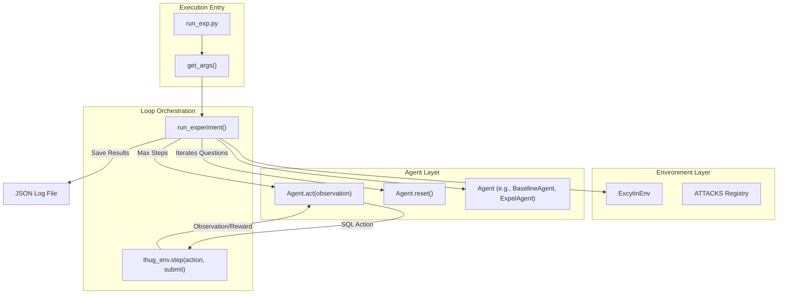
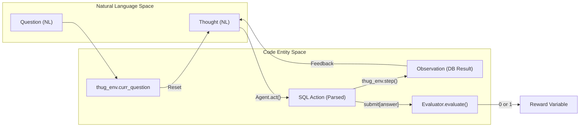

<!-- source: DeepWiki mcp.deepwiki.com · repo microsoft/SecRL · page 5.1 Experiment Execution (run_exp.py) · fetched 2026-10-26 -->

# Experiment Execution (run_exp.py)

Relevant source files

The following files were used as context for generating this wiki page:

- [.gitignore](.gitignore)
- [experiments/run_exp.py](experiments/run_exp.py)
- [requirements_freeze.txt](requirements_freeze.txt)
- [scripts/setup_alert_only.sh](scripts/setup_alert_only.sh)
- [scripts/setup_docker.sh](scripts/setup_docker.sh)
- [scripts/to_run.sh](scripts/to_run.sh)
- [secgym/agents/expel_agent.py](secgym/agents/expel_agent.py)
- [secgym/myconfig.py](secgym/myconfig.py)

The `experiments/run_exp.py` script serves as the primary entry point for executing benchmark evaluations within the SecRL framework. It orchestrates the interaction between the selected LLM agent, the `ExcytinEnv` gymnasium environment, and the underlying incident databases to solve generated security questions.

### Execution Flow and Logic

The script implements a nested loop structure to manage multiple security incidents, individual questions within those incidents, and multiple trials per question.

#### Main Experiment Loop
The `run_experiment()` function handles the core execution logic [experiments/run_exp.py:18-26](). For each question in the environment:
1.  **Agent/Environment Reset**: Both the `ExcytinEnv` and the `Agent` (e.g., `ExpelAgent`) are reset to their initial states for the specific question [experiments/run_exp.py:62-66]().
2.  **Trial Iteration**: The script attempts to solve the question across a configurable `num_trials`. If an agent successfully solves a question (reward = 1), it skips subsequent trials for that specific question [experiments/run_exp.py:127-129]().
3.  **Step Execution**: Within each trial, the agent performs a "Thought-Action-Observation" loop for a maximum of `max_steps` (default 15) [experiments/run_exp.py:83-105]().
4.  **Result Logging**: Results, including trajectories, rewards, and LLM usage metadata, are saved to a JSON file after every question to prevent data loss [experiments/run_exp.py:135-146]().

#### Resume-from-Checkpoint
The script supports resuming interrupted experiments. By default, it checks for an existing log file (`save_agent_file`). If found and `overwrite` is false, it loads the previously tested question keys and skips them during the current run [experiments/run_exp.py:39-45]().

**Sources:** [experiments/run_exp.py:18-154]()

### Code Entity Interaction Diagram

The following diagram illustrates how `run_exp.py` bridges high-level experiment configuration with low-level code entities.

**Experiment Execution Architecture**

**Sources:** [experiments/run_exp.py:9-14](), [experiments/run_exp.py:18-26](), [experiments/run_exp.py:83-105]()

### CLI Arguments and Configuration

The script uses `argparse` to configure the experimental setup [experiments/run_exp.py:158-185]().

| Argument | Type | Default | Description |
| :--- | :--- | :--- | :--- |
| `--agent` | `str` | `baseline` | Type of agent to run (e.g., `react`, `ps_reflexion`, `expel`). |
| `--model` | `str` | `gpt-4.1-nano` | The LLM model identifier used for the agent. |
| `--num_trials` | `int` | `1` | Number of attempts per question if not solved. |
| `--max_steps` | `int` | `15` | Maximum thought-action pairs allowed per trial. |
| `--layer` | `str` | `alert` | Telemetry layer visibility (`alert`, `log`, `alert_only`). |
| `--trial_run` | `bool` | `False` | If True, runs only 2 questions and enables `overwrite`. |
| `--split` | `str` | `test` | Dataset split to use (`train` or `test`). |
| `--cache_seed` | `int` | `131` | Seed for LLM response caching. |

**Sources:** [experiments/run_exp.py:158-185](), [experiments/run_exp.py:29-30]()

### Error and Rate-Limit Handling

The execution loop includes specific handling for API rate limits. If an `anthropic.RateLimitError` or a status code `429` is detected, the script pauses for 120 seconds before retrying the agent's action [experiments/run_exp.py:88-95](). This ensures that long-running benchmarks involving many questions do not fail due to provider constraints.

**Sources:** [experiments/run_exp.py:88-97]()

### Convenience Scripts (`to_run.sh`)

The `scripts/to_run.sh` file provides a collection of pre-configured commands for common experimental setups used in the benchmark [scripts/to_run.sh:1-49]().

**Common Commands from to_run.sh:**
*   **PromptSauce Evaluation**: `python run_exp.py --agent prompt_sauce --cache_seed 34 --model 4o-mini --num_trials 3` [scripts/to_run.sh:10]()
*   **ReAct Reflexion**: `python run_exp.py --agent react_reflexion --cache_seed 378 --model gpt-4o --num_trials 3` [scripts/to_run.sh:38]()

### Multi-Trial and Reflexion Logic

For agents that support multi-trial learning, such as `ReactReflexionAgent` or `PromptSauceReflexionAgent`, the script manages a `replay_buffer` [experiments/run_exp.py:50-51](). At the end of each trial, the script saves the trajectory (messages), the incident context, and the reward into the agent's memory [experiments/run_exp.py:108-117](). This allows the agent to "reflect" on previous failures when starting a subsequent trial for the same question.

**Sources:** [experiments/run_exp.py:50-51](), [experiments/run_exp.py:108-117]()

### Data Flow: From Question to Reward

The following diagram maps the data flow from the natural language question to the final reward calculation.

**Data Flow Mapping**

**Sources:** [experiments/run_exp.py:62](), [experiments/run_exp.py:87](), [experiments/run_exp.py:102](), [secgym/agents/expel_agent.py:126-129]()

---

