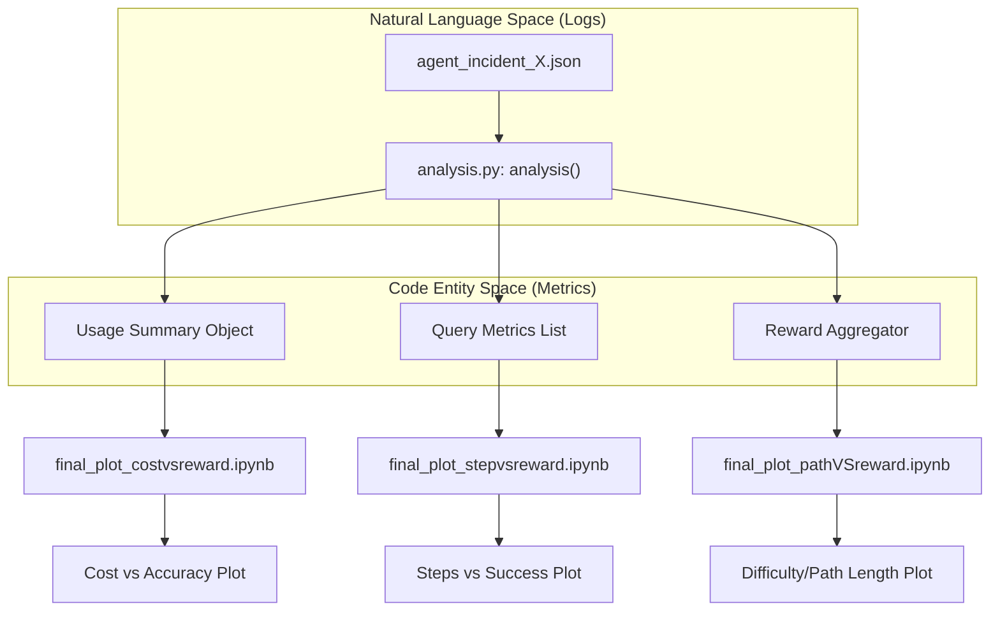
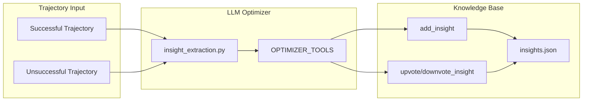

<!-- source: DeepWiki mcp.deepwiki.com · repo microsoft/SecRL · page 5.2 Result Analysis & Benchmarking · fetched 2026-10-26 -->

# Result Analysis & Benchmarking

<details>
<summary>Relevant source files</summary>

The following files were used as context for generating this wiki page:

- [experiments/result_analysis/analysis.py](experiments/result_analysis/analysis.py)
- [experiments/result_analysis/final_plot_costvsreward.ipynb](experiments/result_analysis/final_plot_costvsreward.ipynb)
- [experiments/result_analysis/final_plot_path VS Reward.ipynb](experiments/result_analysis/final_plot_path VS Reward.ipynb)
- [experiments/result_analysis/final_plot_stepvsreward.ipynb](experiments/result_analysis/final_plot_stepvsreward.ipynb)
- [experiments/result_analysis/final_question_examine.ipynb](experiments/result_analysis/final_question_examine.ipynb)
- [experiments/result_analysis/final_result_analysis.ipynb](experiments/result_analysis/final_result_analysis.ipynb)
- [experiments/result_analysis/generate_finetune_data.ipynb](experiments/result_analysis/generate_finetune_data.ipynb)
- [latest_experiments/BaselineAgent_gpt-5_c121_alert_level_t0_s25_trial1/results.txt](latest_experiments/BaselineAgent_gpt-5_c121_alert_level_t0_s25_trial1/results.txt)
- [latest_experiments/BaselineAgent_o3_c106_alert_level_t0_s25_trial1/results.txt](latest_experiments/BaselineAgent_o3_c106_alert_level_t0_s25_trial1/results.txt)
- [secgym/agents/expel_train/insight_extraction.py](secgym/agents/expel_train/insight_extraction.py)
- [secgym/agents/prompt_sauce_reflexion_agent.py](secgym/agents/prompt_sauce_reflexion_agent.py)
- [secgym/agents/react_reflexion_agent.py](secgym/agents/react_reflexion_agent.py)
- [secgym/assets/eval_results.png](secgym/assets/eval_results.png)
- [secgym/assets/overview.png](secgym/assets/overview.png)

</details>


This page provides a technical overview of the evaluation and analysis framework used to benchmark LLM agents within ExCyTIn-Bench. It details the logic for processing agent trajectories, calculating security-specific performance metrics, and visualizing the trade-offs between cost, efficiency, and accuracy.

## Analysis Module (`analysis.py`)

The core logic for interpreting experiment logs resides in `experiments/result_analysis/analysis.py`. This module processes the JSON output from agents and the environment to generate comprehensive performance reports.

### Key Analysis Functions

*   **`analysis(data, verbose, round_cut)`**: The primary entry point for analyzing an agent's log file. It iterates through each question's trajectory and aggregates success rates, costs, and query efficiency [experiments/result_analysis/analysis.py:10-127]().
*   **`analysis_per_level(data, verbose, round_cut)`**: A variant of the analysis function that conditions results based on the difficulty of the task, typically defined by the length of the shortest path in the attack graph [experiments/result_analysis/analysis.py:167-201]().
*   **`get_query_metrics()`**: (Implicitly handled within the analysis loop) Extracts granular data regarding the agent's interaction with the MySQL database, such as the number of `DESCRIBE` vs. `SELECT` queries [experiments/result_analysis/analysis.py:95-102]().

### Performance & Efficiency Metrics

The framework tracks several categories of metrics to provide a multi-dimensional view of agent capability:

| Category | Metric | Description |
| :--- | :--- | :--- |
| **Success** | `total_reward` | Sum of rewards (0 or 1) across all tasks [experiments/result_analysis/analysis.py:137](). |
| | `success_count` | Number of tasks where the agent provided the correct answer [experiments/result_analysis/analysis.py:138](). |
| **Efficiency** | `total_round` | Total number of Thought-Action steps taken [experiments/result_analysis/analysis.py:139](). |
| | `empty_result_rate` | Frequency of queries returning no data (`[]`) [experiments/result_analysis/analysis.py:86-87](). |
| | `error_query_rate` | Frequency of SQL syntax or execution errors [experiments/result_analysis/analysis.py:83-85](). |
| | `very_long_return` | Count of observations exceeding 40,000 characters [experiments/result_analysis/analysis.py:8-91](). |
| **Cost** | `total_cost` | Estimated USD cost based on token usage and model pricing [experiments/result_analysis/analysis.py:144](). |
| | `prompt_tokens` | Total input tokens processed [experiments/result_analysis/analysis.py:145](). |

**Sources:** [experiments/result_analysis/analysis.py:8-165]()

## Experiment Results Structure

Experiments are archived in the `latest_experiments/` directory. Each experiment run creates a unique folder containing detailed logs and a summary file.

### Directory Layout
*   `latest_experiments/AgentName_Model_Layer_Timestamp/`
    *   `agent_incident_X.json`: Contains the Thought-Action-Observation sequence for incident X [experiments/result_analysis/generate_finetune_data.ipynb:40-42]().
    *   `env_incident_X.json`: Detailed environment state transitions.
    *   `results.txt`: A high-level summary of success rates and average rewards per incident [latest_experiments/BaselineAgent_o3_c106_alert_level_t0_s25_trial1/results.txt:1-16]().

### `results.txt` Format
The summary file provides a quick reference for model comparison:
```text
Model: o3, Attack: incident_5, Agent: BaselineAgent, ...
Success: 41/98=0.418, Avg Reward: 0.433
```
**Sources:** [latest_experiments/BaselineAgent_o3_c106_alert_level_t0_s25_trial1/results.txt:1-19](), [latest_experiments/BaselineAgent_gpt-5_c121_alert_level_t0_s25_trial1/results.txt:1-17]()

## Benchmarking Visualizations

Jupyter notebooks in `experiments/result_analysis/` are used to generate standardized plots for research papers and technical reports.

### Data Flow: Log Analysis to Visualization

The following diagram illustrates how raw agent trajectories are transformed into benchmark insights.

Title: Data Analysis Pipeline

**Sources:** [experiments/result_analysis/analysis.py:58-127](), [experiments/result_analysis/final_plot_costvsreward.ipynb:21-71](), [experiments/result_analysis/final_plot_stepvsreward.ipynb:29-49]()

### Visualization Modules

*   **Step vs. Reward (`final_plot_stepvsreward.ipynb`)**: Analyzes how agent accuracy improves as the maximum allowed interaction steps (`max_steps`) increase [experiments/result_analysis/final_plot_stepvsreward.ipynb:82-86]().
*   **Cost vs. Reward (`final_plot_costvsreward.ipynb`)**: Maps the accuracy of different models (GPT-4o, O1, Phi-4, etc.) against their estimated financial cost per task [experiments/result_analysis/final_plot_costvsreward.ipynb:21-39]().
*   **Path vs. Reward (`final_plot_path VS Reward.ipynb`)**: Correlates the agent's success rate with the topological complexity of the attack (the number of hops required in the `AlertGraph`) [experiments/result_analysis/analysis.py:196-198]().

**Sources:** [experiments/result_analysis/final_plot_stepvsreward.ipynb:26-86](), [experiments/result_analysis/final_plot_costvsreward.ipynb:15-71]()

## Fine-tuning & Insight Extraction

The analysis framework also supports the generation of data for training improved agents.

### Fine-tuning Data Generation
The notebook `generate_finetune_data.ipynb` extracts "Gold Trajectories"—sequences where the agent achieved a reward of 1—to create training datasets for supervised fine-tuning (SFT) [experiments/result_analysis/generate_finetune_data.ipynb:45-60]().

### Experience-Based Learning (ExPeL) Training
For agents utilizing the ExPeL framework, `secgym/agents/expel_train/insight_extraction.py` processes successful and unsuccessful trajectories to generate high-level "Insights" or "Rules" [secgym/agents/expel_train/insight_extraction.py:76-80]().

Title: Insight Extraction Workflow

**Sources:** [secgym/agents/expel_train/insight_extraction.py:76-153]()

---

