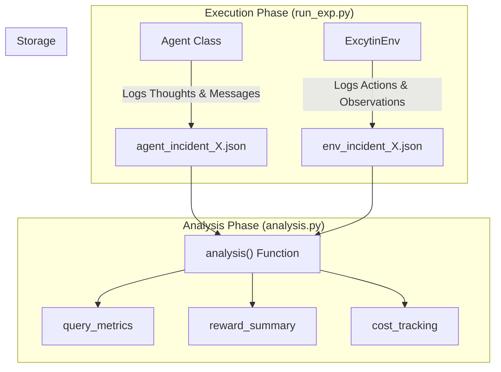
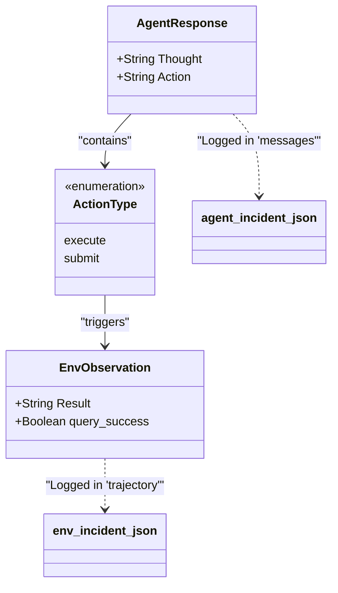

<!-- source: DeepWiki mcp.deepwiki.com · repo microsoft/SecRL · page 5.3 Experiment Logs & Trajectory Format · fetched 2026-10-26 -->

# Experiment Logs & Trajectory Format

<details>
<summary>Relevant source files</summary>

The following files were used as context for generating this wiki page:

- [latest_experiments/BaselineAgent_Qwen3-235B-A22B-Thinking-2507_c131_alert_level_t0_s25_trial1/agent_incident_134.json](latest_experiments/BaselineAgent_Qwen3-235B-A22B-Thinking-2507_c131_alert_level_t0_s25_trial1/agent_incident_134.json)
- [latest_experiments/BaselineAgent_Qwen3-235B-A22B-Thinking-2507_c131_alert_level_t0_s25_trial1/agent_incident_166.json](latest_experiments/BaselineAgent_Qwen3-235B-A22B-Thinking-2507_c131_alert_level_t0_s25_trial1/agent_incident_166.json)
- [latest_experiments/BaselineAgent_Qwen3-235B-A22B-Thinking-2507_c131_alert_level_t0_s25_trial1/agent_incident_322.json](latest_experiments/BaselineAgent_Qwen3-235B-A22B-Thinking-2507_c131_alert_level_t0_s25_trial1/agent_incident_322.json)
- [latest_experiments/BaselineAgent_gpt-5_c121_alert_level_t0_s25_trial1/agent_incident_134.json](latest_experiments/BaselineAgent_gpt-5_c121_alert_level_t0_s25_trial1/agent_incident_134.json)
- [latest_experiments/BaselineAgent_gpt-5_c121_alert_level_t0_s25_trial1/agent_incident_166.json](latest_experiments/BaselineAgent_gpt-5_c121_alert_level_t0_s25_trial1/agent_incident_166.json)
- [latest_experiments/BaselineAgent_gpt-5_c121_alert_level_t0_s25_trial1/agent_incident_322.json](latest_experiments/BaselineAgent_gpt-5_c121_alert_level_t0_s25_trial1/agent_incident_322.json)
- [latest_experiments/BaselineAgent_o3_c106_alert_level_t0_s25_trial1/agent_incident_5.json](latest_experiments/BaselineAgent_o3_c106_alert_level_t0_s25_trial1/agent_incident_5.json)
- [latest_experiments/BaselineAgent_o3_c106_alert_level_t0_s25_trial1/agent_incident_55.json](latest_experiments/BaselineAgent_o3_c106_alert_level_t0_s25_trial1/agent_incident_55.json)
- [latest_experiments/BaselineAgent_o3_c106_alert_level_t0_s25_trial1/env_incident_134.json](latest_experiments/BaselineAgent_o3_c106_alert_level_t0_s25_trial1/env_incident_134.json)
- [latest_experiments/BaselineAgent_o3_c106_alert_level_t0_s25_trial1/env_incident_166.json](latest_experiments/BaselineAgent_o3_c106_alert_level_t0_s25_trial1/env_incident_166.json)

</details>


This page documents the structured JSON logging format used by SecRL to record agent performance and environment interactions. Every experiment execution generates detailed logs that capture the full "Thought-Action-Observation" sequence, allowing for granular analysis of agent reasoning, SQL efficiency, and multi-trial learning progress.

## Overview of Log Files

When an experiment is run via `run_exp.py`, results are stored in a directory within `latest_experiments/` named after the agent, model, and configuration (e.g., `BaselineAgent_o3_c106_alert_level_t0_s25_trial1/`). For each security incident (identified by an ID like 5, 55, or 166), two primary JSON files are created:

1.  **`agent_incident_X.json`**: Contains the agent-centric view, including internal reasoning (Thoughts), the full message history with the LLM, and multi-trial reflection data.
2.  **`env_incident_X.json`**: Contains the environment-centric view, focusing on the trajectory of actions taken, the raw observations returned by the database, and step-by-step reward signals.

### Data Flow: Generation to Analysis

The following diagram illustrates how the `Agent` and `ExcytinEnv` classes collaborate to produce these logs and how they are consumed by the analysis pipeline.

**Log Generation and Consumption Flow**

Sources: [experiments/run_exp.py:1-100](), [experiments/result_analysis/analysis.py:1-50]()

---

## Agent Log Format (`agent_incident_X.json`)

The agent log is a list of objects, where each object represents a specific question/task within the incident. It captures the metadata of the question and the agent's attempts to solve it across one or more trials.

### Key Fields
*   **`question_dict`**: A copy of the source question data, including the natural language `context`, the specific `question`, the `answer` (golden), and the `solution` (step-by-step logic) [latest_experiments/BaselineAgent_o3_c106_alert_level_t0_s25_trial1/agent_incident_5.json:5-29]().
*   **`trials`**: A dictionary where keys are trial indices ("0", "1", etc.).
    *   **`messages`**: The full conversation history sent to the LLM, including the `system` prompt, `user` question, and `assistant` responses [latest_experiments/BaselineAgent_o3_c106_alert_level_t0_s25_trial1/agent_incident_5.json:41-52]().
    *   **`info`**: Metadata about the final submission, including the `submitted_answer` and the `check_ans_response` from the `LLMEvaluator` [latest_experiments/BaselineAgent_o3_c106_alert_level_t0_s25_trial1/agent_incident_5.json:33-40]().
*   **`reward`**: The final score for the incident (typically 0 or 1).

### Example Structure
```json
{
    "question_dict": {
        "question": "What is the IP address associated with the Manatee Tempest activity group?",
        "answer": "198.43.121.209"
    },
    "trials": {
        "0": {
            "reward": 1,
            "info": {
                "check_ans_response": "Analysis: The submitted answer is an exact match...",
                "submitted_answer": "198.43.121.209"
            },
            "messages": [
                {"role": "system", "content": "..."},
                {"role": "user", "content": "..."},
                {"role": "assistant", "content": "Thought: ... Action: execute[...]" }
            ]
        }
    }
}
```
Sources: [latest_experiments/BaselineAgent_o3_c106_alert_level_t0_s25_trial1/agent_incident_5.json:1-60]()

---

## Environment Log Format (`env_incident_X.json`)

The environment log records the external trajectory of the agent. It is used primarily to calculate query efficiency and success rates without needing to parse the LLM's internal dialogue.

### Trajectory Steps
Each entry in the `trajectory` array represents one interaction step with the database:
*   **`action`**: The raw SQL query or submission string extracted from the agent's output [latest_experiments/BaselineAgent_o3_c106_alert_level_t0_s25_trial1/env_incident_166.json:32]().
*   **`observation`**: The string representation of the database result (e.g., a list of tuples or a `ProgrammingError`) [latest_experiments/BaselineAgent_o3_c106_alert_level_t0_s25_trial1/env_incident_166.json:33]().
*   **`info`**: Includes `query_success` (boolean) to track if the SQL was syntactically correct and executed without error [latest_experiments/BaselineAgent_o3_c106_alert_level_t0_s25_trial1/env_incident_166.json:36-39]().

### Summary Metrics
At the top level of each incident object in `env_incident_X.json`:
*   **`success`**: Whether the final answer was correct.
*   **`steps`**: Total number of Thought-Action-Observation cycles.
*   **`success_query_count`**: Number of SQL queries that returned valid data.
*   **`total_query_count`**: Total number of `execute[]` actions attempted.

Sources: [latest_experiments/BaselineAgent_o3_c106_alert_level_t0_s25_trial1/env_incident_166.json:1-40](), [latest_experiments/BaselineAgent_o3_c106_alert_level_t0_s25_trial1/env_incident_134.json:1-10]()

---

## Thought-Action-Observation Pattern

SecRL enforces a strict interaction contract. The logs reflect this structure, which is essential for the `sql_parser` in `agent_utils.py` to function correctly.

**Entity Association: Logic to Log**


### Implementation Details
*   **Thought**: The reasoning process. In the logs, this is found within the `assistant` message content [latest_experiments/BaselineAgent_o3_c106_alert_level_t0_s25_trial1/agent_incident_5.json:52]().
*   **Action**: Extracted using regex by the `Agent` class. It can be `execute[SQL]` or `submit[Answer]`.
*   **Observation**: The output of `ExcytinEnv.step()`. If a result is too large, it is truncated in the logs (e.g., `(truncated 2510636 characters)`) to keep file sizes manageable [latest_experiments/BaselineAgent_o3_c106_alert_level_t0_s25_trial1/env_incident_166.json:53]().

Sources: [secgym/agents/agent_utils.py:1-50](), [latest_experiments/BaselineAgent_o3_c106_alert_level_t0_s25_trial1/env_incident_166.json:53]()

---

## Consumption by Analysis Tools

The `experiments/result_analysis/analysis.py` script iterates through these JSON files to produce the final `results.txt` and performance metrics.

| Metric | Source Field | Logic |
| :--- | :--- | :--- |
| **Success Rate** | `reward` | Percentage of incidents where reward == 1. |
| **Query Error Rate** | `info.query_success` | Ratio of `False` successes to total `execute` actions in `trajectory`. |
| **Step Efficiency** | `steps` | Average steps taken per successful incident. |
| **Cost** | `usage_summary` | Calculated based on token counts in the `agent_incident_X.json` usage field. |

The `analysis_per_level()` function specifically looks at the `question_dict` within these logs to categorize performance by the difficulty level (e.g., alert-level vs. incident-level questions).

Sources: [experiments/result_analysis/analysis.py:50-150](), [latest_experiments/BaselineAgent_Qwen3-235B-A22B-Thinking-2507_c131_alert_level_t0_s25_trial1/agent_incident_322.json:71-72]()

---

