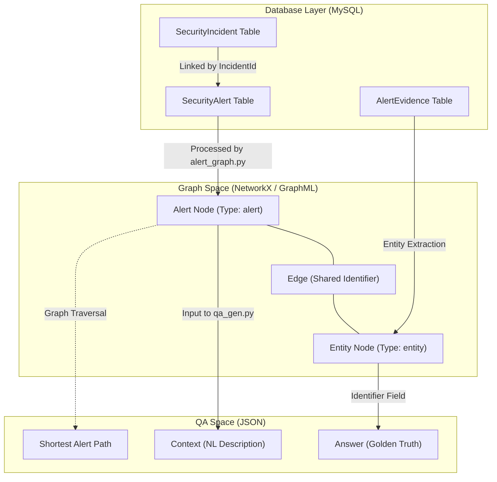
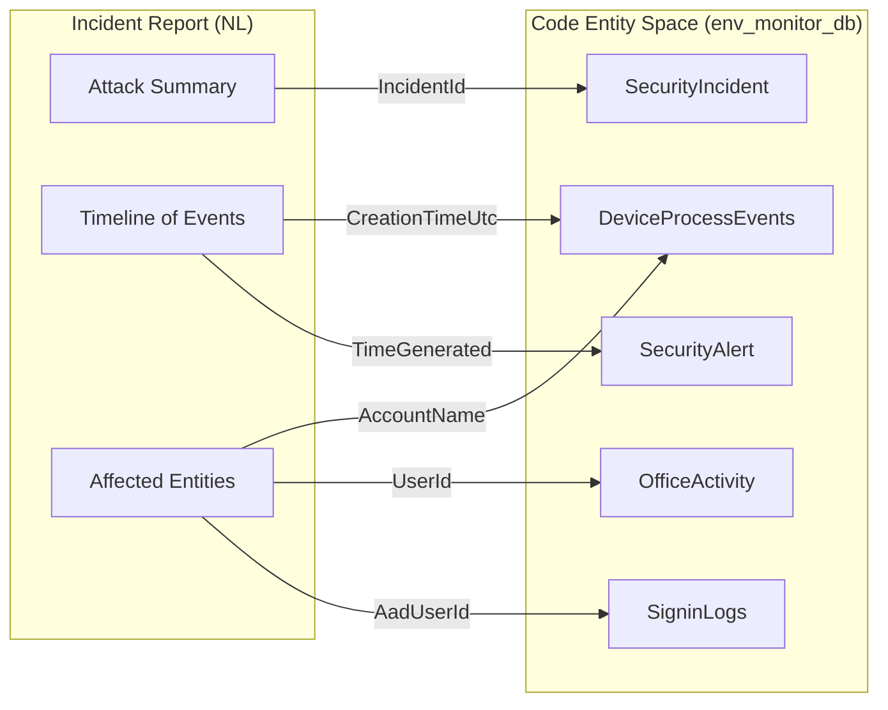

<!-- source: DeepWiki mcp.deepwiki.com · repo microsoft/SecRL · page 6.1 Incident Scenarios & Attack Types · fetched 2026-10-26 -->

# Incident Scenarios & Attack Types

Relevant source files

The following files were used as context for generating this wiki page:

- [latest_experiments/BaselineAgent_gpt-5_c121_alert_level_t0_s25_trial1/agent_incident_134.json](latest_experiments/BaselineAgent_gpt-5_c121_alert_level_t0_s25_trial1/agent_incident_134.json)
- [latest_experiments/BaselineAgent_gpt-5_c121_alert_level_t0_s25_trial1/agent_incident_166.json](latest_experiments/BaselineAgent_gpt-5_c121_alert_level_t0_s25_trial1/agent_incident_166.json)
- [latest_experiments/BaselineAgent_gpt-5_c121_alert_level_t0_s25_trial1/agent_incident_322.json](latest_experiments/BaselineAgent_gpt-5_c121_alert_level_t0_s25_trial1/agent_incident_322.json)
- [latest_experiments/BaselineAgent_o3_c106_alert_level_t0_s25_trial1/agent_incident_5.json](latest_experiments/BaselineAgent_o3_c106_alert_level_t0_s25_trial1/agent_incident_5.json)
- [latest_experiments/BaselineAgent_o3_c106_alert_level_t0_s25_trial1/agent_incident_55.json](latest_experiments/BaselineAgent_o3_c106_alert_level_t0_s25_trial1/agent_incident_55.json)
- [latest_experiments/BaselineAgent_o3_c106_alert_level_t0_s25_trial1/env_incident_134.json](latest_experiments/BaselineAgent_o3_c106_alert_level_t0_s25_trial1/env_incident_134.json)
- [latest_experiments/BaselineAgent_o3_c106_alert_level_t0_s25_trial1/env_incident_166.json](latest_experiments/BaselineAgent_o3_c106_alert_level_t0_s25_trial1/env_incident_166.json)
- [secgym/qagen/graph_files/incident_134.graphml](secgym/qagen/graph_files/incident_134.graphml)
- [secgym/qagen/graph_files/incident_166.graphml](secgym/qagen/graph_files/incident_166.graphml)
- [secgym/qagen/graph_files/incident_322.graphml](secgym/qagen/graph_files/incident_322.graphml)
- [secgym/qagen/graph_files/incident_34.graphml](secgym/qagen/graph_files/incident_34.graphml)
- [secgym/qagen/graph_files/incident_38.graphml](secgym/qagen/graph_files/incident_38.graphml)
- [secgym/qagen/graph_files/incident_39.graphml](secgym/qagen/graph_files/incident_39.graphml)
- [secgym/qagen/graph_files/incident_5.graphml](secgym/qagen/graph_files/incident_5.graphml)
- [secgym/qagen/graph_files/incident_55.graphml](secgym/qagen/graph_files/incident_55.graphml)

This page provides a detailed technical overview of the 8 security incidents that form the core of the ExCyTIn-Bench benchmark. These incidents represent a diverse range of modern cyber threats, including Ransomware, Business Email Compromise (BEC), and Credential Dumping. Each incident is backed by a full telemetry set in the MySQL database, allowing agents to perform multi-step investigations across various log types.

## Incident Overview

The benchmark consists of 8 specific incidents, identified by their unique `IncidentId`. These are derived from real-world attack patterns and mapped into the `SecurityIncident` and `SecurityAlert` tables of the `env_monitor_db` [latest_experiments/BaselineAgent_o3_c106_alert_level_t0_s25_trial1/env_incident_166.json:33]().

### Incident Metadata Table

| Incident ID | Primary Attack Type | Key Threat Actor | Affected Entities | Core Evidence Table |
| :--- | :--- | :--- | :--- | :--- |
| **5** | Ransomware / C2 | Manatee Tempest | `vnevado-win10r`, Grace Chen | `DeviceProcessEvents` |
| **34** | Phishing / Credential Theft | N/A | Multiple Users | `EmailUrlInfo`, `UrlClickEvents` |
| **38** | Password Spray | N/A | Azure AD Accounts | `SigninLogs`, `AADUserRiskEvents` |
| **39** | Credential Dumping | Rubeus Tool | Emma Clark, `PSEXESVC` | `DeviceProcessEvents` |
| **55** | Malicious PowerShell | N/A | `mb-winclient`, bjenkins | `DeviceEvents`, `AlertInfo` |
| **134** | BEC / Inbox Manipulation | N/A | Nina Park | `OfficeActivity`, `EmailEvents` |
| **166** | BEC / Financial Fraud | N/A | Jordan P (laylaw) | `OfficeActivity`, `SigninLogs` |
| **322** | Phishing (ZAP) | N/A | alyssat, Hailey Johnson | `EmailPostDeliveryEvents` |

Sources: [latest_experiments/BaselineAgent_o3_c106_alert_level_t0_s25_trial1/agent_incident_5.json:6-11](), [latest_experiments/BaselineAgent_o3_c106_alert_level_t0_s25_trial1/agent_incident_55.json:6-11](), [latest_experiments/BaselineAgent_o3_c106_alert_level_t0_s25_trial1/env_incident_134.json:9-15](), [secgym/qagen/graph_files/incident_166.graphml:12-60]().

---

## Technical Breakdown of Key Scenarios

### 1. Incident 5: Manatee Tempest Ransomware
This scenario simulates a Command and Control (C2) infection by the **Manatee Tempest** (also known as EvilCorp) group. The attack involves the use of `curl` to reach out to a malicious domain `vectorsandarrows.com` [latest_experiments/BaselineAgent_o3_c106_alert_level_t0_s25_trial1/agent_incident_5.json:6]().

*   **Attack Flow:**
    1.  Initial access facilitated by an access broker.
    2.  Execution of `curl.exe` (PID 1332) on host `vnevado-win10r` [latest_experiments/BaselineAgent_o3_c106_alert_level_t0_s25_trial1/agent_incident_5.json:48]().
    3.  Connection to IP `198.43.121.209` [secgym/qagen/graph_files/incident_5.graphml:24-29]().
*   **Graph Structure:** The `incident_5.graphml` file links the `SecurityAlert` for C2 behavior to the specific process entity and the IP address entity [secgym/qagen/graph_files/incident_5.graphml:12-40]().

### 2. Incident 166: BEC & Financial Fraud
This incident focuses on Business Email Compromise where an attacker manipulates inbox rules to hide fraudulent activities.

*   **Attack Flow:**
    1.  **Initial Access:** Sign-in from anonymous IP `95.202.65.202` (Tor/VPN) [secgym/qagen/graph_files/incident_166.graphml:12-16]().
    2.  **Persistence:** Creation of a "MoveToFolder" inbox rule named "n" for user `laylaw@vnevado.alpineskihouse.co` [secgym/qagen/graph_files/incident_166.graphml:44-46]().
    3.  **Identification:** The agent must correlate the `AadUserId` `89e933b9-5b2e-4bd6-bcdf-033db707ef82` with the SID `S-1-5-21-1740051960-3534030288-108486866-1602` [latest_experiments/BaselineAgent_o3_c106_alert_level_t0_s25_trial1/env_incident_166.json:11-14]().

### 3. Incident 39: Credential Dumping (Rubeus)
Focuses on post-exploitation techniques where an attacker attempts to extract Kerberos tickets.

*   **Attack Flow:**
    1.  Execution of `Rubeus.exe` via `cmd.exe` [secgym/qagen/graph_files/incident_39.graphml:13-17]().
    2.  The command `Rubeus.exe dump /service:xfbzkp /user:lucasb` is captured in `DeviceProcessEvents` [secgym/qagen/graph_files/incident_39.graphml:13]().
    3.  Associated with user Emma Clark (SID: `S-1-5-21-1540151660-3530000288-105586595-1517`) [secgym/qagen/graph_files/incident_39.graphml:2-5]().

---

## Data Flow: From Incident to Question

The following diagram illustrates how raw incident data in the `env_monitor_db` is transformed into the graph representation and eventually into the natural language questions used for agent evaluation.

### Natural Language to Code Entity Space Mapping
Title: Incident Data Transformation Pipeline

Sources: [secgym/qagen/graph_files/incident_166.graphml:1-10](), [latest_experiments/BaselineAgent_o3_c106_alert_level_t0_s25_trial1/env_incident_166.json:8-28]().

---

## Incident Report Generation

The `incident_reports/` directory contains LLM-generated summaries of these incidents. These are produced via the `generate_reports.py` workflow, which queries the database to synthesize a human-readable narrative of the attack.

### Report Structure and Database Correlation
The following diagram maps the logical components of an incident report back to the specific database tables and columns used to verify the agent's findings.

Title: Incident Report to Database Schema Mapping

Sources: [latest_experiments/BaselineAgent_o3_c106_alert_level_t0_s25_trial1/env_incident_166.json:33](), [latest_experiments/BaselineAgent_o3_c106_alert_level_t0_s25_trial1/agent_incident_5.json:64](), [secgym/qagen/graph_files/incident_5.graphml:24-30]().

## Key Threat Actor: Manatee Tempest
Manatee Tempest is a recurring high-sophistication actor in the benchmark (specifically Incident 5).
*   **Tactics:** Drive-by downloads, SocGholish infections, Cobalt Strike beacons, and Ransomware deployment [secgym/qagen/graph_files/incident_5.graphml:17]().
*   **Infrastructure:** Known to use domain fronting and specific IPs like `198.43.121.209` [secgym/qagen/graph_files/incident_5.graphml:24]().
*   **Code Reference:** Agents identify this actor by querying the `Description` or `ExtendedProperties` columns in the `SecurityAlert` table [latest_experiments/BaselineAgent_o3_c106_alert_level_t0_s25_trial1/agent_incident_5.json:64]().

Sources: [secgym/qagen/graph_files/incident_5.graphml:15-20](), [latest_experiments/BaselineAgent_o3_c106_alert_level_t0_s25_trial1/agent_incident_5.json:7-11]().

---

