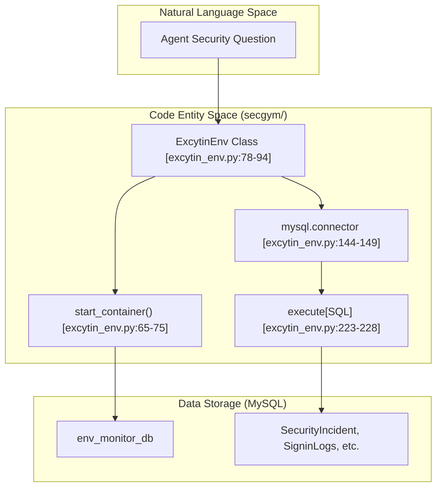
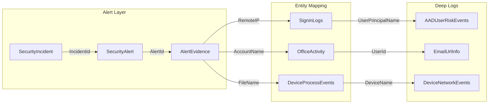

<!-- source: DeepWiki mcp.deepwiki.com · repo microsoft/SecRL · page 6.2 Database Schema Reference · fetched 2026-10-26 -->

# Database Schema Reference

Relevant source files

The following files were used as context for generating this wiki page:

- [latest_experiments/BaselineAgent_gpt-5_c121_alert_level_t0_s25_trial1/agent_incident_134.json](latest_experiments/BaselineAgent_gpt-5_c121_alert_level_t0_s25_trial1/agent_incident_134.json)
- [latest_experiments/BaselineAgent_gpt-5_c121_alert_level_t0_s25_trial1/agent_incident_166.json](latest_experiments/BaselineAgent_gpt-5_c121_alert_level_t0_s25_trial1/agent_incident_166.json)
- [latest_experiments/BaselineAgent_gpt-5_c121_alert_level_t0_s25_trial1/agent_incident_322.json](latest_experiments/BaselineAgent_gpt-5_c121_alert_level_t0_s25_trial1/agent_incident_322.json)
- [latest_experiments/BaselineAgent_o3_c106_alert_level_t0_s25_trial1/agent_incident_5.json](latest_experiments/BaselineAgent_o3_c106_alert_level_t0_s25_trial1/agent_incident_5.json)
- [latest_experiments/BaselineAgent_o3_c106_alert_level_t0_s25_trial1/agent_incident_55.json](latest_experiments/BaselineAgent_o3_c106_alert_level_t0_s25_trial1/agent_incident_55.json)
- [latest_experiments/BaselineAgent_o3_c106_alert_level_t0_s25_trial1/env_incident_134.json](latest_experiments/BaselineAgent_o3_c106_alert_level_t0_s25_trial1/env_incident_134.json)
- [latest_experiments/BaselineAgent_o3_c106_alert_level_t0_s25_trial1/env_incident_166.json](latest_experiments/BaselineAgent_o3_c106_alert_level_t0_s25_trial1/env_incident_166.json)
- [secgym/database/process_logs.py](secgym/database/process_logs.py)
- [secgym/excytin_env.py](secgym/excytin_env.py)

The `env_monitor_db` MySQL schema serves as the primary telemetry source for the ExCyTIn-Bench framework. It replicates a real-world Security Operations Center (SOC) data environment, containing diverse logs ranging from high-level security incidents to low-level system events. Agents interact with this schema using standard SQL queries to perform forensic investigations and correlate evidence across multiple telemetry layers.

### Schema Overview and Data Flow

The database is structured into three logical layers of telemetry:
1.  **Alert Layer**: High-level summaries of detected threats (`SecurityIncident`, `SecurityAlert`, `AlertInfo`).
2.  **Identity & Cloud Layer**: Logs pertaining to user authentication and SaaS activity (`SigninLogs`, `OfficeActivity`, `AADUserRiskEvents`).
3.  **Endpoint & Network Layer**: Detailed host-based and network-level events (`DeviceProcessEvents`, `EmailEvents`, `AZFWDnsQuery`).

#### System-to-Code Mapping
The following diagram illustrates how the `ExcytinEnv` class manages the lifecycle of the MySQL database and how the SQL actions from agents are processed.

**Figure 1: Environment Database Management Flow**

**Sources:** [secgym/excytin_env.py:65-75](), [secgym/excytin_env.py:78-94](), [secgym/excytin_env.py:144-149](), [secgym/excytin_env.py:223-228]()

---

### Core Telemetry Tables

The following tables are central to incident investigation. Agents typically begin by querying `SecurityIncident` or `SecurityAlert` to identify the scope of an attack.

#### 1. Security Alerts and Incidents
These tables provide the entry point for investigations, linking specific alerts to broader incident IDs.

| Table | Key Columns | Purpose |
| :--- | :--- | :--- |
| `SecurityIncident` | `IncidentId`, `Title`, `Severity`, `Status` | Aggregates related alerts into a single case. |
| `SecurityAlert` | `AlertId`, `DisplayName`, `Entities`, `Tactics`, `Techniques` | Individual detections with MITRE ATT&CK mapping [latest_experiments/BaselineAgent_o3_c106_alert_level_t0_s25_trial1/agent_incident_5.json:64-64](). |
| `AlertInfo` | `AlertId`, `Title`, `Category`, `AttackTechniques` | Metadata for specific alerts [latest_experiments/BaselineAgent_o3_c106_alert_level_t0_s25_trial1/agent_incident_55.json:61-61](). |
| `AlertEvidence` | `AlertId`, `EntityType`, `EvidenceRole`, `RemoteIP`, `AccountName` | Maps specific entities (IPs, files, accounts) to an alert [latest_experiments/BaselineAgent_o3_c106_alert_level_t0_s25_trial1/env_incident_166.json:53-53](). |

#### 2. Identity and Access Logs
Crucial for Business Email Compromise (BEC) and lateral movement scenarios.

| Table | Key Columns | Purpose |
| :--- | :--- | :--- |
| `SigninLogs` | `UserPrincipalName`, `IPAddress`, `ResultType`, `AppDisplayName` | Tracks Azure AD sign-in attempts and failures. |
| `AADUserRiskEvents` | `UserPrincipalName`, `RiskLevel`, `RiskEventType`, `IpAddress` | Records risky behavior identified by Azure AD Identity Protection. |
| `IdentityLogonEvents` | `AccountName`, `DeviceName`, `LogonType`, `IPAddress` | On-premises and cloud logon activity correlation. |
| `AADServicePrincipalSignInLogs` | `ServicePrincipalId`, `AppId`, `IPAddress` | Logs for non-human identities/applications. |

#### 3. Endpoint and Network Activity
Used for deep-dive forensics into malware execution and C2 communication.

| Table | Key Columns | Purpose |
| :--- | :--- | :--- |
| `DeviceProcessEvents` | `DeviceName`, `FileName`, `ProcessCommandLine`, `InitiatingProcessCommandLine` | Execution history, including parent/child process relationships. |
| `EmailEvents` | `SenderMailFromAddress`, `RecipientEmailAddress`, `Subject`, `DeliveryAction` | Metadata for sent/received emails. |
| `EmailUrlInfo` | `Url`, `NetworkMessageId` | Mapping of URLs found within specific emails. |
| `UrlClickEvents` | `Url`, `AccountUpn`, `ActionType` | Tracks when a user actually interacts with a link. |
| `AZFWDnsQuery` | `SourceIp`, `QueryName`, `QueryType` | Azure Firewall logs for outbound DNS requests (C2 detection). |

**Sources:** [latest_experiments/BaselineAgent_o3_c106_alert_level_t0_s25_trial1/env_incident_166.json:33-33](), [latest_experiments/BaselineAgent_o3_c106_alert_level_t0_s25_trial1/agent_incident_5.json:56-56](), [latest_experiments/BaselineAgent_gpt-5_c121_alert_level_t0_s25_trial1/agent_incident_322.json:64-64]()

---

### Evidence Correlation and Navigation

Agents navigate the schema by joining tables on common entity identifiers. The `AlertEvidence` table acts as a bridge between the high-level `SecurityAlert` and the low-level log tables.

**Figure 2: Cross-Table Correlation Logic**

**Sources:** [latest_experiments/BaselineAgent_o3_c106_alert_level_t0_s25_trial1/env_incident_166.json:53-53](), [latest_experiments/BaselineAgent_gpt-5_c121_alert_level_t0_s25_trial1/agent_incident_322.json:64-64]()

#### Key Join Keys for Agents:
*   **User Correlation**: `UserPrincipalName`, `AccountName`, `AadUserId`, `SID`.
*   **Host Correlation**: `DeviceName`, `Computer`, `SourceComputerId`.
*   **Network Correlation**: `RemoteIP`, `SourceIp`, `Url`.
*   **Alert Correlation**: `AlertId`, `SystemAlertId`.

### Data Integrity and Processing

The telemetry data is processed from raw CSVs using `secgym/database/process_logs.py`. 
*   **Separators**: The system uses a unique separator `❖` (stored as `SEPARATOR`) to handle complex security log strings that often contain commas or quotes [secgym/database/process_logs.py:107-108]().
*   **JSON Fields**: Columns marked as "dynamic" in `.meta` files are converted to valid JSON strings (`{}`) if empty to ensure compatibility with the MySQL loader [secgym/database/process_logs.py:24-37]().
*   **Normalization**: The `convert_double_quotes` function ensures that command-line data (often containing nested quotes) is normalized to prevent SQL syntax errors during ingestion [secgym/database/process_logs.py:88-91]().

**Sources:** [secgym/database/process_logs.py:24-37](), [secgym/database/process_logs.py:88-91](), [secgym/database/process_logs.py:107-108]()

---

