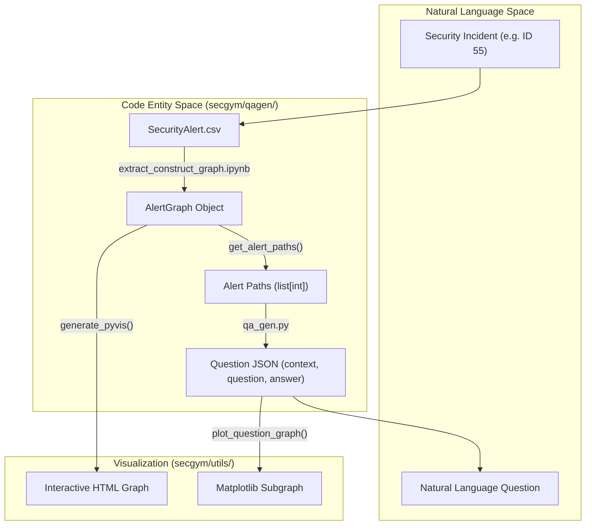
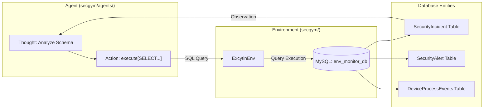

<!-- source: DeepWiki mcp.deepwiki.com · repo microsoft/SecRL · page 7 Notebooks & Exploratory Tools · fetched 2026-10-26 -->

# Notebooks & Exploratory Tools

Relevant source files

The following files were used as context for generating this wiki page:

- [notebooks/explore_graph_questions.ipynb](notebooks/explore_graph_questions.ipynb)
- [notebooks/extract_construct_graph.ipynb](notebooks/extract_construct_graph.ipynb)
- [notebooks/question_split.ipynb](notebooks/question_split.ipynb)
- [notebooks/react_example.ipynb](notebooks/react_example.ipynb)
- [secgym/qagen/alert_graph.py](secgym/qagen/alert_graph.py)
- [secgym/qagen/qa_gen.py](secgym/qagen/qa_gen.py)
- [secgym/qagen/qa_gen_prompts.py](secgym/qagen/qa_gen_prompts.py)
- [secgym/utils/graph_viz_utils.py](secgym/utils/graph_viz_utils.py)
- [secgym/utils/utils.py](secgym/utils/utils.py)

This section documents the Jupyter notebooks and exploratory tools provided in the `notebooks/` directory. These tools are essential for the benchmark's lifecycle, covering everything from the initial construction of attack graphs to the generation of train/test splits and interactive demonstrations of agent behavior.

## Overview of Notebooks

The repository includes several key notebooks used for data engineering, dataset curation, and visualization:

*   **Graph Construction**: `extract_construct_graph.ipynb` is used to filter raw incident data and build the initial `AlertGraph` objects.
*   **QA Exploration**: `explore_graph_questions.ipynb` provides interactive visualization of the generated attack paths and questions.
*   **Dataset Splitting**: `question_split.ipynb` implements the logic for creating balanced train/test splits based on path similarity scores.
*   **Agent Demos**: `react_example.ipynb` provides a step-by-step walkthrough of how a ReAct agent interacts with the `SecGym` environment.

---

## 7.1 Graph Construction & Exploration Notebooks

These notebooks are used to transform raw telemetry data into structured graph representations and provide visual tools for verifying the quality of generated questions.

### Incident Extraction and Graph Building
The `extract_construct_graph.ipynb` notebook serves as the entry point for processing raw anonymized CSVs from the `data_anonymized/` directory [notebooks/extract_construct_graph.ipynb:33-43](). It performs the following technical steps:
1.  **Filtering**: Identifies incidents marked with the `LATEST` label [notebooks/extract_construct_graph.ipynb:60-68]().
2.  **Alert Association**: Maps `SystemAlertId` values from the `SecurityIncident` table to entries in the `SecurityAlert` table [notebooks/extract_construct_graph.ipynb:105-112]().
3.  **Graph Generation**: Utilizes the `AlertGraph` class [secgym/qagen/alert_graph.py:14-26]() to build a NetworkX graph where nodes represent alerts and entities (Accounts, Hosts, IPs), and edges represent shared attributes.

### Interactive Visualization
The `explore_graph_questions.ipynb` notebook utilizes `pyvis` and `matplotlib` to render the attack graphs. It allows developers to:
*   Load `.graphml` files generated during the construction phase [notebooks/explore_graph_questions.ipynb:181-182]().
*   Visualize the "shortest alert path" between a starting entity and a target answer [secgym/qagen/alert_graph.py:160-170]().
*   Inspect node attributes such as `node_type`, `identifier_fields`, and `value` through interactive hover-overs [secgym/utils/graph_viz_utils.py:78-99]().

For details, see [Graph Construction & Exploration Notebooks](#7.1).

**Sources:** [notebooks/extract_construct_graph.ipynb:1-125](), [secgym/qagen/alert_graph.py:14-170](), [secgym/utils/graph_viz_utils.py:78-185]().

---

## 7.2 Question Splitting & ReAct Example Notebooks

These tools focus on the evaluation framework, ensuring that the benchmark questions are partitioned correctly and demonstrating the agentic reasoning loop.

### Path-Relevance Splitting
The `question_split.ipynb` notebook is responsible for generating the `train` and `test` datasets found in `experiments/split_files/`. It implements a sophisticated overlap scoring mechanism to ensure that the test set contains novel challenges.

| Feature | Description |
| :--- | :--- |
| **Overlap Score** | Calculates similarity between two alert paths based on shared vs. unshared edges [notebooks/question_split.ipynb:14-45](). |
| **Split Types** | Generates `low_score`, `median_score`, and `high_score` splits to test agent generalization [notebooks/question_split.ipynb:140-147](). |
| **Length Weighting** | Adjusts split probability based on path length to ensure a mix of simple and complex questions [notebooks/question_split.ipynb:74-80](). |

### Agent Interaction Walkthrough
The `react_example.ipynb` notebook provides a manual trace of the **Thought-Action-Observation** loop used by agents in `SecGym`. It demonstrates:
*   **System Prompting**: How the agent is instructed to use `execute[<query>]` and `submit[<answer>]` [notebooks/react_example.ipynb:9-12]().
*   **Schema Discovery**: The agent's process of calling `SHOW TABLES` and `DESCRIBE <table_name>` to navigate the MySQL backend [notebooks/react_example.ipynb:20-40]().
*   **Error Recovery**: How the agent handles `ProgrammingError` (e.g., unknown columns) by refining its SQL queries [notebooks/react_example.ipynb:28-36]().

For details, see [Question Splitting & ReAct Example Notebooks](#7.2).

**Sources:** [notebooks/question_split.ipynb:1-176](), [notebooks/react_example.ipynb:1-52]().

---

## Mapping Natural Language to Code Entities

The following diagrams illustrate how the exploratory tools bridge the gap between high-level security questions and the underlying code structures.

### Data Flow: From CSV to Interactive Graph
This diagram shows how the notebooks utilize `AlertGraph` and `graph_viz_utils` to process raw telemetry.

**Sources:** [secgym/qagen/alert_graph.py:29-58](), [secgym/qagen/qa_gen.py:145-155](), [secgym/utils/graph_viz_utils.py:100-140]().

### Agent Reasoning: ReAct Interaction Loop
This diagram maps the interaction demonstrated in `react_example.ipynb` to the environment's database entities.

**Sources:** [notebooks/react_example.ipynb:12-44](), [secgym/utils/utils.py:19-22]().

---

